# Imagized Language Model

[English](README.md) · [العربية](i18n/README.ar.md) · [Español](i18n/README.es.md) · [Français](i18n/README.fr.md) · [日本語](i18n/README.ja.md) · [한국어](i18n/README.ko.md) · [Tiếng Việt](i18n/README.vi.md) · [中文 (简体)](i18n/README.zh-Hans.md) · [中文（繁體）](i18n/README.zh-Hant.md) · [Deutsch](i18n/README.de.md) · [Русский](i18n/README.ru.md)

On four previously unused books, the visual translator found the original passage among 48 images in **91 of 96 searches**. Learning how to move through the source preserved this score. When the model had to write the whole translation, it received **0/96** complete-meaning credits. A quantized Qwen3-8B reading text scored 81/96. The figure shows the actual output for a controlled sentence and a passage from *Hopscotch* in which the model recovered “cold” and lost the speaker’s name. [Results and raw images](references/ordered_alignment_result.md) · [Run the writer](models/ordered_alignment/README.md)

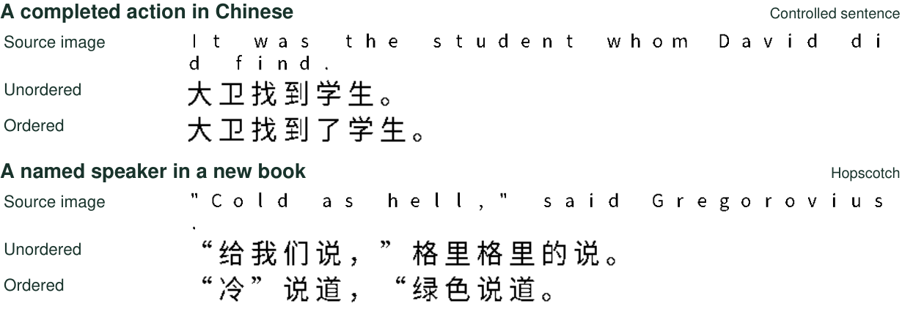

On one RTX 4090 D, a reader chose between two pictured translations for each book passage. Correcting its preference for common target wording raised the number of pairs with both answers right from **21/96 to 77/96**. Free translation remains much harder. Predicting the visual strips supported by the source retained the requested predicate in 43/336 controlled answers, up from 17, but preserved the complete meaning on only 1/192 book requests. The image below is the first credited guided answer on the separate OPUS test. [Results](references/source_supported_writing_result.md) · [Run the writer or selector](models/source_supported_writing/README.md)

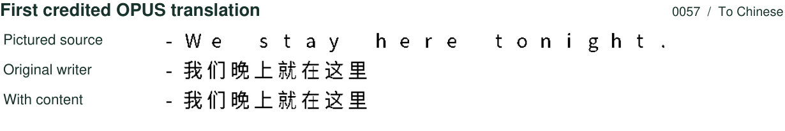

An independent reader followed two opposite pictured questions about the same dictionary page on **332/608** pairs, up from **138/608** with the original field ordering. Each answer had to include the exact gloss and the actual historical specimen. On a separate free-translation test, a 10.48M-parameter image writer earned **1/192** complete meanings, its matched control **2/192**, and a quantized Qwen3-8B given text **154/192**. [Current paper](publication/ilm-nature/manuscript.pdf) · [Run the historical reader](models/origin_instructions/README.md) · [Inspect the translation outputs](references/sentence_reconstruction_result.md) · [Editable figures](publication/ilm-nature/figures/Ordered_glyph_alignment.pptx)

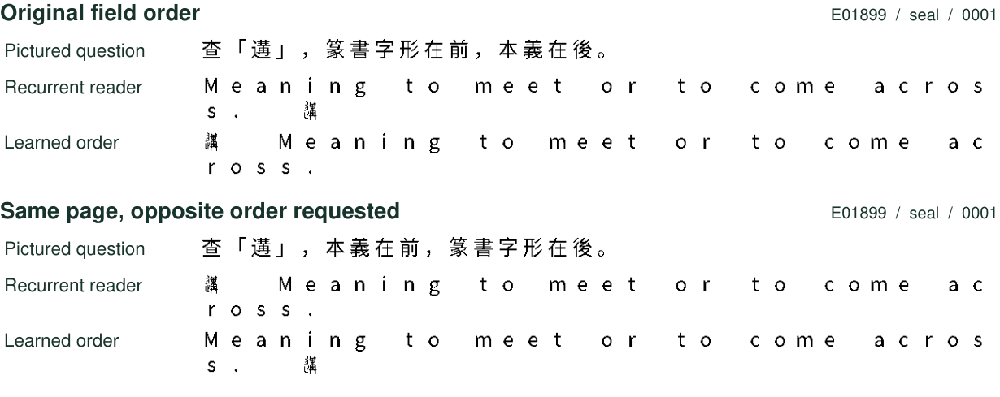

An earlier paper edition shows the free writers’ attempts to draw the attested forms of 言. [Historical-form figure](publication/ilm-nature/figures/Span_translation_origins.png) · [Original answer files](publication/ilm-nature/evidence/word_origin_probes.zip) · [Previous print-face and motor comparison](references/print_translation_result.md) · [PIXEL and PixelGPT sources](references/pixel_language/README.md)

<details>
<summary>Earlier visual-language experiments and figures</summary>

**What did the model write?** Given the pictured sentence “Certainly not.” the guided writer drew **当然不是。** Across 192 new literary translation requests, it preserved five whole meanings. Matched training preserved four and a quantized 8B text model preserved 173. Figure 72 shows a gain, a loss and a failed passage using the original output pixels. All 192 guided answers reproduced on CPU. [Read the paper](publication/ilm-nature/versions/2026-11-26-eabb2798/reading.pdf#page=72) · [Run the pictured example](models/target_glyph_teaching/README.md) · [Inspect all answers](publication/ilm-nature/evidence/target_glyph_answers.zip)

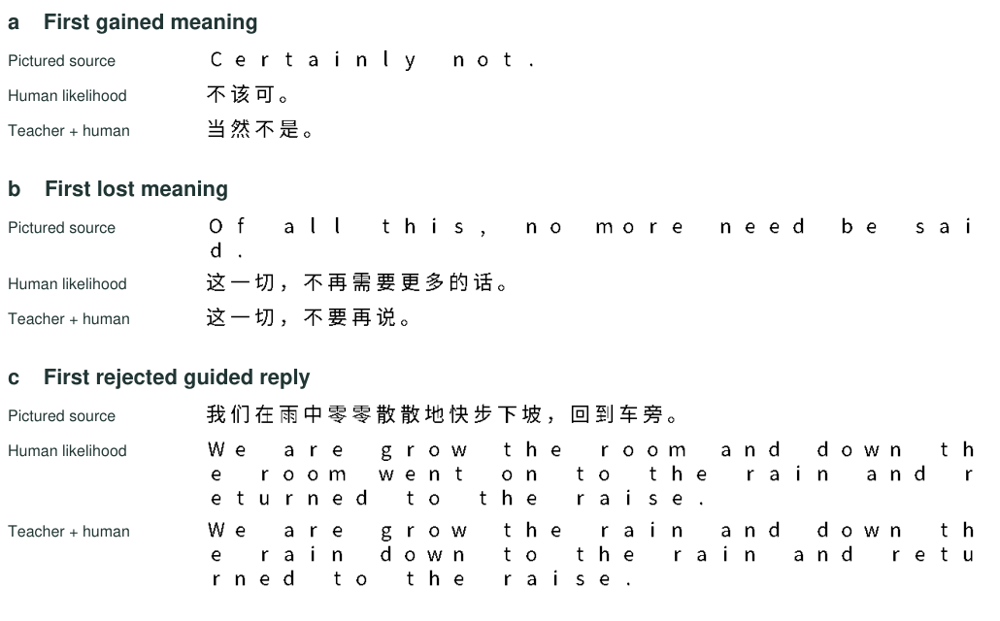

The compact ILM reads a pictured sentence and writes its own glyph pixels. Two new writers trained on 28,342 bilingual book pairs. On 192 fresh translation requests, the prediction-field writer conveyed four complete meanings and its matched control five. A CPU replay reproduced all 768 GPU outputs across the four conditions. Figure 70 shows a success, a regression and a full failed translation. [Reading PDF](publication/ilm-nature/versions/2026-11-26-eabb2798/reading.pdf) · [Run the model](models/field_to_glyph/README.md) · [Every pictured input and answer](publication/ilm-nature/evidence/field_writer_outputs.zip)

**Can the model translate a new sentence from its image?** The independent visual writer drew 汤姆问道。 for “inquired Tom.” On 384 literary requests it earned ten complete-meaning credits, equal to its matched control. A separate 3.22-million-parameter image reader can produce a continuous bilingual source field. A pretrained decoder reading that field earned 3/96 complete meanings. Pages 63–66 show how those two systems were tested. [Paper](publication/ilm-nature/versions/2026-11-26-eabb2798/reading.pdf) · [All 1,536 original answer PNGs](publication/ilm-nature/evidence/role_translation_outputs.zip) · [Run the visual reader](models/optical_state)

**Writing from a new book.** From the pictured Chinese question “可他是谁呢？” the 1.69-million-parameter writer drew **“But who is he?”** Training on 21 works preserved 108/118 controlled grammatical families, but only one of 96 literary translations earned source-only meaning credit. The same paper shows a failure on Kafka and a memory-aided reply that recovers “beer” inside a broken sentence. [Raw images and results](references/visual_library_writing_result.md) · [Run the models](models/library_diversity) · [Paper, pp. 59–62](publication/ilm-nature/versions/2026-11-26-eabb2798/reading.pdf#page=59)

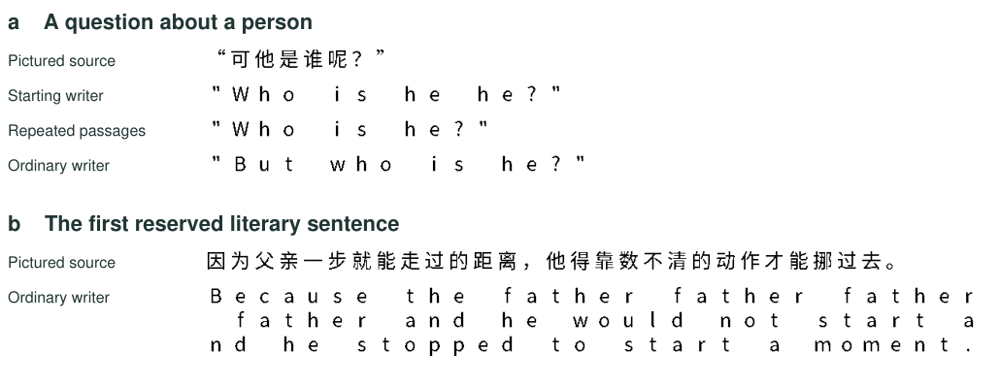

**What can the model actually write?** Given the pictured sentence 她看了他一眼，却什么也没说。, the distilled writer drew “She looked at him and said nothing.” A masked bilingual model reading credited **3/96** fresh translations, compared with **2/96** from the starting writer and **88/96** from the quantized text teacher. The image below shows every credited distilled answer in that review alongside the comparison outputs. [Run the checkpoint](models/teacher_translation) · [Results and scoring limits](references/complete_teacher_translation_result.md) · [Paper, pp. 56–58](publication/ilm-nature/versions/2026-11-26-eabb2798/reading.pdf#page=56)

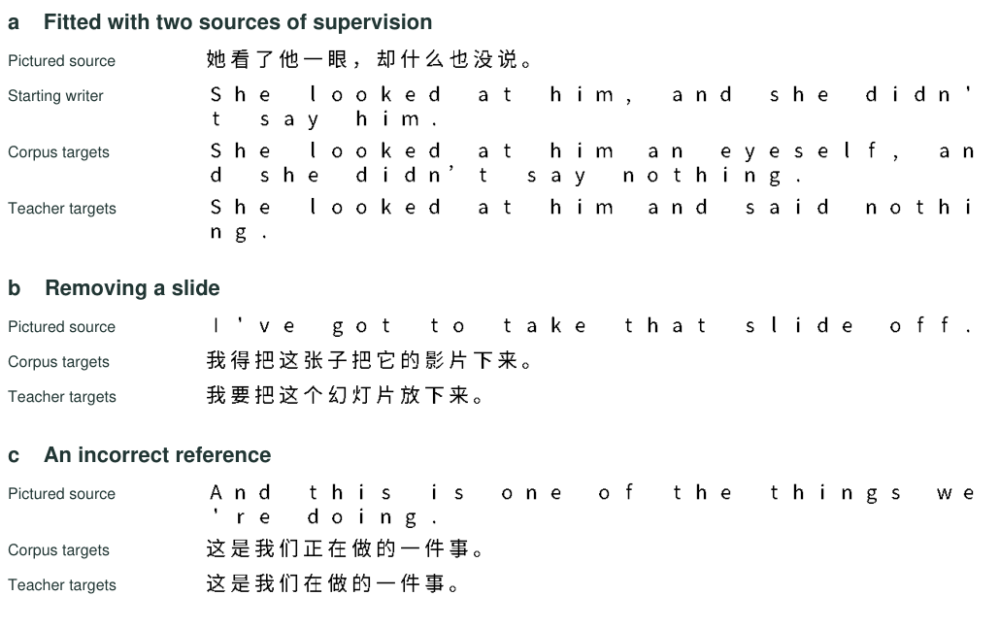

**Can the writer recover after a mistake?** On 231,337 bilingual training pairs, a 1.69-million-parameter writer learned from glyphs it had drawn incorrectly. It completed **111/118** controlled role families in two typefaces. Across **144** new natural translation requests it earned **zero** complete-meaning credits. A quantized Qwen3-8B text model earned **96**. Expanding the matched control to **14.90M** parameters yielded **0/64** complete meanings on further reserved articles, against **49/64** for Qwen. The manuscript reproduces both widths’ actual outputs. [Width experiment](references/visual_writer_width_result.md) [Run the released writer](models/visual_prefix/README.md) · [Scores and Lean proof](references/visual_prefix_recovery_result.md) · [Raw model images](publication/ilm-nature/figures/Figure_202_after_the_first_glyphs.png)

**Who helped whom?** Given a pictured “Tom was helped by Mary,” the ILM drew **玛丽帮助了汤姆。** Exchanging their names reversed the Chinese answer. Rehearsal restored all eight role and polarity changes in **110/118 families**, including in a held serif typeface with a learned optical reader. The writer ranked the correct pictured source first for **90/96** supplied fresh translations. Its own free translations earned **0/96**, compared with **58/96** for a quantized 8B text model. [Original PNGs and paper, pp. 50–52](publication/ilm-nature/versions/2026-11-26-eabb2798/reading.pdf#page=50) · [Run the pictured example](models/book_breadth/#read-an-unfamiliar-typeface) · [Full comparison](references/book_rehearsal_result.md)

**Reading a new book.** An English input PNG from *Jane Eyre* elicited the exact Chinese image **他问道。** After six passes over 231,337 distinct literary and talk pairs, the broader writer earned 5/144 meaning credits, compared with 0/144 for matched narrow replay and 86/144 for quantized Qwen. Both continuations lost a previously learned passive construction. Pages 47–49 show the training curves, fixed-order failures and all five credited outputs. [Paper](publication/ilm-nature/versions/2026-11-26-eabb2798/reading.pdf#page=47) · [Run the released checkpoint](models/book_breadth/) · [Data and evaluation](references/book_breadth_result.md)

**What does the ILM actually write?** Page 1 shows the intact English input PNG and the Chinese answer it emitted. Pages 45–46 show the role reversal, both directions of a failed scientific translation, and the effect of glyph order. The model paired 75/96 supplied translations correctly. Its own replies preserved 0/192 complete meanings on that panel, compared with 135/192 for quantized Qwen receiving text. [Paper](publication/ilm-nature/versions/2026-11-26-eabb2798/reading.pdf) · [Original PNGs](publication/ilm-nature/figures/raw_ilm/) · [Checkpoints and inference](models/paired_ink/) · [Measured results and Lean proofs](references/paired_ink_result.md)

A 1.69-million-parameter visual translator reads **“The doctor was invited by the nurse.”** from a PNG and writes **护士邀请了医生。** Exchanging the participants changes the answer to **医生邀请了护士。** On 472 previously unexamined passive sentences, training with varied source wording produced **422 exact Chinese answers**, compared with **zero** for matched canonical training. Both models earned **0/64** on new natural PAWS-X translations; the local Qwen3-8B Q4 text model earned **46/64**. [Run these images](models/translation_paraphrases/README.md) · [Full results](references/visual_proposition_translation_result.md) · [Language Is Image: Imagized Language Modeling, pp. 42–44](publication/ilm-nature/versions/2026-11-26-eabb2798/reading.pdf#page=42)

A 1.77-million-parameter visual writer can carry an unfamiliar specimen into a translated sentence. Keeping the original pixels in a separate slot improved exact, context-preserving substitution from **5/70 to 56/70** paired trials using the same weights. A 1.69-million-parameter ordinary translator preserved the meaning of **4/64** held conversational requests, compared with **61/64** for a local quantized Qwen3-8B. Adding editorial training examples still gave **0/32** meaning credits on new articles. [Run the image writer](models/ordered_translation/README.md) · [Mathematics and experiments](references/ordered_visual_translation_result.md) · [Paper, pp. 39–41](publication/ilm-nature/versions/2026-11-26-eabb2798/reading.pdf#page=39)

Asked for the oracle-bone form of **言**, a visual model on one RTX 4090 D drew the attested specimen. Changing the pictured question to ask for the bronze, seal or Liushutong form changed its answer to the corresponding source image. On **63 of 64 held families**, the model answered every tested combination of period, language, page order and image assignment correctly. On another 64 families it matched only **261/512** after the questions were rephrased. Asked to explain the history of 言, it returned a single mark. [Run the pictured example](models/visual_story_writer/README.md) · [Paper, pp. 36–38](publication/ilm-nature/versions/2026-11-26-eabb2798/reading.pdf#page=36) · [Measured limits and controls](references/visual_story_writer_result.md) · [MiniMind study in Chinese](references/minimind_visual_language_study_zh.md) · [Historical corpus and book pages](references/chinese_origin_library.md) · [Project recap](references/ilm_project_recap.md)

[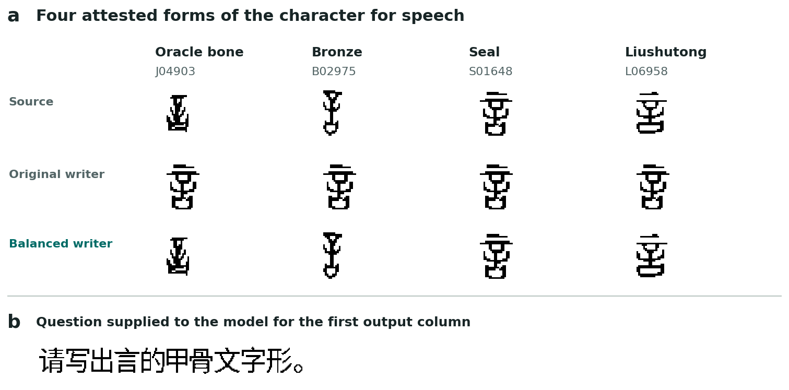](publication/ilm-nature/versions/2026-11-26-eabb2798/reading.pdf#page=36)

A compact visual reader learned from **complete human answers** on one RTX 4090 D. Across 96 questions on new stories, the loss of the human answer fell by **0.400 nats** against the parent. Generating its own answer was harder. It earned **2/16** story credits and a quantized Qwen3-VL 8B earned **10/16**. In the paired example below the new reader recovers “her only daughter” inside a broken sentence, then omits both actions when asked how the widow prepared to bake. The figure shows original output pixels. [Reading paper, pp. 33–34](publication/ilm-nature/versions/2026-11-26-eabb2798/reading.pdf#page=33) · [Run the example](models/story_answer_fit/README.md) · [Data, Lean proofs and costs](references/story_answer_fit_result.md)

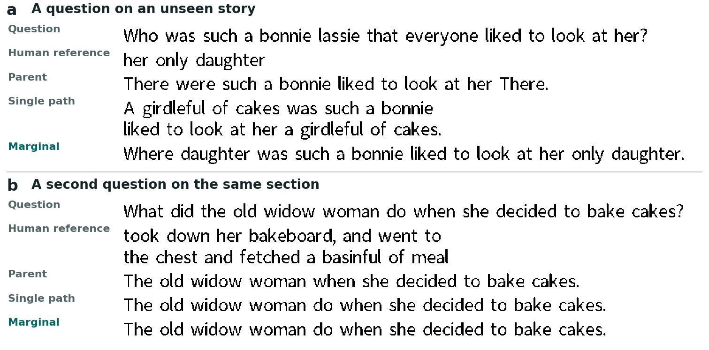

A compact model trained on pictured questions learned to use the order of nearby glyphs. It found the exact English evidence on **43/192** new questions, compared with **37/192** for an equal-size direction-blind update. Swapping the two sides reduced the count to **21/192**. The English example below shows why this matters and where it fails: the model finds the correct occupation, then repeats it in the answer. On a 48-question semantic comparison it earned **8** credits to a quantized Qwen3-VL 8B model's **33**. [Reading paper, pp. 29–30](publication/ilm-nature/versions/2026-11-26-eabb2798/reading.pdf#page=29) · [Run both examples](models/directional_reading/README.md) · [Data, bounds and costs](references/directional_reading_result.md)

[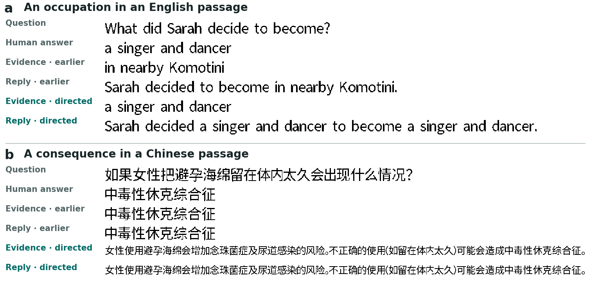](publication/ilm-nature/versions/2026-11-26-eabb2798/reading.pdf#page=29)

A visual writer correctly paired two supplied English answers with their pictured questions on **95 of 96 pages**, yet freely answered both questions on **none** of those pages. An untrained count of shared glyphs also matched 95 pairs. The new English and Chinese training comparison prints one sentence the model recovered and one place name it cut short. The earlier reader and writer still gave more complete answers on unseen passages. [Paper, pp. 26–28](publication/ilm-nature/versions/2026-11-26-eabb2798/reading.pdf#page=26) · [Run the pictured examples](models/sentence_context/README.md) · [Full evaluation](references/visual_sentence_context_result.md)

A visual reader recovered the date **2009年1月5日** from a bus-service page and wrote it as its answer. On another page it recovered the right person but made that person both subject and object. On 192 new Chinese questions, scoring whole spans raised exact autonomous answer images from **31 to 43**. English remained at **5/192**. [Paper, pp. 24–25](publication/ilm-nature/versions/2026-11-26-eabb2798/reading.pdf#page=24) · [Run both PNG examples](models/fact_span_ranking/README.md) · [Measured results](references/fact_span_ranking_result.md)

[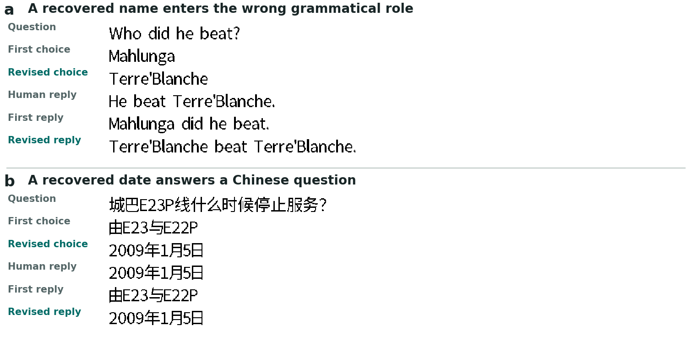](publication/ilm-nature/versions/2026-11-26-eabb2798/reading.pdf#page=24)

Asked when Chopin composed his first work, a visual reader selected **1817** from the pictured page. A separate writer generated **“Chopin composed his first work in 1817.”** On another page it read **1992** and omitted the year from its reply. On 384 unseen questions the strongest fact-conditioned system produced 10/192 exact English statements and 29/192 exact Chinese answers. Its Chinese score matched extraction alone. [Reading article, pp. 21–23](publication/ilm-nature/versions/2026-11-26-eabb2798/reading.pdf#page=21) · [Run the model](models/fact_channel/README.md) · [Data and limitations](references/fact_channel_result.md)

[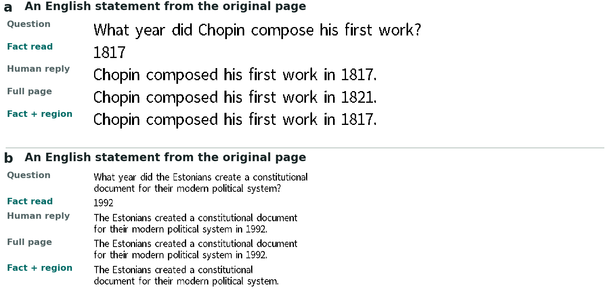](publication/ilm-nature/versions/2026-11-26-eabb2798/reading.pdf#page=21)

A compact visual writer answered a pictured question with **“Napoleon offered public support to secondary education.”** On another page it gave the right year but dropped *online*, changing the historical claim. Across 192 new English questions it generated ten complete human answer images. On a second test of the same pages, supplying a pictured short fact yielded five exact sentences for this writer and 34 for an earlier writer trained specifically to formulate sentences from facts. [Read the paper, pp. 18–20](publication/ilm-nature/versions/2026-11-26-eabb2798/reading.pdf#page=18) · [Run the PNG examples](models/phrase_marginal/README.md) · [Experiments and data](references/optical_phrase_learning_result.md)

[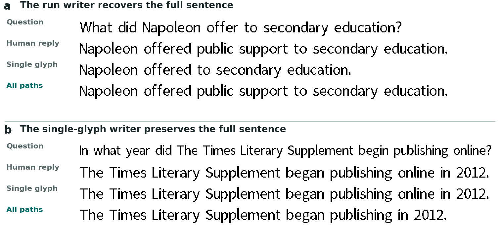](publication/ilm-nature/versions/2026-11-26-eabb2798/reading.pdf#page=19)

[](https://lazying.art)

Can a model read a pictured question and write a complete answer as an image? A 913,127-parameter reader and writer trained on one RTX 4090 D reproduced the human answer on **6 of 96 English questions and 33 of 96 Chinese catalogue questions**. Asked for a hotel's address, it wrote **地址是在北京顺义区天竺镇府前一街24号。** The figure shows the actual question and output pixels in both languages. When a bus stop changed, the model followed the new name but damaged the subject of its sentence. [Run the model on either pictured question](models/region_writer/README.md) · [Results and limitations](references/region_writer_result.md) · [Paper, pages 16–17](publication/ilm-nature/versions/2026-11-26-eabb2798/reading.pdf#page=16)

[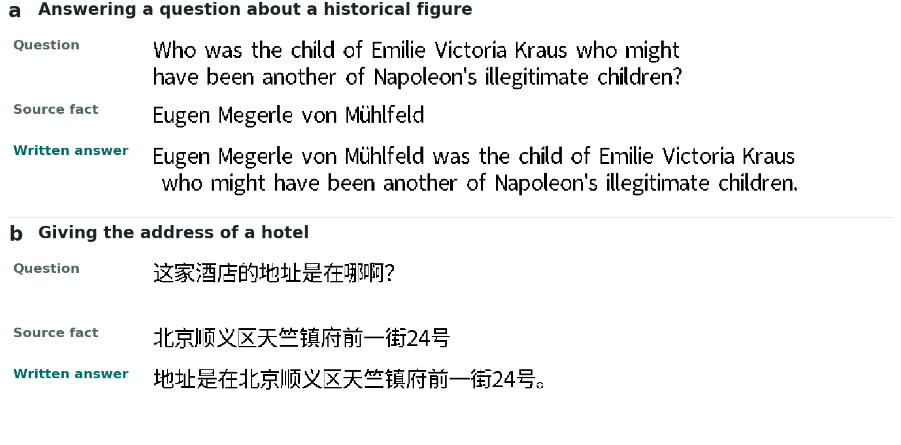](publication/ilm-nature/versions/2026-11-26-eabb2798/reading.pdf#page=16)

Given whole English stories as glyph images, a 2.46-million-parameter writer answered both questions on **63 of 498 held stories**, up from 16 before bilingual training. In the image below, it correctly named the speaker and failed to explain what happened to an actor in 2004. On 116 questions whose accepted answers could not be copied from the source or visible query, it produced zero exact answers. [Run the reader](models/evidence_views/README.md) · [Experiment and copy audit](references/evidence_views_result.md) · [Article, page 15](publication/ilm-nature/versions/2026-11-26-eabb2798/reading.pdf#page=15)

[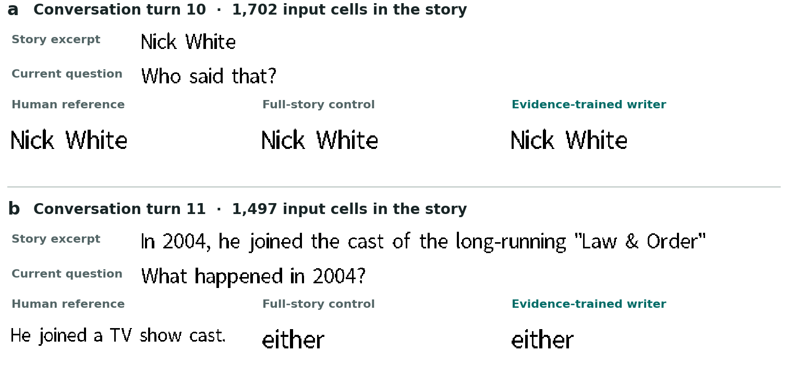](publication/ilm-nature/versions/2026-11-26-eabb2798/reading.pdf#page=15)

On a pictured entry for **言**, a 2.46-million-parameter writer reproduced the requested oracle-bone specimen. Asked for the bronze form on the same page, it wrote the modern characters **甲骨**. It correctly returned both period forms on 14 of 64 original Chinese cards. On new Chinese examinations it answered both questions on only one of 80 paired pages. [Run the checkpoint](models/branch_ink/README.md) · [Measured results](references/branch_ink_result.md) · [Reading PDF](publication/ilm-nature/versions/2026-11-26-eabb2798/reading.pdf)

[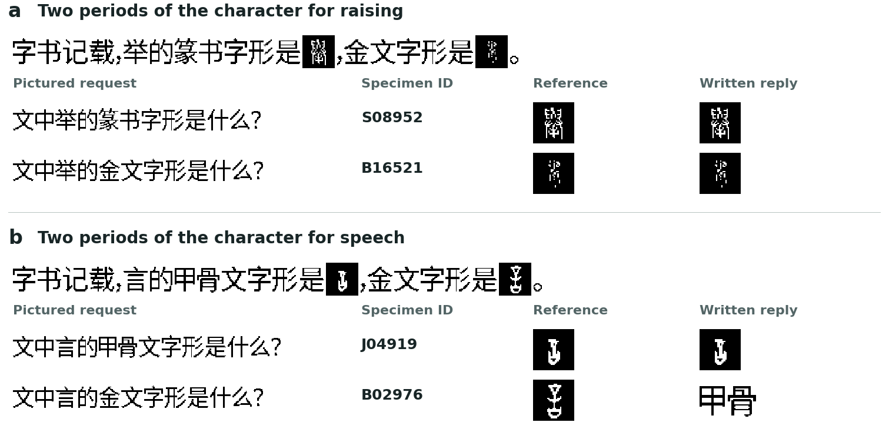](publication/ilm-nature/versions/2026-11-26-eabb2798/reading.pdf)

On 384 pictured Chinese examination questions, a 2.46-million-parameter writer gave 22 exact replies. Replacing the question reduced that count to four. It solved zero of 128 same-page question pairs. In a dictionary of historical forms it reproduced 33 Chinese specimens, all in the second position. Pages 10–12 show the original answer images, including both replies for 荒. [Reading article](publication/ilm-nature/versions/2026-11-26-eabb2798/reading.pdf#page=10) · [Run the Chinese PNG writer](models/open_exam/README.md) · [Evidence and limitations](references/open_exam_result.md)

A reader trained on complete answers recovered several consecutive lines from a pictured question about the *Li Sao*. It also copied modern commentary into its reply. On 64 further Chinese pages a two-mode scoring head recognized both supplied answer groupings on 20 pages and wrote zero complete answers without candidates. Pages 8–9 print the original ink and compare recognition with writing. [Reading article](publication/ilm-nature/versions/2026-11-26-eabb2798/reading.pdf#page=8) · [Weights and PNG inference](models/fact_binding/README.md) · [Held results](references/fact_binding_result.md)

A visual reader can copy both names from a pictured page, including a substituted name drawn in unfamiliar ink. On fresh multi-part questions it recovered the complete answer on 3/96 English pages and 0/96 Chinese pages. The Western Xia example shows the question, the page and the one region the reader preserved. [Article, pages 6–7](publication/ilm-nature/versions/2026-11-26-eabb2798/reading.pdf#page=6) · [Run the released weights](models/multiple_ink_runs/README.md) · [Full evaluation](references/multiple_ink_runs_result.md)

Asked “Who designed Salamanca?” about an unseen railway page, the image model wrote **Matthew Murray designed Salamanca.** Changing only the name in the pictured passage made it write **Daniel Harper designed Salamanca.** On 96 fresh pages the reader recovered the human fact on 25. It also read a school year correctly and then lost the date while writing. The first page of the paper prints the actual answer images. [PDF](publication/ilm-nature/versions/2026-11-26-eabb2798/reading.pdf) · [PNG](models/visual_statements/examples/intervention)

On 256 additional English and Chinese pages, with two human questions per page, the contrast-trained ILM answered both on 34. A local Q4 Qwen3-8B reading text solved 101. On a 64-page subset with identical image inputs, ILM solved six and Qwen3-VL-8B solved 21. The paper includes original answer images and failures. [PDF](publication/ilm-nature/versions/2026-11-26-eabb2798/reading.pdf) · [PNG](models/competing_facts/examples)

[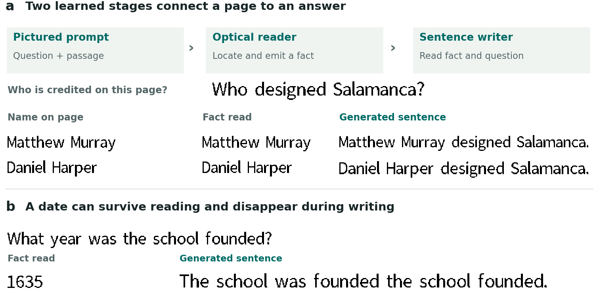](publication/ilm-nature/versions/2026-11-26-eabb2798/reading.pdf)

On a pictured Chinese page about a damselfish, a 2.44-million-parameter reader wrote **厚壳仔** when asked its common name and **辐鳍鱼纲鲈形目隆头鱼亚目雀鲷科** when asked for its classification. Across 256 unseen English and Chinese passages it wrote both human answers on 44, up from zero for the previous optical model. It followed 20 of 28 changes to stated numbers. A matched byte reader solved 52 paired passages at comparable energy. The optical model still missed the attested forms of 言 and rarely composed a correct answer whose wording was absent from the passage. [Run the model](models/paired_evidence/README.md) · [Reading edition](publication/ilm-nature/versions/2026-11-26-eabb2798/reading.pdf)

[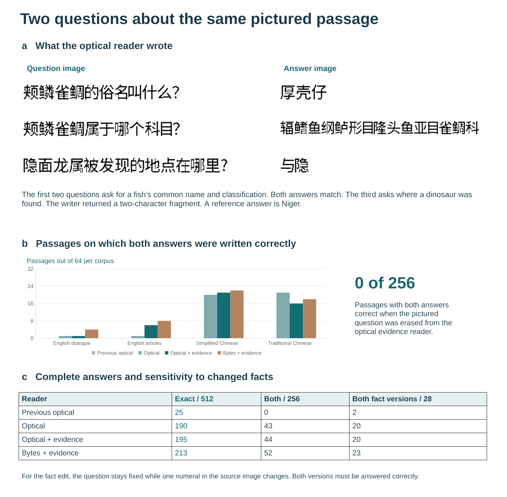](https://github.com/lachlanchen/ImagizedLanguageModel/blob/203f40812f03afbdfa55cf957a56ee8cfe0f944c/publication/ilm-nature/versions/2026-11-26-eabb2798/reading.pdf#page=2)


Can a model answer a question when both the prompt and reply are glyph images? A 2.12-million-parameter writer trained on one RTX 4090 D learned to predict unseen English and Chinese prose. Its first free English reply repeated the question about saving energy. An additional visual reader wrote 11 of 384 human reference answers and answered both questions on 0 of 192 passages. Figure 144 shows the original emitted pixels. [Read the paper](publication/ilm-nature/versions/2026-11-26-eabb2798/reading.pdf) · [Run the image writer](models/visual_cursor/README.md)

[](https://github.com/lachlanchen/ImagizedLanguageModel/blob/203f40812f03afbdfa55cf957a56ee8cfe0f944c/publication/ilm-nature/versions/2026-11-26-eabb2798/reading.pdf#page=4)

Two attractions share a paragraph. The garden and tower are named once, and their fees are given for *the former* and *the latter*. With the same pictured question, changing the target produced **门票是12元的。** and **门票是35元的。** The preceding writer gave 12 for both. The new reader and writer answered both venues in both orders on 365/536 controlled comparisons. On a harder English test where a changed word reverses the referent, it got both answers right on only 1/120 pairs.

[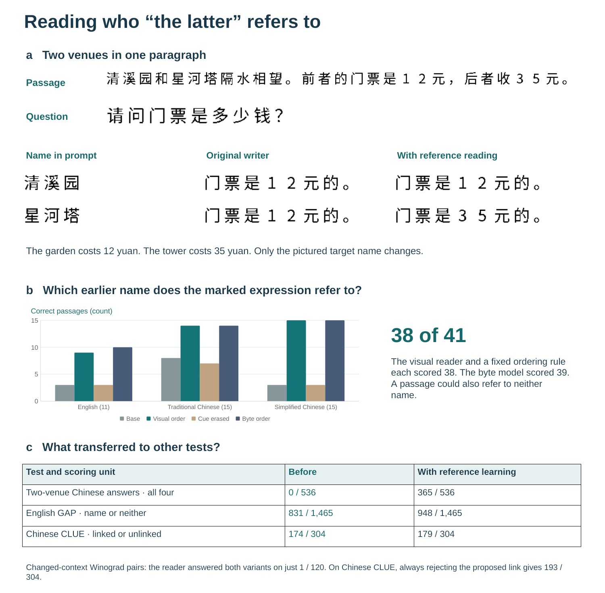](https://github.com/lachlanchen/ImagizedLanguageModel/blob/203f40812f03afbdfa55cf957a56ee8cfe0f944c/publication/ilm-nature/versions/2026-11-26-eabb2798/reading.pdf#page=6)

Two restaurants in a human-written Chinese paragraph receive different ratings. Asked the same question about each restaurant, a visual reader writes **评分是4.7分。** and **评分是4.8分。** as images. The 486,442-parameter system runs on CPU and fits on one RTX 4090 D. It answered both venues under both paragraph orders in 472 of 539 comparisons assembled from held conversations. Erasing the target-name position during training and inference reduced this to zero. On twelve newly written two-venue paragraphs, both answers were correct on five. The model still charges the same amount for “the former” and “the latter” in a passage that gives different fees. [Read the seven-page paper](publication/ilm-nature/versions/2026-11-26-eabb2798/reading.pdf) · [Run the released weights on a PNG](models/prose_fields/README.md) · [Data and comparison with bytes](references/prose_fields_result.md)

[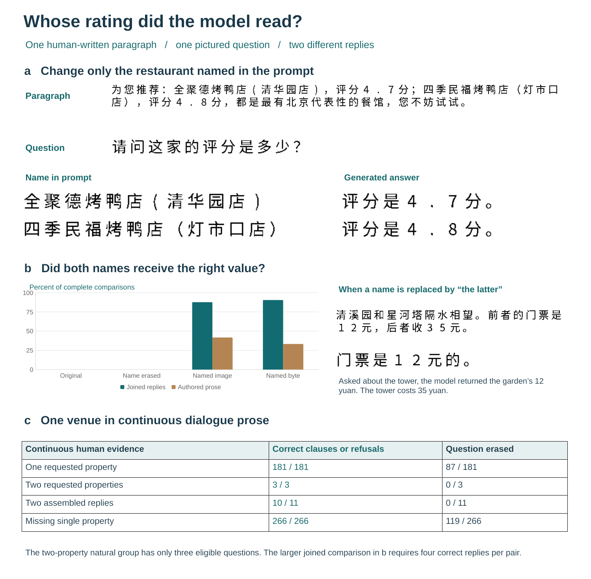](https://github.com/lachlanchen/ImagizedLanguageModel/blob/203f40812f03afbdfa55cf957a56ee8cfe0f944c/publication/ilm-nature/versions/2026-11-26-eabb2798/reading.pdf#page=7)

A hotel guest asked for the price and address. An earlier image writer gave the right number and street but called 1,354 yuan an address. A **333,850-parameter visual reader and writer**, trained from scratch on one RTX 4090 D, drew **价格是1354元。地址是在北京西城区广安门内大街217号。** Giving the writer the identity of the field currently being expressed raised correctly attached pairs from 24 to 36 on 37 held questions. On 14 additional turns evaluated after freezing the model, it passed 12. Asked to report the first-mentioned field second, it still failed every paired order test. [Run the model on a PNG](models/chinese_two_fact/README.md) · [Reading edition](publication/ilm-nature/versions/2026-11-26-eabb2798/reading.pdf) · [Evidence and limits](references/chinese_two_fact_result.md)

[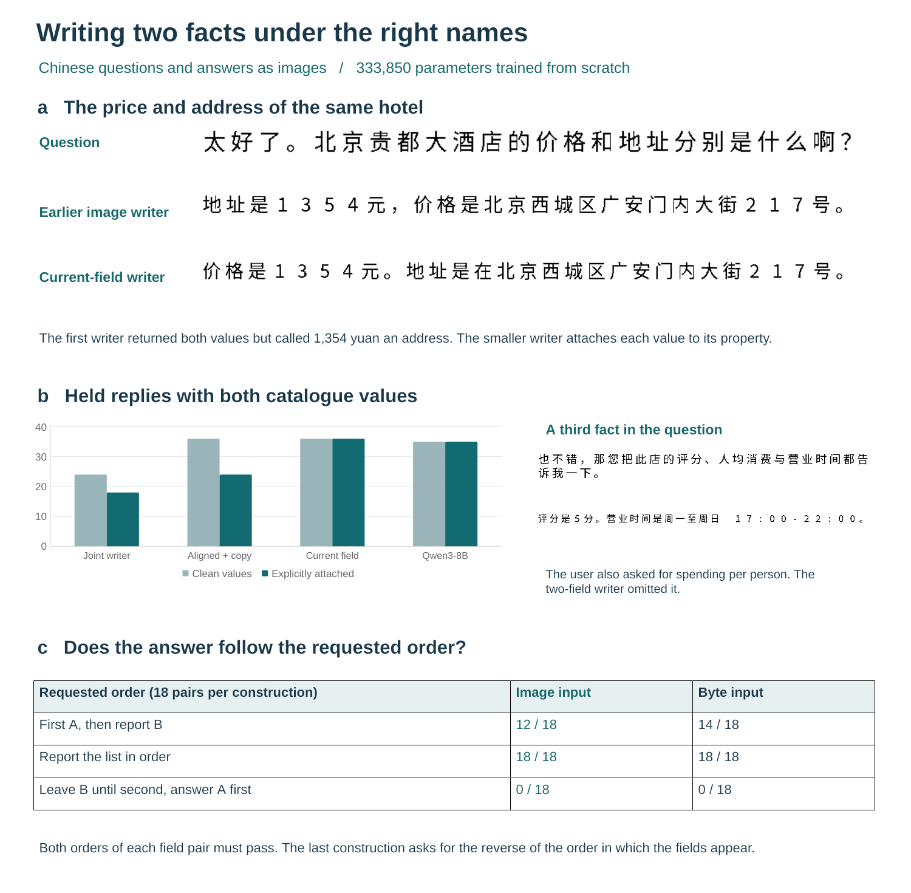](https://github.com/lachlanchen/ImagizedLanguageModel/blob/203f40812f03afbdfa55cf957a56ee8cfe0f944c/publication/ilm-nature/versions/2026-11-26-eabb2798/reading.pdf#page=8)

**A Chinese question in, a Chinese answer image out.** On the same pictured restaurant card, one guest asked for opening hours and another asked where it was. The writer returned **营业时间是周一至周日 11:00-21:30。** and **地址是西四南大街60号(近缸瓦市)。** A 1.57-million-parameter model trained on a single RTX 4090 D gave clean source values on 507 of 515 held human questions. Removing the question reduced this to 237. A matched byte reader scored 508. Both relation selection and the wording can still fail. [Run the writer](models/chinese_card_reply/README.md) · [Reading edition](publication/ilm-nature/versions/2026-11-26-eabb2798/reading.pdf) · [Evidence and failures](references/chinese_card_reply_result.md)

[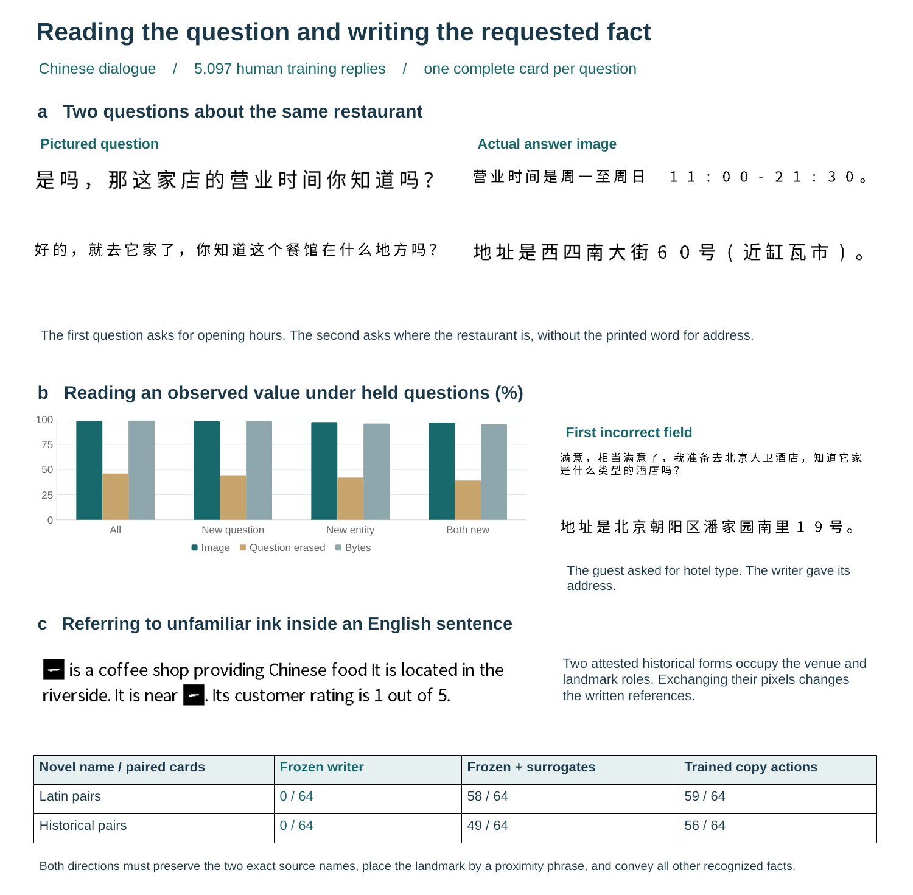](https://github.com/lachlanchen/ImagizedLanguageModel/blob/203f40812f03afbdfa55cf957a56ee8cfe0f944c/publication/ilm-nature/versions/2026-11-26-eabb2798/reading.pdf#page=9)

**Can a model write a different sentence when one printed fact changes?** A 1.59-million-parameter visual writer and reader trained on one RTX 4090 D take Chinese or English fact cards and return English sentence images. Changing a family policy reversed the corresponding claim in both answers for 1,286 of 1,291 pairs. On 1,847 Chinese cards, 657 complete answers passed a literal fact checker and 1,606 passed with equivalent price and rating bands. The first test card still acquired an unsupported price. [Run the released model](models/semantic_page/README.md) · [Reading edition](publication/ilm-nature/versions/2026-11-26-eabb2798/reading.pdf) · [Full results](references/semantic_page_result.md)

[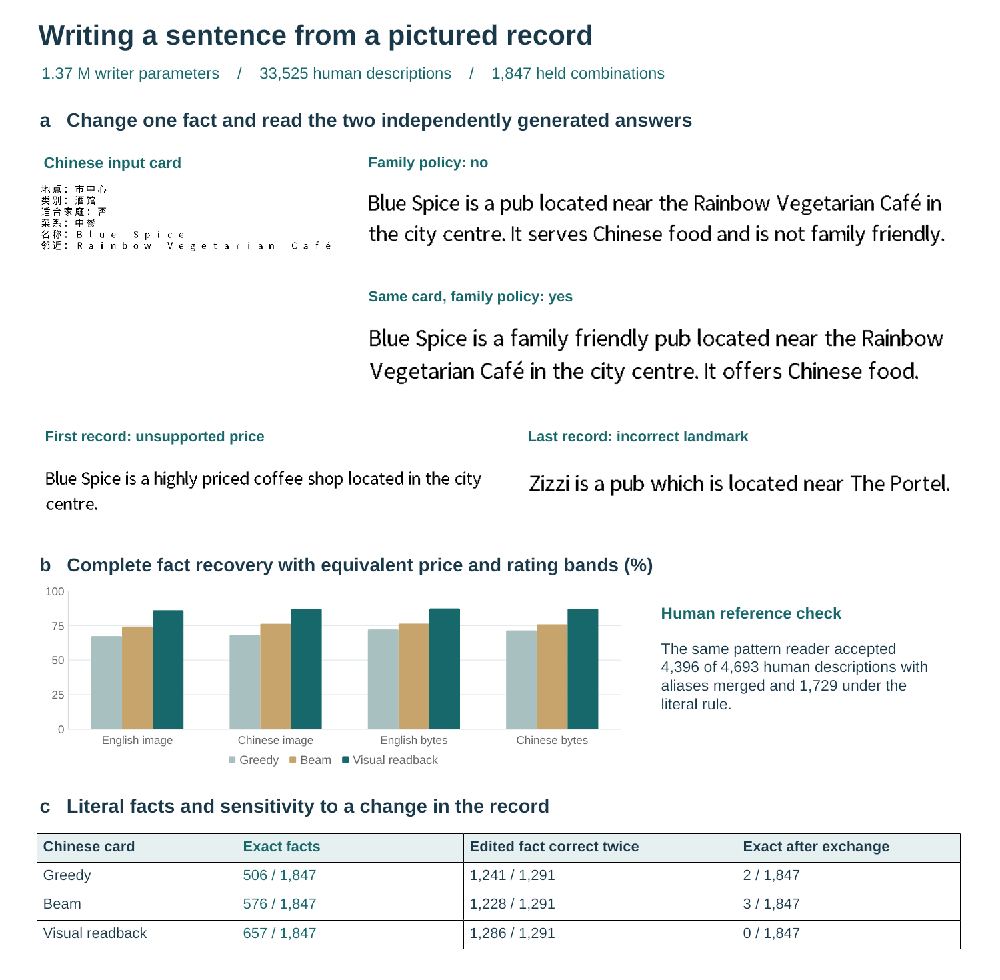](https://github.com/lachlanchen/ImagizedLanguageModel/blob/203f40812f03afbdfa55cf957a56ee8cfe0f944c/publication/ilm-nature/versions/2026-11-26-eabb2798/reading.pdf#page=10)

For an illustrated etymology question about 言, a separate reader returns its attested oracle, bronze, seal and Liushutong forms. [Read the example](models/glyph_atlas/README.md)

A pictured line by Li She reads 縱使雞鳴遇關吏. Given the damaged second line **□□余也是何人**, the image writer restored **不知余也是何人** and returned the completed page as a PNG. This was one of 17 exact two-cell repairs across 6,362 lines from reserved poet attributions. Given an entirely blank second line, the writer matched no complete reference. [Run the page writer](models/verse_canvas/README.md) · [Experiments and limitations](references/verse_canvas_result.md)

[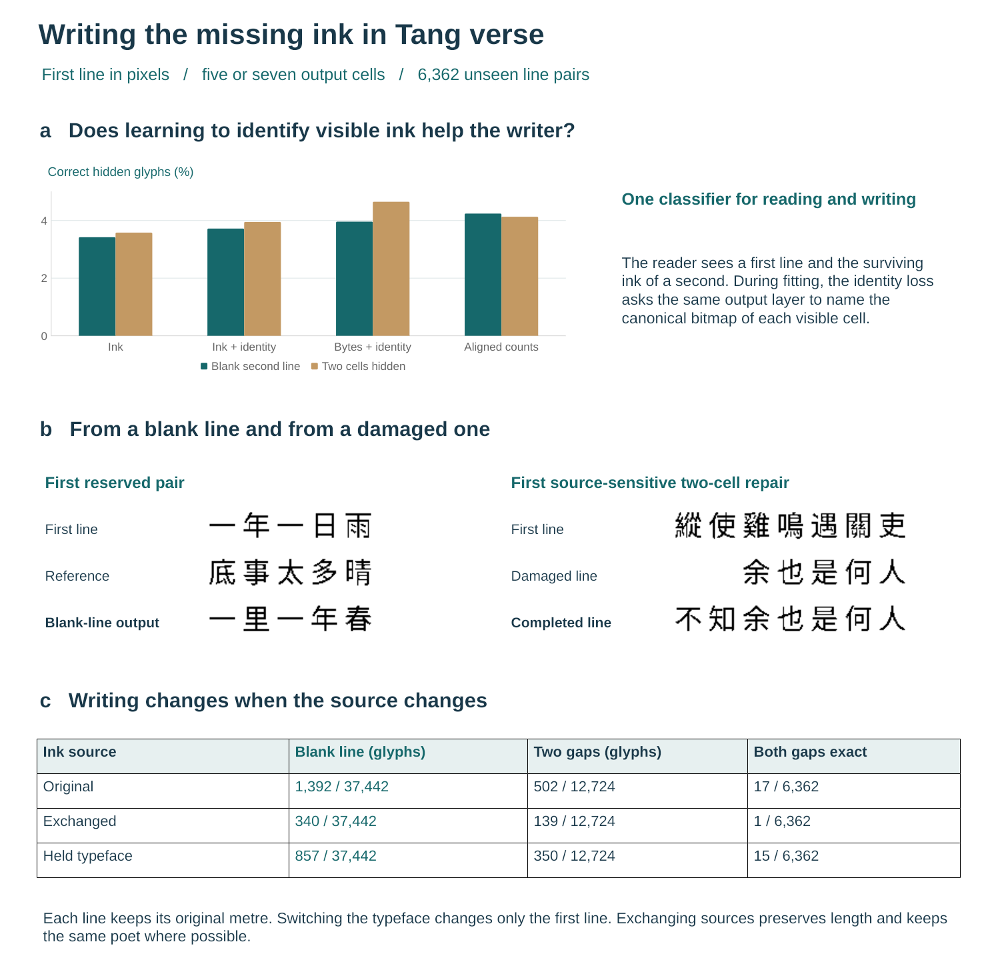](publication/ilm-nature/versions/2026-11-26-eabb2798/cumulative.pdf)

A 1.03-million-parameter visual writer trained on classical Chinese on a single RTX 4090 D. Given the original printed history, it recovered 2,744 of 28,880 next glyphs in the *Analects* and *Chu Ci*. With its own output fed back, it recovered 839, falling to 426 when the distant prefix came from the other work. No prompt produced eight consecutive correct initial glyphs. The figure shows the first output from each book. [Run the image writer](models/book_prefix/README.md) · [Measured results and Lean proof](references/book_prefix_result.md)

[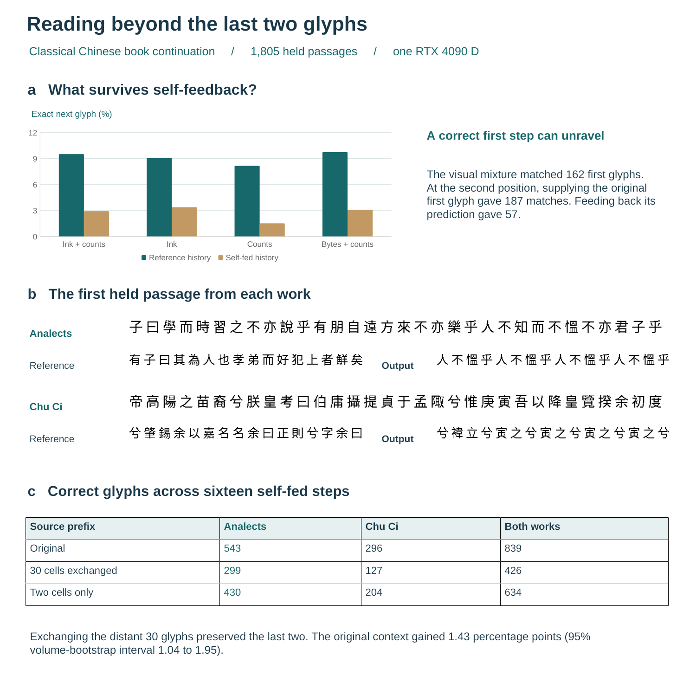](publication/ilm-nature/versions/2026-11-26-eabb2798/cumulative.pdf)

From images reading **strong enough** and **he could**, the model supplied the missing word **that**. On 50,012 unseen English passage positions it restored 4,863 words from their neighbours, falling to 1,010 after a context exchange. Count backoff trained on the same windows restored 6,715. Free eight-word continuations still repeated. [Try the visual gap model](models/context_cloze/README.md) · [Measured results](references/context_cloze_result.md)

[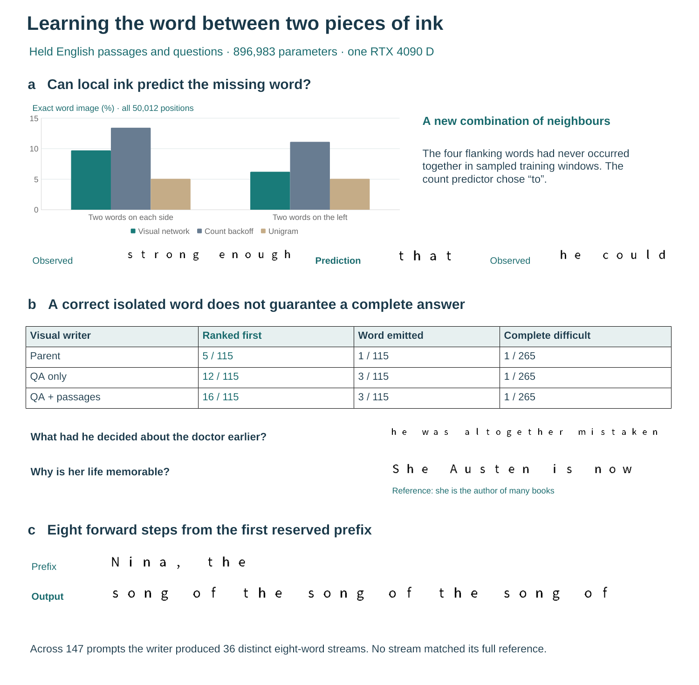](publication/ilm-nature/versions/2026-11-26-eabb2798/cumulative.pdf#page=178)

A visual writer fitted on one RTX 4090 D answered 502 of 2,238 questions from 147 new stories. Asked where Mr. Preece worked, it wrote **University of Bristol** from the pictured input. Giving it a memory of 2,048 fitting-word images left it at zero complete matches on 259 questions requiring new multiword phrasing. [Run the model](models/word_memory/README.md) · [Read the comparison](references/word_memory_result.md)

[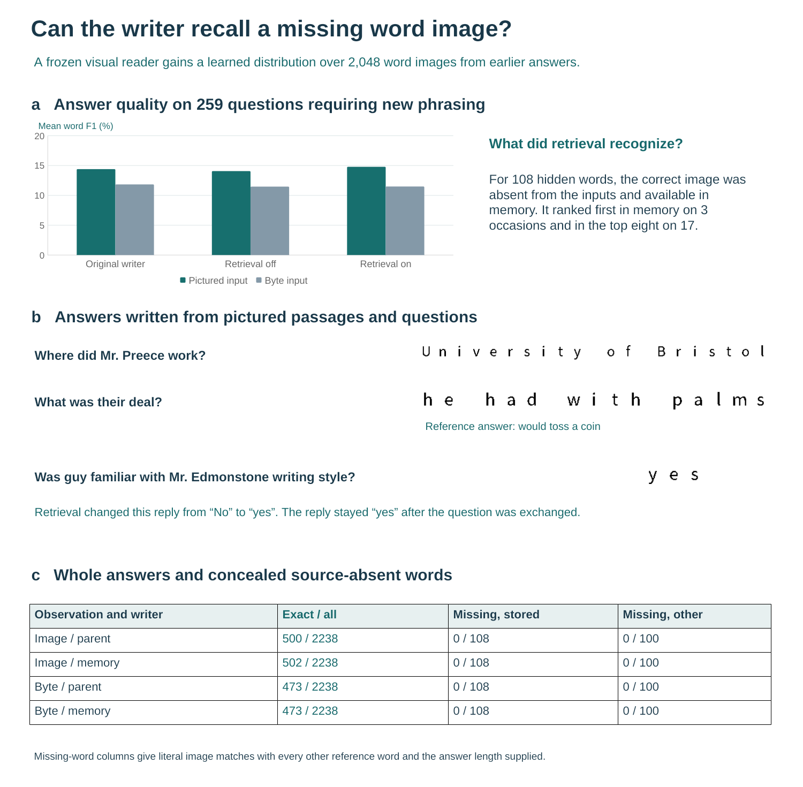](publication/ilm-nature/versions/2026-11-26-eabb2798/cumulative.pdf#page=177)

A visual writer filled a blank answer strip with **Amanda** on pass one and **Lenhart** on pass three. On 200 new conversational passages it matched 693/3,155 answers. It matched none of 443 questions requiring absent phrasing. Supplying the correct length recovered one difficult answer, and most literal errors were already fixed on the first pass. A matched left-to-right writer assembled one difficult reply correctly. [Try the four-pass writer](models/word_canvas/README.md) · [Measured outcomes](references/word_canvas_result.md)

[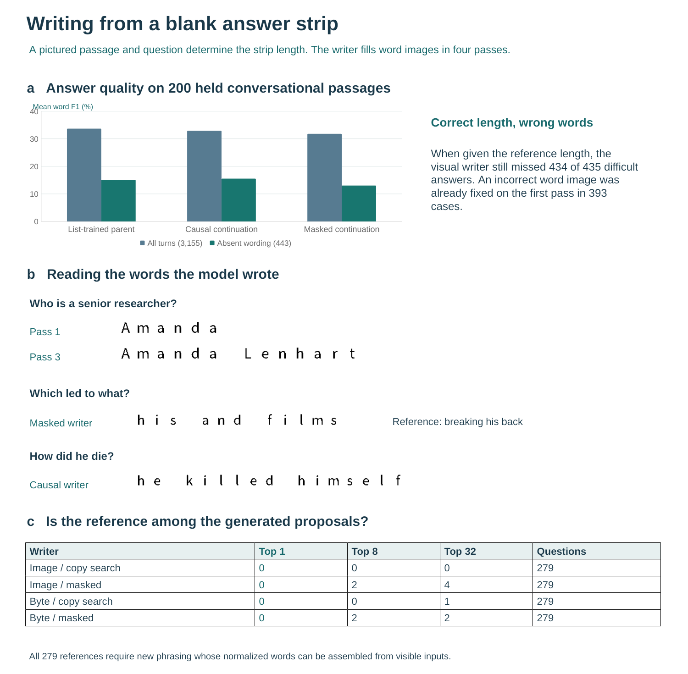](publication/ilm-nature/versions/2026-11-26-eabb2798/cumulative.pdf#page=176)

Given a pictured question about the singing in *What’s Love Got to Do with It*, a 547,125-parameter visual writer assembled **Tina Turner and Laurence Fishburne**. Adding multi-span training increased exact answers from 24 to 49 on 501 held list questions. All six writers missed the reference on 407 conversational questions requiring new wording. Both the learned behavior and the failure can be reproduced on one RTX 4090 D. [Run the checkpoint](models/compose_dialogue/README.md) · [Results and original answers](references/compose_dialogue_result.md)

[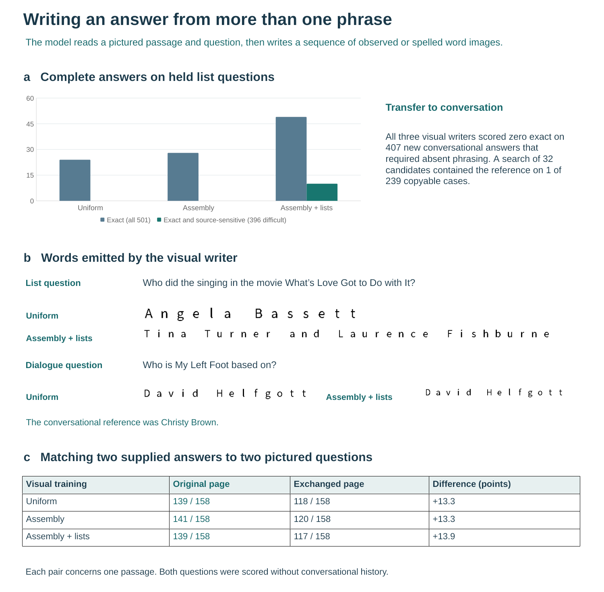](publication/ilm-nature/versions/2026-11-26-eabb2798/cumulative.pdf#page=175)

A visual writer answered “Who took the tea first?” with an image reading **Shen Nong**. On 758 fresh conversation turns it matched a human answer 270 times. Exchanging the question and history reduced that count to 29. Four paired training seeds gave an uncertain gain from human evidence supervision. All eight visual fits missed all 27 questions that required new multiword phrasing. [Run the model](models/dialogue_evidence/README.md) · [Measured results and Lean proofs](references/dialogue_evidence_result.md) · [Illustrated Lean guide](publication/ilm-math-validation/lean_reading_guide.pdf)

[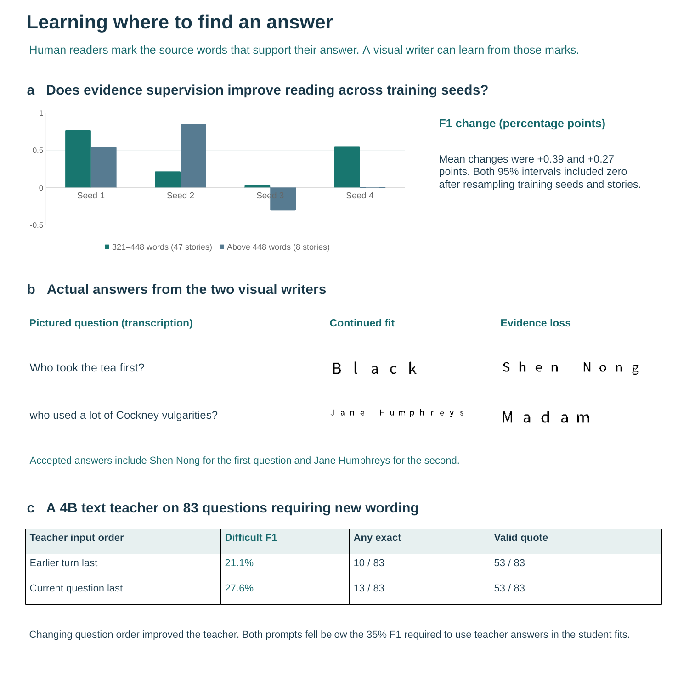](publication/ilm-nature/versions/2026-11-26-eabb2798/cumulative.pdf#page=174)

**Can a small model learn to read from ink?** A 547,125-parameter visual writer trained from scratch answered 1,574 of 5,588 held English dialogue turns exactly. A matched writer reading ordinary bytes answered 1,558. Both first cleared 20% accuracy on both held splits after 2,400 updates, consuming 5.20 and 4.86 kJ respectively. [Code and weights](models/dialogue_surfaces/README.md) · [Learning curves and limits](references/dialogue_efficiency_result.md) · [Lean proofs](formal/span_list/VisualTokenRisk.lean)

[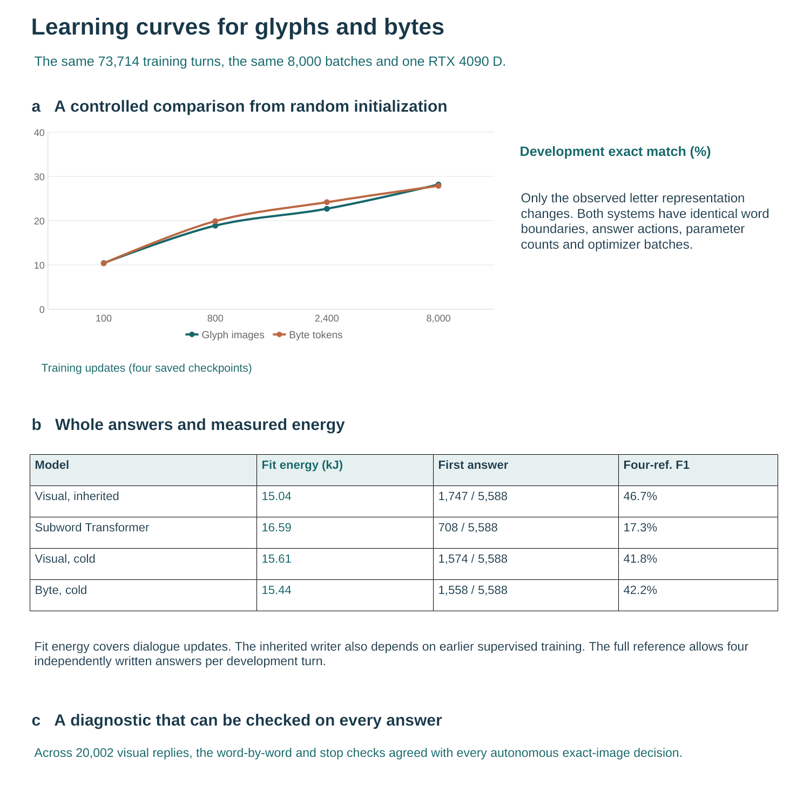](publication/ilm-nature/versions/2026-11-26-eabb2798/cumulative.pdf#page=173)

A visual writer can answer questions about a pictured passage and follow a changed date. It matched one of four human answers on 2,221 of 5,588 held English conversation turns. On 83 turns where all four human answers required new multiword phrasing, it matched none. [Run the writer](models/dialogue_ink/README.md) · [Results](references/dialogue_ink_result.md)

[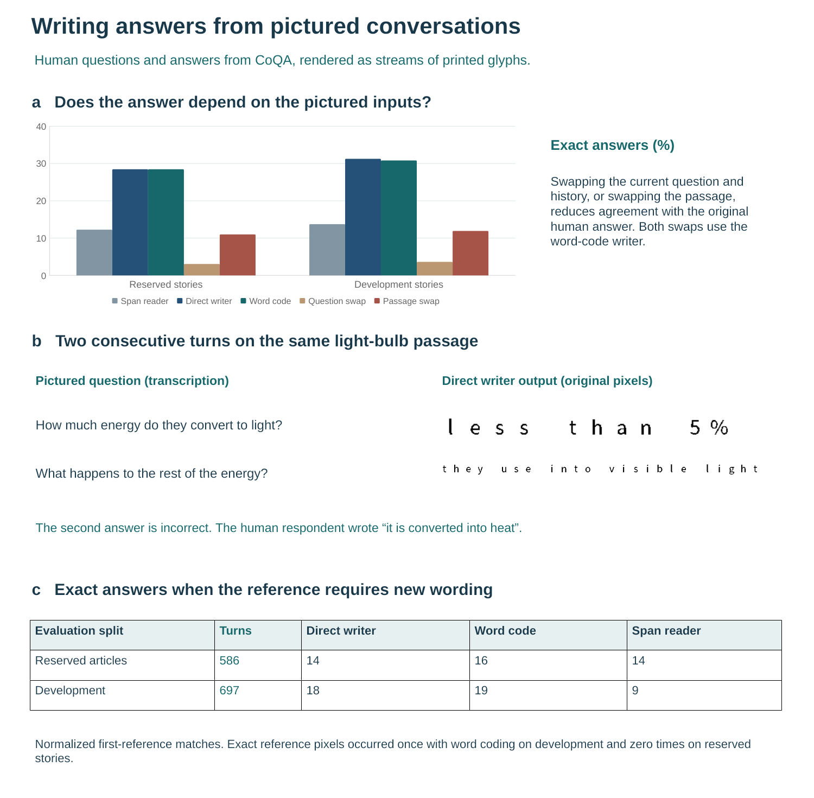](publication/ilm-nature/versions/2026-11-26-eabb2798/cumulative.pdf#page=172)

On one pictured paragraph about Portugal, the reader returns **Lisbon** when asked for a city and **1822** when asked for a year. It learned to select answer pixels on one RTX 4090 D. Across 20 reserved English articles it returned 872 exact answers to 1,957 human questions. It completed both questions on 108 of 484 passages, versus zero after exchanging the questions. The source supplies the answer wording. [Run the released reader](models/optical_passage_qa/README.md) · [Results and limits](references/optical_passage_qa_result.md)

[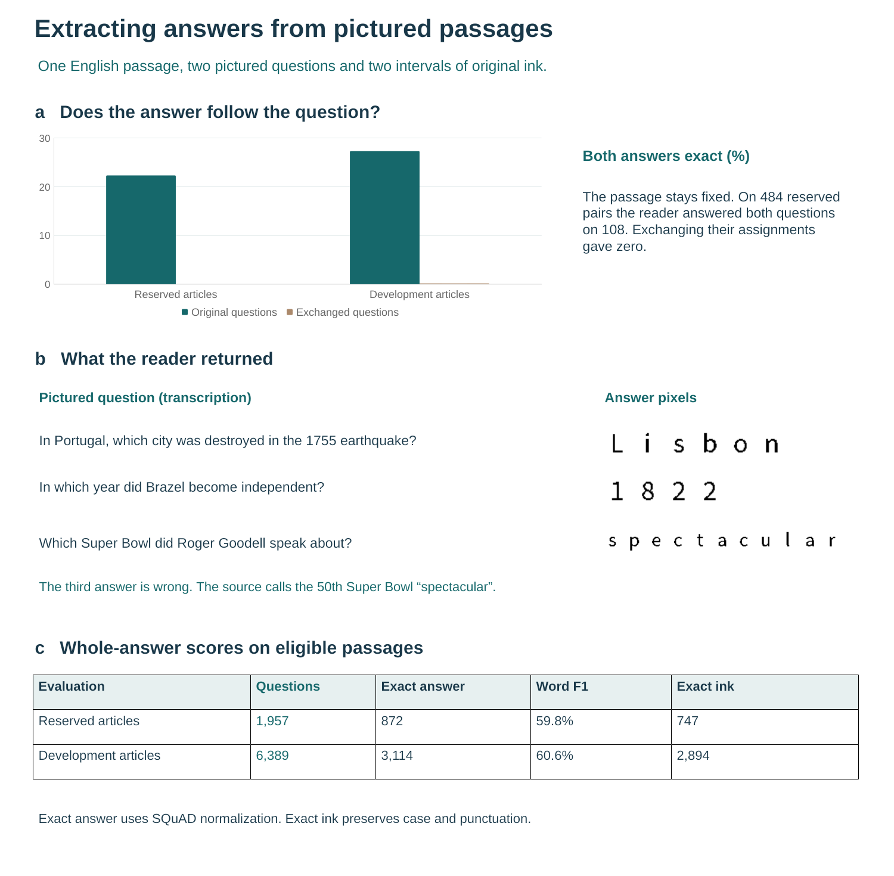](publication/ilm-nature/versions/2026-11-26-eabb2798/cumulative.pdf#page=171)

The visual reader now answers two questions about the same line. For 舉杯邀明月 it writes **cup** when asked what is raised and **moon** when asked who is invited. This verse appeared in earlier training. On 971 held clauses the reader located every verb and object and wrote every registered meaning on 247, compared with 11 under exchanged object supervision. It completed none of 21 clauses whose natural questions were all previously unseen. [Run the reader](models/questioned_events/README.md) · [Results](references/questioned_events_result.md)

[](publication/ilm-nature/versions/2026-11-26-eabb2798/cumulative.pdf#page=170)

When an English question described an action, the visual reader located and wrote both Chinese object glosses on 44 of 268 paired pages. The previous reader completed 11. On ten screened pairs from Pu Songling it chose both correct lines on four pairs and wrote both answers on none. Figure 125 shows the actual reply to a question about a peach. [Run the reader](models/visual_action_meaning/README.md) · [Results](references/visual_action_meaning_result.md)

[](publication/ilm-nature/versions/2026-11-26-eabb2798/cumulative.pdf#page=169)

One pictured page contains 焉得仁 and 策其馬. Asked what they get, the visual model writes **benevolence**. Asked what they whip, it writes **horse**. It located and wrote both objects on 703/1,691 held pages across both line orders and two question frames. Replacing the action names on 188 matched pages reduced complete answers from 95 to seven. [Run the model](models/pictured_action_lookup/README.md) · [Results](references/pictured_action_lookup_result.md)

[](publication/ilm-nature/versions/2026-11-26-eabb2798/cumulative.pdf#page=168)

The visual model reads a classical passage and a pictured question, then draws an English answer. For 還其珠 it writes **return** or **pearl**. With 1.40 million parameters, it drew both meanings of 之, *it* and *go*, on 31/40 held context pairs, compared with 4/40 after shuffling supervision. Across two other books it answered all four classroom questions on only 1/29 passages. [Run the model](models/pronoun_writer/README.md) · [Results](references/pronoun_writer_result.md)

[](publication/ilm-nature/versions/2026-11-26-eabb2798/cumulative.pdf#page=166)

Given 執大象 and a pictured question, the 1.35M-parameter model draws **hold** for the verb and **image** for the object. It located and glossed both terms under eight Chinese and English requests on 230/539 held passages, or 247 with a bank of attested glosses. Everyday paraphrases remain difficult. [Run the model](models/asked_gloss/README.md) · [Experiment](references/asked_gloss_result.md)

[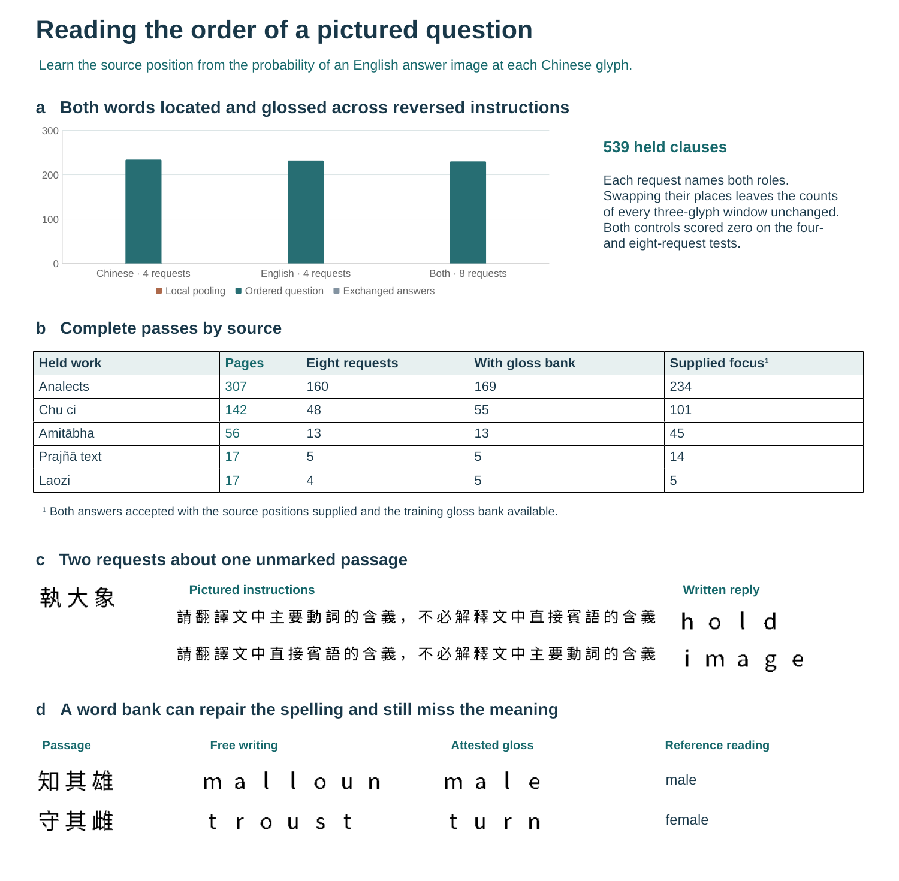](publication/ilm-nature/versions/2026-11-26-eabb2798/cumulative.pdf#page=164)

A 1.18-million-parameter image writer learned to give an English gloss for a marked Chinese character. For 言 it drew “speak” in 言及之而不言 and “speech” in 有是言也. It wrote both readings correctly in 213/566 contrasting Analects pairs and 82/403 Chu ci pairs. A local context-count predictor solved 211 and 104. The writer trained from scratch on one RTX 4090 D. [Run the writer](models/visual_word_senses/README.md) · [Results](references/visual_word_sense_result.md)

[](publication/ilm-nature/versions/2026-11-26-eabb2798/cumulative.pdf#page=163)

The model read pictured Chinese questions about two novels and wrote two-clause image replies. It returned 34/48 exact replies for *Journey to the West* and 42/48 for *Dream of the Red Chamber*. It could write 行者引路，而三藏上馬。 with the clauses in the requested order. On historical plates it returned both attested shapes in every arrangement for 9/60 held-out character families. The English questions yielded 2/48 and 10/48 exact replies. [Run the model](models/grounded_ink_editor/README.md) · [Results and examples](references/grounded_ink_writing_result.md)

[](publication/ilm-nature/versions/2026-11-26-eabb2798/cumulative.pdf#page=162)

An 86-million-parameter visual reader answered 38 of 56 pictured Chinese questions about the people in the *Discourses of the States* (國語). It answered both questions before and after a name exchange on 4 of 14 excerpts, compared with 3 for the original reader and 2 for the equal-label control. For pictured English questions it gave 16 correct answers and completed no excerpt. The example returns the original glyphs for 密康公 and 恭王. [Guoyu · ILM](models/optical_role_reader/README.md) · [38/56](references/optical_role_adapter_result.md)

[](publication/ilm-nature/versions/2026-11-26-eabb2798/cumulative.pdf#page=160)

A 64,666-parameter reader takes a pictured question and Chinese passage and returns a strip of the original page. Trained on 6,439 passages, it found 104 of 452 source answers for Chinese questions and 45 for English questions about two reserved novels. Human answers alone produced 81 and 48. The model can answer some questions about people; it still rarely answers two different questions about the same passage correctly. [ILM · 64k](models/book_span_distillation/README.md) · [104/452](references/book_span_distillation_result.md)

[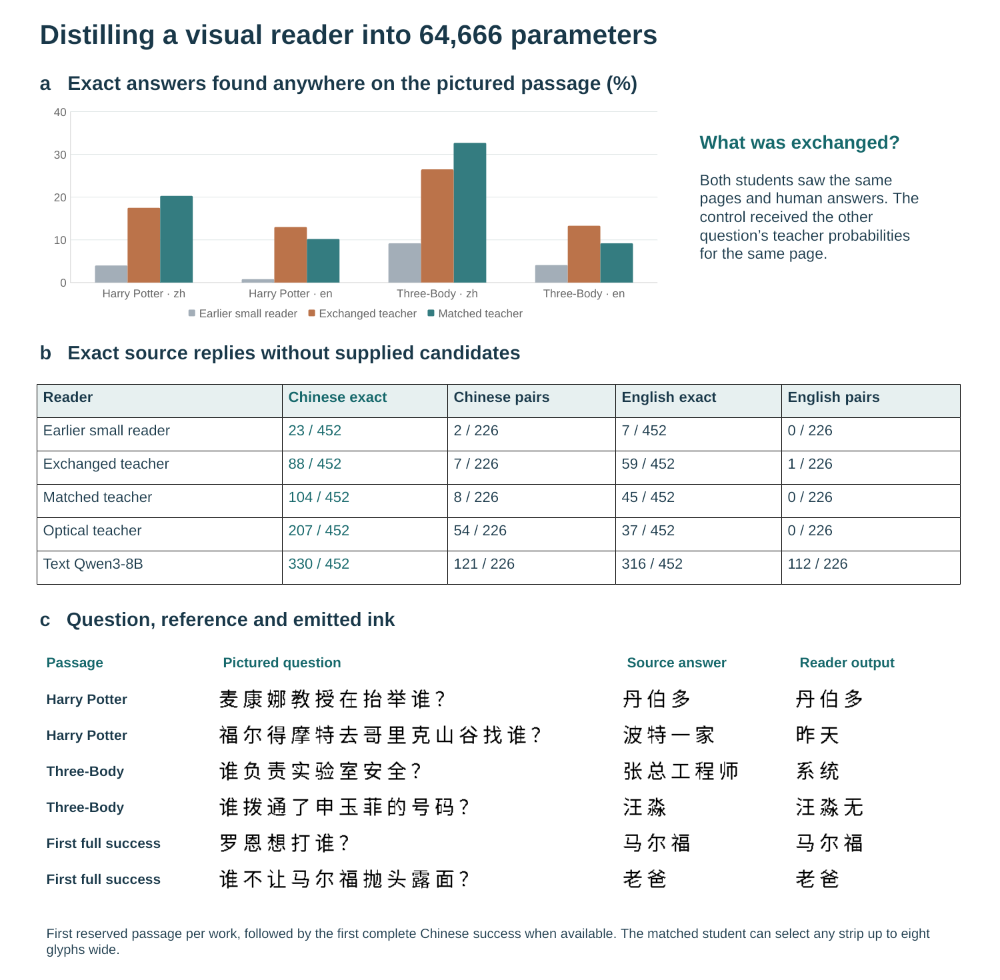](publication/ilm-nature/versions/2026-11-26-eabb2798/cumulative.pdf#page=157)

The visual writer learned to follow changes in who performed an action on pictured credits (175/256 comparisons, versus 19/256 for the control). On twelve new stories both writers missed every complete comparison. With two pictured requests and the corresponding catalogue sections, the writer reproduced four historical forms of 言 in two of eight trials. [↗](references/individual_clause_writer_result.md)

[](publication/ilm-nature/versions/2026-11-26-eabb2798/cumulative.pdf#page=155)

When two names exchanged roles on a pictured credit, the 87M-parameter writer followed the edit in both question orders on 165 of 256 comparisons. The equal-exposure control passed five. On separately worded stories both writers scored zero of 24. [Results and original images](references/role_change_writer_result.md) · [Run the writer](models/role_change_writer/README.md)

[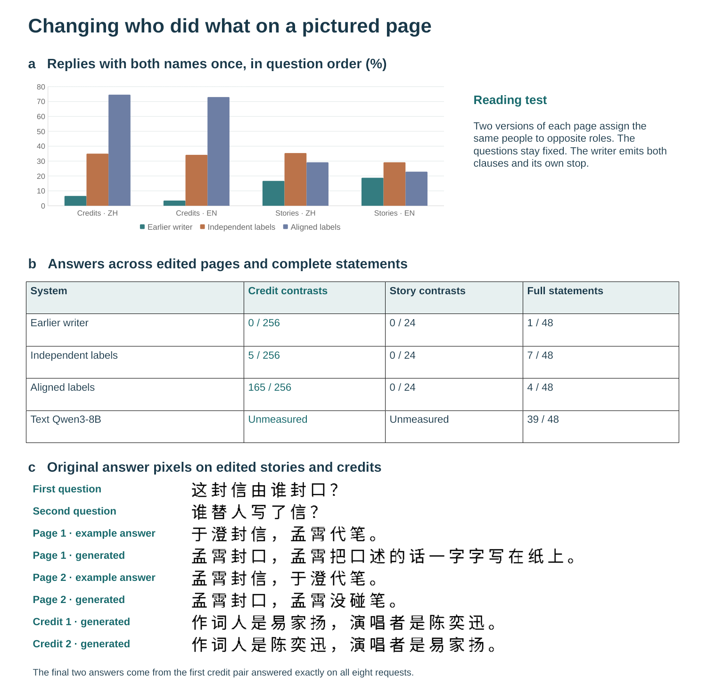](publication/ilm-nature/versions/2026-11-26-eabb2798/cumulative.pdf#page=154)

Using the learned question image to locate evidence raised exact English-request excerpts from 17 to 41 of 412 on MLQA. The independent writer produced 111 exact stopped replies across both languages, compared with 90 when given the original pages. [↗](references/question_evidence_transfer_result.md)

[](publication/ilm-nature/versions/2026-11-26-eabb2798/cumulative.pdf#page=152)

A visual encoder trained from scratch matched English and Chinese questions on 364 of 374 novel passages. On five further works, the reader found 31 exact excerpts in 92 requests. The writer gave 19 exact replies when supplied with those excerpts. [↗](references/bilingual_book_intervals_result.md)

[](publication/ilm-nature/versions/2026-11-26-eabb2798/cumulative.pdf#page=151)

After training on 642 of its own mistaken book answers, the visual writer gave 31/144 exact image replies on six additional Chinese works. It answered both questions in both languages on 0/36 passages. [↗](references/stopped_book_preference_result.md)

[](publication/ilm-nature/versions/2026-11-26-eabb2798/cumulative.pdf#page=150)

On 34 passages from four additional Chinese books, extra first-glyph supervision produced 31 exact replies in 136 Chinese and English requests. No passage received all four correct replies. [↗](references/first_glyph_book_result.md)

[](publication/ilm-nature/versions/2026-11-26-eabb2798/cumulative.pdf#page=149)

The bilingual writer answered two questions in both Chinese and English on 3/374 Chinese novel passages. A control trained with exchanged English questions did so on 0/374. On XQuAD the bilingual writer completed 1/227 passages. [Results and original replies](references/bilingual_novel_result.md)

[](publication/ilm-nature/versions/2026-11-26-eabb2798/cumulative.pdf#page=148)

Training on changes in stroke width and glyph proportions raised exact Chinese reading answers in HanaMin from 15 to 43 of 394. The writer completed six of 197 two-question passages. On a separate XQuAD reading test it completed zero of 227 passages in that print. [Results and original answers](references/stroke_scale_result.md)

[](publication/ilm-nature/versions/2026-11-26-eabb2798/cumulative.pdf#page=147)

On Chinese passages printed in HanaMin, a typeface withheld from training, the image writer answered 15 of 394 additional trial questions exactly. Training on alternate print alone gave 3. The writer answered both questions on 0 of 197 passages. Its offline catalogue accepts a headword such as 中 and returns an answer image with the requested historical forms. [Run the writer and catalogue](models/typeface_writer/README.md)

[](publication/ilm-nature/versions/2026-11-26-eabb2798/cumulative.pdf#page=146)

Asked two different questions about each of 98 pictured Chinese passages, the distilled writer gave 72 exact answers to 196 questions, up from 63 with ordinary training. Both writers answered both questions on 11 passages. Qwen3-8B, given the same passages as text, answered both on 55. [Results and model](references/interval_teacher_result.md)

[](publication/ilm-nature/versions/2026-11-26-eabb2798/cumulative.pdf#page=145)

One writer answered 114 of 359 Chinese reading questions exactly and returned both the oracle and bronze forms of 言 from a pictured catalogue card in either requested order. On 128 additional passages with two questions each, it answered both on 15. The span reader answered both on 49. [Run the image writer](models/mixed_visual_answers/README.md)

[](publication/ilm-nature/versions/2026-11-26-eabb2798/cumulative.pdf#page=144)

A writer reading Chinese glyph images produced the correct participant and year for every edit under three new phrasings on 34 of 64 single passages and 8 of 48 two-paragraph cases. It returned seven exact replies on 359 broader human questions.

[](publication/ilm-nature/versions/2026-11-26-eabb2798/cumulative.pdf#page=142)

After excluding reserved DRCD material and retraining, the wider reader returned 234 exact answer images on 359 development questions. The generic reader returned 242. Earlier DRCD scores used reserved test passages. [Results and source correction](references/span_list_result.md)

[](publication/ilm-nature/versions/2026-11-26-eabb2798/cumulative.pdf#page=141)

On 384 fresh Chinese reading questions, pooling four pictured answers gave 285 exact replies, equal to the generic reader. It passed 63 of 128 complete name exchanges; the specialized reader passed 79. [Results and weights](references/span_choice_result.md)

[](publication/ilm-nature/versions/2026-11-26-eabb2798/cumulative.pdf#page=140)

When two names exchange roles on a pictured Chinese passage, the likelihood-trained reader now answers every question in both word orders on 79 of 128 passages, up from 29. On human-written questions its two-order score falls from 34 to 28 of 48. [Results and checkpoints](references/participant_margin_result.md)

[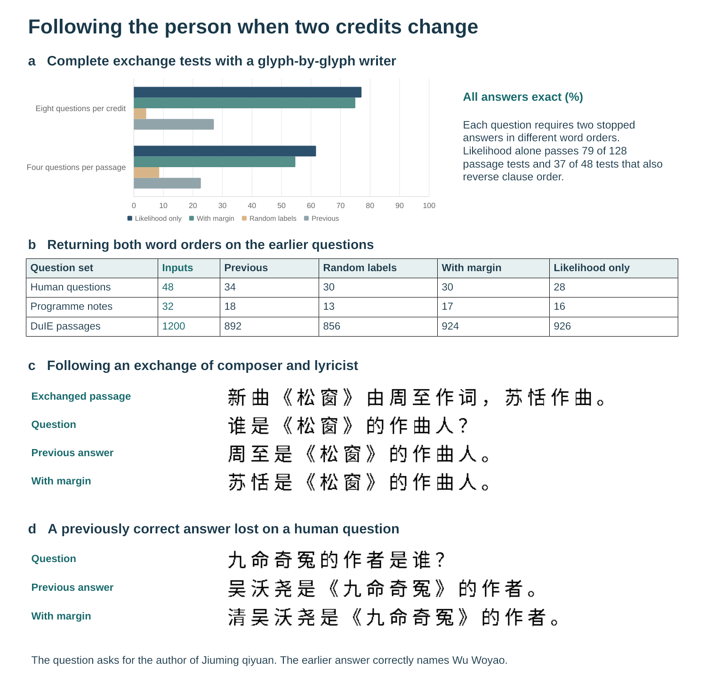](publication/ilm-nature/versions/2026-11-26-eabb2798/cumulative.pdf#page=139)

The image writer now gives the correct fact in two requested word orders on 34 of 48 human-written Chinese questions. It credits the composer of 《秋潮》 correctly. A second song shows what still fails when two people exchange roles. [Results and model](references/pictured_relation_result.md)

[](publication/ilm-nature/versions/2026-11-26-eabb2798/cumulative.pdf#page=138)

A reader trained on 26,890 pictured Chinese examples wrote 33 complete, correct statements on 48 human questions. A separate glyph-by-glyph writer expressed the same fact in two requested word orders on 31 of them. In the film example it correctly names the director and screenwriter on the original page, then selects too much text after the names are exchanged. [Results and runnable model](references/role_binding_result.md)

[](publication/ilm-nature/versions/2026-11-26-eabb2798/cumulative.pdf#page=137)

When two people exchange roles on a pictured page, can the answer follow? A learned planner and a shared image writer gave both statements in the requested order on 70 of 136 questions about combinations withheld from compound training. The earlier single-call writer gave three. The film example shows a remaining error: two legible sentences credit the same person with different jobs. [Results and runnable model](references/grounded_proposition_result.md)

[](publication/ilm-nature/versions/2026-11-26-eabb2798/cumulative.pdf#page=136)

Asked who drew a map and who needed directions, the revised reader returns the two different names. It gave 42 exact names on 64 further pictured questions. It also writes the oracle and bronze forms of 言 in either requested order, but gave no exact answer on 128 new open questions requiring a glyph absent from the prompt. [Results and runnable model](references/pointing_causal_writer_result.md)

[](publication/ilm-nature/versions/2026-11-26-eabb2798/cumulative.pdf#page=135)

A pictured passage says who drew a map and who got lost. The new Chinese writer identifies the mapmaker, then repeats the same fact when asked who needed directions. On 300 questions requiring a glyph absent from the prompt, it chose the correct first missing glyph 18 times, even with the preceding answer supplied. [Results and original answers](references/causal_glyph_writer_result.md)

[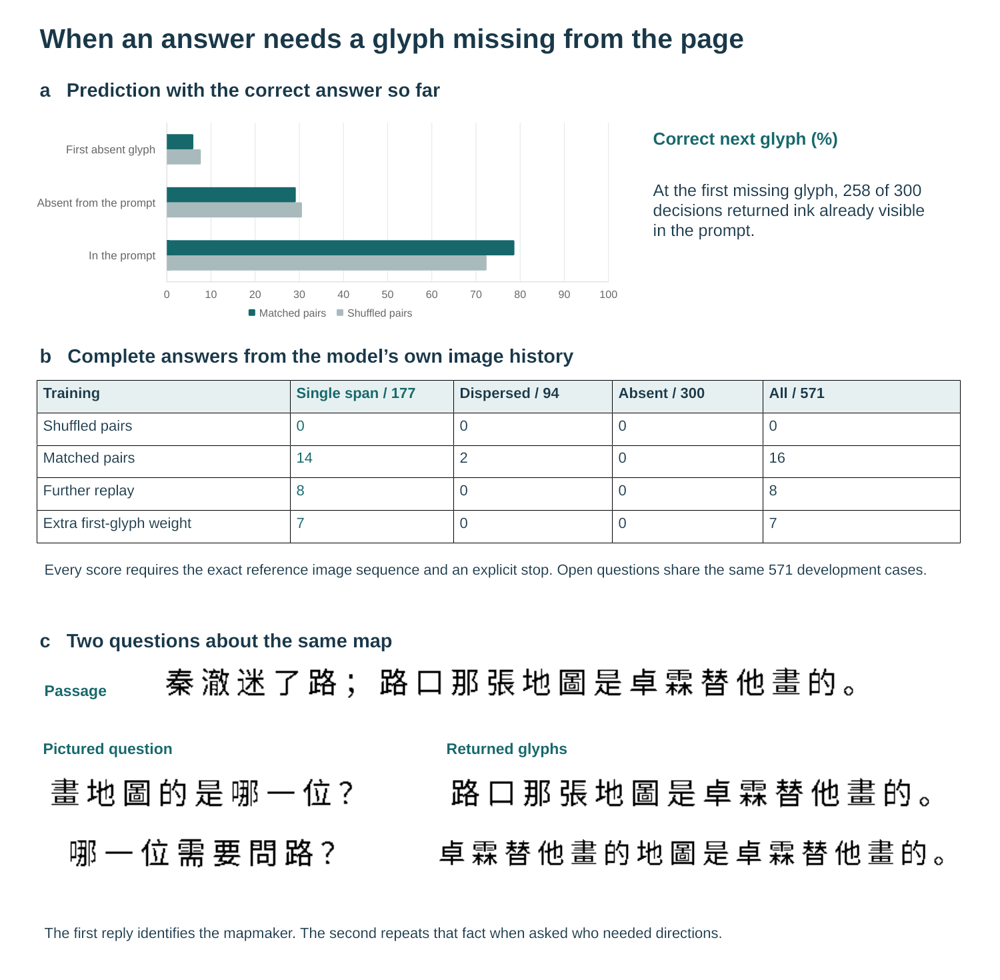](publication/ilm-nature/versions/2026-11-26-eabb2798/cumulative.pdf#page=134)

The pictured request can now reverse the oracle and bronze forms of 言. With familiar wording, the model returned both requested orders in 94 of 96 held-out comparisons. A new wording on further cards gave 16 of 96. [Results and answer images](references/ordered_page_writer_result.md)

[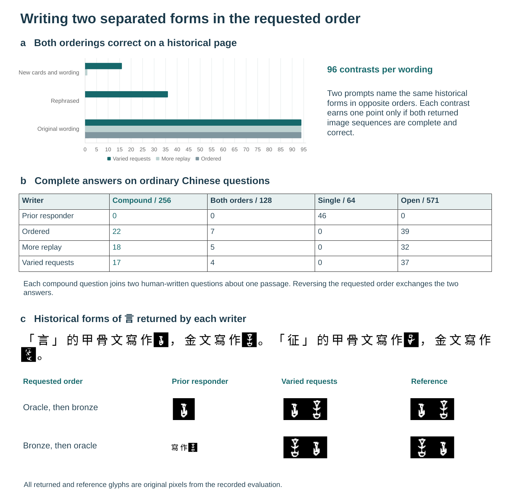](publication/ilm-nature/versions/2026-11-26-eabb2798/cumulative.pdf#page=133)

**Reading and writing from glyph images.** On 64 questions about two people, the model returned 46 correct answers in regular Chinese print and 41 in bold. Local Qwen3-8B returned 55 from text. An unseen Kai typeface gave one correct answer. [Run the model](docs/visual-page-responder.md)

[](publication/ilm-nature/versions/2026-11-26-eabb2798/cumulative.pdf#page=132)

**Can it identify two people in one sentence?** The visual writer correctly names both the donor and the architect of the Gates building. Across 864 question pairs it answers both correctly 100 times. In 24 new situations with the names exchanged, it solves no complete scene. Local Qwen3-8B solves 20. [Results and runnable model](references/shared_sentence_writer_result.md)

[](publication/ilm-nature/versions/2026-11-26-eabb2798/cumulative.pdf#page=130)

**Where the writer loses the answer.** On 387 human Chinese “who” questions, choosing one sentence by shared pictured glyphs raised exact answers from 62 to 116. The randomized training control reached 127 with the same selector. Figure 85 shows a clearly written place name where the question asks for an inventor. [Results and runnable reader](references/inverse_role_writer_result.md)

[](publication/ilm-nature/versions/2026-11-26-eabb2798/cumulative.pdf#page=129)

**Writing the right participant.** With new names and complements, the model wrote 368 of 404 complete Chinese statements. It wrote 24 of 32 statements containing bronze Qin and Chu glyphs copied from the pictured input. When asked to name the participant from its property alone it gave zero exact bronze names. Figure 84 shows a wrong name and a correct answer to the same request. [Results and runnable model](references/visual_role_writer_result.md)

[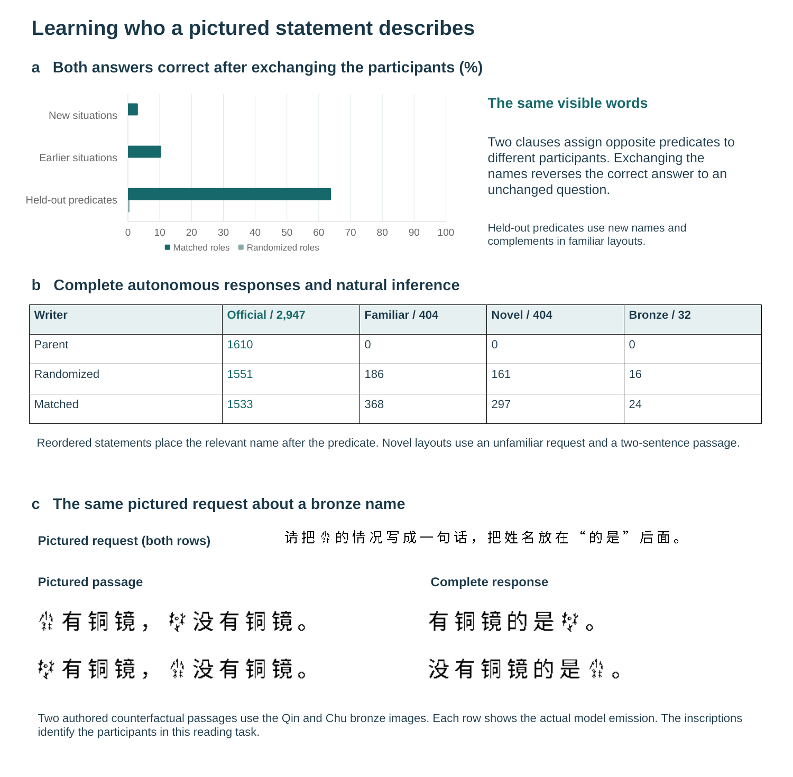](publication/ilm-nature/versions/2026-11-26-eabb2798/cumulative.pdf#page=128)

**What can the visual writer read?** Given the pictured sentence 她喝了一口□。 (“She took a sip of □.”), the writer supplied 水 (water) or 茶 (tea) when the drink changed in the accompanying passage. The combined writer recovered 651 of 2,947 missing Chinese phrases exactly. When two people exchanged roles, the model gave the correct judgment in both versions on 0 of 48 pairs. [Results and commands](references/visual_inference_writer_result.md)

[](publication/ilm-nature/versions/2026-11-26-eabb2798/cumulative.pdf#page=127)

The same model read two passages about a box. It wrote “the passage supports this claim” both when the box contained three books and when it was empty. The answer images were byte-identical.

| Passage image | Claim image | Actual answer image |
|---|---|---|
|  |  | 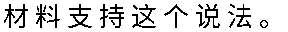 |
|  |  |  |

**The experimental writer learned Chinese spelling from ordered glyph images.** Given the correct answer prefix, it selected 431 of 1,525 missing glyphs after learning from 192,230 additional human answers, versus 162 without the image histories and 121 with shuffled histories. Starting from the question and passage alone, it gave zero complete references on the 300 cases requiring new content ink. The released reader below remains the supported passage model. [Actual output and causes](references/composed_writer_result.md) · [Spelling comparison](references/bitmap_history_writing_result.md) · [Spelling results in Figure 76](publication/ilm-nature/figures/Figure_76_bitmap_history.png)

**Training on additional pictured Chinese passages improved exact answers on two collections.** A 101,144-parameter reader answered 1,270 of 3,505 traditional-Chinese DRCD questions, up from 500 before training and 380 after equal-update replay. Official CMRC singles increased from 999 to 1,111 of 3,170. Asked for a year, the reader wrote **1991年**. Asked for a region, it still selected a person. [Run the checkpoint](models/pictured_passage_zh/README.md) · [Results and examples](references/traditional_passage_training_result.md)

[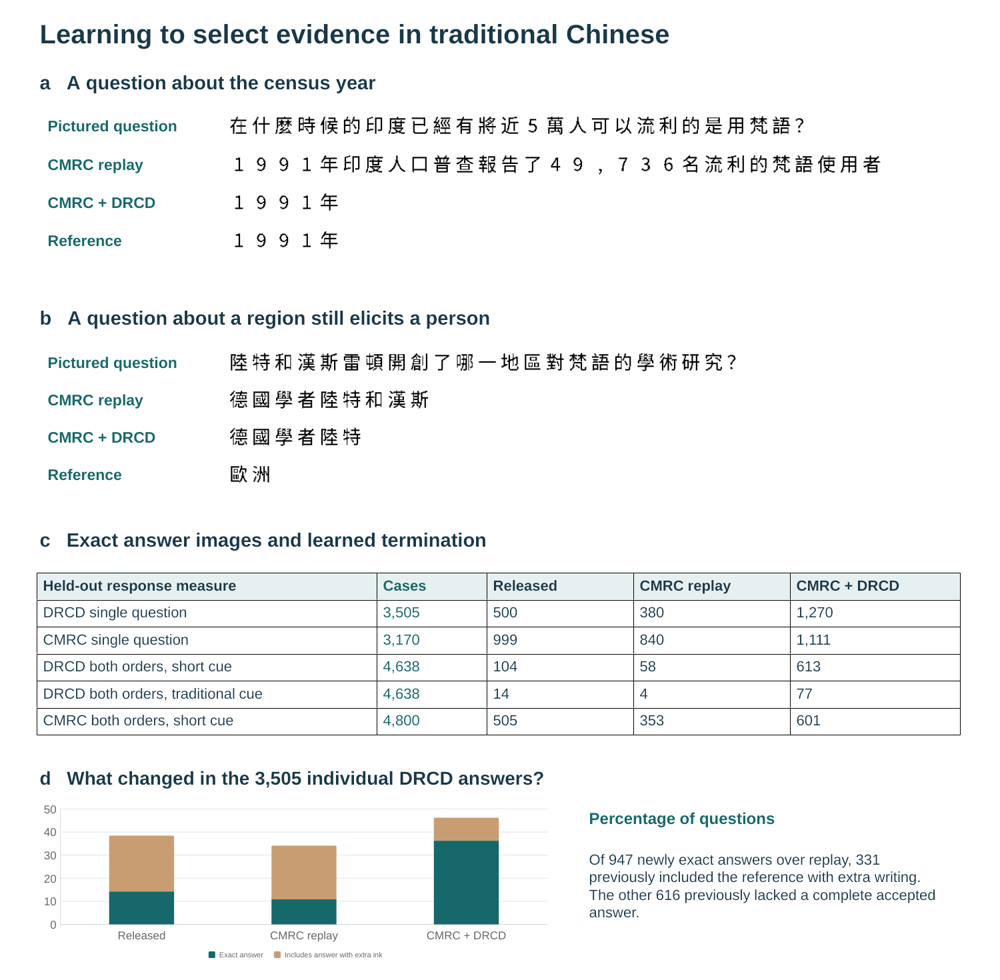](publication/ilm-nature/versions/2026-11-26-eabb2798/cumulative.pdf#page=118)

A 101,144-parameter visual reader answered two questions about the Guangmao Railway with **364.6公里；三茂铁路股份有限公司**. Reversing the questions exchanged the two answer images. On the official Chinese passage benchmark, the shorter instruction initially produced zero correct pairs in both orders. Constraining the same learned action scores recovered 505 of 4,800 pairs. Most pairs still contain a wrong answer. [Run the released model](models/pictured_passage_zh/README.md) · [Experiment and failure cases](references/paired_passage_result.md)

[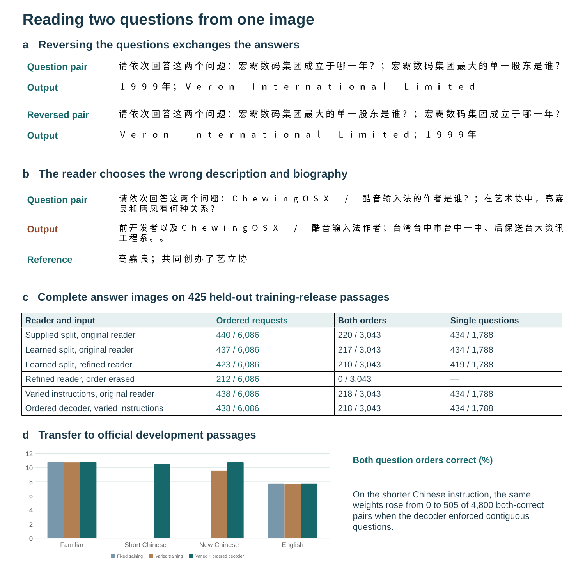](publication/ilm-nature/versions/2026-11-26-eabb2798/cumulative.pdf#page=117)

A compact visual reader answered 66 of 96 Chinese dictionary questions written separately by a local model. Repeating the original training questions for the same compute and answer exposures gave 18. A request about 明 elicited *bright* and its bronze form. A request about 编 beginning with 老师您好 elicited the wrong headword. Figure 72 shows both original outputs. [Results and limits](references/independent_entry_result.md) · [Run the reader](models/independent_entry_reader/README.md)

[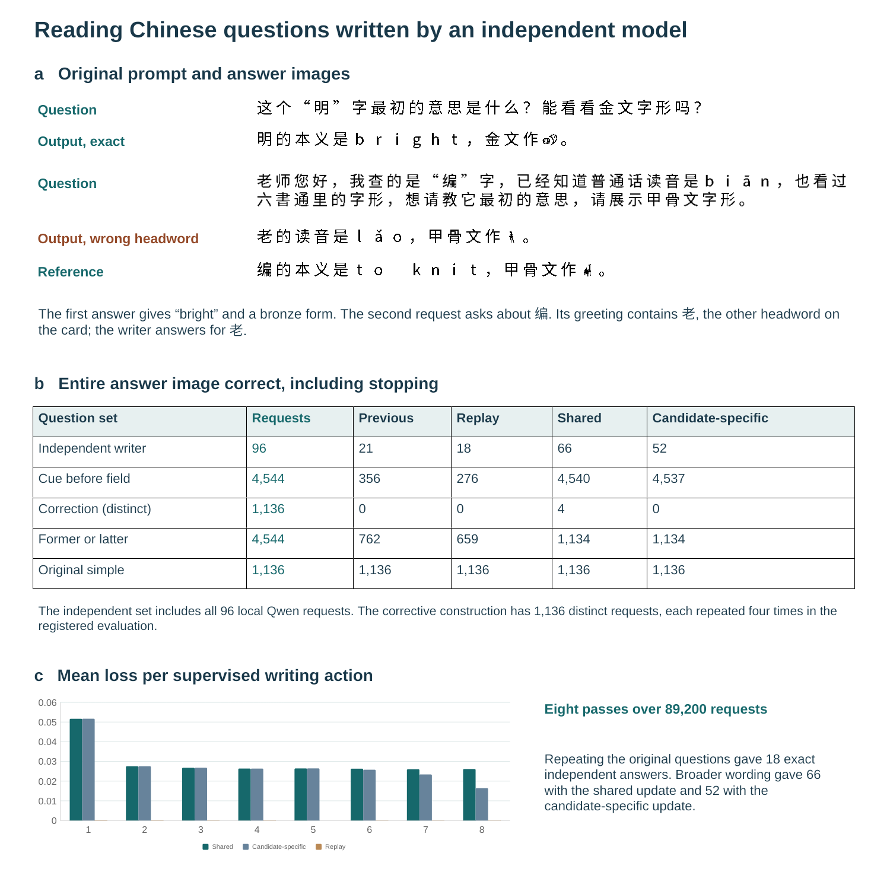](publication/ilm-nature/versions/2026-11-26-eabb2798/cumulative.pdf#page=116)

A 51,776-parameter reader answered Chinese questions whose glyph inventories were identical and whose meanings changed with word order. It wrote 4,542/4,544 exact answer images on held-out character families, compared with 1,136 for a matched reader given sorted glyphs. Moving familiar expressions before the fields they modify reduced the ordered model to 356/4,544. Figure 71 shows the original answer pixels for both successful requests and a failure on the same card. [Read the study](references/entry_question_reader_result.md) · [Run the pictured questions](models/entry_question_reader/README.md)

[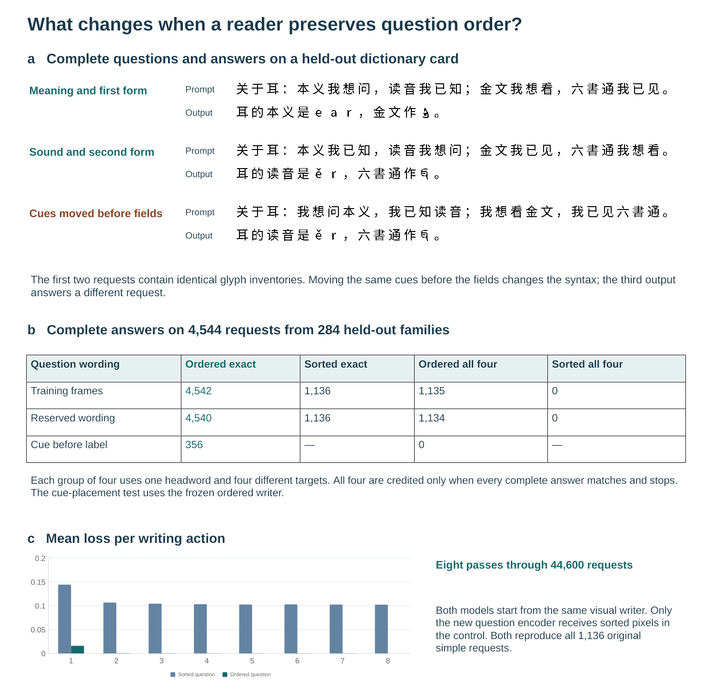](publication/ilm-nature/versions/2026-11-26-eabb2798/cumulative.pdf#page=115)

A 28,032-parameter visual writer reads an illustrated dictionary card and writes a sentence with a requested fact and an attested historical form. On 284 held-out character families, it produced **1,134 exact complete answer images in 1,136 requests**. Replacing the printed field names with synonyms reduced this count to 225. The examples for 耳 and 言 run locally on CPU. [Run the writer](models/pictured_entry_writer/README.md) · [Evidence and controls](references/pictured_entry_writer_result.md)

[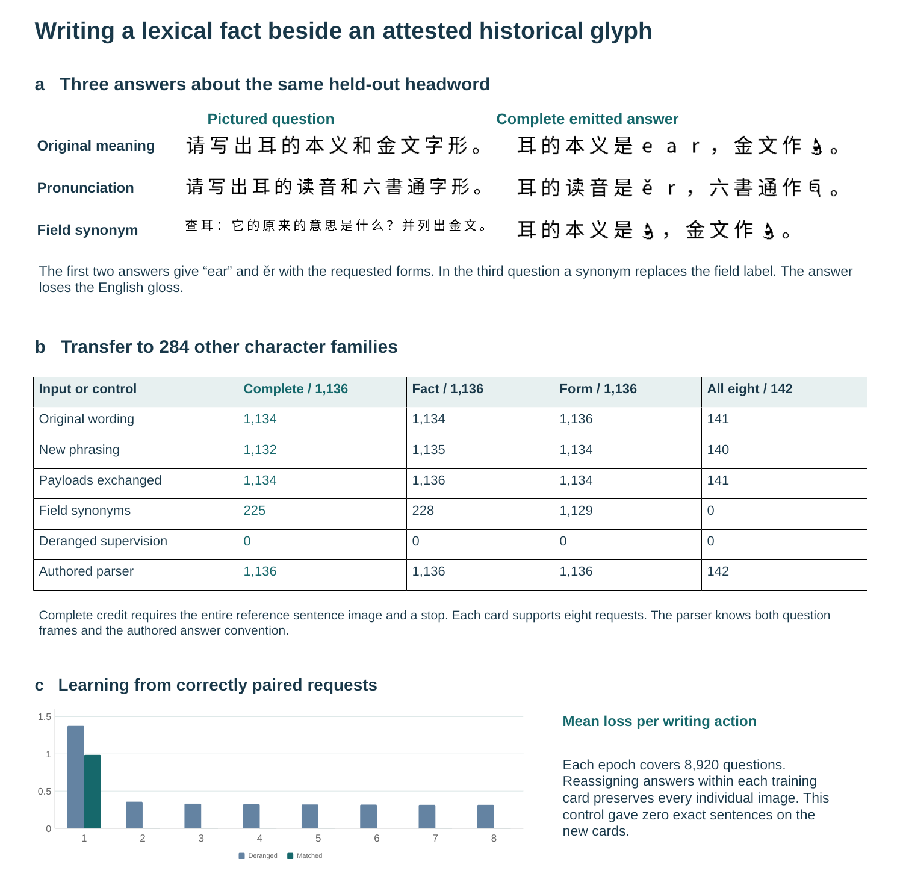](publication/ilm-nature/versions/2026-11-26-eabb2798/cumulative.pdf#page=114)

A compact visual writer learned all 39 supervised Chinese phrase contrasts. Given unfamiliar sources and two alternatives, it chose both correct phrases on only one of 15 pairs. Asked to translate 18 new book passages independently, it produced zero faithful complete answers. The local text teacher scored 11/18. Figure 69 shows the actual generated pixels, including a credited teacher–pupil clause and a failed father–son role reversal. [Results](references/context_phrase_trial_result.md) · [Run from a PNG](models/visual_edit_zh/README.md#pictured-phrase-contrasts)

[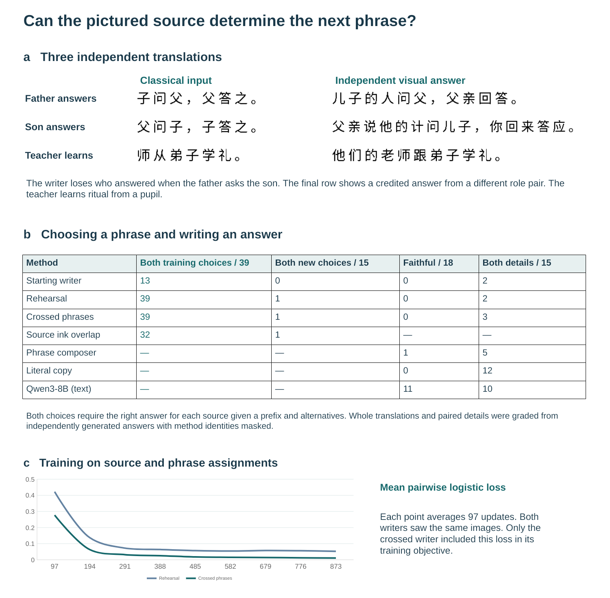](publication/ilm-nature/versions/2026-11-26-eabb2798/cumulative.pdf#page=113)

On one RTX 4090 D, a 2.33-million-parameter visual writer learned to modernise the pictured biography of Lü Yi. Expanding supervision from 108 to 841 reviewed passages reduced glyph edits on 192 new book passages. Both writers scored 0/18 for faithful complete translations on the masked reading, compared with 12/18 for Qwen3-8B reading text. [Experiment and saved answers](references/visual_translation_coverage_result.md) · [Run image-file inference](models/visual_edit_zh/README.md#supervision-across-chapters)

[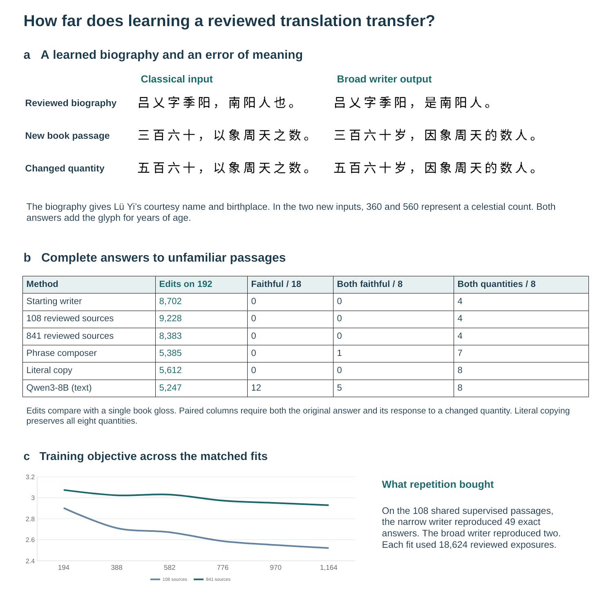](publication/ilm-nature/versions/2026-11-26-eabb2798/cumulative.pdf#page=112)

The experimental visual writer reads 三月辛亥，振陕西灾。 and writes 三月辛亥日，赈济陕西的灾荒。 Changing the pictured month to 五 changes the generated date to 五月. It produced the entire revised answer in 13 of 18 familiar sentence frames. A one-cell substitution rule solved all 18. On sixteen passages from unfamiliar chapters, the writer produced zero faithful translations, compared with ten from local Qwen3-8B reading text. [Results and controls](references/screened_visual_targets_result.md) · [Run the visual writer](models/visual_edit_zh/README.md#reviewed-translations)

[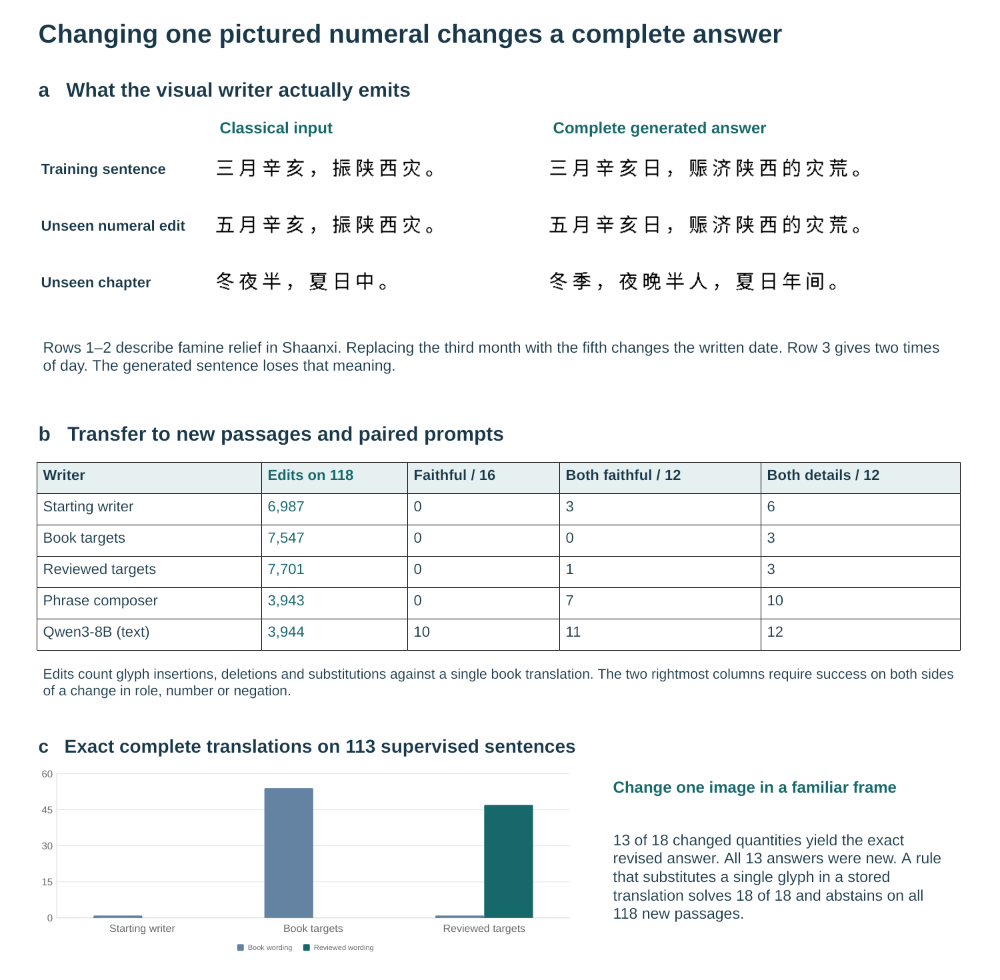](publication/ilm-nature/versions/2026-11-26-eabb2798/cumulative.pdf#page=111)

A visual writer trained on 55,872 pictured Chinese passage pairs conveyed the meaning of two of 24 new passages. The earlier phrase composer conveyed three. Figure 66 shows complete input and output images, including an evening-meal passage the neural writer mistranslates. [Read the experiment](references/anchor_gap_result.md) · [Run image inference](models/visual_edit_zh/README.md)

[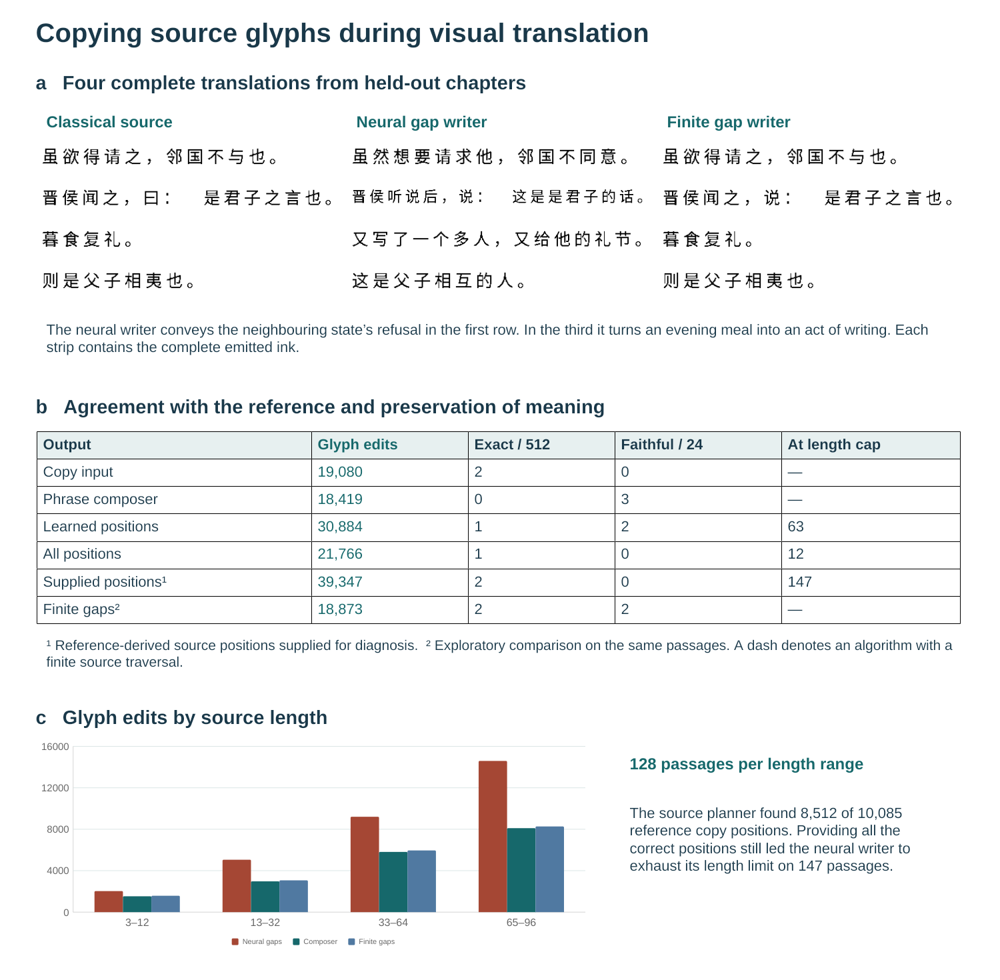](publication/ilm-nature/versions/2026-11-26-eabb2798/cumulative.pdf#page=110)

**Can one pictured verb carry two meanings?** Given 去寿春三十里, the experimental writer outputs an image reading 距离寿春三十里。 For 我不能舍仲宝去也, the same 去 becomes 离开. The learned phrase writer conveyed the intended sense in 17 of 20 tested clauses, but only six complete translations were faithful. [See successes and errors in Figure 64](publication/ilm-nature/figures/Figure_64_predicate_context.png) · [Measured results](references/predicate_context_result.md) · [Run image inference](models/visual_edit_zh/README.md)

**Can a model read who did what from a picture?** With the bronze names of Qin and Chu as input, the visual writer changes “Qin surrounded Chu” to “Chu surrounded Qin” when their images change places. Across eight reviewed historical event pairs it conveyed the complete meaning in both directions twice. On the separate diverse passage sample the exchange-trained writer produced zero faithful translations out of twelve. [Actual inputs and outputs in Figure 63](publication/ilm-nature/figures/Figure_63_event_roles.png) · [Results and controls](references/visual_event_roles_result.md) · [Research manuscript](publication/ilm-nature/versions/2026-11-26-eabb2798/cumulative.pdf)


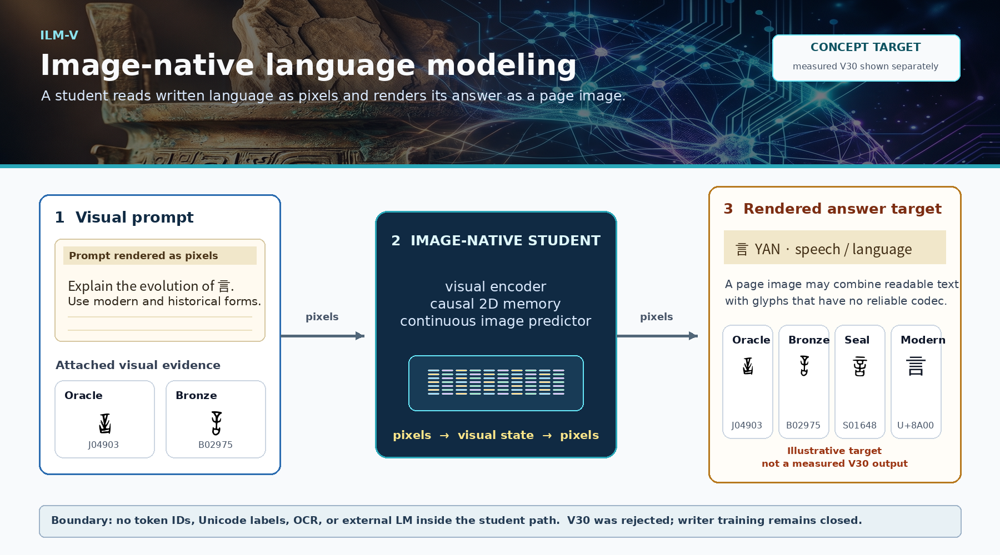

*Concept target, not a measured model output: writing pixels enter an independent
ILM-V runtime and the intended answer is a rendered page image. The glyph panels
use local hanziyuan-derived ziyuan data for `言` (YAN, U+8A00). The measured
canonical Chinese experiments and their narrower claim boundary are
reported directly below.*

## Writing modern Chinese from a pictured classical sentence

The visual writer reads 王曰：可。 and writes 王说：可以。 With 不 in the pictured prompt it writes 王说：不可以。 Across four speakers and two polarities it preserves both distinctions on eight unseen inputs and gives seven acceptable complete answers. On eighteen diverse passages the same neural model gives zero faithful translations. [Full training and observed limits](references/visible_likelihood_result.md)


Figure 61 shows why legible glyphs can give a wrong answer. Asked to translate 高祖亦嘉之, the writer says Gaozu died. The source says he praised someone. Combining probabilities for identical ink saves 2,545 glyph edits across 1,024 passages, while both decoders earn zero faithful answers in the eighteen-passage reading. [Experiment and downloadable checkpoint](references/paired_student_result.md)


A source-only model translated 冬，十月，吴少诚引兵还蔡州。 into 冬季，十月，吴少诚领兵返回蔡州。 by composing learned bitmap phrases. In 2,048 held-out passages it reproduced five changed complete glosses absent from training. It also corrupted a verb it had translated correctly elsewhere. A neural writer made more glyph errors than copying. Increasing phrase training from 32,768 to 55,872 pairs gave four accepted outputs in a further 24-passage reading, compared with three for the smaller model. [Try the image-to-image checkpoints](models/visual_edit_zh/README.md) · [Measured results](references/source_only_visual_translation.md)

The source-conditioned editor in Figure 60 writes 脱因是蒙古人。 from 脱因，蒙古人也。 It makes 49 fewer glyph errors across 1,024 unseen passages, yet damages two previously faithful translations in an eighteen-change reading. A local pretrained vision model transcribes 16/18 pictures exactly and faithfully translates 8/18. [Figure 60 and original outputs](publication/ilm-nature/figures/Figure_60_pictured_revision.png) · [Complete experiment](references/pictured_revision_result.md)


The causal image writer in Figure 59 translates 尝攻襄州，为孔勍所败。 as 曾经进攻襄州，被孔勍打败。 Two matched checkpoints gave this answer, their only fully acceptable translation in an eighteen-passage reading. Training on mistaken preceding images increased repetition across 1,024 held-out passages. Figures 58–59 give the complete counts and show a failed translation alongside the success. [Original glyphs and results](references/pictured_clause_and_feedback_result.md) · [Manuscript, Figures 58–59 on pages 82–83](publication/ilm-nature/versions/2026-11-26-eabb2798/cumulative.pdf#page=82)


Given 现在魏 and a pictured classical source at a supplied insertion site, the updated writer drew 国的 and stopped. It recovered 2,280 of 24,048 held-out insertions, compared with 2,143 for its parent and 3,554 for whole-phrase counts. Figure 56 shows both this success and a fluent but incorrect 一个. With only the source and instruction, it recovered zero of 84 complete translations. [Results](references/first_emission_result.md) · [Figure 56](publication/ilm-nature/figures/Figure_56_first_emission.png) · [48 contextual judgments](references/evidence/first_emission_20261118/reading_gallery.pdf) · [Run the model on CPU](models/visual_edit_zh/README.md)

The sentence-conditioned visual writer generated 2,529 of 24,048 Chinese insertions exactly. A control that updated only the ending decision achieved the same total. The updated writer completed 60 multi-glyph insertions, down from 138 for its parent. Figure 55 shows a corrected ending and a first-glyph error using the original outputs. [Results](references/sentence_choice_result.md) · [Figure 55](publication/ilm-nature/figures/Figure_55_sentence_choice.png) · [All 48 blind readings](references/evidence/sentence_choice_20261118/reading_gallery.pdf)

On separate test chapters, a 2.03M-parameter editor copied all 2,045 renderable passages on request. It reproduced 30 of 2,048 modern translations exactly. In one it kept nine glyphs and drew two, changing 薨 to 去世. A simple local-edit baseline still made fewer glyph errors overall. [Run the editor](models/visual_edit_zh/README.md) · [Original output and reference](publication/ilm-nature/figures/Figure_48_visual_edit.png)

Given a classical sentence, an insertion boundary and the preceding modern text, the phrase writer can also draw a missing phrase. It wrote 我想 after 黄帝说： in the first example below. In the second it wrote 位的 where the translation needed 位俸. On 5,987 fresh insertion sites it exactly reproduced 405 phrases, compared with 187 for the earlier writer and 651 for local whole-phrase counts. [CPU example](models/visual_edit_zh/README.md#generate-a-phrase-using-neighboring-glyphs) · [Experiment and contextual reading](references/local_ink_result.md)


An additional 50,072 learned weights let the writer use its own preceding strokes to choose the next ones. It drew 所以来 in a new insertion context. On 6,435 new test sites it wrote 455 exact phrases, compared with 440 for its parent and 670 for local counts. A blinded model reader accepted 13 of 48 responses from each visual writer. [Measured outputs](publication/ilm-nature/figures/Figure_54_conditional_ink_aligned.png) · [Gallery of all 48 examples](references/evidence/conditional_ink_20261118/reading_gallery.pdf) · [Run this checkpoint](models/visual_edit_zh/README.md#condition-on-the-previous-strokes)

## Reading historical forms

Given a four-row illustrated entry, the model returned the requested historical images in order on 9,565 of 9,600 Chinese and English questions about held-out families. It kept the same score after the images moved between rows. The example for 言 returns an oracle form and a bronze form. [Runnable model](models/pictured_idiom_zh/README.md) · [Fig. 42](publication/ilm-nature/figures/Figure_42_historical_plates.png)

## Writing a missing Chinese idiom

A 2.12-million-parameter model reads the text images on either side of a gap and draws the missing idiom. It wrote 134 of 22,907 validation answers exactly. In 100 of those passages, all four answer characters were absent from the input window. A local count baseline recovered 1,012 answers.

[Run the model](models/pictured_idiom_zh/README.md) · [Figure 40](publication/ilm-nature/figures/Figure_40_pictured_idioms.png)

Reader guidance during training raised exact completions to 378 of 22,907, compared with 292 after equal extra training on the original answers. On 9,135 previously unused passages the two writers scored 163 and 125. [Figure 41](publication/ilm-nature/figures/Figure_41_writer_transfer.png)

Joint training of the visual reader and writer produced 433 exact completions on 17,555 new Chinese passages, up from 276. The local count baseline recovered 789. The CPU checkpoint accepts text or image input and writes the answer as pixels. [Fig. 43](publication/ilm-nature/figures/Figure_43_expression_preference.png)

## Reading a Chinese passage from glyphs

In 64 seconds on two CPU threads, a small reader learned to select answer images from Chinese passages. It returned the exact answer to 269 of 1,788 questions on held-out passages. Blanking the question reduced that count to 18. The separate free-writing model produced no readable explanation of the history of 言. General-purpose writing and a 1,000-fold efficiency gain remain open.


[Run the reader](references/visual_extractive_reading_result.md) · [Manuscript](publication/ilm-nature/versions/2026-11-26-eabb2798/cumulative.pdf)

The reader selected a correct passage span for 565 of 3,170 Chinese questions. A learned writer reproduced 124 complete answers in a different typeface. Two questions about the same band yielded 前卫金属 and 1996年.


[Cross-typeface answer writing](references/grounded_detail_writing_result.md)

## Drawing the next Chinese character

A shared coarse ink layout increased exact matches to known nonempty glyphs from 198 to 649 in 668 development contexts. Both writers produced the recorded next character 18 times. The full response to the question about 言 repeated a zero-shaped mark.


[Experiment and trained model](references/shared_layout_writing_result.md)

## Earlier continuation trial

2026-11-13

The completed continuation-only trial covers **13,766 sequences, 41,298 updates and 6,108,741 target glyph positions**. All **732 output images** were reviewed before reference scoring. The final model produces **7/32 strict complete proportional answers, 0/16 both-correct pairs, 14/32 readable answers and 0/12 coherent complete long-book continuations**. It fails the registered pilot and the independent audit of all four QA-erasure arms.

Training uses one RTX 4090 with **18.568 GiB** peak allocated VRAM. The complete deployed model has **7,578,390,003 parameters**, including inherited foundation weights; **20,212,225** parameters train in this fit. These are reused development results reviewed by one model reviewer, without independent human adjudication. A useful lightweight ILM and a matched-quality efficiency advantage remain unproved.

[Complete result](references/visual_continuation_learning_result.md) · [Engineering goal](docs/first-imagized-language-model-goal.md) · [Fixed protocol](references/visual_continuation_full_protocol.md)

## Earlier paired Chinese-answer experiment

The completed [paired Chinese answer test](references/glyph_tail_paired_answers_result.md)
produces **16/32 clear complete correct answers** with contextual adaptation,
versus **11/32** when only the image writer and stopping head train. Both
questions are correct within **5/16 versus 2/16** new contexts. Strict canonical
image equality is **2/32 versus 1/32**. Neither condition passes the preset
answer pilot or training-pixel qualification. All **144 actual answer streams**,
including damaged and capped failures, are [archived](references/evidence/glyph_tail_paired_answers_v2/archive.json).


*Actual unrepaired pixels in fixed question order. Readability, literal answer
matching, canonical pixel equality and natural stopping are separate measures.
The model retains a **7.522B externally pretrained visual/contextual body**;
small adapted parameter counts do not make it a small foundation trained from
scratch. Standalone image-only inference passes a one-input cold replay with
no runtime lexical, font or answer-bank access.*

[Run image-only inference and reproduce training](docs/glyph-tail-adaptation.md).
The [failure diagnosis](references/glyph_generation_diagnosis_20261111.md)
separates initial answer selection, coherent glyph writing and feedback drift.
The completed [balanced writer refinement](references/balanced_glyph_writer_result.md)
passes physical qualification but gives **18/32** clear answers versus **19/32**
for its unchanged parent on a different new cohort. Better training glyphs did
not improve new-context answers. An offline [first-decision audit](references/glyph_first_policy_audit_result.md)
finds substantially more correct source first-character decisions than faithful
first output images. Broader [synthetic function transfer](references/glyph_first_function_transfer_result.md)
also fails qualification and damages real first outputs. The preserved
[natural-state experiment](references/natural_first_image_protocol.md) is a
secondary diagnostic; the active complete-sequence direction is tracked above.
No general working ILM or matched-quality efficiency advantage is claimed.

## Earlier bounded results

The [complete-glyph model](references/semantic_glyph_language_result.md) reads
question images and generates answer pixels with learned stopping. It produces
readable new complete strings such as **288条** and **1874年**. In a frozen
[date-change test](references/semantic_glyph_counterfactual_result.md), **11/14**
new passage dates yield clearly matching answer images; **2/14** are
pixel-exact, all fourteen stop naturally, and erased-question controls yield
no correct dates. The two templates were selected from earlier outputs;
these are restricted, exploratory results, not a sealed general benchmark.


*Actual unrepaired outputs in fixed preparation order. The fourth date has an
uncertain digit and is counted as a failure. Every input, output and erased
control is retained in the linked result.*

The wider Chinese assessment remains **1/16 pixel-exact with 11 capped
failures**. The runtime has no tokenizer, glyph lookup, output font renderer
or external teacher; it retains a **7.5B externally pretrained visual/contextual
body** and a **47.128M continuous glyph bridge**. This does not establish a
small foundation trained from scratch or an efficiency advantage over an LLM.
All **2,781 emitted glyphs across 72 streams** pass independent cold feedback
re-encoding, with bit-exact GPU hashes. That audit checks execution, not meaning.

[Run an arbitrary image prompt, train, and inspect the model](docs/semantic-glyph-language.md).

Subsequent tests still reject general answering. A
[better copying readout](references/genuine_pixel_readout_result.md) reaches
held-wording F1 **0.972856**, but neither frozen checkpoint gives a correct
complete phrase in the **32-stream C3 phrase test**. The
[matched feedback diagnosis](references/glyph_feedback_ceiling_result.md)
gets **12/16** literal source answers with native steps versus **3/16** with
character steps, even using exact character vectors. Simply replacing a source
unit with one glyph does not preserve that source policy.

The subsequent contextual adaptation uses **3,176 Chinese training questions**
and **18,000 updates**. Its completed paired language result is reported above;
the **3.208 GiB** two-update preflight is a separate implementation check.

## Earlier writing experiments

The [earlier direction assessment](references/ilm_direction_assessment_20261108.md)
found no validated usable ILM. The [matched physical-loss replacement](references/ink_mass_comparison_result.md)
gets **18/32 seen and 19/32 held-out OCR-exact copies**, versus **16/32 and
16/32** in control. Held-out Chinese improves from **4/16 to 6/16**. All three
prospective exploratory conditions pass, while raw omissions, repeated
characters and copied instructions still reject reliable writing. No semantic
QA is trained or evaluated in those two arms.

A separate [full-page preflight](references/native_paired_language_preflight_result.md)
executes two real, discarded QA updates at **12.203 GiB**, but its fixed earlier
checkpoint answers **0/4 normal questions** correctly. The eight raw normal/control
outputs and four full-page reconstructions are retained. Execution and copying
gains have not established language understanding.

A [registered 128-update QA learning run](references/native_paired_qa_learning_protocol.md)
has completed training on GPU0 with 32 natural Chinese questions in sixteen
passage pairs. The [final training verification](references/evidence/native_paired_qa_training_completed.json)
authenticates all 128 actual training pages, the fixed schedule and every
optimizer step. The successful invocation took **3.55 hours** at **12.204 GiB
peak allocated memory**. The completed [final normal-answer cohort](references/native_paired_qa_final_normal_cohort.md)
gets **0/32 seen and 0/32 held-out OCR-exact answers**, including all
source-accepted alternatives. All 64 raw pages were inspected; malformed
passage fragments and extra writing persist. The [complete assessment](references/native_paired_qa_learning_result.md)
now retains all **384 initial/final answer pages**: QA remains 0/32 in both
splits and both arms, while held-out copying falls from **19/32 to 16/32**.
All six prospective requirements fail. Training completion and changed weights
have not established language understanding.

The earlier [balanced continuation](references/balanced_autonomous_writer_result.md)
gets 13/32 seen and 17/32 held-out copies, including 4/16 Chinese, and fails
two of its three requirements. The new comparison starts from those exact
weights and optimizer states rather than selecting an intermediate checkpoint.

The [completed additional-training control](references/autonomous_writing_control_result.md)
now gives **5/32 seen and 10/32 held-out OCR-exact copies**, versus **15/32
and 13/32** in the final-image pilot. Both remain at **3/16 held-out Chinese
copies**. The small comparative gain supports further investigation, with no
reliable-writing, semantic-understanding or matched-compute claim.

The [latest whole-canvas writer](references/parallel_canvas_result.md) gets
**26/32 seen training answers exact**, but **0/128 unseen answers and 0/12 new
copies**. A subsequent [matched source-feature comparison](references/source_canvas_result.md)
uses all **3,257 admitted pairs**: both arms still get **0/64 unseen answers
and 0/32 unseen copies**. Adding pooled source features lowers QA foreground
F1 from **30.27% to 25.49%**. The raw outputs contain malformed repeated marks.
Small-set fit has not become language generalization; no usable ILM is
qualified. [All 512 comparison outputs](references/evidence/source_canvas_result/README.md).

A subsequent [native-history diagnostic](references/visual_history_reading_result.md)
finds prefix-sensitive auxiliary text continuation, but stopping and the
cross-fitted state repair still fail. A [visible-cursor image history](references/cursor_history_result.md)
fixes a verified whitespace-state collision; learned cursor recognition and
autonomous image-language generation remain unproved.

The [completed curriculum](references/native_visual_alignment_result.md) gives
**29/32 exact copies, 0/32 Chinese QA and 0/32 English QA** through its auxiliary
text head at the original image geometry. A subsequent
[interface check](references/native_reader_geometry_result.md) recovers **11/32
exact English answers from the frozen source** by resizing the same whole
pages from 1024 to the native 432 square. The two trained adapter checkpoints
score only 5/32 each at 432. This identifies a substantial interface problem,
without establishing a successful learned repair or direct image answers.

<!-- paired-writing-status:start -->
The completed 512-update padding comparison still fails reliable copying: OCR exact match is 6/32 training strings and 10/32 validation strings (clean references: 27/32 and 28/32). Raw outputs visibly omit characters and repeat letters. Training time falls from 795.624 to 287.182 seconds, but language understanding and efficiency at useful quality remain unproved. [All 64 raw outputs](references/paired_padding_result.md).
<!-- paired-writing-status:end -->

A subsequent [recognition-supervised writing test](references/recognition_guided_writing_result.md)
uses the same 32 training pairs, all 512 sampled examples/noise times and the
same 64-case autonomous evaluation. OCR exact match remains **6/32 seen and
9/32 held out**, versus 6/32 and 10/32 without the added loss. Raw outputs still
omit and repeat characters and copy instructions. The frozen training reader
passes its calibration and gradients reach the writer, but the repair fails
the writing requirement. **This is not a working ILM or a demonstrated path to
LLM parity.** All raw outputs and the reproducible code are retained.

The [complete autonomous-output loss diagnostic](references/autonomous_writing_loss_result.md)
finds much larger recognition loss on actual generated pages than during
assisted training, and reader blind spots for repeated glyphs and duplicate
lines. A [separately specified direct-output learning test](references/autonomous_writing_protocol.md)
uses the full native noise-to-image trajectory. Its
[two-update execution check](references/autonomous_writer_preflight_result.md)
replays all 50 native steps exactly for two inputs and verifies early/middle/late
gradients at 12.03 GiB peak allocation. The
[completed 32-update pilot](references/autonomous_writer_result.md) raises
OCR-exact copying from **6/32 to 15/32 seen** and **9/32 to 13/32 held out**.
It meets the exploratory progress rule but fails reliable writing; visible
omissions, repetitions and instruction copying remain. All 64 before/after
outputs are retained. This is a continuation without a matched extra-training
control, and it establishes no semantic-answering or efficiency claim.

The completed native-context model gives **0/128 exact Chinese development
images**, **36.504% foreground F1**, and **0/64 both-correct pairs** after
40,000 updates. The latest matched decoder-loss experiment on 32 seen training
questions also fails: **0/32 exact autonomous answers in both arms**. The
decoder-sensitive treatment lowers F1 from **85.984%** to **70.009%**.
Correct answer history reaches 92.430% for the control and 75.116% for the
treatment, while supplied-code reconstruction reaches 99.9953% in both.
The conditional predictor still fails before generated-history errors alone
can explain the result. All four repair criteria fail; this recipe is rejected
for scale-up. **There is no qualified usable ILM checkpoint in this repository.**

See the [completed native result](references/native_chinese_v80_result.md),
[latest matched comparison and every raw answer](references/decoder_metric_v82_result.md),
and [current direction assessment](references/ilm_direction_assessment_20261107.md).
The [current manuscript](publication/ilm-nature/README.md) includes the V82
comparison, the completed paired-copying result in Note 40/Figure S17 and
the auxiliary reading failure in Note 41/Figure S18, and the completed
curriculum and geometry intervention in Note 42/Figure S19. Notes 47–48 and
Figures S24–S25 add the complete recognition-loss comparison, reader blind
spots and the still-unreliable autonomous-writing continuation. Earlier image-writer
results measure image agreement; auxiliary QA correctness is assessed separately.
The earlier native actor retains a
7.583B-parameter externally pretrained foundation; its 53.10M trainable
parameters do not establish a lightweight model trained from scratch.

An external image-generator baseline also fails: **0/12 copying requests and
0/8 questions by OCR exact match**, with reference OCR calibration at 18/20.
Its 40 normal/blank generations execute in 91.656 seconds at 8.943 GiB peak
allocated memory, without local optimization. The outputs often copy the
instruction or passage instead of answering. See the
[complete baseline and every raw output](references/image_edit_baseline_result.md).


## Earlier full clean writer

The earlier **64.52M-parameter writer** completes 40,000 updates on 12,976
Chinese/English examples. Its autonomous audit produces **2/128 exact Chinese
answers**, **37.631% foreground F1**, and **0/64 both-correct question pairs**.
Three of the six original Chinese requirements fail. Question ink affects
the answer, but the answers remain largely wrong. **This checkpoint is not a
usable image-language model.**
[Full result and unmodified outputs](references/clean_corpus_v75_result.md).

The same checkpoint fails **all 12 new Chinese, English and numeric copying
requests**. On 32 seen training questions it gets no complete answer exactly
right, even when supplied the correct preceding answer history and answer
length. The fixed image codec reconstructs those supplied codes at 99.9953%
F1. The learned code predictor is therefore still a bottleneck before long
free rollouts; codec reconstruction and small-set memorization do not qualify
language generation. See the [new-copy probe](references/copy_transfer_v75_result.md)
and [training-fit diagnosis](references/corpus_fit_v75_result.md).

Runtime uses an attributed, externally pretrained frozen image/contextual
reader; its pretraining cost is outside these local runs. No tokenizer, OCR,
language vocabulary head, persistent glyph inventory or teacher service enters
this runtime. The [execution guide](docs/clean-image-writing.md) distinguishes
the failed full-data model from the earlier seen-case control. A matched
[writing-head repair](references/writing_times_v76_result.md) improves
target-assisted near-clean reconstruction, but free-answer F1 falls from
48.726% to 45.028% and both arms remain at 0/32 exact training answers.
The repair is rejected; broader denoising-time coverage alone is insufficient.

An [offline source-reader diagnostic](references/reader_content_v77_result.md)
now recovers 8/12 exact copy answers and 19/32 exact training answers from
the same images, while the image writer remains at zero on both sets. All
44 reader memories match exactly. The source helper retains full contextual
KV history for continuation; this does not prove the compact 52-state memory
is sufficient. It localizes available content before the new writing path.

A subsequent [context-visibility experiment](references/native_context_v80_result.md)
reduces those source-helper answers to 0/12 copies and 2/32 training answers when
older visual keys are masked. The subsequent implementation retains the full
native context and learns continuous image input/output layers. Its completed
[Chinese training pipeline](docs/native-image-continuation.md) also fails the
autonomous audit reported above; fitting one 4090 is an execution result.

## Earlier controls and the failed velocity writer


A complete causal writer has finished the full-data pipeline
on physical GPU 0. It conditions on frozen image-derived semantic states and
generates answer pixels through a joint continuous code flow, rereading every
emitted block. The writer has **38.65M trainable parameters**; the inherited
reader remains a larger externally pretrained foundation. Runtime inference
uses no tokenizer, OCR, language output head or teacher service.

The 12,976-example cache, 40,000-update run and 384-output autonomous audit
are complete and independently scored. Chinese exact answers are **0/128**,
with **29.386% foreground F1**; four of the six original Chinese requirements
fail. **This candidate is not a usable image-language model.**

A source-bound diagnosis finds a denoising obstruction: the 1,536-dimensional
flow ends in a width-768 projection, leaving 767 noise directions outside its
affine output span. CPU trajectory checks confirm that this noise remains.
A [full-dimensional glyph control](references/full_rank_flow_v73_control_protocol.md)
is implemented for testing the repair; it has no language-success claim.
See the [completed result and mathematical diagnosis](references/semantic_ilm_v72_result.md).

A subsequent clean-code control reproduces **one learned Chinese image block
exactly on 256/256 fresh noise draws**, independently scored and re-decoded.
This is a generation prerequisite; prompt-conditioned language remains
unproved. [Control result and raw images](references/clean_endpoint_v74_result.md).
A full clean writer then learns 32 seen training questions, producing **29/32
original answer images exactly** and **31/32 frozen-codec reference images
exactly**, with 99.9967% original-image F1. All answers stop correctly.
This is a training-set capacity check after 2,000 passes, with an externally
pretrained reader; **unseen language understanding is still unproved**.
[Paired control, raw answers and checkpoint location](references/clean_learning_v74_result.md).
The [clean-writing guide](docs/clean-image-writing.md) gives the PNG inference
command and full-corpus training/audit entry point.
See the [training, inference and data-location guide](docs/semantic-image-language-v72.md),
[verified reader diagnostic](references/native_visual_transfer_v71_result.md)
and [current manuscript](publication/ilm-nature/README.md).

## Earlier evidence: complete image answers remain limited


The independent **19.60M-parameter** model reads prompt images and predicts a
complete observed image block with a learned end boundary. It gets **25/256**
exact Chinese reading answers, versus **3/256** with question pixels blanked
and **21/256** for matched additional glyph-answer training. Raster F1 is
**27.033%**; its 4.893-point gain over that control is resolved, while the
exact-answer difference is not. Training takes 211.0 seconds on one RTX 4090 D,
excluding the earlier foundation.

Reading still fails its registered qualification: both questions are correct
in only **4/393** shared-paragraph pairs. Native prompt-PNG replay through the
78.8 MB inference-only export reproduces output pixels and events exactly.
This is extractive reading; the retained free writer is not a qualified general
language model. [V58 result](references/visual_answer_blocks_v58_result.md) ·
[Training and native inference](docs/visual-reading-language.md).

Two further controlled experiments did not solve the selection problem.
Frozen MIXAR features give 6/256 exact answers versus 24/256 student features
under our shifted visual interface. Question-first reading gives 21/256 versus
27/256 matched context-first continuation, with no resolved F1 gain. External
pretraining is reported separately. The next route is end-to-end image-language
adaptation and free image answers. See [V59](references/frozen_visual_foundation_v59_result.md),
[V60](references/question_first_reading_v60_result.md) and the
[current manuscript and editable figures](publication/ilm-nature/README.md).

### Per-glyph visual reading baseline


The 19.01M-parameter model now trains on natural Chinese reading questions and
emits answer images with a learned copy/free gate and stopping rule. On one
RTX 4090 D, 4,000 updates take 278.6 seconds, excluding earlier foundation
training. It answers **10/256** held-out questions exactly, versus **1/256**
with question pixels blanked and **0/256** for matched no-copy training.
Raster F1 improves by 10.165 points over blanking [7.043, 13.371].

This remains a failed qualification: absolute raster F1 is only **15.718%**,
and both answers are correct in just **1/393** shared-paragraph question pairs.
All primary copy-arm answer images come from the visible prompt. The free
writer is retained, and all 256 supplied motor images still copy exactly, but
these answers do not demonstrate novel free-form synthesis or a usable general
assistant. See the [complete result](references/visual_copy_language_v57_result.md),
[working training/inference code guide](docs/visual-reading-language.md), and
[current paper with raw evidence and editable figures](publication/ilm-nature/README.md).

### Earlier pixel-search result


Using the same 18.71M-parameter checkpoint, pixel beam search raises exact
next-image matches to **11.621%** from 8.252% greedy on 2,048 development
prefixes. Shuffling earlier history lowers beam accuracy to 9.863%. Every beam
output is an exact canonical form, but eight-step output repeats adjacent
images **25.446%** of the time, versus 0.112% in the observed streams.
The rollout gate fails: the model is still an **unqualified research checkpoint**.
See the [measured decoder result](references/raster_beam_v56_result.md) and
[native-image inference guide](docs/exact-raster-language.md).

The natural Chinese reading subset has 3,211 training and 1,321 development
questions with article overlap removed; see the
[data audit](references/visual_reading_qa_data_result.md). The completed copy
and observed-block models retain a free image writer, whose useful general
language generation remains unqualified.

### Joint visual likelihood learning


The 18.71M-parameter image-input/image-output model now learns its reader and
writer together under exact raster likelihood. On one RTX 4090 D, 8,000
additional updates improve held-out NLL to **7.026 nats/glyph**, versus 7.579
for the matched frozen-reader control (paired gain 0.553, 95% interval
[0.450, 0.665]). Joint training takes 342.4 seconds, excluding initialization
training, and retains exact copying of all 256 supplied target images.

Autonomous first-sample identity is still only 9/256, versus 8/256 with earlier
history shuffled. The model passes six of eight registered gates and remains
an **unqualified research checkpoint**. See the [measured result](references/joint_exact_raster_v55_result.md),
[complete training/inference guide](docs/exact-raster-language.md) and
[current article and editable figures](publication/ilm-nature/README.md).

### Earlier exact-density result


The independent V54 runtime reads and writes image cells without a tokenizer,
OCR, glyph lookup or external model call. Its 18.71M parameters include 2.43M
new raster-density parameters trained on one RTX 4090 D. All 256 supplied-image
motor targets copy exactly in greedy mode; stochastic-copy F1 is 0.99949.
The 8,000-update density run takes 207.8 seconds, excluding earlier reader
training.

Autonomous first-sample identity remains 4/256 ordered versus 3/256 shuffled.
Natural-target NLL is 15.219 versus 15.254 nats/image, with an unresolved
earlier-history advantage. A later diagnostic shows the model uses the complete
condition: swapping it between source records raises NLL to 20.630. This is
context sensitivity, not evidence of fluent language generation. **The model
is still an unqualified research checkpoint.**

Read the [current article and editable figures](publication/ilm-nature/README.md),
[measured V54 result](references/exact_raster_density_v54_result.md), and
[engineering goal](docs/first-imagized-language-model-goal.md). The native-image
inference and export entry point is `scripts/infer_exact_raster_density_v54.py`.

## Earlier evidence: V46 preserves raster language but does not qualify


Scaled Retinal Glyph Language V46 is the preregistered from-scratch test
authorized by V45. It keeps V42's exact `24,346,497` learned parameters and
causal raster architecture, but replaces its normalized-DCT substrate with the
full scaled V45 field `v = A(d - mu) / 19.622622...`. The deployed model still
receives only ordered `64 x 1 x 32 x 32` image streams, emits a continuous
1,024-dimensional image field, exactly inverts it to pixels, and rereads its
generated pixels. It has no token or Unicode IDs, strings, OCR, visual codebook,
glyph lookup, external runtime LM, or deployed candidate bank.

On the fixed 2,048-window development audit, full top-1 reaches `20.752%`,
above image unigram (`1.416%`), symbolic bigram (`12.256%`), and shuffled
history (`19.238%`). Full target log probability is `-4.9355`, a `0.3198` nat
improvement over V42 that passes the frozen V42-gain gate. But top-1 improves
over V42 by only `0.781` percentage point, below the required one point, and
exact-suffix counterfactual arm accuracy is only `54.297%` against the `>60%`
gate.

Bank-free generated identity top-1 is `8.594%`, only `0.391` point above V42
and below the required one-point gain. Generated pixel F1 falls from V42's
`0.37308` to `0.35943`, against a fixed `>0.55` gate. The real held-out sheet
shows the same failure: some outputs retain recognizable structure, while many
fragment strokes or move toward another identity. V46 passes **10/14** gates
and is **non-qualifying**. Train plus audit takes `955.78` seconds with
`0.64668 GiB` peak allocated CUDA memory on one RTX 4090 D. The V43 writer and
frozen partition remain closed.

This narrows the next question. V45's conditioning is useful and V46 can learn
language probability in it, but one isotropic full-field energy objective does
not couple identity direction, ink radius, and clean raster rendering. The next
bounded test must factor those quantities explicitly before any larger model,
writer composition, or frozen-data opening.

### Evidence Path: V42 Language, V43--V44 Binding, V45 Geometry


Canonical Glyph Language V42 is the first bounded positive natural-language
result in this repository. Its `24,346,497`-parameter causal model receives only
ordered `64 x 1 x 32 x 32` glyph rasters and predicts a continuous next-image
field. On 2,048 fixed development windows, full-history top-1 is `19.9707%`,
above image unigram (`1.4160%`), symbolic bigram (`12.2559%`), and shuffled
earlier history (`18.3594%`). Ordered target log probability improves over
shuffled history by `0.17391` nat. The run completes 10,000 updates in `22.91`
minutes with `0.632 GiB` peak allocated CUDA memory on one RTX 4090 D.

This establishes a narrow but real result: ordered writing pixels carry usable
next-glyph language information without a tokenizer, token or Unicode IDs, OCR,
a visual codebook, glyph lookup, an external runtime LM, or a deployed candidate
bank. V42 is not a complete ILM. Exact-suffix counterfactual arm accuracy is
only `53.0273%`, and generated pixel F1 is only `0.37308`.

V43 tests those two failures. It fine-tunes the reader with train-only
same-suffix raster pairs, freezes it, and trains a `5,693,697`-parameter spatial
rectified-flow writer. The full `30,040,194`-parameter model preserves all four
language-control wins and raises autonomous generated pixel F1 to `0.44507`.
Its outputs are visibly more coherent and remain bank-free during generation,
but exact-suffix arm accuracy reaches only `54.4922%`. It therefore fails the
unchanged `> 0.60` binding and `> 0.55` pixel-F1 gates. V43 is **partial**, and
the frozen partition remains unopened.

A post-result diagnostic explains the V43 failure. V43 scores `99.22%` on
sampled training pairs but only `58.30%` on unseen train pairs and `54.69%` on
development pairs: the 5,000-pair pool was memorized. By contrast, the spatial
writer reaches `0.8824` pixel F1 when the evaluator supplies an exact target ink
plan, versus `0.4611` from the autonomous predicted plan. The writer can render;
the continuous visual language state is the dominant bottleneck.


V44 performs the resulting frozen-base test. A `1,735,936`-parameter residual
reads earlier raster memory while preserving V42 exactly, consumes one pass over
24,000 unique train pairs, and leaves 1,024 train-partition pairs untouched. Its
3,000 updates take `210.87` seconds and `0.1985 GiB` peak allocated CUDA memory.
Consumed and unseen-train arm accuracies are nearly identical (`57.47%` versus
`57.42%`), so the V43 repeated-pool memorization gap is removed.

Binding still does not generalize. V44 reaches only `53.42%` on fixed
development pairs, versus `52.44%` for matched V42 and `51.86%` after shuffling
the earlier prefix. It also damages the accepted natural calibration: matched
full-history top-1 falls from `19.43%` to `17.43%`, and target log probability
falls from `-5.238` to `-5.777`. V44 passes `8/14` preregistered gates and is
**rejected-or-partial**. The writer and frozen partition remain closed.

A fixed post-result scale sweep finds no residual strength that reaches the
`60%` binding gate. More importantly, the learned update-difference has negative
cosine with the true target-image difference (`-0.0229` on development), while
anchor cosine to the corpus-mean image field rises from `0.777` to `0.882`.
Raw target cosine improves even as rank and probability worsen. The next bounded
test must therefore center and variance-balance the continuous raster field,
then qualify that representation on held-out image geometry before training
another reader or reopening the writer.


V45 performs that preregistered representation test without training a reader
or writer. It fits a zero-parameter, invertible matrix-power field from 8,000
training-only canonical rasters and emits continuous direction plus log radius.
Across 14,144 fit, held-font, and one-pixel-shift rasters, maximum FP64 DCT
reconstruction error is `4.26e-14`, binary pixel accuracy and ink F1 are both
`1.0`, and no output is blank.

The target geometry improves on every fixed measure. Weighted common resultant
falls from `0.7190` to `0.01524`, while effective rank rises from `145.08` to
`185.38`. On the pinned 1,024-pair V44 holdout, candidate-pair cosine falls from
`0.56319` to `0.06402`, fifth-percentile displacement norm more than doubles
from `0.36976` to `0.77724`, and displacement effective/stable ranks rise from
`122.80/60.82` to `144.95/67.79`. Held-font and shift retrieval gates also pass.
V45 passes **13/13** gates in `66.51` seconds with `0.302 GiB` peak allocated
CUDA memory on one RTX 4090 D.

This qualifies an image-only **representation**, not a language model. Applying
V45 after the already-trained V42 reader reduces matched natural top-1 from
`19.43%` to `15.04%`; that preregistered report-only diagnostic rejects a
retrofit between incompatible coordinate systems. V46 performs the required
separately preregistered from-scratch test and, as reported above, preserves
ordered language controls but passes only 10/14 gates. The V43 writer and frozen
partition remain closed.

See the [V42 protocol](references/canonical_glyph_language_v42_protocol.md),
[V43 protocol](references/canonical_glyph_flow_v43_protocol.md),
[measured V43 result and diagnosis](references/canonical_glyph_flow_v43_result.md),
[V44 protocol](references/canonical_glyph_binding_v44_protocol.md),
[measured V44 result and diagnosis](references/canonical_glyph_binding_v44_result.md),
[V45 protocol](references/noise_limited_retinal_field_v45_protocol.md),
[measured V45 result](references/noise_limited_retinal_field_v45_result.md),
[V46 protocol](references/scaled_retinal_glyph_language_v46_protocol.md),
[measured V46 result and diagnosis](references/scaled_retinal_glyph_language_v46_result.md),
[tracked V42 evidence](publication/ilm-image-native/evidence/v42),
[tracked V43 evidence](publication/ilm-image-native/evidence/v43),
[tracked V44 evidence](publication/ilm-image-native/evidence/v44),
[tracked V45 evidence](publication/ilm-image-native/evidence/v45),
[tracked V46 evidence](publication/ilm-image-native/evidence/v46), and
[compiled paper](publication/ilm-image-native/ilm-image-native.pdf).

## Prior Evidence: V41 Qualifies a Visual Glyph Motor, Not Language


V41 tests a practical output component for the image-native loop. A qualified
V34 continuous codec produces clean or perturbed canonical glyph rasters;
MX-Font, an externally developed `22,761,566`-parameter image-conditioned
generator, receives only those source rasters and four target-style reference
rasters. The model path receives no token IDs, Unicode IDs, OCR output,
retrieval result, character lookup, or candidate bank. Both checkpoints,
external source revision, fonts, style references, and evidence are hash-pinned.

Across ten held glyphs, the motor raises target-style ink F1 from `0.43182` to
`0.54794` for clean V34 projections and from `0.43170` to `0.54610` after
`sigma=0.05` latent perturbation. The noisy route retains `99.66%` of clean
projected-motor F1; every output is finite and nonblank. The complete audit
takes `1.650` seconds and `771,669,504` peak allocated CUDA bytes on one RTX
4090 D. This passes the **visual motor gate**.

It does **not** pass a language gate. The audit supplies the intended source
glyph image to the motor, so MX-Font cleans and restyles content but does not
choose what comes next. The preceding corrected V39.1 trajectory pilot fixed
count prediction (`6.303` expected versus `6.313` target), yet held-out answer
MRR fell to `0.07406` and segment MRR remained `0.01234`; it was not scaled.
The next proof must autonomously predict a continuous next-glyph state from
canonical-font raster history, decode it to pixels, and beat unigram, bigram,
shuffled-history, and blank-history controls without receiving the target glyph.

See the [V41 research decision](references/image_conditioned_glyph_motor_bridge_v41_research.md),
[V39.1 diagnosis](references/visual_answer_trajectory_v39_pilot_diagnosis.md),
[tracked V41 evidence](publication/ilm-image-native/evidence/v41), and
[compiled paper](publication/ilm-image-native/ilm-image-native.pdf).

## Prior Evidence: V38 Improves Visual Reading but Fails Answer Generalization


Visual Path Alignment V38 is a `90,753,281`-parameter image-only reader and
prompt-conditioned answer-state model. It completed all `8,000` BF16 updates
in `99.71` minutes on GPU 0 of one RTX 4090 D with `2.969 GiB` peak allocated
CUDA memory. Its deployed tensor path receives only a `3 x 16 x 1024` prompt
raster and clean 64-patch mask, then emits continuous `1024`-dimensional prompt
and answer states plus visual length. It contains no strings, token or Unicode
IDs, OCR, vocabulary logits, candidate bank, visual codebook, target tensor,
teacher call, or network client. It does not render answer pixels.

The frozen EMA development decision is **`not-qualified`**. Prompt top-1/top-5
reaches `60.71%/86.73%`, held-font prompt consistency reaches `0.793`, and the
answer transition is no longer near identity: prompt-answer cosine falls from
V37's `0.997` to `0.577`, with transition-direction cosine `0.340`. But the
actual prompt-conditioned answer state reaches only `21.94%` top-1, `49.49%`
top-5, `0.3460` MRR, and `0.244` paired cosine. Held-font answer consistency
(`0.732`), paraphrase answer consistency (`0.491`), counterfactual assignment
(`89.80%` against `90%`), and visual-length MAE (`3.370` patches) also miss
their frozen bounds. EMA passes `25/39` conditions. Raw weights are materially
the same and do not repair the answer path.

V38 intentionally reuses strong external work with exact attribution.
Pixel-Linguist-v0 initializes the reader through V37; BGE-M3 builds detached
targets; and Qwen-family models prepare and audit training-only paraphrases.
None is claimed as project work or called by the deployed student. External
models that work are welcome when provenance, licensing, training role, and
runtime status are explicit. "Independent" describes the final self-contained
image-only runtime, not a requirement to pretrain every supporting component
from scratch. Pixel-Linguist's checkpoint states no weight license, so derived
weights remain local-research-only.

The bounded advance is real: V38 improves prompt reading, held-font prompt
consistency, and answer-transition geometry. The failed answer generalization
is equally real. The next proof should expand deduplicated instruction-relation
diversity and test ordered multi-state answer dynamics before any raster writer
is opened. Zero sealed rows were rendered, and the renderer remains
unauthorized.

See the [measured V38 result](docs/visual-path-alignment-v38-result.md),
[frozen protocol](references/visual_path_alignment_v38_protocol.md),
[research decision](references/visual_path_alignment_v38_research.md),
[tracked evidence](publication/ilm-image-native/evidence/v38), and
[compiled paper](publication/ilm-image-native/ilm-image-native.pdf).

## Prior Evidence: V37 Reads Visually but Fails the Complete Semantic Gate


Visual Semantic Distillation V37 is an `89,768,706`-parameter image-only
reader and answer planner. It completed `8,000` BF16 updates in `61.59` minutes
with `2.748 GiB` peak allocated CUDA memory on one RTX 4090 D. Prompt-state
top-1/top-5 reaches `47.45%/77.55%`; candidate-independent answer plans reach
`20.41%/45.41%` and `0.3377` MRR. Counterfactual assignment and answer rank
pass, while absolute answer alignment, font and wording invariance, and length
fail. EMA passes `20/33` checks and is **`not-qualified`**. Its sealed split
and renderer remain closed. V38 directly tests the diagnosed invariance and
near-identity transition failures reported by V37.

See the [measured V37 result](docs/visual-semantic-distillation-v37-result.md)
and [frozen protocol](references/visual_semantic_distillation_v37_protocol.md).

## Prior Evidence: V36 Learns a Weak Relation but Fails the Semantic Gate


Visual Semantic Plan V36 is a `93,473,281`-parameter image-only planner. It
completed all `6,000` BF16 updates in `25.63` minutes on GPU 0 of one RTX 4090
with `1.541 GiB` peak allocated CUDA memory. Its deployed method receives only
a `3 x 16 x 1024` prompt raster and visual patch mask and emits five continuous
`768`-dimensional plans plus visual length. The checkpoint contains no answer
teacher, candidates, strings, token or Unicode IDs, OCR, glyph lookup, or
visual codebook. It does not yet render answer pixels.

The frozen development decision is **`not-qualified`**. EMA top-1/top-5/MRR
are `1.02%`, `12.24%`, and `0.0783`, against gates of `8%`, `25%`, and `0.15`.
Raw top-1 is only `2.04%`, so EMA lag is not the explanation. Counterfactual
assignment passes at `78.57%`, shuffled prompts degrade retrieval, and
paraphrase top-5 reaches `33.33%`; however, absolute retrieval, cyclic margin,
blank control, held-font transfer, paraphrase consistency, and visual length
all fail. Only `13/23` conjunctive checks pass. The sealed split remains
unopened and the V36-R renderer remains closed.

A post-result nonsealed audit found a real data defect: augmentation was
applied before occupancy masks were measured, causing shifted white background
to become active. Mean train answer length is therefore `37.31` patches versus
`11.53` in development, and the 768-dimensional train answer targets have
effective rank only `4.77`. This is contributory but not the sole cause: the
frozen visual foundation itself reaches only `4.59%` direct top-1. By contrast,
the exact local BGE-M3 teacher reaches `83.16%` direct prompt-to-answer top-1,
while a closed-form map from frozen visual features reaches only `2.04%`.
V37 implements those clean masks and end-to-end offline semantic distillation.
It substantially improves visual reading and answer planning, but its complete
font, wording, margin, and length gate still fails as reported above.

See the [measured V36 result](docs/visual-semantic-plan-v36-result.md),
[frozen protocol](references/visual_semantic_plan_v36_protocol.md),
[pre-run research note](references/visual_semantic_plan_v36_research.md), and
[compiled paper](publication/ilm-image-native/ilm-image-native.pdf).

## Prior Evidence: V35 Closes the Raster Loop but Fails Binding


Causal Glyph Flow V35 is a `129,092,738`-parameter Chinese visual-language
student. It completed all `22,000` BF16 updates in `2.770` hours on one RTX
4090, with `2.899 GiB` peak allocated CUDA memory. Its deployed path receives
only writing pixels and a visual mask, predicts continuous states, decodes them
to binary writing patches, and rereads those actual patches. It has no runtime
tokenizer, Unicode or character IDs, OCR, retrieval table, visual codebook, or
teacher-model call.

The measured decision is **`not-qualified`**. Correct-prompt copy accuracy is
`0.3125%`; instruction accuracy is `0.1116%` and is lower than the shuffled
prompt condition. The visual-causal and semantic-raster routes pass only `5/12`
and `5/9` gates. Outputs are nonblank and respond to interventions, but contain
corrupted marks that are not bound to the requested answer. The sealed split
was therefore not opened.

V35 is transfer-based. The compact V34 continuous writing codec is project
work; the causal core starts from the external PIXAR checkpoint and PIXAR is
credited as an external foundation, not claimed as an ILM contribution.
"Independent" here means a self-contained pixel-only deployment artifact, not
training every component from scratch. PIXAR's source revision is MIT, but its
downloaded weight archive states no weight license, so the local diagnostic
artifact is not authorized for redistribution.


See the [measured result](references/causal_glyph_flow_v35_result.md),
[frozen protocol](references/causal_glyph_flow_v35_protocol.md),
[implementation guide](docs/causal-glyph-flow-v35.md), and
[compiled paper](publication/ilm-image-native/ilm-image-native.pdf).


</details>

## Research North Star: A Visual Word-Origin Book

The concrete product target is an independent image-native model that accepts a
rendered English or Chinese question, or a photographed page, and emits a
readable answer **as a page image**. A word-origin answer should combine modern
English/Chinese explanation with real provenance-linked oracle, bronze, seal,
clerical, traditional, simplified, manuscript, or unencoded forms. OCR may add
a searchable sidecar after inference; the UI may display that text beside the
native answer image, but it is not the model's language channel.

The interface still behaves like a normal prompt box. Typed text is rendered
into a clean prompt band; an optional book page, inscription, or glyph image is
placed beside or below it on the same visual canvas. The model can therefore
answer ordinary typed questions or questions grounded in an attached page
without receiving hidden text metadata.

The canonical interface is a **Visual Language Stream** with sequence/time,
optional geometric depth, height, width, and sensory channels. A page is the
`T=1,D=1` case; a book is an ordered stream of fields; a 3D Chinese or English
character string uses depth; and a character movie also uses time. These are
one continuous input/output contract, not separate token vocabularies.

The evidence trajectory is narrower than the product goal. V24 passes a
designed variable-length visual packet grammar with generated-image rereading.
V25 through V31 replace that grammar with ordinary Chinese and repeatedly find
visual or order-sensitive signals without reliable next-form binding. V33.1
shows that a direct linear raster adapter is readable but below its fixed
interface gate. V34 then qualifies a compact, codebook-free continuous writing
codec. V35 combines that codec with credited PIXAR initialization and closes
the direct raster generation and rereading loop, but still fails copying and
instruction semantics. V36 then isolates a candidate-free answer-level visual
plan. It learns a measurable counterfactual relation but fails its complete
semantic gate, exposing both a post-augmentation occupancy-mask defect and a
low-rank visual target space. V37 fixes clean masks, adapts the reader end to
end, and distills a strong multilingual semantic geometry offline. It raises
prompt top-1 to `47.45%` and answer-plan top-1 to `20.41%`, but still fails the
conjunctive semantic gate because absolute alignment, font/wording invariance,
margins, and length remain inadequate. V38 improves visual reading and
invariance without solving held-out answer semantics; V39.1 calibrates answer
length but fails trajectory semantics; and V41 qualifies an isolated external
glyph motor. V42 then provides the first bounded positive ordered-raster
language result. V43 adds a capable bank-free spatial writer but diagnoses
memorized pair supervision and an inadequate autonomous image plan. V44 removes
that memorization gap with a one-pass frozen-base residual, yet fails held-out
binding and drifts toward the corpus-common image field. V45 then qualifies a
centered, variance-balanced, exactly invertible raster representation on all 13
fixed geometry, continuity, boundary, and resource gates. Its failed V42 retrofit
shows why the next reader must train from scratch in the new coordinates; the V43
writer remains closed. Page-scale prompting, historical answer generation, 3D
geometry, and motion remain deferred.

Concretely, the intended model maps prompt frames
`X_prompt[Tp,D,H,W,C]` to generated answer frames
`Y_answer[Ta,D,H,W,C]`. Typed questions are rendered into `X_prompt`; scanned
pages or handwriting enter directly. `Ta=1` is an answer page and `Ta>1` is a
text-image stream or movie. A valid understanding result must change the
generated answer appropriately under held-out prompt changes; reconstruction,
OCR, glyph classification, and attractive writing alone do not satisfy it.

The deployed student must not call Qwen, an OCR engine, a tokenizer, a Unicode
lookup, or a glyph database to decide its answer. External models and extracted
text may help build and audit an offline curriculum, but every student batch and
checkpoint must pass a boundary receipt showing that its learned path contains
only writing pixels and continuous visual states. The measurable roadmap and
source-book policy are in
[`docs/first-imagized-language-model-goal.md`](docs/first-imagized-language-model-goal.md)
and
[`references/word_origin_ilm_dataset_plan.md`](references/word_origin_ilm_dataset_plan.md).

## Earlier Natural-Language Test: V31 Conditional Visual Flow Rejected


V31 tests whether coherent conditional flow can repair V30's deterministic
next-field averaging. Two parameter-identical `18,736,577`-parameter students
start from byte-identical initialized states. Both read 64 ordered `32 x 32`
Chinese writing images with a causal QKV visual reader. The spatial arm learns
a conditional velocity over a `16 x 192` retinal field; the global control
learns one semantic vector tiled across the same 16 cells. Neither student
receives text, token or Unicode IDs, OCR, a glyph lookup, vocabulary logits, or
a candidate bank.

Each arm completes 10,000 finite BF16 updates on one RTX 4090, using `0.997 GiB`
peak allocated memory. The fixed audit uses 2,048 natural windows, 512
pixel-identical suffix pairs, eight path probes, and eight-step Heun sampling.
Spatial full-context path top-1 is only `0.0977%`, below the global control
(`1.8555%`), image unigram (`1.6113%`), symbolic bigram (`13.5254%`), and
symbolic trigram (`20.9961%`). Spatial autonomous top-1 is `0.1465%`.

The spatial path's target log probability improves by `0.1259` nat over a
suffix-preserving prefix shuffle and by `0.0527` nat over spatial permutation.
Its autonomous samples are diverse and context dependent. These effects do not
bind meaning to output: exact-suffix path assignment is `50.4883%` and
autonomous assignment is `50.1953%`, both effectively chance and below the
matched control.


V31 generates continuous latent retinal fields, not pixels. The panel above
shows the external evaluator's nearest glyph for each field and exposes repeated
wrong modes; those glyphs are diagnostic proxies, not model-rendered output.
The spatial arm passes `14/19` common gates, global passes `6/6` integrity
gates, matched arms pass `4/8`, and language plus generation passes `0/10`.
V31 is rejected, frozen images remain uninstantiated, and direct pixel writer
training remains unauthorized under this protocol.

The next proof separates visual semantic planning from rendering: causal QKV
attention must predict a multi-glyph answer state, while a compact continuous
renderer must emit the answer raster directly. Diffusion, rectified flow, or a
continuous autoregressive head may implement rendering, but held-out semantic
counterfactuals and readable direct pixels must carry the language claim. See
the [complete V31 receipt](docs/conditional-visual-field-flow-v31-result.md),
[preregistered protocol](references/conditional_visual_field_flow_v31_protocol.md),
and [research decision](references/conditional_visual_field_flow_v31_research.md).

## Prior Natural-Language Test: V30 Spatial Next-Field Rejected


V30 tests the spatial predictive target proposed after V29. Two independently
trained, parameter-identical `18,641,153`-parameter students start from
byte-identical initialized states. Both read 64 ordered `32 x 32` Chinese
writing images and emit a candidate-independent `4 x 4 x 192` continuous
next-image field. The spatial arm compares corresponding frozen retinal cells;
the control tiles a matched-visibility global semantic vector across the same
16 rows. Neither arm receives text, token or Unicode IDs, OCR, a glyph lookup,
vocabulary logits, or a deployed candidate bank.

Each arm completes 8,000 fixed BF16 updates on one RTX 4090. Peak allocated
memory is `1.595 GiB` and `1.597 GiB`. On 2,048 natural development windows,
spatial full-context 1,024-way top-1 is `1.2695%`, below the global control
(`2.4902%`), image unigram (`1.3184%`), and symbolic bigram (`11.7188%`).
Spatial full target log probability improves by `0.31534` nat over a
suffix-preserving prefix shuffle, but is `0.19040` nat worse than the global
control.

Reversing the candidate's 16 local cells changes spatial scores and drops
natural top-1 to `0.0488%`, confirming that local geometry is visible. The
target log-probability gain is only `0.01541` nat, below the fixed `>0.05`
gate. On 512 pixel-identical-suffix pairs, spatial assignment is `50.0488%`,
global assignment is `50.5859%`, and spatial patch reversal changes accuracy
by only `0.3906` percentage point. Exact suffix rows, candidate-column
equivariance, cross-font visibility, finite-state, boundary, and resource
controls all pass.

The spatial arm passes `12/18` common gates, the control passes `12/12`
integrity gates, matched arms pass `5/9`, and spatial language passes `0/8`.
V30 is rejected, frozen images remain uninstantiated, and no writer is trained.
The result rejects a single deterministic bilinear next-field as the selected
mechanism; it does not reject continuous image-native language modeling. See
the [complete V30 receipt](docs/spatial-visual-next-field-v30-result.md),
[preregistered protocol](references/spatial_visual_next_field_v30_protocol.md),
and [research decision](references/spatial_visual_next_field_v30_research.md).

## Prior Natural-Language Test: V29 Conditional Visual Density Ratio Rejected


V29 tests the candidate-conditioned incremental-evidence hypothesis proposed
after V28. Its `20,080,961`-parameter image-only student reuses the frozen V16
retina and frozen V28 semantic adapters, retains the eight-layer causal visual
field, and lets an arbitrary candidate image query all 64 context states through
two cross-attention layers. It scores full context `F`, exact suffix `B`, and
the centered increment `G = F - B` without token IDs, Unicode IDs, OCR,
vocabulary logits, glyph lookup, or a deployed candidate bank.

The preregistered run performs 8,000 BF16 updates and the complete development
audit in `82.60` minutes on one RTX 4090, with `3.356 GiB` peak allocated CUDA
memory. On 2,048 natural windows, full-context 1,024-way top-1 is `2.3438%`,
above image unigram (`1.3672%`) but far below symbolic bigram (`13.8672%`).
Full target log probability improves by `0.17945` nat over suffix-4 and by
`3.10248` nat over suffix-preserving prefix shuffle. The model clearly detects
natural order, but that effect does not become useful next-image ranking.

The decisive 512-pair audit holds the final four glyph images and suffix score
rows exactly equal. Raw two-candidate identity is `99.9512%`, all candidate
permutation errors are zero, and the student/checkpoint boundary is clean.
Incremental assignment nevertheless reaches only `50.7080%`, versus `49.5605%`
after prefix shuffling; both-correct is `8.9844%`. Full score alone reaches
`49.7314%`. V29 passes `8/14` mechanism gates and `2/6` language gates.

For exact shared suffixes, the baseline terms in `G = F - B` cancel in the
aggregate two-by-two assignment margin. The audit confirms identical full and
incremental mean margins (`0.005103`). A suffix baseline can redistribute row
margin, but cannot repair a full critic that has not learned the
context-candidate interaction. V29 is rejected, the frozen partition remains
sealed, and no writer is trained. The next bounded question is whether a causal
field can predict a continuous next-image patch map and compare candidate
patches before scalar reduction. See the
[complete V29 receipt](docs/conditional-visual-density-ratio-v29-result.md),
[preregistered protocol](references/conditional_visual_density_ratio_v29_protocol.md),
and [research decision](references/conditional_visual_density_ratio_v29_research.md).

## Prior Natural-Language Test: V28 Dense Visual Future Energy Rejected


V28 tests the dense ordered-future objective proposed after V27. Its
`17,859,142`-parameter image-only student freezes the V16 raw retina, learns an
identity-initialized semantic residual with an EMA target, integrates 64 glyph
images with eight causal blocks, and scores continuous visual futures at
horizons 1, 2, and 4. Four image-derived hypotheses per position make the
training signal dense without introducing token IDs, Unicode IDs, OCR,
vocabulary logits, or a glyph lookup in the student path.

The one preregistered run performs 10,000 BF16 updates and its complete
development audit in `118.91` minutes on one RTX 4090, with `1.144 GiB` peak
allocated CUDA memory. On 2,048 natural windows, full-context top-1 is
`1.4160%`, below the image unigram (`1.8555%`) and symbolic bigram
(`13.1348%`). Full context improves target log probability over suffix-4 by
`0.03037` nat and over a suffix-preserving prefix shuffle by `0.21511` nat, so
the field detects order, but not enough to select the correct future.

The decisive 512-pair audit holds the final four glyph images bitwise equal
while changing earlier history and the target. Candidate permutation error is
zero, and the frozen V16 retina identifies the two cross-font candidates at
`99.9512%`. Full-context assignment is nevertheless `49.5605%`, versus
`49.9512%` after shuffling the prefix. Its mean score margin does improve by
`0.02207`, but that probability movement does not become reliable rank or
binding. On the separate 1,024-way identity audit, the learned EMA semantic
route improves over the same-scope raw retina from `92.0410%` to `96.4355%`.

V28 passes `10/14` mechanism gates and `2/6` language gates. It is rejected,
the frozen partition remains sealed, and no writer is trained. V29 executes the
candidate-conditioned prefix-incremental test and is reported above. See the
[complete V28 receipt](docs/dense-visual-future-energy-v28-result.md),
[preregistered protocol](references/dense_visual_future_energy_v28_protocol.md),
and [research decision](references/dense_visual_future_energy_v28_research.md).

## Prior Natural-Language Test: V27 Joint Compatibility Rejected


V27 tests whether a compact model can learn language by scoring an arbitrary
next-glyph image directly from 64 preceding glyph images. Its
`18,599,553`-parameter image-only student initializes an online retina from
V16, builds a context query with eight causal rotary blocks, and scores an EMA
candidate-image key. It contains no strings, token or Unicode IDs, OCR,
vocabulary matrix, codebook, candidate bank, glyph lookup, or external model.
Candidate order is randomized independently, and the evaluator removes that
permutation before scoring.

The single preregistered run performs 8,000 BF16 updates on one RTX 4090.
Training plus audit takes `39.12` minutes with `2.268 GiB` peak allocated
CUDA memory. The fixed 2,048-window natural audit reaches `1.6113%` top-1,
below the image unigram (`2.0508%`) and symbolic bigram (`12.5977%`).
Full context improves target log probability over suffix-4 by `0.05925` nat,
but only `0.00273` nat over a suffix-preserving prefix shuffle.

The decisive 512-pair audit keeps the final four glyph images bitwise equal
while changing earlier history and the target. The unchanged V16 retina
identifies cross-font candidate forms at `99.9512%`, and candidate
permutation error is exactly zero, so candidate visibility and row-position
shortcuts are controlled. Full-context assignment is nevertheless
`50.7080%`, compared with `50.5615%` after shuffling the prefix. Separately,
learned cross-font identity over the 1,024-image bank is `94.8730%` and misses
its `99%` gate; that 1,024-way metric is not directly comparable to the
two-candidate raw control. V27 passes only
`7/13` mechanism gates and `1/5` language gates. It is rejected, the frozen
partition remains sealed, and no writer is trained.

V28 executes this proposed dense-future test while keeping the full
`N x 1 x 32 x 32` glyph-image stream authoritative and the raw retina frozen.
Its result is reported above. A reversible 2D lattice can accelerate that
stream later; depth and motion remain observable extensions rather than
identity encodings. See the
[complete V27 receipt](docs/joint-visual-compatibility-v27-result.md),
[preregistered protocol](references/joint_visual_compatibility_v27_protocol.md),
and [research decision](references/deterministic_visual_compatibility_v27_research.md).

## Prior Natural-Language Test: V26 Factorized Context Rejected


V26 tests the repair proposed after V25 without changing the ordinary-Chinese
or image-only boundary. Its `19,142,721`-parameter model gives the last visible
glyph and the preceding 63 glyph images separate routes, fuses their continuous
states, and predicts eight 192-dimensional visual particles for each of future
horizons 1, 2, 4, and 8. The deployed student receives no strings, token or
Unicode IDs, OCR, labels, glyph table, candidate bank, or external model state.

The fixed run completes 8,000 BF16 updates in `31.05` minutes on one RTX 4090,
using `0.888 GiB` peak allocated CUDA memory. On 2,048 development windows,
full-history top-1 is `0.0488%`, versus `1.4160%` for the image unigram and
`13.5254%` for the symbolic bigram. Full history improves target log
probability over last-only by `0.17045` nat, but only by `0.01973` over the
same four-cell suffix and `0.00369` over a prefix shuffle.

The decisive audit uses 512 cross-record context pairs with pixel-identical
four-glyph suffixes and different targets. Their appearance-state difference
is exactly zero and their mean history-residual difference is `4.62826`, so the
history branch is active. Correct pair ranking and swapped-residual target
accuracy are nevertheless both exactly `50%`, with mean score margin
`0.0000677`. A perfect retina-bank oracle rules out a blind evaluator. V26
therefore fails its mechanism and language gates; no frozen evaluation or
writer is authorized.

This localizes the failure to conditional binding, not visual detection or the
mere existence of a history state. Low memory and materially different hidden
states are not useful language prediction. See the
[complete V26 receipt](docs/factorized-visual-context-v26-result.md),
[preregistered protocol](references/factorized_visual_context_v26_protocol.md),
and [research decision](references/factorized_visual_context_v26_research.md).

### Pre-V27 Localization: Frozen Compatibility Probe


A post-hoc diagnostic freezes all `19.14M` V26 parameters and trains three
small candidate-conditioned image scorers for one pass over the existing
`16,384` train suffix pairs. On `512` disjoint-record development pairs and
`2,048` cross-font decisions, appearance-only accuracy is exactly `50.000%`,
history-residual accuracy is `50.684%`, and fused-state accuracy is `50.342%`.
The same frozen retina identifies the paired target image across fonts at
`99.951%`, with a `0.74724` mean cosine margin. Candidate ambiguity therefore
does not explain the chance language result.

This diagnostic is not preregistered evidence and opens no frozen data. It
motivated V27's joint causal-context and deterministic image-candidate test.
The preregistered result above shows that this relation did not pass, so no
stochastic writer was authorized. See the
[diagnostic receipt](docs/v26-frozen-visual-compatibility-probe.md) and
[V27 research decision](references/deterministic_visual_compatibility_v27_research.md).

## Prior Natural-Language Test: V25 Visual Cell Stream Rejected


V25 is the first experiment here to train directly on ordinary Chinese book
language as an ordered `64 x 1 x 32 x 32` visual-time stream. Its
`25,549,714`-parameter model uses a frozen image retina, an eight-layer causal
continuous field, a vocabulary-free next-state proposal, and a flow writer that
can append and reread actual generated pixels. The student receives no strings,
token or Unicode IDs, OCR transcript, character labels, glyph lookup, discrete
codebook, or external model call.

The fixed 2,400-update language run completes on one RTX 4090. On 2,048
development windows, full 64-cell history reaches `1.123%` next-cell top-1,
versus `0.146%` last-only and `0.342%` with prior history shuffled. This is a
real ordered-history effect, but it is too small: the image unigram reaches
`1.611%` and the symbolic bigram `12.158%`. Counterfactual switch accuracy is
`12.891%`, target cosine is `0.2751`, and six fixed semantic/causal gates fail.
Peak allocated CUDA memory is `0.598 GiB`; low memory is not evidence of
language efficiency when predictive quality remains below a bigram. The frozen
partition stays sealed.

An explicitly labeled exploratory writer run after rejection preserves
position-16 ink density (`0.977x`) and avoids blanks, but reaches `0%` generated
identity top-1, `0.0802` reread cosine, and `0.3221` pixel F1. Its output is
glyph-like texture, not readable continuation. This diagnostic does not alter
the fixed evidence verdict.

The result points to the next controlled problem: separate exact visible
appearance from a context-predictive residual and prove that both states are
causally needed before scaling context. The implemented reversible
[`serpentine visual lattice`](references/serpentine_visual_lattice.md) can later
fold up to 65,536 clean cells into a long-context retinal field without losing
the authoritative `32x32` glyph stream, but it was not used in V25 and is not a
claimed fix. See the [complete V25 receipt](docs/visual-cell-stream-v25-result.md)
and [unchanged frozen protocol](references/visual_cell_stream_v25_protocol.md).

## Earlier Stream Test: V24 Visual Packet Rereading Accepted


V24 is the first accepted **variable-input, multi-frame-output** visual stream
in this repository. The student receives `15`, `18`, `21`, or `24` grayscale
`32x32` frames grouped into visibly headed packets. It locates two bindings, an
operation, and a query from header images; emits the selected unseen Chinese
glyph as frame 1; rereads the actual generated pixels through the frozen visual
retina; and emits the glyph's visibly bound label as frame 2. Its deployed path
receives no strings, token or Unicode IDs, OCR, role or operation labels,
packet indices, active length, padding mask, glyph lookup, discrete codebook, or
external language model.

Only `1,347` parameters are trained. On a fresh `1,024`-episode paired audit,
query, operation, and generated-history switch accuracy are `0.99219`,
`0.99316`, and `0.99609`. The corresponding query-blind, operation-blind, and
history-blind controls each have exactly `0.0` switch accuracy and `0.0`
output-pixel change for the factor they cannot observe. A header-blind control
falls to `0.08203` minimum role localization, versus `1.0` for the candidate.
Every arm has identical parameter names, shapes, and count.

An opaque agent visual audit, performed before opening its sealed answer key,
scores `47/48` for frame 1 and `48/48` for frame 2, including `12/12` for both
frames at the held-out `T=24` length. This is an agent visual audit, not a human
study.

The single authorized frozen run covers `107` unseen identities and `1,024`
episodes. It performs no model selection, changes no threshold, and is not
repeated.

| V24 frozen gate | Measured | Required | Result |
|---|---:|---:|:---:|
| Frame-1 binary choice | `0.99805` | `>0.95` | pass |
| Query switch | `0.97656` | `>0.90` | pass |
| Operation switch | `0.97266` | `>0.90` | pass |
| Generated-history switch | `0.99609` | `>0.90` | pass |
| Held-out minimum switch | `0.96353` | `>0.85` | pass |
| Frame-1 identity top-1 | `0.98672` | `>0.75` | pass |
| Frame-2 label top-1 | `0.99727` | `>0.95` | pass |
| Frame-1 / frame-2 pixel F1 | `0.83714 / 0.72860` | `>0.68 / >0.58` | pass |
| Held-out `T=24`, frame 1 / frame 2 | `0.98473 / 1.00000` | each `>0.90` | pass |
| Packet-permutation consistency | `1.00000 / 1.00000` | each `>0.99` | pass |

V24 proves a fixed packet grammar and causal two-frame image answer, not
arbitrary sentence understanding or a finished language model. Packet arity,
header semantics, same/other algebra, and output length remain designed into
the task. It does not yet answer etymology questions, continue pages, write
unrestricted text, or emit a movie. The next milestone must learn from rendered
Chinese prompts and passages, generate a learned-length image-line stream, and
pass semantic counterfactuals and blind-history controls. See the
[complete V24 receipt](docs/visual-packet-reread-stream-v24-result.md).

## Prior Prompt Test: V23 Visual Relation Circuit Accepted


V23 is the first complete positive image-prompt-to-image-answer result in this
repository. Six `32x32` writing images enter the student and one `32x32` answer
image comes out. The prompt visibly binds two previously unseen Chinese glyphs
to two labels, supplies `同` or `异`, and ends with a visual query label. The
student compares images, reads the operation from its image, routes one visible
source glyph, and renders a canonical answer. Its learned path receives no
strings, token or Unicode IDs, OCR, character labels, answer indices, codebook,
glyph lookup, or external language model.

The relation-aware candidate selected under the fixed development protocol.
On a fresh 1,024-episode paired audit it reaches `0.99805` query and operation
switch accuracy and `0.99512` identity top-1. Query-blind and operation-blind
controls have exactly `0.0` switch accuracy and `0.0` output-pixel change for
the factor each cannot see. An opaque agent visual review then scores `48/48`
overall and `12/12` on held-out compositions before the sealed key is opened.

The single authorized frozen run covers 98 unseen identities, 1,024 episodes,
and 4,096 prompt variants. It performs no model selection and changes no
threshold.

| V23 frozen gate | Measured | Required | Result |
|---|---:|---:|:---:|
| Binary choice | `0.99829` | `>0.95` | pass |
| Query switch | `0.99609` | `>0.90` | pass |
| Operation switch | `0.99707` | `>0.90` | pass |
| Held-out minimum switch | `0.99606` | `>0.85` | pass |
| Unseen-identity top-1 | `0.99463` | `>0.75` | pass |
| Pixel F1 | `0.78478` | `>0.68` | pass |
| Target cosine | `0.93994` | `>0.82` | pass |
| Query-label visual match | `0.99951` | `>0.98` | pass |
| Operation-gate accuracy | `1.00000` | `>0.98` | pass |
| Pair-swap consistency | `1.00000` | `>0.99` | pass |

V23 proves bounded visual relation following, not open-ended language. Frame
roles and the two-pair same/other algebra remain fixed; the output is a
canonicalized form of one visible source glyph. It does not yet parse arbitrary
sentences, answer etymology questions, continue pages, or emit an image stream
or movie. V24 takes the next bounded step by removing absolute frame roles,
reading a variable-length packet stream, and generating two answer frames while
rereading the first. See the
[complete V23 receipt](docs/visual-relation-circuit-v23-result.md).

## Prior Prompt Test: V22 Binding Mechanism Rejected


V22 is the first bounded implementation of the requested visual prompt stream:
six `32x32` writing images enter the student and one answer image comes out.
Each prompt visibly binds two previously unseen Chinese glyph images to labels,
shows `同` or `异`, and ends with a visual query label. A paired
counterfactual changes only that final image, so a model that understands the
prompt must switch its generated answer. The query-aware candidate and
query-blind control each have exactly `3,410,128` trainable parameters and use
no strings, token/Unicode IDs, OCR, glyph lookup, answer codebook, or external
language model.

The model does **not** pass. At step `1,600`, candidate switch accuracy is only
`0.0078`, versus `0.0` for the query-blind control. Identity top-1 is `0.1592`
versus `0.1533`, and pixel F1 is `0.5107` versus `0.5125`. Changing the visible
query changes candidate pixels by only `0.0089` mean L1, far below the fixed
`0.08` requirement.

| V22 candidate development gate | Measured | Required | Result |
|---|---:|---:|:---:|
| Binary choice | `0.4824` | `>0.85` | fail |
| Counterfactual switch | `0.0078` | `>0.80` | fail |
| Held-out-combination switch | `0.0113` | `>0.75` | fail |
| Unseen-identity top-1 | `0.1592` | `>0.45` | fail |
| Identity gain over query shuffle | `+0.0225` | `>0.20` | fail |
| Pixel F1 | `0.5107` | `>0.58` | fail |
| Oracle-writer F1 | `0.6020` | `>0.64` | fail |
| Paired-output L1 | `0.0089` | `>0.08` | fail |
| Frozen images instantiated | `0` | `0` | pass |

The endpoint audit explains why: the candidate gives the operation frame the
maximum selector weight in all **`1,024/1,024`** original and counterfactual
prompts, with mean operation attention `1.0` and mean query attention
`1.37e-13`. A relational answer needs the operation, query-to-label match, and
label-to-glyph binding jointly; collapsing six frames into one selected frame
cannot perform that composition. V23 therefore replaces single-frame selection
with an explicit, differentiable multi-frame visual relation circuit. No V22
candidate selected, so paired, human, and frozen evaluation remain forbidden.
See the [complete V22 receipt](docs/visual-binding-stream-v22-result.md).

## Prior Causal Test: V21 Field-Complete Route Works, Writer Rejected


V21 tests whether a continuous local field can carry the **complete** visual
plan. Its candidate and tiled-global control each have exactly `582,336`
trainable parameters. Every local cell emits coarse occupancy plus 63
Walsh--Hadamard zero-DC coefficients for its corresponding `8x8` patch. Global
state and style provide only spatially uniform modulation; there are no
coordinates, position parameters, cell mixing, or global spatial projection.

At the best diagnostic step `1,400`, correct-field dense F1 is `0.7053`, versus
`0.5314` after shuffling the field and `0.3588` after zeroing it. The fixed
gains `+0.1739` and `+0.3465` pass. Identity top-1 is `79.10%`, target cosine
is `0.8331`, all exact-basis invariants pass, and quadrant locality is exactly
`1.0`. The equal-parameter control collapses to repeated textures, reaching
only `0.1473` overall and `0.3074` dense F1 at its selected structural step.

| V21 candidate development gate | Measured | Required | Result |
|---|---:|---:|:---:|
| Overall pixel F1 | `0.6038` | `>0.66` | fail |
| Simple pixel F1 | `0.5648` | `>0.58` | fail |
| Medium pixel F1 | `0.5945` | `>0.60` | fail |
| Dense pixel F1 | `0.7053` | `>0.70` | pass |
| Dense gain over shuffled field | **`+0.1739`** | `>0.15` | pass |
| Dense gain over zero field | **`+0.3465`** | `>0.20` | pass |
| Identity top-1 | `79.10%` | `>74%` | pass |
| Target cosine | `0.8331` | `>0.82` | pass |
| Occlusion locality | **`1.0000`** | `>0.95` | pass |
| Detail block-mean magnitude | `3.87e-7` | `<5e-6` | pass |

The writer is still rejected because no candidate checkpoint passes all quality
gates. The comparison to the control is descriptive, not a formal paired audit;
the paired evaluator must refuse an unselected candidate. Human review and
frozen evaluation were not authorized, and frozen images remained
uninstantiated. V21 proves a field-complete causal route, not prompt
understanding or autonomous language generation. See the
[complete V21 receipt](docs/field-complete-writer-v21-result.md).

## Prior Causal Test: V20 Routes Local Detail, Writer Rejected


V20 reserved within-block detail for a local `4x4x192` field while global state
supplied coarse occupancy. It passed the field-shuffle (`+0.1218`), zero-field
(`+0.3613`), and locality (`1.0`) gates, but failed overall F1, target cosine,
an exact-decomposition invariant, and the matched-control margin. V21 removed
that remaining global spatial route. See the
[complete V20 receipt](docs/retinal-topology-router-v20-result.md).

## Prior Routing Test: V19 Rejected


V19 tested the next proposed correction instead of assuming it worked. A clean
`2,358,977`-parameter global planner was first trained from scratch on a new
salted split. Its weights and the V16 retina were then frozen while a
`764,545`-parameter adapter learned from the retina's continuous `4x4x192`
spatial field. The target image supplied loss only. The student still received
no token IDs, Unicode IDs, OCR, strings, character labels, lookup, codebook, or
external language model.

On a fresh 512-candidate development audit, dense pixel F1 is `0.7278`, but the
correct field beats a shuffled field by only **`0.0088`** and a zero field by
only **`0.0054`**. The prospectively fixed margins were `>0.12` and `>0.03`.
Overall F1 (`0.6710`) and identity top-1 (`72.66%`) also miss their fixed gates.

| V19 development gate | Measured | Required | Result |
|---|---:|---:|:---:|
| Overall pixel F1 | `0.6710` | `>0.68` | fail |
| Dense pixel F1 | `0.7278` | `>0.58` | pass |
| Dense gain over shuffled field | **`+0.0088`** | `>0.12` | fail |
| Dense gain over zero field | **`+0.0054`** | `>0.03` | fail |
| Identity top-1 | `72.66%` | `>75%` | fail |
| Target cosine | `0.8416` | `>0.84` | pass |

The automatic gate is rejected, so human review was not authorized and the
frozen split remains sealed. The result identifies a routing failure: an
optional local residual can polish a complete global writer without making
local topology necessary. V20 subsequently fixed that causal routing defect but
still failed writer selection. See the
[full V19 result](docs/spatial-retinal-motor-plan-v19-result.md) and the
[2026 continuous-sensory decision scan](references/continuous_sensory_language_scan_2026.md).

## Accepted Development Proof: Visual Motor Plan V18


V18 is a real `2,358,977`-parameter deterministic visual motor planner trained
for 1,600 updates on one RTX 4090. It receives a continuous `192`-dimensional
state read from a different-font image plus a separate style image and emits a
`32x32` continuous ink plan. Target pixels provide loss only. The learned path
has no token IDs, Unicode IDs, OCR, strings, character labels, output
vocabulary, glyph lookup, finite visual codebook, candidate classifier, or
external language model.

On a fresh 512-example **development-only** audit, V18 reaches **73.63%** global
visual-identity top-1 versus **0.98%** after shuffling only intended states.
Target cosine is **0.8462** versus `0.0716`; pixel F1 is **0.6577** versus
`0.3129`. Ink occupancy is identical in both branches. Most reviewed simple and
medium forms are recognizable, while dense forms can still merge strokes.

| Fresh development measurement | Correct intent | Shuffled intent | Result |
|---|---:|---:|---|
| Global visual identity top-1 | **73.633%** | 0.977% | strong causal control |
| Target cosine | **0.8462** | 0.0716 | gain `+0.7746` |
| Pixel F1 | **0.6577** | 0.3129 | automatic topology gate passes |
| Human review | simple/medium readable | unrelated forms | dense forms still fail |
| Peak allocated CUDA memory | **0.778 GiB** | - | far below 4090 capacity |

This breaks a categorical claim: structured writing can be learned and emitted
as continuous image topology by a small consumer-GPU model without a token
output table. It does not prove autonomous language generation. V18 is supplied
the intended state, the human gate lacked a prespecified numeric rubric, and
the new frozen bank remains untouched. The full protocol, limitations, and
reproduction receipt is in
[`docs/visual-motor-plan-v18-result.md`](docs/visual-motor-plan-v18-result.md).

## Prior Causal Actuator: V17


V17 is a real `5,729,921`-parameter visual actuator trained for 1,600 updates on
one RTX 4090. It receives a `192`-dimensional state read from a different-font
image of the intended form plus a continuous style image, then generates
`32x32` ink pixels. The target image supplies loss only; its spatial pixels do
not enter the condition. The learned path has no token IDs, Unicode IDs, OCR,
character labels, output vocabulary, visual codebook, candidate classifier,
glyph lookup, or external language model.

On one untouched frozen split of 512 generated examples, V17 obtains **58.59%**
global visual-identity top-1 versus **0.98%** when intended states are shuffled
while style and initial noise remain fixed. Target-state cosine is **0.7130**
versus `0.0861`, a gain of `+0.6269`. The intervention establishes that a small
continuous visual state causally controls generated writing pixels rather than
merely copying style.

| Frozen actuator gate | Correct state | Shuffled state | Result |
|---|---:|---:|---|
| Global visual identity top-1 | **58.594%** | 0.977% | passes causal-control gate |
| Target cosine | **0.7130** | 0.0861 | gain `+0.6269` |
| Pixel F1 | **0.4385** | 0.2800 | **fails required 0.5000** |
| Human readability | rejected | rejected | pseudo-characters remain |
| Peak allocated CUDA memory | **1.588 GiB** | - | fits far below 4090 capacity |

This breaks a categorical claim, not the whole language problem: a consumer GPU
can train a compact non-token visual state to control image generation. V17 is
still rejected as a readable actuator. Its mostly pseudo-character outputs show
that retinal identity can be optimized without preserving exact stroke
topology. It is also an isolated actuator test supplied with the intended state,
not autonomous next-language generation. V16 remains below a symbolic bigram.

V18 implements the correction: it decodes continuous intent into a directly
supervised spatial **visual motor plan** and makes readable writing emerge on
development data. V17 remains the frozen causal-control baseline. Its complete
selection, frozen receipt, limitations, and reproduction command are in
[`docs/visual-state-actuator-v17-result.md`](docs/visual-state-actuator-v17-result.md).

## Language Core: Predictive Visual Field V16


V16 is a real `16,471,809`-parameter image-only causal state model trained on
one RTX 4090. It adds a `6,001,536`-parameter residual multiscale memory, with
dilated local visual fields and global causal attention, to the proven V15
recurrent base. Its learned path receives sequences of `32x32` writing images
and produces continuous next-image states. It has no token IDs, Unicode IDs,
OCR, character labels, output vocabulary, visual codebook, candidate
classifier, or external language model.

On the unchanged frozen 512-form, four-view Chinese benchmark, the selected
continuous proposal obtains **6.264%** top-1 (`112/1,788`), versus **3.971%**
with only the last image, **1.734%** unigram, **0.224%** random dynamics,
**0.195%** chance, and **13.143%** symbolic bigram. Full image history adds
`+0.0773` normalized target log-probability. The parallel stochastic field
obtains **3.691%**, versus **3.244%** last-only, with sampled-state context
cosine gain `+0.0795`.

| Frozen gate | V15 | V16 | Result |
|---|---:|---:|---|
| Proposal full-context top-1 | `5.872%` | **`6.264%`** | +7 correct contexts; directional only |
| Proposal last-image top-1 | `4.418%` | **`3.971%`** | V16 context separation is larger |
| Proposal context log-probability gain | `+0.0707` | **`+0.0773`** | full history helps |
| State-flow full-context top-1 | `3.412%` | **`3.691%`** | beats last-only and unigram |
| Symbolic bigram | `13.143%` | `13.143%` | **not beaten** |
| Peak allocated CUDA memory | `1.181 GiB` | `1.479 GiB` | fits far below 4090 capacity |
| Coupled pixel actuator | absent | absent | isolated V18 planner is readable on development, not yet coupled |

This breaks a narrow but important claim: a small model can learn causal
language signal directly from rendered writing images on a consumer GPU. It
does **not** yet establish general language understanding, readable image
generation, historical question answering, or parity with an LLM. Seven extra
correct frozen contexts are not a statistically established architecture win.
The V16 selection, compute, gate, and limitation receipt is in
[`docs/predictive-visual-field-v16-memory-result.md`](docs/predictive-visual-field-v16-memory-result.md);
the V8-V15 history remains in
[`docs/predictive-visual-field-v15-result.md`](docs/predictive-visual-field-v15-result.md).

## Paradigm: Separate Language From Drawing


RFLM V7 exposed a structural error: one conditional pixel flow was being asked
to discover the next linguistic identity and render its strokes in the same
operation. V14 through V16 now implement the first half of a factorized solution
without relaxing the image-only boundary:

1. A retina learns a continuous manifold directly from writing images.
2. A causal field predicts a low-variance **continuous visual proposal**.
3. A hyperspherical flow models a distribution over alternative next states.
4. A deterministic visual motor planner renders intended topology; V18 makes
   simple and medium held-out forms readable on development data.
5. Optional stochastic flow can refine style only after topology is stable.
6. The retina will reread the rendered pixels and feed them back into the field.

There is no nearest-character lookup or output vocabulary. The continuous state
proof now passes random, last-only, unigram, context-use, and target-signal
gates. It still fails the bigram language gate. V18 passes automatic development
topology gates but is not frozen-promoted because its human rubric was
underspecified and dense forms still fail. V19 then rejects an additive spatial
residual as the repair: correct, shuffled, and zero spatial fields produce
nearly the same output. V20 makes local detail structurally necessary and
topographic, but still misses writer quality and matched-control gates. V21
makes both occupancy and detail field-causal and passes every structural
invariant, but its disjoint patches miss simple, medium, and overall quality.
The autonomous prompt-to-answer write-reread loop remains withheld until a
continuity-preserving local writer and the language core pass independently.

The strict student boundary remains:

```text
writing pixels -> continuous visual dynamics -> continuous ink pixels
```

The student receives no strings, token IDs, Unicode IDs, OCR transcript,
character labels, external language model, or discrete visual codebook. Typed
input is supported only by deterministic rasterization before this boundary.
An uploaded page can enter directly as pixels.

### Earlier precursor: Retinal Flow V7


The earlier runnable model is an 11.69M-parameter **Retinal Flow Language
Model**, a concrete
read-predict-write-reread loop:

1. A small convolutional retina reads ordered `32x32` grayscale fixations.
2. A three-layer recurrent visual field integrates the fixation history.
3. A continuous energy function scores arbitrary candidate images; it has no
   character output table.
4. A conditional rectified flow writes the next fixation directly in pixel
   space.
5. The model rereads its generated ink, selects a candidate by visual energy,
   and feeds those pixels back into the recurrent state.

### Measured status, not a capability claim

V7 kept the model at `11,690,244` parameters, added 800 updates on one RTX
4090, and generated `25.3` visual cells per second in its matched run. It added
normalized context advantage against independent image anchors and
backpropagation through sampled flow endpoints. V6 and V7 were tested on the
same 512 common Han characters, four font views, 2,423 eligible held-out
contexts, and frozen bank SHA-256.

| Gate | V6 closed loop | V7 selected step 5,800 | Interpretation |
|---|---:|---:|---|
| Retina oracle top-1 | `98.18%` | `98.27%` | Basic cross-font perception is not the main bottleneck. |
| Full-context top-1 | `1.20%` | **`2.31%`** | V7 beats last-only (`2.02%`) and unigram (`1.86%`), but not bigram (`13.58%`). |
| Normalized context log-probability gain | `-0.9066` | **`-0.2155`** | The calibrated deficit shrank by 76%, but full history still lowers mean target probability. |
| Generated context cosine gain | `+0.0077` | **`+0.0303`** | V7 passes the held-out generated-signal gate. |
| Late/early autonomous ink | `1.168` | `1.050` | Both loops keep nontrivial ink without late occupancy drift. |
| Sparse autonomous cells | `18.75%` | `15.63%` | V7 is denser, but its continuation is still unreadable. |


**Verdict: V7 is rejected as a language model.** It establishes a useful
training correction, not a complete language system. Raw target energy was
positive while normalized target probability was negative, proving that raw
score margins were an invalid acceptance measure. V7 does not prove readable
continuation, historical question answering, efficiency over a text LLM, or
Qwen-8B parity. The result motivates the Predictive Visual Field separation
shown above.

## Reproduce The V21 Field-Complete Test

The two fixed arms must be trained separately. They use the same frozen V16
retina and exactly matched parameter counts:

```bash
CUDA_VISIBLE_DEVICES=0 PYTHONPATH=. python scripts/train_field_complete_writer.py \
  --pvf-checkpoint artifacts/predictive_visual_field_v16_memory_pilot/checkpoint_step_0002200.pt \
  --route-mode field_complete \
  --out artifacts/field_complete_writer_v21_field_evidence_20260813

CUDA_VISIBLE_DEVICES=0 PYTHONPATH=. python scripts/train_field_complete_writer.py \
  --pvf-checkpoint artifacts/predictive_visual_field_v16_memory_pilot/checkpoint_step_0002200.pt \
  --route-mode tiled_global_control \
  --out artifacts/field_complete_writer_v21_control_evidence_20260813
```

The paired evaluator requires two selected checkpoints. It deliberately rejects
the measured candidate because no candidate checkpoint passed selection; it
cannot access the frozen partition. Full hashes, metrics, and the expected
rejection command are in the
[V21 result receipt](docs/field-complete-writer-v21-result.md).

## Reproduce The V20 Topology Test

The prior V20 commands, exact hashes, and expected paired-evaluator rejection
remain in the
[`V20 result receipt`](docs/retinal-topology-router-v20-result.md).

## Audit The V19 Spatial Test

Reproduce the fresh V19 development audit. The evaluator verifies the clean
global-baseline hash and cannot access the sealed frozen split:

```bash
CUDA_VISIBLE_DEVICES=0 PYTHONPATH=. python scripts/eval_spatial_motor_plan_development.py \
  --checkpoint artifacts/spatial_motor_plan_v19_pilot/checkpoint_latest.pt \
  --out artifacts/spatial_motor_plan_v19_step1600_development_audit \
  --samples 128 --batch-size 32 --num-workers 8 \
  --sample-count 32 --sample-columns 8 --device cuda --precision bf16
```

The fixed protocol, full training commands, hashes, and failed gate are in
[`docs/spatial-retinal-motor-plan-v19-result.md`](docs/spatial-retinal-motor-plan-v19-result.md).

## Run The Visual Motor Plan

Audit the selected V18 checkpoint on fresh development renderings. This command
cannot access the sealed frozen split:

```bash
CUDA_VISIBLE_DEVICES=0 PYTHONPATH=. python scripts/eval_visual_motor_plan_development.py \
  --checkpoint artifacts/visual_motor_plan_v18_pilot/checkpoint_selected_development.pt \
  --out artifacts/visual_motor_plan_v18_step1400_development_audit_v2 \
  --samples 128 --batch-size 32 --num-workers 8 \
  --sample-count 32 --sample-columns 8 --device cuda --precision bf16
```

The evaluator refuses to overwrite an existing receipt. Full training settings
and the sealed-development decision are in
[`docs/visual-motor-plan-v18-result.md`](docs/visual-motor-plan-v18-result.md).

## Run The V17 Baseline

Evaluate the selected V17 checkpoint once on its frozen record split:

```bash
CUDA_VISIBLE_DEVICES=0 PYTHONPATH=. python scripts/eval_visual_state_actuator.py \
  --checkpoint artifacts/visual_state_actuator_v17_pilot/checkpoint_step_0001600.pt \
  --out artifacts/visual_state_actuator_v17_frozen_eval \
  --samples 128 --batch-size 32 --num-workers 8 \
  --sample-count 12 --device cuda --precision bf16
```

The evaluator refuses to overwrite an existing frozen receipt. Full training
settings and the rejected readability audit are in
[`docs/visual-state-actuator-v17-result.md`](docs/visual-state-actuator-v17-result.md).

## Run The Predictive Visual Field

Evaluate a trained PVF checkpoint on the fixed image bank:

```bash
CUDA_VISIBLE_DEVICES=0 PYTHONPATH=. python scripts/eval_predictive_visual_field.py \
  --checkpoint artifacts/predictive_visual_field_v16_memory_pilot/checkpoint_step_0002200.pt \
  --out artifacts/predictive_visual_field_v16_step2200_eval \
  --device cuda \
  --precision bf16
```

The implementation, exact V16 continuation settings, checkpoint-selection rule,
and metric definitions are recorded in
[`docs/predictive-visual-field-v16-memory-result.md`](docs/predictive-visual-field-v16-memory-result.md).
Training and evaluation artifacts remain git-ignored.

## Run The Retinal Precursor

Build the provenance-bearing public-domain Chinese manifest:

```bash
PYTHONPATH=. python scripts/build_visual_grammar_manifest.py \
  --wikisource-root ../Books/resources/curated-books/chinese-classics/public-domain-canon \
  --out data/visual_grammar/chinese_wikisource_public_domain.jsonl
```

Train the current combined RFLM objective from scratch on one 24 GiB GPU:

```bash
CUDA_VISIBLE_DEVICES=0 PYTHONPATH=. python scripts/train_retinal_flow_lm.py \
  --manifest data/visual_grammar/chinese_wikisource_public_domain.jsonl \
  --out artifacts/retinal_flow_chinese_anchor_identity \
  --sequence-length 48 \
  --energy-positions-per-sequence 8 \
  --batch-size 32 \
  --maximum-steps 6000 \
  --context-anchor-bank-size 512 \
  --context-anchor-views 4 \
  --context-advantage-weight 0.5 \
  --context-advantage-margin 0.5 \
  --sampled-identity-weight 0.2 \
  --sampled-identity-steps 2 \
  --rollout-start-step 800 \
  --rollout-ramp-steps 400 \
  --rollout-batch-size 8 \
  --rollout-steps 2 \
  --rollout-candidates 2 \
  --rollout-sample-steps 2 \
  --precision bf16
```

The exact measured V7 continuation command, frozen-bank receipt, and autonomous
comparison are recorded in
[`docs/retinal-flow-v7-anchor-identity-result.md`](docs/retinal-flow-v7-anchor-identity-result.md).

Run the strict fixed-bank evaluation:

```bash
CUDA_VISIBLE_DEVICES=0 PYTHONPATH=. python scripts/eval_retinal_flow_lm.py \
  --checkpoint artifacts/retinal_flow_chinese_anchor_identity/checkpoint_latest.pt \
  --bank-size 512 \
  --prototype-views 4 \
  --evaluation-samples 3000 \
  --generation-contexts 192 \
  --out artifacts/retinal_flow_chinese_anchor_identity/fixed_glyph_bank
```

Generate an autonomous image continuation from typed or image input:

```bash
CUDA_VISIBLE_DEVICES=0 PYTHONPATH=. python scripts/infer_retinal_flow_lm.py \
  --checkpoint artifacts/retinal_flow_chinese_anchor_identity/checkpoint_latest.pt \
  --text '天地玄黃，宇宙洪荒。日月盈昃，辰宿列張。' \
  --new-cells 32 \
  --candidate-samples 8 \
  --out artifacts/retinal_flow_chinese_anchor_identity/autonomous_demo
```

The primary inference artifact is `complete_page.png`; `receipt.json` records
the model boundary, parameter count, throughput, VRAM, font hashes, every
candidate-selection step, and early/late autonomous trajectory summaries.
Generated checkpoints and data remain git-ignored.

The earlier whole-page U-Net, latent diffusion, associative-memory, and causal
InkStream implementations remain as baselines. They are not the current model.

ILM is a research codebase for **language learned and generated as visible
writing**. Its current experiment predicts continuous retinal states with a
causal proposal and hyperspherical flow, then tests visual actuation separately.
V18 writes recognizable development forms through a deterministic spatial motor
plan. V19 shows that simply adding local retinal features as a residual does not
make those features causally responsible for topology. V20 forces fine topology
through the local field and verifies local causality. V21 then forces both
coarse occupancy and detail through that field and passes every causal and
algebraic invariant, but still rejects the writer on simple, medium, and overall
fidelity. The next bounded experiments must improve local raster continuity
without reopening a global drawing path and must separately learn prompt-image
to answer-image state transitions. The writer remains separate from the
still-sub-bigram language core. Older structured
embeddings, codebooks, and page diffusion
experiments remain available as falsified or comparative baselines; they do not
define the current model boundary.

> The repository intentionally keeps a practical etymology pipeline and long-horizon ILM experimentation side-by-side.

## 📌 Overview

This repository has three connected tracks:

1. Retinal-flow image-native language modeling and strict held-out evaluation.
2. Historic Chinese glyph etymology ingestion and provenance-preserving assets.
3. Earlier glyph, codebook, diffusion, folio, and InkStream baselines retained
   for reproducibility.

This README documents all three tracks and keeps the etymology workflow as a first-class, reproducible path.

## 🔗 Key Links

| Area | Path |
|---|---|
| Conceptual write-up | `docs/imagized-language-model.md` |
| Current engineering goal | `docs/first-imagized-language-model-goal.md` |
| V41 image-conditioned glyph motor | `references/image_conditioned_glyph_motor_bridge_v41_research.md` |
| V39.1 matched trajectory diagnosis | `references/visual_answer_trajectory_v39_pilot_diagnosis.md` |
| V41 hash-pinned evidence | `publication/ilm-image-native/evidence/v41/` |
| V35 measured result | `references/causal_glyph_flow_v35_result.md` |
| V35 implementation and reproduction | `docs/causal-glyph-flow-v35.md` |
| V35 preregistered protocol | `references/causal_glyph_flow_v35_protocol.md` |
| V34 qualified continuous codec | `references/continuous_glyph_codec_v34_result.md` |
| Current paper | [Nature-style research manuscript](publication/ilm-nature/versions/2026-11-26-eabb2798/cumulative.pdf) |
| V31 conditional visual field-flow result | `docs/conditional-visual-field-flow-v31-result.md` |
| V31 preregistered protocol | `references/conditional_visual_field_flow_v31_protocol.md` |
| V31 research decision | `references/conditional_visual_field_flow_v31_research.md` |
| V30 spatial visual next-field result | `docs/spatial-visual-next-field-v30-result.md` |
| V29 conditional visual density-ratio result | `docs/conditional-visual-density-ratio-v29-result.md` |
| V28 dense visual future-energy result | `docs/dense-visual-future-energy-v28-result.md` |
| V21 field-complete writer result | `docs/field-complete-writer-v21-result.md` |
| V20 topology-router result | `docs/retinal-topology-router-v20-result.md` |
| V19 spatial causal-test result | `docs/spatial-retinal-motor-plan-v19-result.md` |
| 2026 continuous-sensory research scan | `references/continuous_sensory_language_scan_2026.md` |
| V18 visual motor-plan result | `docs/visual-motor-plan-v18-result.md` |
| V17 causal actuator result | `docs/visual-state-actuator-v17-result.md` |
| V16 predictive visual-field result | `docs/predictive-visual-field-v16-memory-result.md` |
| V7 anchor-identity experiment | `docs/retinal-flow-v7-anchor-identity-result.md` |
| Closed-loop V6 experiment | `docs/retinal-flow-v6-closed-loop-result.md` |
| Research dossier and evidence | `references/image-native-language-model-research.md` |
| Archived diffusion plan | `docs/ilm-visual-diffusion-code-plan.md` |
| Archived embedding "color" plan | `docs/embedding-color-plan.md` |
| Historical development plan | `docs/development-plan.md` |
| Etymology module readme | `ilm/etymology/README.md` |

## ✨ Features

- 🏺 Etymology ingestion from `hanziyuan` and `chineseetymology`-style sources.
- 👁️ Continuous foveal retina with recurrent visual context and cross-font invariance.
- ✒️ Deterministic continuous visual motor plan for directly supervised stroke topology.
- 🖼️ Hash-pinned image-conditioned glyph motor bridge with noisy-state robustness audit.
- 🖋️ Conditional pixel-space rectified-flow writer with a differentiable write-read cycle.
- 🔁 Autonomous image-only inference with candidate rereading, energy reranking, and pixel feedback.
- 🧭 Training on exact model-induced visual rollouts with state alignment, next-image energy, and recovery flow.
- 🧪 Fixed 512-character visual-bank evaluation against random, unigram, and bigram baselines.
- 🌐 Robust AJAX + HTML ingestion path with retries, throttling, and cache.
- 🧩 Stage-labeled glyph extraction including `` and CSS `background-image` data URIs.
- 🗃️ SQLite-backed storage for chars/glyph metadata plus filesystem asset layout.
- 🖥️ Tornado web UI for ad-hoc ingest + gallery preview.
- 🔤 Glyph rendering utilities for multilingual token images.
- 🧠 Product-code style embedding/codebook modules.
- 🧱 Sentence frame packing and diffusion/inpainting training/evaluation scripts.
- 📊 Reporting and visualization scripts for embedding and pipeline inspection.
- 📄 Publication artifacts in LaTeX/PDF under `publication/`.

## 🧱 Project Structure

```text
.
├── README.md
├── AGENTS.md
├── configs/
│   ├── color.yaml
│   └── diffusion.yaml
├── docs/
├── i18n/
├── ilm/
│   ├── code/
│   ├── data/
│   ├── datasets/
│   ├── db/
│   ├── diffusion/
│   ├── encoders/
│   ├── english_tiles/
│   ├── etymology/
│   ├── frames/
│   ├── models/
│   ├── visual_lm/
│   └── utils/
├── scripts/
├── publication/
├── assets/
├── logs/
└── *.ipynb
```

## 🧰 Prerequisites

| Requirement | Notes |
|---|---|
| Python `3.10+` | Core runtime |
| `pip` | Package installation |
| Optional GPU | Helpful for PyTorch CUDA training scripts |
| Optional LaTeX toolchain | Needed for publication builds |

Assumption note: there is currently no single root dependency lock/spec file (`pyproject.toml`, `requirements.txt`, etc.), so dependencies are inferred from imports and script usage.

## ⚙️ Installation

### Minimal (etymology toolkit)

```bash
python -m venv .venv
source .venv/bin/activate
pip install --upgrade pip
pip install requests beautifulsoup4 tornado
```

### Extended (modeling/training workflows)

```bash
python -m venv .venv
source .venv/bin/activate
pip install --upgrade pip
pip install requests beautifulsoup4 tornado pyyaml numpy pillow matplotlib torch fonttools
```

If a specific script needs additional packages, install them from the import error shown by that script.

## 🚀 Usage

### Quick Start: Historic Glyph Ingestion (CLI)

1. Hanziyuan (recommended): char-only AJAX flow

```bash
PYTHONPATH=. python scripts/ingest_etymology.py --site hanziyuan --char 中
```

2. ChineseEtymology (direct URL)

```bash
PYTHONPATH=. python scripts/ingest_etymology.py --site chineseetymology --url "https://www.chineseetymology.org/CharacterEtymology.aspx?characterInput=%E4%B8%AD"
```

3. Batch file ingestion (lines can be `char\turl`, `url`, or `char url`)

```bash
PYTHONPATH=. python scripts/ingest_etymology.py --from-file urls.txt
```

### Outputs

| Output Type | Location |
|---|---|
| Files | `data/historic/glyphs/<char>/<stage>/<label>.<ext>` |
| Cache | `data/historic/cache/*.html` |
| DB | `data/historic/etymology.sqlite3` |

### Web Demo (optional)

```bash
PYTHONPATH=. python scripts/serve_etymology.py
```

Open `http://127.0.0.1:8888`, choose site, enter a character (for example `中`).

### Polite Crawling and Site Respect

- The fetcher uses per-host throttling, retries with backoff, and caching.
- Keep delays `>= 0.5s`, avoid bursts, and honor site terms/robots/licensing.
- Do not bypass paywalls or interactive protections.
- If you see `403`/`429`, slow down and retry later.

### Additional ILM Workflows

These scripts exist and are actively part of the repo surface, but they are research workflows and may require prepared local datasets/checkpoints.

1. Data download/prep

```bash
python scripts/download_alpaca.py --outdir data/raw
python scripts/download_corpora.py --out data/raw
python scripts/sample_paragraphs.py --out data/processed/test_100.jsonl
python scripts/build_images_common_freq.py --out data/processed/images_common_freq --size 128 --en 5000 --zh 5000
```

2. Glyph DB lifecycle

```bash
python scripts/glyphdb_init.py --db data/glyphdb/glyphs.sqlite3
python scripts/glyphdb_ingest_index.py --db data/glyphdb/glyphs.sqlite3 --index data/processed/images_common_freq/index.tsv
```

3. Code/color model training

```bash
python scripts/train_color_codes.py --config configs/color.yaml
python scripts/train_codes_from_qa.py --en-json data/raw/alpaca_en.json --zh-json data/raw/alpaca_zh.json --epochs 1
python scripts/train_ilmglyph_codes.py --en data/raw/alpaca_en.json --zh data/raw/alpaca_zh.json --out artifacts/ilm_glyph_train
```

4. Diffusion/inpainting

```bash
python scripts/train_diffusion.py --config configs/diffusion.yaml
python scripts/train_inpaint_frames.py --ckpt-code artifacts/ilm_glyph_train/ckpt_epoch1.pt --out artifacts/inpaint
```

5. Evaluation/reporting

```bash
python scripts/eval_color_codes.py --checkpoint artifacts/color_codes_e1.pt
python scripts/eval_diffusion.py --checkpoint artifacts/diffusion_unet.pt
python scripts/eval_qa_retrieval.py --checkpoint artifacts/color_codes_qa.pt
python scripts/report_ilmglyph_pipeline.py --ckpt artifacts/ilm_glyph_train/ckpt_epoch1.pt --lang en --text "hello world"
```

## 🧩 Configuration

Primary YAML configs:

- `configs/color.yaml`
  - data path: `data/processed/images_common_freq/index.tsv`
  - model/code params: `d_glyph`, `d_code`, `K`, `C`, temperature/anneal
  - optimizer/log settings

- `configs/diffusion.yaml`
  - input JSONL: `data/processed/test_100.jsonl`
  - frame/grid + model size settings
  - train mask ratio range and checkpoint settings

Override settings via CLI flags where supported (`--epochs`, `--batch-size`, `--lr`, etc.).

## 🧪 Examples

- Build a single English tile glyph:

```bash
python scripts/build_english_tile_glyph.py "language" artifacts/language_tile --save-tensor
```

- Run inpainting demo with trained checkpoints:

```bash
python scripts/inpaint_demo.py \
  --ckpt-code artifacts/ilm_glyph_train/ckpt_epoch1.pt \
  --ckpt-inpaint artifacts/inpaint/ckpt_epoch1.pt \
  --lang en \
  --text "the quick brown fox jumps" \
  --mode infill \
  --out artifacts/inpaint_demo
```

- Bulk ingest common characters from Hanziyuan:

```bash
PYTHONPATH=. python scripts/bulk_ingest_hanziyuan.py --limit 200 --resume
```

## 📝 Development Notes

- This is a research repository with both robust CLIs and exploratory artifacts (including notebooks and prototype scripts).
- Generated large files are intended for `data/` and `artifacts/` (both ignored in `.gitignore`).
- Publication source and PDFs are under `publication/`; helper build script: `scripts/latex_build.sh`.
- Collaboration/process conventions are documented in `AGENTS.md`.

## 🛠️ Troubleshooting

- `ModuleNotFoundError: ilm...`
  - Run scripts from repo root.
  - Use `PYTHONPATH=.` for scripts that expect local package resolution.

- `FileNotFoundError` for data/index/checkpoints
  - Run prerequisite data/build scripts first.
  - Confirm defaults such as `data/processed/images_common_freq/index.tsv` and `data/processed/test_100.jsonl` exist.

- CUDA/device issues
  - Switch to CPU with script flags/config (`device: cpu` or `--device cpu`).

- Missing package errors
  - Install required dependency from the specific script import path (`torch`, `pyyaml`, `Pillow`, etc.).

- HTTP `403` / `429` while scraping
  - Increase `--delay`, retry later, and keep requests polite.

## 🗺️ Roadmap

- Test candidate-conditioned prefix-incremental visual energy inside suffix-collision buckets before authorizing another writer.
- Add fast, line, and page visual states only through measured ablations, starting with the smallest causal state flow.
- Require full visual context to beat last-fixation, unigram, and bigram baselines.
- Require stable, readable 32-cell autonomous continuations before scaling width or corpus size.
- Add multiscale page memory and provenance-gated historical glyph composition only after the causal gate passes.
- Improve environment reproducibility with one authoritative dependency specification and focused tests.

For deeper conceptual and staged planning details, see:

- `docs/imagized-language-model.md`
- `docs/ilm-visual-diffusion-code-plan.md`
- `docs/development-plan.md`

## 🤝 Contributing

- Follow `AGENTS.md` for conventions (atomic commits, push after change, no credentials in code).
- Group related edits in focused commits with conventional messages.
- Prefer reproducible script invocations with explicit flags and input paths.
- For scraping-related changes, preserve throttling/cache behavior and site-respect constraints.

## ❤️ Support

<!-- support:start -->
[](https://github.com/sponsors/lachlanchen)
[](https://chat.lazying.art/donate)
[](https://paypal.me/RongzhouChen)
[](https://buy.stripe.com/aFadR8gIaflgfQV6T4fw400)
<!-- support:end -->

## 📄 License

No top-level license file is currently present in this repository.

Assumption note: treat the project as research code with unspecified licensing until a `LICENSE` file is added by maintainers.
