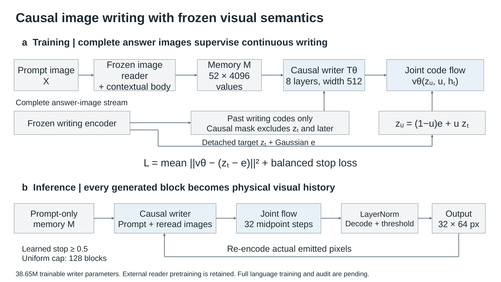

# Training a causal image-language writer

This candidate reads a prompt image and generates an answer as physical
32-by-64 image blocks. A frozen inherited vision/contextual body supplies
prompt semantics. A 38,651,649-parameter causal writer predicts a joint
continuous distribution over the next block's two writing vectors. The fixed
V34 codec renders these coordinates. Every emitted block is thresholded and
encoded again before entering subsequent history.

The actor has no tokenizer, OCR, Unicode IDs, language vocabulary head,
persistent glyph inventory or teacher service. Qwen3-VL 8B source pretraining
and the earlier trained writing codec remain external foundations. The
38.65M count describes the new writer, not the complete inherited actor.
This is a new candidate under training; useful autonomous language generation
has not yet been established.



The [native editable deck](../publication/ilm-nature/ILM_Figures_editable.pptx)
contains the training/inference diagram on slide 26 and the measured reader
diagnostic on slide 25. Earlier figures remain intact.

## Measured starting point

The imported vocabulary-free reader, using fixed numeric task controls,
supports four of eight exact Chinese answers at the declared sampling budget,
versus zero with question ink erased. Those answers use a separate temporary
text projection in a diagnostic helper. They are not image-output successes.
See the [verified reading result](../references/native_visual_transfer_v71_result.md).

On 128 real complete training examples, the new writer passes causal
future-target exclusion, bit-exact optimizer/RNG/data-cursor resume, finite
gradients and actual emitted-pixel feedback checks. That execution preflight
uses 1.739 GiB peak allocated GPU memory without the frozen reader. It is not
a language accuracy result. The unforced early output remains unqualified.
The [execution receipt](../references/evidence/semantic_ilm_v72_execution.json)
binds the exact implementation and source cache.

## Data and computation

All 12,976 admitted training images are retained: 3,193 Chinese CMRC examples
and 9,783 English Dolly instructions. Complete answer blocks and ordinary
padding remain intact; only the two explicitly recorded white termination
blocks are removed. Development questions and source-helper answers do not
enter training. The cache verifies original source hashes and every payload.

The observer uses the declared native-budget geometry, Pillow bilinear
interpolation and original source weights. It computes all 52 final numeric
task-frame states from prompt pixels before answer labels are loaded. Those
states are retained in BF16. Each target block is separately encoded by the
frozen image codec into two FP32 768-vectors. No language identities are used
as labels.

The writing transformer has eight layers, width 512, eight heads and a
2,048-wide feed-forward path. Its joint flow head has width 768 and three
residual MLP blocks. Training uses complete causal histories, up to 16 sampled
block losses per example, conditional flow matching and balanced learned
stopping. Generation uses 32 midpoint flow steps and re-encodes actual output
pixels. Codec coordinates have zero mean and unit variance; they are not
unit-length vectors. The [registered protocol](../references/semantic_ilm_v72_protocol.md)
defines the complete objective and qualification boundary.

## Current run and saved data

The current run is `artifacts/semantic_ilm_v72_20261105/`. Its name records
the launch date even when execution continues the following day.

| Path within the run | Contents |
| --- | --- |
| `cache/recipe.json` | Frozen sources, input corpus, observer and cache order |
| `cache/records/*.pt` | Prompt-only memory and complete answer-image codes |
| `cache/report.json` | Live cache count, hashes, elapsed time and completion flag |
| `preflight/preflight.json` | Real-example execution checks |
| `training/checkpoint_latest.pt` | Model, optimizer, RNG and exact data cursor, once training starts |
| `training/metrics.jsonl` | Production losses and exposure, once training starts |
| `pipeline_status.json` | Current stage and owned child PID |
| `development/` | All 384 raw answer streams after completed training |
| `verification.json` | Independent full-answer scoring after audit |

These generated data/checkpoints are ignored by Git. Source code, protocol and
compact evidence receipts are committed. The original physical training images
remain under `data/general_instructions/complete_lines_train_20261105/`.

## Execution

Use the existing compatible Python 3.12 environment; no duplicated model
download or Ollama server is needed. Run from the repository root. The
persistent coordinator runs cache, training, audit and CPU verification
sequentially on physical GPU 0. It refuses production training before the
whole admitted corpus is cached and the execution receipt passes.

```bash
artifacts/external/mixar_env_py312/bin/python scripts/run_semantic_ilm_v72.py \
  --run artifacts/semantic_ilm_v72_20261105
```

The active process already runs in tmux session `ilm-semantic-v72`; inspect its
status before launching a duplicate. An exclusive GPU lock and memory checks
guard each model stage. GPU 1 belongs to other work. Safe restart preserves
cache identity and resumes the serialized production checkpoint. A hard
interruption can replay at most the updates since the last 500-update save.

The production budget is 40,000 updates with batch 16: 640,000 example draws
under fresh full-corpus permutations. AdamW uses learning rate 1e-4, 500-update
warmup, cosine decay to 1e-5, betas (0.9,0.95), weight decay 0.01 and clipping
at one. Parameters/optimizer state are FP32, decoder contractions BF16, with
no EMA. This budget differs from earlier failed runs; it is not a matched
component comparison or evidence of improved efficiency.

## Independent image inference

After the fixed 40,000-update checkpoint exists, supply a prompt PNG and a
fresh output directory. Handwritten or rendered prompts remain image input;
no text decoder runs in the actor.

```bash
CUDA_DEVICE_ORDER=PCI_BUS_ID CUDA_VISIBLE_DEVICES=0 \
CUBLAS_WORKSPACE_CONFIG=:4096:8 OPENBLAS_NUM_THREADS=4 OMP_NUM_THREADS=4 \
PYTHONPATH=. artifacts/external/mixar_env_py312/bin/python \
  scripts/infer_semantic_ilm_v72.py \
  --prompt prompt.png \
  --checkpoint artifacts/semantic_ilm_v72_20261105/training/checkpoint_latest.pt \
  --output artifacts/my_image_answer
```

Default page mode preserves grayscale and adds white padding to a 32-pixel
boundary. Explicit `--layout strip` accepts binary writing strips and wraps
at blank columns. The runtime saves original prepared input pixels, raw image
blocks, stop probabilities, physical-feedback hashes and an answer PNG when
the generated stream is nonempty. It does not repair pixels or insert a
placeholder image for an empty answer. This interface is implemented; quality
remains subject to the scheduled audit.

## Acceptance

All 192 original audit cases receive normal and matched blank controls with
common random numbers. Complete width, all output ink and learned termination
contribute to scoring. The unchanged Chinese requirements include at least
50% exact answers, 80% foreground F1, 35% both-correct article pairs, a resolved
question effect and reliable stopping. English measurements are literal image
reference agreement, not exhaustive semantic correctness. Independent CPU
verification binds inputs and raw outputs and recomputes every score; it does
not replay the complete neural generation. Sealed final cases remain unopened
until the original development requirements pass.
