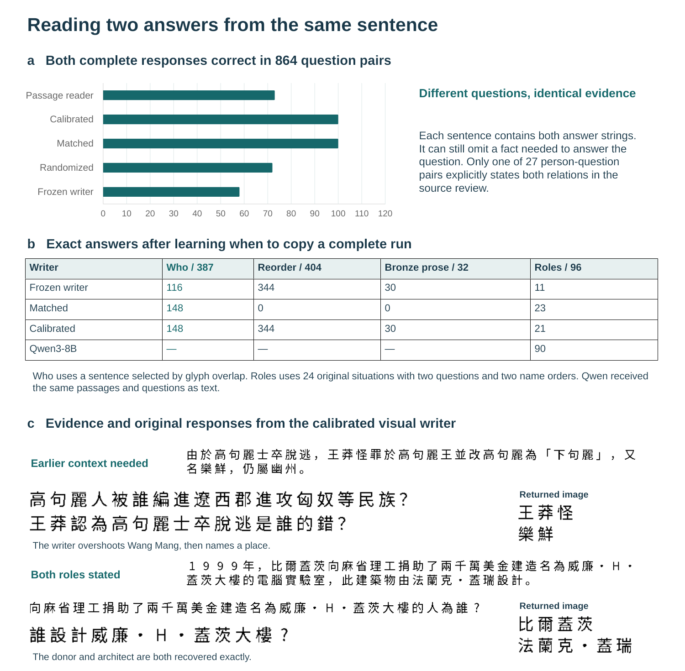
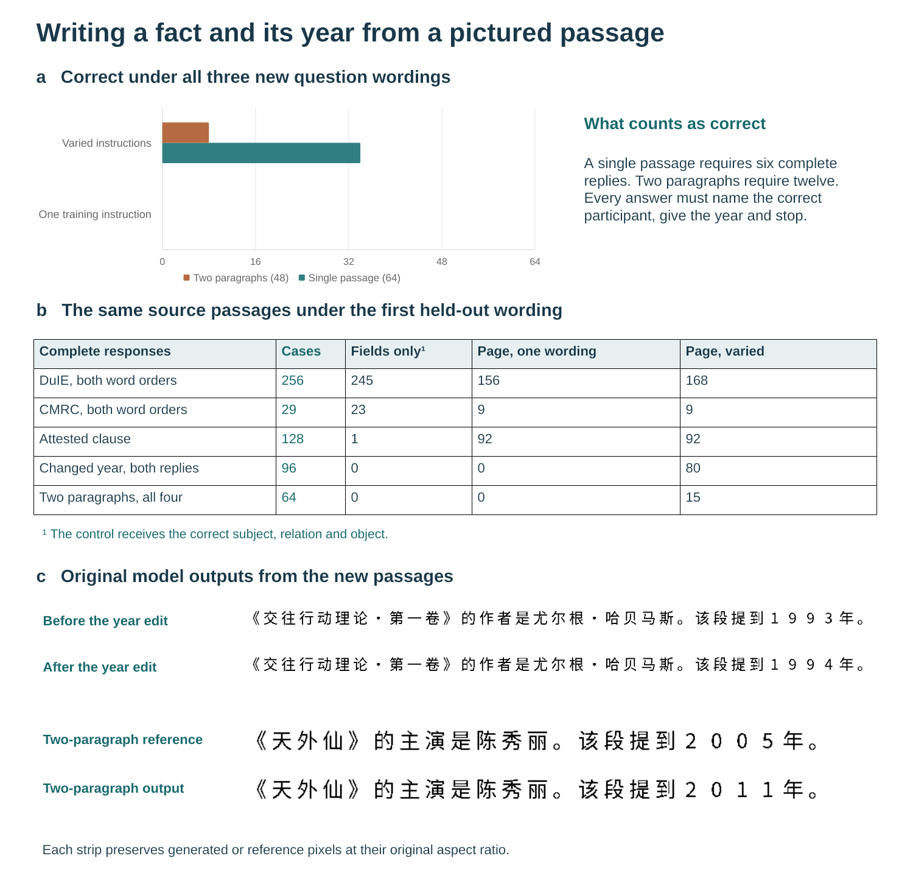

[English](../README.md) · [العربية](README.ar.md) · [Español](README.es.md) · [Français](README.fr.md) · [日本語](README.ja.md) · [한국어](README.ko.md) · [Tiếng Việt](README.vi.md) · [中文 (简体)](README.zh-Hans.md) · [中文（繁體）](README.zh-Hant.md) · [Deutsch](README.de.md) · [Русский](README.ru.md)

بعد استبعاد مواد DRCD المحجوزة وإعادة التدريب، طابق القارئ ذو قائمة الإجابات الأوسع الصورة المرجعية في 234 من 359 سؤالاً في مجموعة التطوير، مقابل 242 للقارئ العام. استُخدمت في تقييمات DRCD السابقة فقرات كانت محجوزة للاختبار. [النتائج وتصحيح مصدر البيانات](../references/span_list_result.md)

[](../publication/ilm-nature/manuscript.pdf#page=132)

في تقييم جديد شمل 384 سؤالاً لفهم نصوص صينية، طابقت إجابات النموذج صورة الإجابة المرجعية في 285 سؤالاً بعد جمع ترجيحات أربعة نماذج، وهي نتيجة القارئ العام أيضاً. وفي اختبارات تبادل الأسماء نجح في جميع أسئلة 63 مجموعة من أصل 128، مقابل 79 للقارئ المتخصص. [النتائج وأوزان النموذج](../references/span_choice_result.md)

[](../publication/ilm-nature/manuscript.pdf#page=131)

عند تبادل اسمين في مقطع صيني مصوّر، أجاب النموذج المدرَّب بتعظيم الإمكان عن جميع الأسئلة بالترتيبين المطلوبين للكلمات في 79 من 128 مقطعاً، مقابل 29 سابقاً. أمّا في الأسئلة التي كتبها أشخاص، فانخفض عدد الإجابات الصحيحة بالترتيبين من 34 إلى 28 من أصل 48. [النتائج والنماذج](../references/participant_margin_result.md)

[](../publication/ilm-nature/manuscript.pdf#page=130)

كتب النموذج المعلومة الصحيحة بالترتيبين المطلوبين للكلمات في 34 من أصل 48 سؤالاً صينياً كتبها أشخاص. وذكر ملحّن أغنية «秋潮» على نحو صحيح، لكنه أخطأ في اسم الملحّن عندما تبدّل دورا الملحّن وكاتب الكلمات في أغنية أخرى. [النتائج والنموذج](../references/pictured_relation_result.md)

[](../publication/ilm-nature/manuscript.pdf#page=129)

تدرّب القارئ على 26,890 مثالاً صينياً مصوّراً، وكتب إجابات تامة وصحيحة عن 33 من 48 سؤالاً صاغها أشخاص. وكتب نموذج منفصل يولّد أشكال الحروف تباعاً الحقيقة نفسها بالترتيبين المطلوبين في 31 سؤالاً. في مثال الفيلم حدّد المخرج وكاتب السيناريو في النص الأصلي، ثم نسخ جزءاً زائداً من النص بعد تبديل الاسمين. [النتائج والنموذج](../references/role_binding_result.md)

[](../publication/ilm-nature/manuscript.pdf#page=128)

ماذا يحدث عند تبديل اسمين في صورة نص؟ في 136 سؤالاً عن أزواج من الأدوار استُبعدت من تدريب الإجابات ذات الجملتين، قسّم النموذج الطلب وكتب الجملتين بالترتيب الصحيح في 70 إجابة. أصاب النموذج الذي يكتب الجملتين دفعة واحدة في ثلاث فقط. وفي مثال عن فيلم، كتب جملتين مقروءتين لكنه نسب الإخراج وكتابة السيناريو إلى الشخص نفسه. [النتائج والنموذج](../references/grounded_proposition_result.md)

[](../publication/ilm-nature/manuscript.pdf#page=127)

من رسم الخريطة ومن احتاج إلى السؤال عن الطريق؟ أعاد النموذج بعد تعديله اسمين مختلفين، وأعطى الاسم الصحيح في 42 من 64 سؤالاً مصوراً جديداً. واستطاع كتابة شكل الحرف 言 في نقوش العظام وفي نقوش البرونز بالترتيب المطلوب. وفي 128 سؤالاً مفتوحاً جديداً تتطلب أشكالاً كتابية غائبة عن المدخلات، لم تتطابق أي إجابة تماماً مع الأجوبة المرجعية. [النتائج والنموذج](../references/pointing_causal_writer_result.md)

[](../publication/ilm-nature/manuscript.pdf#page=126)

تذكر الفقرة المصوّرة مَن رسم الخريطة ومَن ضلّ الطريق. حدّد النموذج رسّام الخريطة، لكنه كرّر الحديث عن الرسم عندما سُئل عمّن احتاج إلى السؤال عن الطريق. في 300 سؤال تطلّبت إجابتها شكلاً كتابياً غائباً عن المدخلات، اختار النموذج أول شكل غائب اختياراً صحيحاً 18 مرة فقط، حتى عند تزويده بالجزء الصحيح السابق من الإجابة. [النتائج وصور الإجابات الأصلية](../references/causal_glyph_writer_result.md)

[](../publication/ilm-nature/manuscript.pdf#page=125)

يستطيع النموذج كتابة الشكلين التاريخيين للحرف 言 بالترتيب المطلوب في السؤال المصوّر. في أمثلة خارج التدريب نجح في الترتيبين معًا في 94 من 96 مقارنة بصياغة مألوفة، وفي 16 من 96 على بطاقات أخرى بصياغة جديدة. [النتائج وصور الإجابات](../references/ordered_page_writer_result.md)

[](../publication/ilm-nature/manuscript.pdf#page=124)

**قراءة صور الحروف والإجابة عنها.** أجاب النموذج إجابة صحيحة عن 46 سؤالًا من أصل 64 عن شخصين بالخط الصيني العادي، وعن 41 بالخط العريض. وأجاب Qwen3-8B المحلي عن 55 سؤالًا إجابة صحيحة عند إدخال النص. وعند استخدام خط كاي لم يسبق للنموذج التدرّب عليه، أجاب عن سؤال واحد فقط إجابة صحيحة. [تشغيل النموذج](../docs/visual-page-responder.md)

[](../publication/ilm-nature/manuscript.pdf#page=123)

**هل يميّز النموذج بين شخصين في جملة واحدة؟** كتب النموذج اسم المتبرع لمبنى غيتس واسم المهندس المعماري بشكل صحيح. ومن أصل 864 زوجًا من الأسئلة أجاب عن السؤالين معًا إجابة صحيحة في 100 زوج. وعند تبديل الأسماء في 24 موقفًا جديدًا لم يُجب عن كل أسئلة أي موقف، بينما نجح نموذج Qwen3-8B المحلي في 20 موقفًا. [النتائج وطريقة التشغيل](../references/shared_sentence_writer_result.md)

[](../publication/ilm-nature/manuscript.pdf#page=121)

**لماذا يختار النموذج الاسم الخطأ؟** في 387 سؤالًا صينيًا عن هوية شخص ارتفع عدد الإجابات الصحيحة بالكامل من 62 إلى 116 عند اختيار جملة بحسب أشكال الحروف المشتركة مع السؤال. وبالطريقة نفسها أجاب نموذج المقارنة ذو التعيين العشوائي في التدريب الإضافي عن 127 سؤالًا إجابة صحيحة. يوضح الشكل 85 كيف كتب النموذج اسم مكان حين سُئل عن اسم مخترع. [النتائج وطريقة التشغيل](../references/inverse_role_writer_result.md)

[](../publication/ilm-nature/manuscript.pdf#page=120)

**عمّن تتحدث الجملة؟.** كتب النموذج 368 جملة صينية كاملة بصورة صحيحة من أصل 404 عند استخدام أسماء وتتمات جديدة. وعندما نسخ اسمي تشين وتشو من صور نقوش برونزية، أصاب في 24 جملة من أصل 32. وعندما عُرضت عليه الصفة وحدها وطُلب منه تحديد الاسم، لم يُرجع أي اسم برونزي صحيح. [النتائج وطريقة التشغيل](../references/visual_role_writer_result.md)

[](../publication/ilm-nature/manuscript.pdf#page=119)

**ماذا يقرأ النموذج من صور الكتابة؟** عُرضت على النموذج صورة الجملة الصينية «她喝了一口□。» (أخذت رشفة من □). عندما تغيّر الشراب في الفقرة المرافقة من الماء إلى الشاي، تغيّرت الإجابة من 水 إلى 茶. واستعاد النموذج، بعد الجمع بين الشبكة العصبية وتكرارات المحارف المتجاورة، النص الأصلي في 651 موضعاً من أصل 2,947. وعند تبادل شخصين دوريهما في 48 زوجاً من الأمثلة، لم يصدر النموذج الحكم الصحيح على النسختين معاً في أي زوج. [النتائج وأوامر التشغيل](../references/visual_inference_writer_result.md)

[](../publication/ilm-nature/manuscript.pdf#page=118)

<!-- paired-writing-status:start -->
لم تحقق مقارنة إزالة الهوامش البيضاء، بعد 512 خطوة تحديث، نسخاً موثوقاً: التطابق التام عبر OCR هو 6/32 للتدريب و10/32 للتحقق، مقابل 27/32 و28/32 للصور المرجعية الواضحة. تظهر المخرجات الأصلية حذفاً وتكراراً للأحرف. انخفض وقت التدريب من 795.624 إلى 287.182 ثانية، لكن فهم اللغة والكفاءة عند جودة عملية لم يثبتا بعد. [المخرجات الأصلية الـ64](../references/paired_padding_result.md).
<!-- paired-writing-status:end -->

الحالة الحالية: لم تثبت بعد صلاحية توليد اللغة على هيئة صور للاستخدام الفعلي. في أحدث مقارنة لدوال خسارة المفكّك على 32 سؤالاً سبق استخدامها في التدريب، حقق كلا النموذجين 0/32 إجابات مستقلة مطابقة بكسلاً ببكسل. أدّت الخسارة المراعية لحساسية المفكّك إلى خفض F1 لضربات الكتابة من 85.984% في النموذج الضابط إلى 70.009%. وحتى مع إعطاء السياق السابق الصحيح للإجابة، لم يتجاوز F1 نسبة 92.430% و75.116%؛ أما إعطاء رموز صورة الإجابة الصحيحة مباشرة فحقق إعادة بناء بنسبة 99.9953% في الحالتين. فشلت معايير الإصلاح الأربعة، ولذلك رُفض توسيع نطاق هذه الوصفة التدريبية. هذه مقاييس تطابق صور وليست دقة دلالية، ولا توجد بعد نقطة تحقق لنموذج ILM ثبتت صلاحيتها للاستخدام. [النتيجة وكل الصور الأصلية](../references/decoder_metric_v82_result.md). تتضمن المخطوطة الآن الملاحظة التكميلية 39 والشكل S16 القابل للتحرير. حقق خط أساس إضافي لمولّد صور خارجي، دون تدريب محلي، تطابق OCR تاماً في 0/12 من طلبات النسخ و0/8 من الأسئلة، مع معايرة OCR للصور المرجعية بلغت 18/20؛ حُفظت المخرجات الأصلية الأربعون. [FLUX.2-klein-4B](../references/image_edit_baseline_result.md).


[](https://lazying.art)

# نموذج اللغة المصوّرة (ILM)

بعد التدريب على 642 إجابة أخطأ فيها سابقًا، أعطى النموذج البصري 31 إجابة مصوّرة مطابقة من أصل 144 سؤالًا عن ستة مؤلفات صينية أخرى. وأجاب عن السؤالين بالصينية والإنجليزية إجابة صحيحة في 0 من أصل 36 مقطعًا. [↗](../references/stopped_book_preference_result.md)

[](../publication/ilm-nature/manuscript.pdf#page=141)

في اختبار شمل 34 مقطعاً من أربعة كتب صينية أخرى، أعطى النموذج الذي زيد وزن تدريب الحرف الأول فيه 31 إجابة مطابقة من أصل 136 سؤالاً بالصينية والإنجليزية. ولم يُجب عن الأسئلة الأربعة كلها إجابة صحيحة في أي مقطع. [↗](../references/first_glyph_book_result.md)

[](../publication/ilm-nature/manuscript.pdf#page=140)

طُرح سؤالان عن كل مقطع روائي صيني، مرة بالصينية ومرة بالإنجليزية. أجاب النموذج الثنائي اللغة عن الطلبات الأربعة بدقة في 3 من 374 مقطعاً، مقابل 0 للنموذج الضابط الذي بُدّلت أسئلته الإنجليزية أثناء التدريب. وفي اختبار XQuAD أجاب النموذج الثنائي بدقة عن الأسئلة الأربعة في 1 من 227 مقطعاً. [النتائج وصور الإجابات](../references/bilingual_novel_result.md)

[](../publication/ilm-nature/manuscript.pdf#page=139)

رفع تغيير سماكة الخط ونسب الحروف أثناء التدريب عدد الإجابات الصحيحة في أسئلة القراءة الصينية بخط HanaMin من 15 إلى 43 من أصل 394. أجاب النموذج عن السؤالين معاً في 6 من 197 مقطعاً، وفي اختبار XQuAD مستقل بالخط نفسه لم يُجب عن السؤالين معاً في أي من المقاطع الـ227. [النتائج وصور الإجابات](../references/stroke_scale_result.md)

[](../publication/ilm-nature/manuscript.pdf#page=138)

في مقاطع صينية جديدة طُبعت بخط HanaMin المستبعد من التدريب، أعطى النموذج 15 إجابة مطابقة من أصل 394، مقابل 3 عند الاكتفاء بالتدريب على خطوط إضافية. وأجاب عن السؤالين معاً في 0 مقطعاً من أصل 197. يتيح الفهرس المحلي طلب الأشكال التاريخية لرمز مثل 中 وتلقّي الإجابة في صورة. [تشغيل النموذج والفهرس](../models/typeface_writer/README.md)

[](../publication/ilm-nature/manuscript.pdf#page=137)

أجاب النموذج المدرَّب بالتقطير بدقة عن 72 سؤالاً من أصل 196 حول صور 98 مقطعاً صينياً، مقابل 63 مع التدريب المعتاد. وأجاب كل من النموذجين عن السؤالين معاً في 11 مقطعاً. وعندما تلقّى Qwen3-8B المقاطع نفسها في صورة نص، أجاب عن السؤالين معاً في 55 مقطعاً. [النتائج والنموذج](../references/interval_teacher_result.md)

[](../publication/ilm-nature/manuscript.pdf#page=136)

أجاب النموذج نفسه بدقة عن 114 سؤالاً من أصل 359 سؤال فهم صيني، واستخرج من بطاقة مصوّرة شكلي الرمز 言 في نقوش العظام والبرونز وكتبهما بالترتيب المطلوب. وفي 128 مقطعاً إضافياً لكل منها سؤالان، أجاب عن كليهما في 15 مقطعاً، مقابل 49 لنموذج يستخرج الإجابة من النص. [تشغيل النموذج](../models/mixed_visual_answers/README.md)

[](../publication/ilm-nature/manuscript.pdf#page=135)

قرأ النموذج نصوصًا صينية مصوّرة وكتب الاسم والسنة الصحيحين بعد كل تغيير وبثلاث صيغ جديدة للسؤال، في 34 من 64 حالة بفقرة واحدة و8 من 48 حالة بفقرتين. وطابقت إجاباته المرجع في سبعة من 359 سؤال فهم أوسع نطاقًا كتبها أشخاص.

[](../publication/ilm-nature/manuscript.pdf#page=133)


ILM مشروع بحثي لتعلّم اللغة وتوليدها بوصفها **كتابة مرئية**، من الصورة إلى
حالة بصرية مستمرة ثم إلى صورة، من دون مسار رموز نصية مخفي.


فحص الواجهة الأحدث: يجيب النموذج المسبق المجمد إجابة مطابقة في 11/32 حالة إنجليزية بعد تغيير حجم الصفحات نفسها من 1024 إلى 432، مقابل 0/32 بالحجم الأصلي. يحقق كل من المحولين المدرَّبين 5/32 فقط بالحجم 432. لم يتحقق بعد نموذج ILM مستقل يولّد الإجابات كصور.

[2026-11-07: English result and full evidence](../references/native_reader_geometry_result.md)

نتيجة 2026-11-08: اكتمل تقييم التدريب ذي 128 تحديثاً، وفُحصت صور الإجابات الأصلية الـ384. يحقق النموذجان الأولي والنهائي 0/32 إجابة مطابقة وفق OCR في كل من الأسئلة التي دُرّب عليها النموذج والأسئلة المحجوبة، حتى مع بدائل المصدر. انخفض النسخ المطابق في المجموعة المحجوبة من 19/32 إلى 16/32. أخفقت الشروط الستة المحددة مسبقاً؛ ولم يُثبت تعلّم اللغة بعد.

[النتيجة وحدود الدليل](../references/native_paired_qa_learning_result.md)

## قراءة جملة صينية كلاسيكية من صورة وكتابتها بالصينية الحديثة

نسخ النموذج، الذي يضم 2.03 مليون مُعامِل، المقاطع الـ 2,045 القابلة للرسم كاملة في فصول خُصصت للاختبار. وعند طلب الترجمة إلى الصينية الحديثة، طابقت 30 ترجمة من أصل 2,048 الصورة المرجعية تمامًا. وفي إحدى الجمل نسخ تسعة رموز ورسم رمزين جديدين، فاستبدل 薨 بـ 去世. وظل أسلوب التحرير البسيط المعتمد على السياق القريب أقل خطأً في مجمل النتائج. [تشغيل النموذج](../models/visual_edit_zh/README.md) · [صور المخرجات والمراجع](../publication/ilm-nature/figures/Figure_48_visual_edit.png)

## قراءة الأشكال التاريخية

أعاد النموذج الصور التاريخية بالترتيب المطلوب في 9,565 من أصل 9,600 سؤال بالصينية والإنجليزية عن عائلات محارف لم تدخل التدريب. تأتي الصور من جدول معروض من أربعة صفوف. [تشغيل النموذج](../models/pictured_idiom_zh/README.md) · [Fig. 42](../publication/ilm-nature/figures/Figure_42_historical_plates.png)

## قراءة النص المصوّر وكتابة التعبير الصيني الناقص

يقرأ نموذج يضم 2.12 مليون مُعامِل صور النص على جانبي الفراغ ثم يرسم أحرف التعبير الصيني الناقص. طابقت إجاباته الأصل تمامًا في 134 حالة من أصل 22,907 حالات في مجموعة التحقق. وفي 100 حالة من هذه الإجابات الصحيحة، لم يظهر أيّ من الأحرف الأربعة في النص المعروض. وأعطت طريقة مرجعية تعتمد على التكرار في السياق القريب 1,012 إجابة صحيحة.

[تشغيل النموذج](../models/pictured_idiom_zh/README.md) · [الشكل 40](../publication/ilm-nature/figures/Figure_40_pictured_idioms.png)

عند استخدام تنبؤات نموذج القراءة لتوجيه التدريب الإضافي، بلغ عدد الإجابات المطابقة 378 من أصل 22,907، مقابل 292 عند التدريب للمدة نفسها من حيث عدد التحديثات على الإجابات الأصلية وحدها. وعلى 9,135 مقطعًا لم تُستخدم سابقًا، بلغ العدد 163 و125 على التوالي. [الشكل 41](../publication/ilm-nature/figures/Figure_41_writer_transfer.png)

بعد تدريب القارئ والكاتب البصريين معًا، أنتج النموذج الإجابة الصحيحة في 433 من 17,555 مقطعًا صينيًا جديدًا، مقابل 276 للنموذج السابق و789 لطريقة العدّ في السياق القريب. [Fig. 43](../publication/ilm-nature/figures/Figure_43_expression_preference.png)

## اختيار الإجابة من صور الحروف الصينية

تدرّب نموذج القراءة الصغير في 64 ثانية باستخدام خيطين من المعالج المركزي. وفي فقرات صينية حُجزت للتقييم، اختار صورة الإجابة المطابقة تمامًا في 269 سؤالًا من أصل 1,788. وعند إخفاء السؤال انخفض العدد إلى 18. أما نموذج الكتابة الحرة المنفصل فلم ينتج شرحًا مقروءًا لتطوّر الحرف 言. وتظلّ القدرة على الكتابة العامة وزيادة كفاءة التدريب ألف ضعف هدفين قيد الاختبار.


[تشغيل نموذج القراءة](../references/visual_extractive_reading_result.md) · [البحث](../publication/ilm-nature/manuscript.pdf)

اختار نموذج القراءة المقطع الصحيح في 565 سؤالًا من أصل 3,170 سؤالًا صينيًا. وأعاد نموذج الكتابة رسم 124 إجابة كاملة بخط مختلف مع تطابق كل بكسل. أجاب عن سؤالين حول الفرقة نفسها بعبارتي 前卫金属 و1996年.


[كتابة الإجابة بخط مختلف](../references/grounded_detail_writing_result.md)

## رسم الحرف الصيني التالي من السياق

في 668 سياقًا من مجموعة التطوير، أدى توقّع التوزيع العام للحبر قبل رسم التفاصيل إلى زيادة عدد الصور المطابقة بكسلًا ببكسل لأشكال كتابية معروفة غير فارغة من 198 إلى 649. رسم كلّ من النموذجين الحرف التالي الوارد في النص الأصلي 18 مرة. وعند السؤال عن أصل الحرف 言، كرّر النموذج الجديد شكلًا يشبه الصفر.


[نتائج التجربة والنموذج المدرّب](../references/shared_layout_writing_result.md)

## تجربة إكمال النص السابقة

2026-11-13

شملت تجربة التسلسلات الكاملة **13,766 تسلسلاً و41,298 تحديثاً و6,108,741 موضعاً مستهدفاً لأشكال الكتابة**. روجعت **صور المخرجات الـ732 جميعها** قبل التقييم بالإجابات المرجعية. مع المدخلات ذات التنضيد النسبي، حقق النموذج النهائي **7/32 إجابات كاملة مطابقة بالمعيار الصارم، و0/16 زوجاً صحيح الإجابتين، و14/32 إجابة مقروءة، و0/12 متابعة طويلة للكتب متماسكة ومكتملة**. لم يجتز المعايير المسجلة مسبقاً ولا التدقيق المستقل لحالات محو السؤال أو الفقرة الأربع.

استُخدمت بطاقة RTX 4090 واحدة، وبلغت ذروة ذاكرة VRAM المخصصة **18.568 GiB**. يحتوي النموذج المنشور للتشغيل على **7,578,390,003 معامل** بما فيها أوزان الأساس الموروثة، بينما حُدّث **20,212,225 معامل** في هذا التدريب. استُخدمت مجموعة تطوير معاد استخدامها ومراجع نموذجي واحد، دون تحكيم بشري مستقل. لم تثبت بعد صلاحية ILM خفيف للاستخدام أو أفضلية كفاءته عند جودة مماثلة.

[النتائج الكاملة](../references/visual_continuation_learning_result.md) · [الهدف الهندسي](../docs/first-imagized-language-model-goal.md) · [البروتوكول الثابت](../references/visual_continuation_full_protocol.md)

## نتائج V35 السابقة


V35 نموذج لغة بصرية صيني يضم `129,092,738` معلّمة. أكمل جميع تحديثات BF16
البالغ عددها `22,000` خلال `2.770` ساعة على بطاقة RTX 4090 واحدة، وبذروة ذاكرة
GPU قدرها `2.899 GiB`. لا يستقبل مسار التشغيل إلا بكسلات الكتابة وقناعاً
بصرياً، ثم يولد الصورة النقطية ويعيد قراءتها مباشرة. ولا يستخدم أثناء التشغيل
tokenizer أو معرفات Unicode/الأحرف أو OCR أو الاسترجاع أو codebook بصرياً أو
نموذجاً معلماً.

القرار المقاس هو **`not-qualified`**. دقة النسخ مع التوجيه الصحيح `0.3125%`،
ودقة التعليمات `0.1116%` وهي أقل من حالة التوجيه المخلوط. نجح المسار في `5/12`
فقط من بوابات السببية البصرية و`5/9` من بوابات الدلالة النقطية. المخرجات غير
فارغة وتتغير مع التوجيه، لكن علاماتها مشوهة وغير مرتبطة بالإجابة المطلوبة؛ لذلك
لم تُفتح مجموعة الاختبار المختومة.

يعتمد V35 على نقل التعلم. مُرمّز الكتابة المستمر V34 هو من عمل المشروع، أما
النواة السببية فمهيأة من نقطة PIXAR الخارجية. يُنسب PIXAR بوضوح بوصفه أساساً
خارجياً ولا يُدّعى أنه مساهمة من المشروع. وتعني «الاستقلالية» هنا حزمة تشغيل
ذاتية الاكتفاء، لا تدريب كل المكونات من الصفر. راجع [التقرير المقاس بالإنجليزية](../references/causal_glyph_flow_v35_result.md)،
[دليل التنفيذ](../docs/causal-glyph-flow-v35.md)، و[البحث](../publication/ilm-image-native/ilm-image-native.pdf).

## اختبار توجيه محدود سابق: قبول دائرة العلاقات البصرية V23


V23 هي أول تجربة في هذا المستودع تجتاز سلسلة الإثبات كاملة من توجيه مصوّر إلى
جواب مصوّر. لا يستقبل النموذج سوى ست صور كتابة بقياس `32x32` ويُنتج صورة جواب
واحدة بقياس `32x32`. ولا يحتوي مسار الاستدلال على سلاسل نصية أو tokens أو
معرّفات Unicode أو OCR أو بحث عن glyph أو فهرس جواب أو نموذج لغة خارجي.

في التقييم المجمّد الوحيد المسموح، على 98 محرفاً صينياً غير مرئي سابقاً و1,024
حلقة و4,096 تنويعاً للتوجيه، بلغت دقة الاختيار الثنائي `0.99829`، وتبديل
الاستعلام `0.99609`، وتبديل العملية `0.99707`، وtop-1 للرسم الناتج `0.99463`،
وpixel F1 مقدار `0.78478`. ظل ضابطا حجب الاستعلام وحجب العملية ثابتين تماماً
أمام العامل الذي لا يراه كل منهما.

تثبت هذه النتيجة فقط اتباع توجيه بصري ضمن نحو ثابت ذي ستة أدوار وزوجين من
الارتباط وعلاقة same/other؛ ولا تثبت فهماً حراً للغة. سيزيل V24 أدوار الإطارات
الثابتة، ويقرأ تيار كتابة بصرياً ثنائي الأبعاد متغير الطول، ثم يولد الإطار
الثاني بعد إعادة قراءة الأول. راجع [سجل V23 بالإنجليزية](../docs/visual-relation-circuit-v23-result.md).

## خط الأساس البحثي السابق: بداية المجال البصري التنبؤي


أظهرت تجربة RFLM V7 أن جامعاً بصرياً واحداً لا ينبغي أن يستنتج الهوية
اللغوية ويرسم الضربات في العملية نفسها. رفع V7 دقة السياق الكامل من `1.20%`
إلى `2.31%`، متجاوزاً last-only (`2.02%`) وunigram (`1.86%`)، لكنه بقي دون
bigram (`13.58%`). تحسن فرق الاحتمال اللوغاريتمي المطبّع من `-0.9066` إلى
`-0.2155` لكنه ظل سالباً، وبقي الناتج المستقل غير مقروء. لذلك **رُفض V7
كنموذج لغة**.

يفصل نموذج PVF التالي بين تدفق مستمر يتنبأ بالحالة الشبكية التالية ومشغّل
بصري مستقل يحوّل تلك الحالة إلى حبر ثم يعيد قراءتها. لا يوجد بحث عن أقرب حرف
ولا جدول إخراج. الحد الصارم هو: `بكسلات كتابة -> ديناميكيات بصرية مستمرة ->
بكسلات حبر`. لا يتلقى الطالب tokens أو معرفات Unicode أو OCR أو دفتر أكواد
بصرياً أو نموذج لغة خارجياً. PVF فرضية V8 قابلة للاختبار، وليس قدرة مثبتة.

> يحتفظ المستودع عمدًا بمسار عملي لتتبع علم الأصول التاريخي جنبًا إلى جنب مع تجارب ILM طويلة المدى.

## 📌 نظرة عامة

هذا المستودع يضم ثلاثة مسارات مترابطة:

1. نمذجة اللغة بالصور عبر التدفق الشبكي وتقييمها الصارم خارج التدريب.
2. استيعاب أصول glyph الصينية التاريخية مع حفظ المصدر.
3. خطوط أساس أقدم للرموز والانتشار وInkStream محفوظة لإعادة الإنتاج.

يوثّق هذا الـ README المسارات الثلاثة ويجعل سير عمل علم الأصول قابلاً لإعادة التنفيذ.

## 🔗 الروابط الأساسية

| المجال | المسار |
|---|---|
| الموجز المفاهيمي | `docs/imagized-language-model.md` |
| الهدف الهندسي الحالي | `docs/first-imagized-language-model-goal.md` |
| ملف البحث والأدلة | `references/image-native-language-model-research.md` |
| خطة الشيفرة والمقاييس | `docs/ilm-visual-diffusion-code-plan.md` |
| خطة "color" للتضمين | `docs/embedding-color-plan.md` |
| ملاحظات/خطة التطوير | `docs/development-plan.md` |
| دليل وحدة الأصول | `ilm/etymology/README.md` |

## ✨ الميزات

- 🏺 استيعاب الأصول من مصادر من نمط `hanziyuan` و`chineseetymology`.
- 🌐 مسار استيعاب AJAX + HTML قوي مع إعادة المحاولة، وضبط الوتيرة، والتخزين المؤقت.
- 🧩 استخراج glyph موسوم بمراحل يضم بيانات `` وبيانات URI داخل CSS `background-image`.
- 🗃️ تخزين قائم على SQLite لبيانات الـ chars/metadata الخاصة بالـ glyph مع تخطيط الأصول على نظام الملفات.
- 🖥️ واجهة ويب عبر Tornado للاستيعاب اليدوي ومعاينة المعرض.
- 🔤 أدوات عرض glyphs لتوكنات متعددة اللغات.
- 🧠 وحدات embedding/codebook بنمط product-code.
- 🧱 تعبئة إطارات الجمل ونصوص التدريب/التقييم لعمليات diffusion/inpainting.
- 📊 نصوص التقارير والتصور لفحص embedding وسلسلة المعالجة.
- 📄 مخرجات النشر بصيغ LaTeX/PDF داخل `publication/`.

## 🧱 هيكل المشروع

```text
.
├── README.md
├── AGENTS.md
├── configs/
│   ├── color.yaml
│   └── diffusion.yaml
├── docs/
├── i18n/
├── ilm/
│   ├── code/
│   ├── data/
│   ├── datasets/
│   ├── db/
│   ├── diffusion/
│   ├── encoders/
│   ├── english_tiles/
│   ├── etymology/
│   ├── frames/
│   ├── models/
│   └── utils/
├── scripts/
├── publication/
├── assets/
├── logs/
└── *.ipynb
```

## 🧰 المتطلبات المسبقة

| المتطلب | ملاحظات |
|---|---|
| Python `3.10+` | بيئة التشغيل الأساسية |
| `pip` | لتثبيت الحزم |
| GPU اختياري | مفيد لبرامج التدريب باستخدام PyTorch CUDA |
| سلسلة أدوات LaTeX اختيارية | مطلوبة لبناء ملفات النشر |

ملاحظة افتراضية: لا يوجد حاليًا ملف جذر واحد لقفل/تحديد الاعتماديات (`pyproject.toml`, `requirements.txt`, وغيرها)، لذلك تُستنتج الاعتماديات من الاستيرادات واستخدامات السكربتات.

## ⚙️ التثبيت

### الحد الأدنى (أدوات مسار الأصول)

```bash
python -m venv .venv
source .venv/bin/activate
pip install --upgrade pip
pip install requests beautifulsoup4 tornado
```

### موسع (مسارات النمذجة/التدريب)

```bash
python -m venv .venv
source .venv/bin/activate
pip install --upgrade pip
pip install requests beautifulsoup4 tornado pyyaml numpy pillow matplotlib torch
```

إذا احتاج سكربت معيّن حزمًا إضافية، ثبّتها بحسب الخطأ الظاهر في استيراد ذلك السكربت.

## 🚀 الاستخدام

### البدء السريع: استيعاب glyph التاريخية (CLI)

1. Hanziyuan (موصى به): مسار AJAX للحروف فقط

```bash
PYTHONPATH=. python scripts/ingest_etymology.py --site hanziyuan --char 中
```

2. ChineseEtymology (رابط مباشر)

```bash
PYTHONPATH=. python scripts/ingest_etymology.py --site chineseetymology --url "https://www.chineseetymology.org/CharacterEtymology.aspx?characterInput=%E4%B8%AD"
```

3. استيعاب دفعة من ملف (الأسطر قد تكون `char\turl`, `url`, أو `char url`)

```bash
PYTHONPATH=. python scripts/ingest_etymology.py --from-file urls.txt
```

### المخرجات

| نوع المخرج | الموقع |
|---|---|
| الملفات | `data/historic/glyphs/<char>/<stage>/<label>.<ext>` |
| التخزين المؤقت | `data/historic/cache/*.html` |
| قاعدة البيانات | `data/historic/etymology.sqlite3` |

### عرض الويب (اختياري)

```bash
PYTHONPATH=. python scripts/serve_etymology.py
```

افتح `http://127.0.0.1:8888`، واختر الموقع، وأدخل حرفًا (مثل `中`).

### الزحف المهذب واحترام المواقع

- يستخدم أداة الجلب تقييد معدل لكل مضيف مع إعادة المحاولة (backoff) والتخزين المؤقت.
- احرص على فواصل `>= 0.5s`، وتجنب الاندفاع، واطّلع على شروط الموقع/robots/licensing.
- لا تتجاوز الجدران المدفوعة أو الحواجز التفاعلية.
- إذا ظهرت `403`/`429`، خفّف السرعة وحاول لاحقًا.

### مسارات ILM الإضافية

توجد هذه السكربتات حالًا ضمن سطح المستودع، لكنها تُعدّ تدفقًا بحثيًا وقد تتطلب مجموعات بيانات/نقاط تفتيش محضّرة محليًا.

1. تنزيل/إعداد البيانات

```bash
python scripts/download_alpaca.py --outdir data/raw
python scripts/download_corpora.py --out data/raw
python scripts/sample_paragraphs.py --out data/processed/test_100.jsonl
python scripts/build_images_common_freq.py --out data/processed/images_common_freq --size 128 --en 5000 --zh 5000
```

2. دورة حياة قاعدة glyph DB

```bash
python scripts/glyphdb_init.py --db data/glyphdb/glyphs.sqlite3
python scripts/glyphdb_ingest_index.py --db data/glyphdb/glyphs.sqlite3 --index data/processed/images_common_freq/index.tsv
```

3. تدريب كود/ألوان النموذج

```bash
python scripts/train_color_codes.py --config configs/color.yaml
python scripts/train_codes_from_qa.py --en-json data/raw/alpaca_en.json --zh-json data/raw/alpaca_zh.json --epochs 1
python scripts/train_ilmglyph_codes.py --en data/raw/alpaca_en.json --zh data/raw/alpaca_zh.json --out artifacts/ilm_glyph_train
```

4. diffusion/inpainting

```bash
python scripts/train_diffusion.py --config configs/diffusion.yaml
python scripts/train_inpaint_frames.py --ckpt-code artifacts/ilm_glyph_train/ckpt_epoch1.pt --out artifacts/inpaint
```

5. التقييم/التقارير

```bash
python scripts/eval_color_codes.py --checkpoint artifacts/color_codes_e1.pt
python scripts/eval_diffusion.py --checkpoint artifacts/diffusion_unet.pt
python scripts/eval_qa_retrieval.py --checkpoint artifacts/color_codes_qa.pt
python scripts/report_ilmglyph_pipeline.py --ckpt artifacts/ilm_glyph_train/ckpt_epoch1.pt --lang en --text "hello world"
```

## 🧩 الإعدادات

إعدادات YAML الأساسية:

- `configs/color.yaml`
  - مسار البيانات: `data/processed/images_common_freq/index.tsv`
  - معاملات النموذج/الكود: `d_glyph`، `d_code`، `K`، `C`، temperature/anneal
  - إعدادات المحسن/السجلات

- `configs/diffusion.yaml`
  - JSONL الإدخال: `data/processed/test_100.jsonl`
  - إعدادات الشبكة/الإطار/النموذج
  - نطاق نسبة القناع أثناء التدريب وإعدادات نقاط التفتيش

يمكن تجاوز الإعدادات عبر أعلام سطر الأوامر حيث يدعم ذلك (`--epochs`, `--batch-size`, `--lr`, ...).

## 🧪 أمثلة

- بناء glyph بلاطة إنجليزية واحدة:

```bash
python scripts/build_english_tile_glyph.py "language" artifacts/language_tile --save-tensor
```

- تشغيل عرض inpainting باستخدام نقاط تفتيش مدربة:

```bash
python scripts/inpaint_demo.py \
  --ckpt-code artifacts/ilm_glyph_train/ckpt_epoch1.pt \
  --ckpt-inpaint artifacts/inpaint/ckpt_epoch1.pt \
  --lang en \
  --text "the quick brown fox jumps" \
  --mode infill \
  --out artifacts/inpaint_demo
```

- استيعاب جماعي للأحرف الشائعة من Hanziyuan:

```bash
PYTHONPATH=. python scripts/bulk_ingest_hanziyuan.py --limit 200 --resume
```

## 📝 ملاحظات التطوير

- هذا مستودع بحثي يجمع بين أدوات CLI المتماسكة والمواد الاستكشافية (بما في ذلك notebooks و prototype scripts).
- الملفات الكبيرة الناتجة تُوجّه إلى `data/` و`artifacts/` (كلاهما مُستثنى في `.gitignore`).
- مصادر وملفات النشر تكون داخل `publication/`؛ سكربت البناء المساعد: `scripts/latex_build.sh`.
- عادات التعاون/العمليات موثقة في `AGENTS.md`.

## 🛠️ استكشاف الأخطاء وإصلاحها

- `ModuleNotFoundError: ilm...`
  - نفّذ السكربتات من جذر المستودع.
  - استخدم `PYTHONPATH=.` للسكربتات التي تتطلب حلًا محليًا للحزم.

- `FileNotFoundError` لملفات البيانات/الفهارس/نقاط التفتيش
  - شغّل سكربتات البيانات/البناء التمهيدي أولًا.
  - تأكد من وجود المسارات الافتراضية مثل `data/processed/images_common_freq/index.tsv` و`data/processed/test_100.jsonl`.


## ❤️ Support

<!-- support:start -->
[](https://github.com/sponsors/lachlanchen)
[](https://chat.lazying.art/donate)
[](https://paypal.me/RongzhouChen)
[](https://buy.stripe.com/aFadR8gIaflgfQV6T4fw400)
<!-- support:end -->
