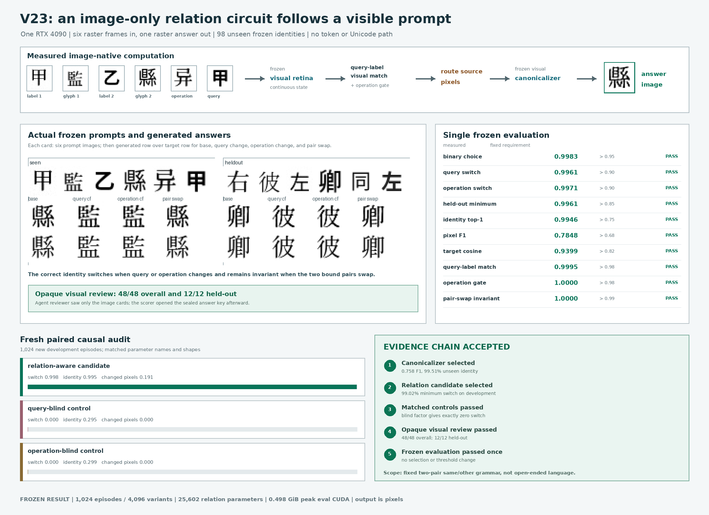

[English](../README.md) · [العربية](README.ar.md) · [Español](README.es.md) · [Français](README.fr.md) · [日本語](README.ja.md) · [한국어](README.ko.md) · [Tiếng Việt](README.vi.md) · [中文 (简体)](README.zh-Hans.md) · [中文（繁體）](README.zh-Hant.md) · [Deutsch](README.de.md) · [Русский](README.ru.md)

<!-- paired-writing-status:start -->
Auch der Vergleich nach 512 Aktualisierungen mit entfernten weißen Rändern liefert keine zuverlässigen Abschriften: exakt per OCR erkannt werden 6/32 Trainings- und 10/32 Validierungsfolgen (klare Referenzbilder: 27/32 und 28/32). Die Rohbilder lassen Zeichen aus und wiederholen Buchstaben. Die Trainingszeit sinkt von 795.624 auf 287.182 Sekunden; Sprachverständnis und Effizienz bei brauchbarer Qualität bleiben unbelegt. [Alle 64 Rohbilder](../references/paired_padding_result.md).
<!-- paired-writing-status:end -->

Aktueller Stand: Die Spracherzeugung als Bild ist weiterhin nicht für den praktischen Einsatz validiert. Im jüngsten Vergleich der Decoder-Verlustfunktionen liefern beide Modelle auf 32 bekannten Trainingsfragen 0/32 pixelgenau übereinstimmende autonome Antworten. Der decoderempfindliche Verlust senkt den Vordergrund-F1 von 85.984% bei der Kontrolle auf 70.009%. Selbst mit korrekter Antwortvorgeschichte werden nur 92.430% beziehungsweise 75.116% erreicht; direkt vorgegebene Antwortbildcodes werden in beiden Fällen mit 99.9953% rekonstruiert. Alle vier Verbesserungskriterien verfehlen ihr Ziel; dieses Trainingsrezept wird nicht hochskaliert. Das misst Bildübereinstimmung, nicht semantische Richtigkeit. Es gibt noch keinen für den praktischen Einsatz validierten ILM-Checkpoint. [Ergebnis und sämtliche unveränderten Bilder](../references/decoder_metric_v82_result.md). Das Manuskript enthält nun Ergänzungsnotiz 39 und die bearbeitbare Abbildung S16. Eine weitere Basis mit einem externen Bildgenerator erreicht ohne lokales Training 0/12 Kopieraufträge und 0/8 Fragen im exakten OCR-Abgleich; die OCR-Kalibrierung an Referenzbildern beträgt 18/20. Alle 40 unveränderten Ausgaben bleiben erhalten. [FLUX.2-klein-4B](../references/image_edit_baseline_result.md).


[](https://lazying.art)

# Imagized-Sprachmodell (ILM)


ILM ist eine Forschungscodebasis für **Text-als-Bild-Generierung**: Sie kodiert Sprache in kompakte, bildähnliche Tensoren und erzeugt Text mit iterativer Diffusions-verstärkter Verfeinerung. Die Repräsentation zerlegt Sätze in Meta-Elemente (Grammatik, Semantik, Tonfall, Emotion) sowie hierarchische, speicherartige Codes für Wörter und Zeichen. Das vereint Ideen aus diskreter Diffusion, Superposition/Disentanglement, strukturierten Einbettungen und glyph-bewusster Zeichenerkennung.


Der jüngste Schnittstellentest liefert beim eingefrorenen vortrainierten Modell 11/32 exakt richtige englische Antworten, wenn dieselben Seiten von 1024 auf 432 verkleinert werden, statt 0/32 in der ursprünglichen Größe. Die beiden trainierten Adapter erreichen bei 432 jeweils nur 5/32. Ein unabhängiges ILM, das Antworten als Bilder erzeugt, ist weiterhin nicht nachgewiesen.

[2026-11-07: English result and full evidence](../references/native_reader_geometry_result.md)

Ergebnis vom 2026-11-08: Die Auswertung des Trainings mit 128 Updates ist abgeschlossen; alle 384 ursprünglichen Antwortbilder wurden geprüft. Ausgangs- und Endmodell erreichen in den Gruppen der gesehenen und zurückgehaltenen Fragen jeweils 0/32 exakt richtige Antworten laut OCR, auch mit den von der Quelle akzeptierten Alternativen. Exaktes Abschreiben auf zurückgehaltenen Fällen fällt von 19/32 auf 16/32. Alle sechs vorab festgelegten Anforderungen werden verfehlt; Sprachlernen ist weiterhin nicht nachgewiesen.

[Ergebnis und Aussagegrenzen](../references/native_paired_qa_learning_result.md)

## Neuestes Ergebnis: Vollständiger Versuch beendet, Sprachkriterien verfehlt

2026-11-13

Der Versuch mit vollständigen Sequenzen umfasst **13,766 Sequenzen, 41,298 Aktualisierungen und 6,108,741 Zielpositionen für Glyphen**. Alle **732 Ausgabebilder** wurden vor der Bewertung anhand von Referenzantworten geprüft. Mit proportional gesetzten Eingaben erreicht das Endmodell **7/32 strikt exakte vollständige Antworten, 0/16 Paare mit beiden Fragen richtig, 14/32 lesbare Antworten und 0/12 kohärente vollständige lange Buchfortsetzungen**. Sowohl die vorab registrierten Kriterien als auch die unabhängige Prüfung aller vier Kontrollen mit gelöschter Frage oder gelöschtem Text werden verfehlt.

Das Training nutzt eine RTX 4090 mit maximal **18.568 GiB** zugewiesenem VRAM. Das gesamte eingesetzte Modell hat **7,578,390,003 Parameter**, einschließlich übernommener Basisgewichte; **20,212,225** Parameter werden hier aktualisiert. Es handelt sich um wiederverwendete Entwicklungsdaten mit einem Modell als Gutachter und ohne unabhängige menschliche Beurteilung. Ein nutzbares leichtgewichtiges ILM und ein Effizienzvorteil bei gleicher Qualität sind weiterhin nicht nachgewiesen.

[Vollständiges Ergebnis](../references/visual_continuation_learning_result.md) · [Entwicklungsziel](../docs/first-imagized-language-model-goal.md) · [Festes Protokoll](../references/visual_continuation_full_protocol.md)

## Frühere V23-Ergebnisse



V23 ist das erste Experiment dieses Repositorys, das die vollständige
Beweiskette von einem Bild-Prompt zu einem Bild-Antwortfeld besteht. Das Modell
erhält nur sechs `32x32`-Schriftbilder und erzeugt ein `32x32`-Antwortbild. Im
Inferenzpfad gibt es keine Strings, Tokens, Unicode-IDs, OCR, Glyphensuche,
Antwortindizes oder externen Sprachmodelle.

In der einzigen autorisierten Frozen-Evaluation mit 98 ungesehenen chinesischen
Zeichen, 1.024 Episoden und 4.096 Promptvarianten erreicht es `0.99829` binäre
Auswahl, `0.99609` Query-Wechsel, `0.99707` Operationswechsel, `0.99463`
Glyphen-Top-1 und `0.78478` Pixel-F1. Query-blinde und operationsblinde
Kontrollen bleiben gegenüber ihrem jeweils unsichtbaren Faktor exakt invariant.

Dies belegt nur visuelles Prompt-Folgen für eine feste Grammatik mit sechs
Rollen, zwei Bindungen und einer Same/Other-Relation, nicht freies
Sprachverständnis. V24 soll feste Framerollen entfernen, einen variabel langen
2D-Schriftbildstrom lesen und nach dem Wiederlesen des ersten Ausgabeframes ein
zweites erzeugen. Siehe den [englischen V23-Bericht](../docs/visual-relation-circuit-v23-result.md).

> Das Repository hält bewusst eine praxisnahe Etymologie-Pipeline und ILM-Experimentieren auf lange Sicht nebeneinander.

## 📌 Überblick

Dieses Repository verfolgt zwei aktive Pfade:

1. Historische chinesische Glyphen-Etymologie-Ingestion (Scraping/Parsing/Speicherung/Vorschau).
2. ILM-Experimente für Glyphen-/Bildmodellierung (Token-Glyph-Rendering, Codebücher, Frame-Packing, Diffusion/Inpainting, Auswertung/Reporting).

Diese README dokumentiert beide Spuren und hält den Etymologie-Workflow als ersten Klassen-Zweig mit reproduzierbarem Pfad.

## 🔗 Wichtige Links

| Bereich | Pfad |
|---|---|
| Konzeptionelles Exposé | `docs/imagized-language-model.md` |
| Codeplan und Metriken | `docs/ilm-visual-diffusion-code-plan.md` |
| Embedding-„Color“-Plan | `docs/embedding-color-plan.md` |
| Entwicklungsnotizen/-plan | `docs/development-plan.md` |
| Etymologie-Modul-README | `ilm/etymology/README.md` |

## ✨ Funktionen

- 🏺 Etymologie-Ingestion aus `hanziyuan`- und `chineseetymology`-ähnlichen Quellen.
- 🌐 Robuster AJAX- + HTML-Ingestion-Pfad mit Wiederholungsversuchen, Drosselung und Cache.
- 🧩 Etappen-etikettierte Glyphen-Extraktion inklusive ``- und CSS-`background-image`-Data-URIs.
- 🗃️ SQLite-basierte Speicherung für Zeichen-/Glyphen-Metadaten plus Dateisystemstruktur für Assets.
- 🖥️ Tornado-Web-UI für ad-hoc-Ingestion + Galerievorschau.
- 🔤 Glyph-Rendering-Werkzeuge für mehrsprachige Token-Bilder.
- 🧠 Embedding-/Codebook-Module im Stil von Product-Codes.
- 🧱 Satz-Frame-Packing sowie Diffusions-/Inpainting-Trainings- und Evaluations-Skripte.
- 📊 Reporting- und Visualisierungs-Skripte für Embeddings und Pipeline-Inspektion.
- 📄 Veröffentlichungsartefakte in LaTeX/PDF unter `publication/`.

## 🧱 Projektstruktur

```text
.
├── README.md
├── AGENTS.md
├── configs/
│   ├── color.yaml
│   └── diffusion.yaml
├── docs/
├── i18n/
├── ilm/
│   ├── code/
│   ├── data/
│   ├── datasets/
│   ├── db/
│   ├── diffusion/
│   ├── encoders/
│   ├── english_tiles/
│   ├── etymology/
│   ├── frames/
│   ├── models/
│   └── utils/
├── scripts/
├── publication/
├── assets/
├── logs/
└── *.ipynb
```

## 🧰 Voraussetzungen

| Anforderung | Hinweise |
|---|---|
| Python `3.10+` | Zentrale Laufzeit |
| `pip` | Paketinstallation |
| Optional GPU | Hilfreich für PyTorch CUDA-Trainingsskripte |
| Optionaler LaTeX-Stack | Für Publication-Builds erforderlich |

Hinweis zur Annahme: Es gibt momentan keine einzelne zentrale Dependency-Sperre/Spezifikation (`pyproject.toml`, `requirements.txt` usw.), daher werden Abhängigkeiten aus Imports und Skript-Nutzung abgeleitet.

## ⚙️ Installation

### Minimal (Etymologie-Toolkit)

```bash
python -m venv .venv
source .venv/bin/activate
pip install --upgrade pip
pip install requests beautifulsoup4 tornado
```

### Erweitert (Modellierungs-/Trainings-Workflows)

```bash
python -m venv .venv
source .venv/bin/activate
pip install --upgrade pip
pip install requests beautifulsoup4 tornado pyyaml numpy pillow matplotlib torch
```

Wenn ein bestimmtes Skript zusätzliche Pakete benötigt, installiere diese anhand der konkreten Import-Fehlermeldung des Skripts.

## 🚀 Verwendung

### Schnellstart: Historische Glyphen-Ingestion (CLI)

1. Hanziyuan (empfohlen): Nur-Zeichen-AJAX-Flow

```bash
PYTHONPATH=. python scripts/ingest_etymology.py --site hanziyuan --char 中
```

2. ChineseEtymology (direkte URL)

```bash
PYTHONPATH=. python scripts/ingest_etymology.py --site chineseetymology --url "https://www.chineseetymology.org/CharacterEtymology.aspx?characterInput=%E4%B8%AD"
```

3. Batch-Datei-Ingestion (Zeilen können `char\turl`, `url` oder `char url` sein)

```bash
PYTHONPATH=. python scripts/ingest_etymology.py --from-file urls.txt
```

### Ausgaben

| Ausgabetyp | Ort |
|---|---|
| Dateien | `data/historic/glyphs/<char>/<stage>/<label>.<ext>` |
| Cache | `data/historic/cache/*.html` |
| Datenbank | `data/historic/etymology.sqlite3` |

### Web-Demo (optional)

```bash
PYTHONPATH=. python scripts/serve_etymology.py
```

Öffne `http://127.0.0.1:8888`, wähle eine Seite und gib ein Zeichen ein (zum Beispiel `中`).

### Höfliches Crawling und Rücksicht auf Webseiten

- Der Fetcher nutzt pro-Host-Drosselung, Wiederholungsversuche mit Backoff und Caching.
- Halte Delays von `>= 0.5s` ein, vermeide Bursts und beachte Nutzungsbedingungen/Robots/Lizenz.
- Umgehe keine Paywalls oder interaktive Schutzmaßnahmen.
- Bei `403`/`429` langsamer machen und später erneut versuchen.

### Zusätzliche ILM-Workflows

Diese Skripte sind vorhanden und aktiv Teil der Repo-Oberfläche, aber Forschungs-Workflows und können vorbereitete lokale Datensätze/Checkpoints erfordern.

1. Daten herunterladen/vorbereiten

```bash
python scripts/download_alpaca.py --outdir data/raw
python scripts/download_corpora.py --out data/raw
python scripts/sample_paragraphs.py --out data/processed/test_100.jsonl
python scripts/build_images_common_freq.py --out data/processed/images_common_freq --size 128 --en 5000 --zh 5000
```

2. Glyph-DB-Lebenszyklus

```bash
python scripts/glyphdb_init.py --db data/glyphdb/glyphs.sqlite3
python scripts/glyphdb_ingest_index.py --db data/glyphdb/glyphs.sqlite3 --index data/processed/images_common_freq/index.tsv
```

3. Code-/Farbmodell-Training

```bash
python scripts/train_color_codes.py --config configs/color.yaml
python scripts/train_codes_from_qa.py --en-json data/raw/alpaca_en.json --zh-json data/raw/alpaca_zh.json --epochs 1
python scripts/train_ilmglyph_codes.py --en data/raw/alpaca_en.json --zh data/raw/alpaca_zh.json --out artifacts/ilm_glyph_train
```

4. Diffusions-/Inpainting-Workflows

```bash
python scripts/train_diffusion.py --config configs/diffusion.yaml
python scripts/train_inpaint_frames.py --ckpt-code artifacts/ilm_glyph_train/ckpt_epoch1.pt --out artifacts/inpaint
```

5. Evaluation/Reporting

```bash
python scripts/eval_color_codes.py --checkpoint artifacts/color_codes_e1.pt
python scripts/eval_diffusion.py --checkpoint artifacts/diffusion_unet.pt
python scripts/eval_qa_retrieval.py --checkpoint artifacts/color_codes_qa.pt
python scripts/report_ilmglyph_pipeline.py --ckpt artifacts/ilm_glyph_train/ckpt_epoch1.pt --lang en --text "hello world"
```

## 🧩 Konfiguration

Primäre YAML-Konfigurationen:

- `configs/color.yaml`
  - Datenpfad: `data/processed/images_common_freq/index.tsv`
  - Modell/Code-Parameter: `d_glyph`, `d_code`, `K`, `C`, temperature/anneal
  - Optimizer-/Logging-Einstellungen

- `configs/diffusion.yaml`
  - Eingabe-JSONL: `data/processed/test_100.jsonl`
  - Frame-/Raster- und Modellgrößeneinstellungen
  - Bereich der Trainings-Maske und Checkpoint-Einstellungen

Überschreibe Einstellungen über CLI-Flags, wo unterstützt (`--epochs`, `--batch-size`, `--lr` usw.).

## 🧪 Beispiele

- Erstelle eine einzelne englische Tile-Glyphe:

```bash
python scripts/build_english_tile_glyph.py "language" artifacts/language_tile --save-tensor
```

- Inpainting-Demo mit trainierten Checkpoints ausführen:

```bash
python scripts/inpaint_demo.py \
  --ckpt-code artifacts/ilm_glyph_train/ckpt_epoch1.pt \
  --ckpt-inpaint artifacts/inpaint/ckpt_epoch1.pt \
  --lang en \
  --text "the quick brown fox jumps" \
  --mode infill \
  --out artifacts/inpaint_demo
```

- Häufige Zeichen massenhaft aus Hanziyuan ingestieren:

```bash
PYTHONPATH=. python scripts/bulk_ingest_hanziyuan.py --limit 200 --resume
```

## 📝 Entwicklungsnotizen

- Dieses ist ein Forschungs-Repository mit robusten CLIs und explorativen Artefakten (inklusive Notebooks und Prototyp-Skripten).
- Große erzeugte Dateien sind für `data/` und `artifacts/` vorgesehen (beides ist in `.gitignore` ausgeschlossen).
- Veröffentlichungssourcen und PDFs liegen unter `publication/`; Hilfsskript: `scripts/latex_build.sh`.
- Zusammenarbeit/Prozesskonventionen sind in `AGENTS.md` dokumentiert.

## 🛠️ Fehlerbehebung

- `ModuleNotFoundError: ilm...`
  - Führe Skripte vom Repo-Root aus.
  - Setze `PYTHONPATH=.` für Skripte, die mit lokaler Paketauflösung arbeiten.

- `FileNotFoundError` bei Daten/Index/Checkpoints
  - Führe zuerst die nötigen Daten-/Build-Skripte aus.
  - Prüfe, dass Standardpfade wie `data/processed/images_common_freq/index.tsv` und `data/processed/test_100.jsonl` existieren.

- CUDA/Geräteprobleme
  - Wechsle mit Skript-Flags/Konfiguration auf CPU (`device: cpu` oder `--device cpu`).

- Fehlende Paketfehler
  - Installiere die benötigte Abhängigkeit aus dem konkreten Importpfad des Skripts (`torch`, `pyyaml`, `Pillow` usw.).

- HTTP `403`/`429` beim Scraping
  - Erhöhe `--delay`, versuche es später erneut und halte Anfragen höflich.

## 🗺️ Roadmap

- Verfeinere die Text-als-Bild-ILM-Trainings-/Eval-Runbooks über den Etymologie-orientierten Quick-Start hinaus.
- Verbessere Reproduzierbarkeit der Umgebung (eine einzige autoritative Dependency-Spezifikation).
- Erweitere Tests/CI-Abdeckung für Forschungsskripte und Pipeline-Klebeschicht.
- Iteriere weiter bei hierarchischen Codebooks, Diffusionszielen und Kontrollierbarkeitskanälen.
- Konsolidiere Dokumentation über `docs/`, Skript-Helptexte und Veröffentlichungspakete.

Für konzeptionell tiefere und stufenweise Planungsdetails siehe:

- `docs/imagized-language-model.md`
- `docs/ilm-visual-diffusion-code-plan.md`
- `docs/development-plan.md`

## 🤝 Mitwirken

- Folge `AGENTS.md` für Konventionen (atomare Commits, Push nach Änderungen, keine Zugangsdaten im Code).
- Fasse verwandte Änderungen in fokussierten Commits mit konventionellen Nachrichten zusammen.
- Bevorzuge reproduzierbare Skriptaufrufe mit expliziten Flags und Eingabepfaden.
- Für Änderungen am Scraping die Drosselung/Cache-Verhalten und Site-Respekt-Kontrollen unverändert erhalten.

## 📄 Lizenz

Eine Top-level-Lizenzdatei ist derzeit im Repository nicht vorhanden.

Annahmehinweis: Betrachte das Projekt bis zum Hinzufügen einer `LICENSE` durch die Maintainer als Forschungs-Code mit nicht spezifizierter Lizenzierung.


## ❤️ Support

<!-- support:start -->
[](https://github.com/sponsors/lachlanchen)
[](https://chat.lazying.art/donate)
[](https://paypal.me/RongzhouChen)
[](https://buy.stripe.com/aFadR8gIaflgfQV6T4fw400)
<!-- support:end -->
