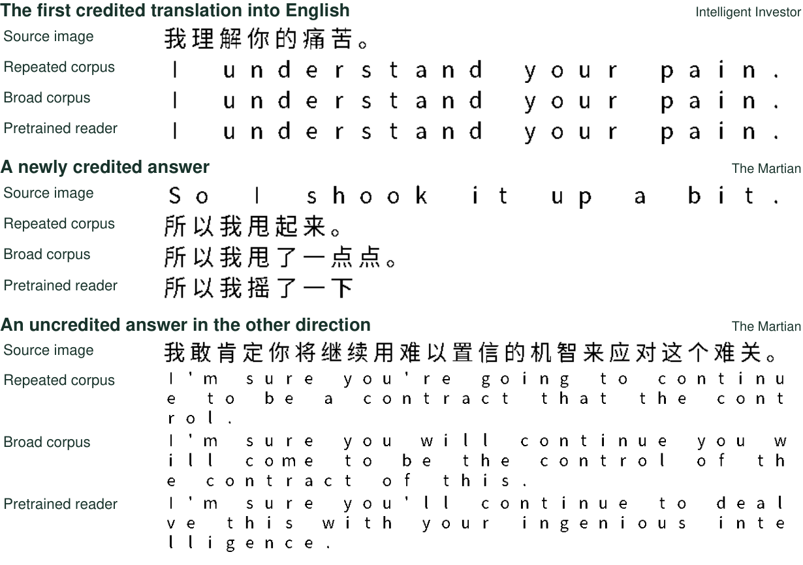
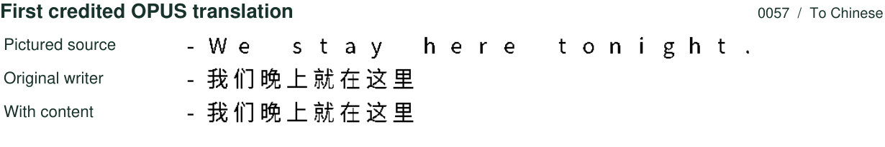
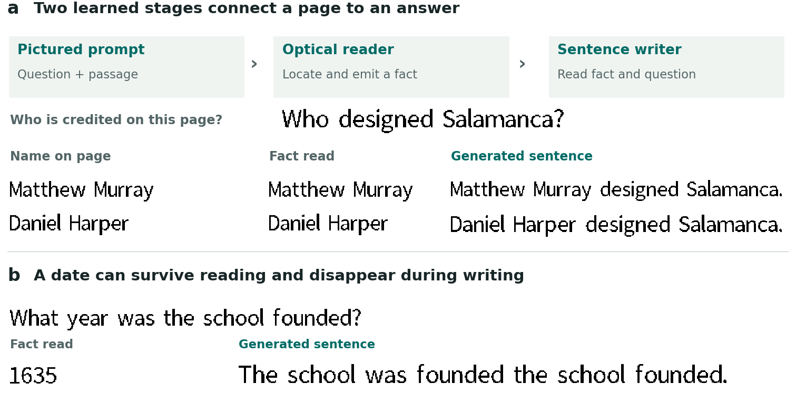
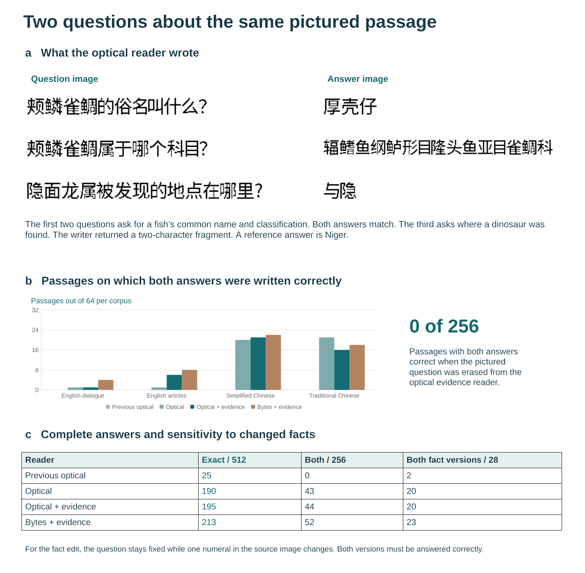
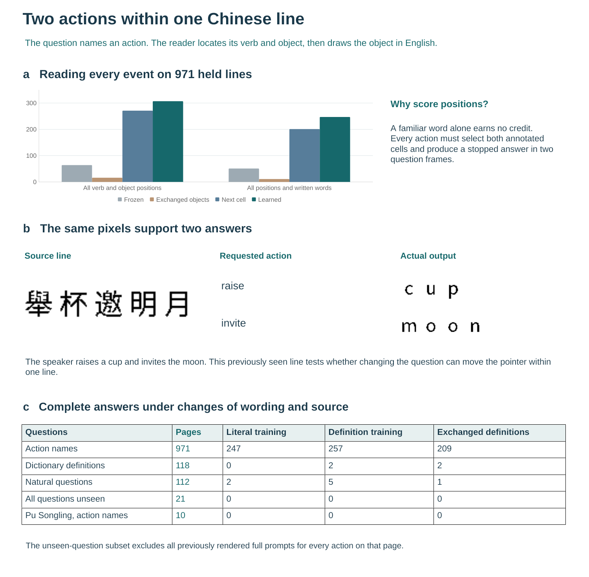
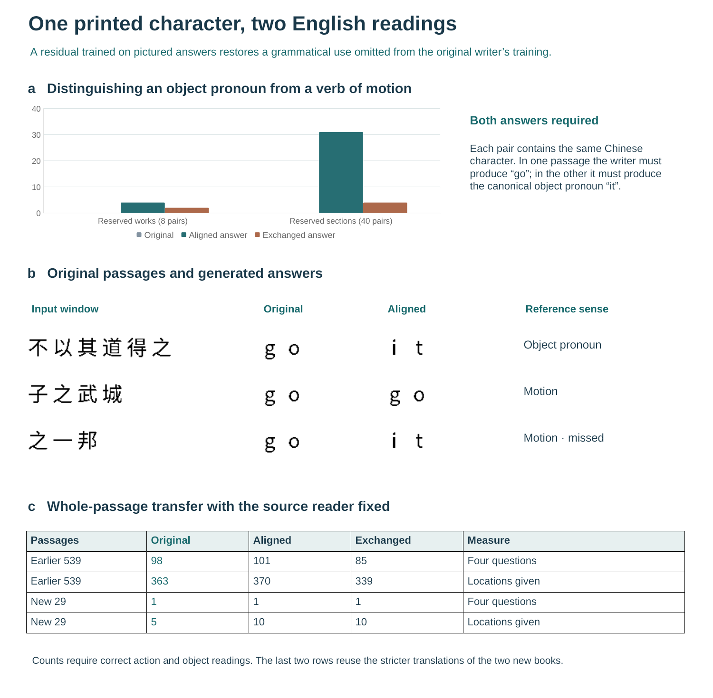
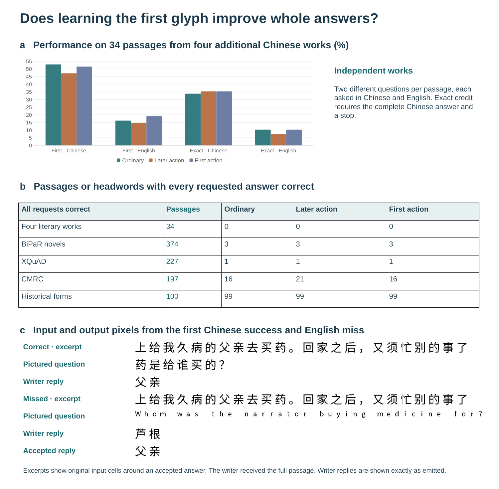
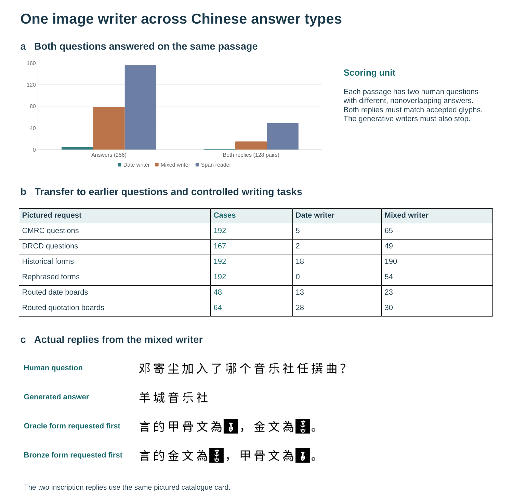

[English](../README.md) · [العربية](README.ar.md) · [Español](README.es.md) · [Français](README.fr.md) · [日本語](README.ja.md) · [한국어](README.ko.md) · [Tiếng Việt](README.vi.md) · [中文 (简体)](README.zh-Hans.md) · [中文（繁體）](README.zh-Hant.md) · [Deutsch](README.de.md) · [Русский](README.ru.md)

Für das Satzbild „我理解你的痛苦。“ aus einem bisher ungesehenen Buch schrieb das eigenständige visuelle Modell „I understand your pain.“. Bei gleichem Trainingsbudget auf einer RTX 4090 D gelangen mit 147.456 unterschiedlichen Satzpaaren 6 von 96 vollständigen Übersetzungen, mit 24.576 wiederholten Paaren 4 und vor dem Training 5. Das quantisierte Textmodell Qwen3-8B erreichte 88. Die über Bücher geschätzten Intervalle der Differenzen schließen null ein. [Versuch und Gewichte](../references/visual_training_breadth_result.md)



[Frühere Versuche zu Korrektur und Suche](../references/visual_sequence_preference_result.md) · [2/96](../references/retrieved_glyph_writer_result.md)

Das auf einer RTX 4090 D trainierte Modell wählt für jede Buchpassage zwischen zwei abgebildeten Übersetzungen. Nach Korrektur seiner Vorliebe für bestimmte Zielformulierungen stieg die Zahl der Paare mit zwei richtigen Entscheidungen von **21/96 auf 77/96**. Beim freien Schreiben erhöhte die Vorhersage von Glyphengruppen aus dem Quellbild die Zahl der Antworten mit dem gesuchten Prädikat von 17/336 auf 43/336. Nur eine von 192 Buchübersetzungen gab die vollständige Bedeutung wieder. Die Abbildung zeigt die erste im separaten OPUS-Test akzeptierte Antwort. [Ergebnisse](../references/source_supported_writing_result.md) · [Modell ausführen](../models/source_supported_writing/README.md)



Zwei Fragen zur selben Wörterbuchseite verlangen die Bedeutung und die historische Zeichenform in entgegengesetzter Reihenfolge. Der Leser erfüllte beide Aufträge bei 332 von 608 Paaren, zuvor bei 138. In einem separaten Übersetzungstest gab das unabhängige Bildmodell bei einem von 192 Beispielen die vollständige Bedeutung wieder, Qwen3-8B mit Texteingabe bei 154. [Sechsseitiger Artikel](../publication/ilm-nature/manuscript.pdf) · [Wörterbuchbeispiel](../models/origin_instructions/README.md)

### Frühere Experimente

Auf die Frage nach dem Konstrukteur der Lokomotive Salamanca schrieb das Modell **Matthew Murray designed Salamanca.** Wurde nur der Name im Seitenbild in Daniel Harper geändert, wechselte auch das Subjekt der Antwort. In 96 neuen Texten las das Modell 25 Kurzantworten richtig. In einem anderen Fall erkannte es das Gründungsjahr einer Schule, ließ es im Satz aber aus. Die erste Seite des Artikels zeigt die tatsächlichen Ausgabebilder. [PDF](../publication/ilm-nature/visual_language_paper.pdf) · [PNG](../models/visual_statements/examples/intervention)

Auf 256 neuen englischen und chinesischen Seiten mit je zwei von Menschen formulierten Fragen beantwortete das kontrastiv trainierte ILM auf 34 Seiten beide Fragen richtig. Das quantisierte Qwen3-8B erreichte mit Texteingabe 101 Seiten. Bei identischer Bildeingabe auf 64 Seiten löste das ILM beide Fragen auf 6 Seiten, Qwen3-VL-8B auf 21. [PDF](../publication/ilm-nature/visual_language_paper.pdf) · [PNG](../models/competing_facts/examples)

[](../publication/ilm-nature/visual_language_paper.pdf)

Auf derselben chinesischen Buchseite über einen Fisch schrieb das Modell je nach Frage dessen gebräuchlichen Namen oder dessen Klassifikation. Der auf einer RTX 4090 D trainierte Leser mit 2,44 Millionen Parametern beantwortete bei 44 von 256 neuen englischen und chinesischen Passagen beide Fragen richtig. Der Vorgänger schaffte kein Paar, das Byte-Vergleichsmodell bei ähnlichem Energieverbrauch 52. Die historischen Formen von 言 gab der visuelle Leser nicht korrekt wieder. [Modell ausführen](../models/paired_evidence/README.md) · [Forschungsbericht](../publication/ilm-nature/visual_language_paper.pdf)

[](https://github.com/lachlanchen/ImagizedLanguageModel/blob/203f40812f03afbdfa55cf957a56ee8cfe0f944c/publication/ilm-nature/visual_language_paper.pdf#page=2)

Ein Modell mit 2,12 Millionen Parametern lernte auf einer RTX 4090 D, Schriftzeichen in unbekannten englischen und chinesischen Texten vorherzusagen. Auf die Frage nach einer Möglichkeit zum Energiesparen wiederholte es Teile der Frage. Nach Ergänzung eines visuellen Lesemoduls traf es bei 11 von 384 Fragen eine Referenzantwort. Bei keiner der 192 Passagen beantwortete es beide Fragen richtig. Abbildung 144 zeigt die ausgegebenen Pixel. [Artikel lesen](../publication/ilm-nature/visual_language_paper.pdf) · [Modell ausführen](../models/visual_cursor/README.md)

[](https://github.com/lachlanchen/ImagizedLanguageModel/blob/203f40812f03afbdfa55cf957a56ee8cfe0f944c/publication/ilm-nature/visual_language_paper.pdf#page=4)

Ein Modell mit 1,18 Millionen Parametern liest ein markiertes Zeichen in einem Bild eines klassischen chinesischen Textes und zeichnet seine englische Bedeutung. Für 言 schreibt es am Ende von 言及之而不言 „speak“, in 有是言也 dagegen „speech“. Beide Bedeutungen trifft es bei 213 von 566 Paaren in den Gesprächen des Konfuzius und 82 von 403 in den Liedern von Chu. Ein Häufigkeitsverfahren mit Nachbarzeichen löst 211 und 104 Paare. [Modell ausführen](../models/visual_word_senses/README.md) · [Ergebnisse](../references/visual_word_sense_result.md)

[](../publication/ilm-nature/manuscript.pdf#page=160)

Das Modell liest chinesische Fragen und Romanpassagen als Bilder und schreibt seine Antwort in zwei Teilsätzen als Bild. Für Die Reise nach Westen stimmten 34 von 48 Antworten exakt mit der Vorlage überein, für Der Traum der Roten Kammer waren es 42 von 48. Bei 9 von 60 zurückgehaltenen Zeichenfamilien schrieb es die belegten Orakelknochen- und Bronzeformen in jeder Anordnung richtig. Bei englischen Fragen gelangen 2 bzw. 10 von 48 Antworten. [Modell ausführen](../models/grounded_ink_editor/README.md) · [Ergebnisse und Beispiele](../references/grounded_ink_writing_result.md)

[](../publication/ilm-nature/manuscript.pdf#page=159)

Ein visuelles Lesemodell mit 86 Millionen Parametern beantwortete 38 von 56 chinesischen Fragen zu den Personen im *Guoyu* (國語) richtig. Fragen und Passagen lagen als Bilder vor. Vor und nach dem Tausch zweier Namen gelangen alle vier Antworten in 4 von 14 Passagen. Das Ausgangsmodell schaffte 3, das Kontrollmodell mit gleich gewichteten Namen 2. Auf Englisch gelangen 16 richtige Antworten, aber keine vollständige Vierergruppe. Das Beispiel gibt die Schriftbilder von 密康公 und 恭王 aus der Vorlage zurück. [Guoyu · ILM](../models/optical_role_reader/README.md) · [38/56](../references/optical_role_adapter_result.md)

[](../publication/ilm-nature/manuscript.pdf#page=157)

Das Lesemodell mit 64.666 Parametern erhält eine Frage und einen chinesischen Text als Bilder und gibt einen Ausschnitt der Originalseite zurück. Nach dem Training mit 6.439 Passagen beantwortete es zu zwei zurückgehaltenen Romanen 104 von 452 chinesischen und 45 von 452 englischen Fragen richtig. Beim Training allein mit menschlichen Antworten waren es 81 beziehungsweise 48. Zwei verschiedene Fragen zur selben Passage beantwortet das Modell bislang selten beide richtig. [ILM · 64k](../models/book_span_distillation/README.md) · [104/452](../references/book_span_distillation_result.md)

[](../publication/ilm-nature/manuscript.pdf#page=154)

Bei abgebildeten Werkangaben erkannte das visuelle Modell einen Rollentausch in 175 von 256 Vergleichen, das Kontrollmodell in 19. Bei zwölf neuen Erzählungen gelang beiden kein vollständiger Vergleich. Mit zwei Fragen als Bild und den zugehörigen Katalogausschnitten gab das Modell vier historische Formen von 言 in zwei von acht Versuchen korrekt wieder. [↗](../references/individual_clause_writer_result.md)

[](../publication/ilm-nature/manuscript.pdf#page=152)

Nach dem Tausch zweier Namen in abgebildeten Werkangaben beantwortete das Modell mit 87 Millionen Parametern die Fragen in beiden Reihenfolgen bei 165 von 256 Vergleichen richtig. Das Kontrollmodell sah dieselben Beispiele und bestand fünf Vergleiche. Bei eigens formulierten Erzählungen erreichten beide Modelle 0 von 24. [Ergebnisse und Originalbilder](../references/role_change_writer_result.md) · [Modell ausführen](../models/role_change_writer/README.md)

Nach Ausschluss der reservierten DRCD-Daten und erneutem Training lieferte das Modell mit der erweiterten Auswahlliste bei 234 von 359 Entwicklungsfragen das exakte Antwortbild, das allgemeine Lesemodell bei 242. Frühere DRCD-Auswertungen verwendeten reservierte Testpassagen. [Ergebnisse und Berichtigung zur Datenquelle](../references/span_list_result.md)

[](../publication/ilm-nature/manuscript.pdf#page=138)

Bei 384 neu ausgewerteten chinesischen Lesefragen stimmten 285 Antworten des kombinierten Modells exakt mit dem Referenzbild überein, ebenso viele wie beim allgemeinen Lesemodell. Von 128 Tests mit vertauschten Namen bestand es 63 vollständig, das spezialisierte Modell 79. [Ergebnisse und Gewichte](../references/span_choice_result.md)

[](../publication/ilm-nature/manuscript.pdf#page=137)

Nach dem Vertauschen zweier Namen in einem chinesischen Textbild beantwortete das allein mit Likelihood trainierte Modell bei 79 von 128 Passagen sämtliche Fragen in beiden Wortstellungen richtig. Zuvor waren es 29. Bei 48 von Menschen formulierten Fragen sank die Zahl richtiger Antworten in beiden Wortstellungen von 34 auf 28. [Ergebnisse und Modelle](../references/participant_margin_result.md)

[](../publication/ilm-nature/manuscript.pdf#page=136)

Bei 34 von 48 von Menschen formulierten chinesischen Fragen gab das Modell den Sachverhalt in beiden gewünschten Wortstellungen korrekt wieder. Es nannte den richtigen Komponisten von „秋潮“. Bei einem anderen Lied verwechselte es Komponist und Texter, als ihre Namen vertauscht wurden. [Ergebnisse und Modell](../references/pictured_relation_result.md)

[](../publication/ilm-nature/manuscript.pdf#page=135)

Nach dem Training mit 26.890 chinesischen Bildbeispielen beantwortete das Modell 33 von 48 von Menschen formulierten Fragen in vollständigen, korrekten Sätzen. Ein zweites Modell schrieb Zeichen für Zeichen und drückte denselben Sachverhalt bei 31 Fragen in beiden verlangten Wortfolgen aus. Im Filmbeispiel stimmen die ursprünglichen Angaben zu Regie und Drehbuch. Nach dem Namenstausch kopiert das Modell einen Teil des Satzes mit. [Ergebnisse und Modell](../references/role_binding_result.md)

[](../publication/ilm-nature/manuscript.pdf#page=134)

Folgt die Antwort, wenn zwei Namen im Bild eines Textes vertauscht werden? Bei Rollenkombinationen, die beim Training mit zwei Sätzen ausgelassen wurden, schrieb das Modell mit getrennter Aufgabenplanung und gemeinsamem Bildgenerator in 70 von 136 Fällen beide Fakten in der verlangten Reihenfolge. Das Modell, das beide Sätze in einem Durchgang schrieb, schaffte dies dreimal. Im Filmbeispiel schrieb es lesbare Sätze, nannte aber dieselbe Person für Drehbuch und Regie. [Ergebnisse und Modell](../references/grounded_proposition_result.md)

[](../publication/ilm-nature/manuscript.pdf#page=133)

Wer zeichnete die Karte und wer musste nach dem Weg fragen? Das überarbeitete Modell nennt zwei verschiedene Namen. Bei 64 neuen Fragen in Bildform gab es 42 Namen exakt wieder. Es schreibt auch die Orakelknochen- und Bronzeformen von 言 in der verlangten Reihenfolge. Bei 128 neuen offenen Fragen, die ein in der Eingabe fehlendes Schriftzeichen erforderten, stimmte keine Antwort genau mit einer Referenz überein. [Ergebnisse und Modell](../references/pointing_causal_writer_result.md)

[](../publication/ilm-nature/manuscript.pdf#page=132)

Der abgebildete Text nennt die Person, die eine Karte zeichnete, und die Person, die sich verlaufen hatte. Das Modell benennt den Kartenzeichner richtig, wiederholt diese Aussage aber auf die Frage, wer nach dem Weg fragen musste. Bei 300 Fragen fehlte eine benötigte Glyphe in der Eingabe. Selbst mit dem richtigen bisherigen Antwortverlauf wählte das Modell die erste fehlende Glyphe nur 18-mal richtig. [Ergebnisse und ursprüngliche Antwortbilder](../references/causal_glyph_writer_result.md)

[](../publication/ilm-nature/manuscript.pdf#page=131)

Das Modell gibt die Orakelknochen- und Bronzeformen von 言 in der Reihenfolge der abgebildeten Frage aus. Bei zurückgehaltenen Zeichen und vertrauter Formulierung gelangen beide Reihenfolgen in 94 von 96 Vergleichen. Bei weiteren Karten und neuer Formulierung waren es 16 von 96. [Ergebnisse und Antwortbilder](../references/ordered_page_writer_result.md)

[](../publication/ilm-nature/manuscript.pdf#page=130)

**Schriftbilder lesen und Fragen beantworten.** Von 64 chinesischen Fragen zu zwei Personen beantwortete das Modell 46 in Normalschrift und 41 in Fettschrift richtig. Das lokale Qwen3-8B kam mit Texteingabe auf 55. Bei einer im Training nicht verwendeten Kai-Schrift war nur eine Antwort richtig. [Modell ausführen](../docs/visual-page-responder.md)

[](../publication/ilm-nature/manuscript.pdf#page=129)

**Kann das Modell zwei Personen in einem Satz unterscheiden?** Das Modell nennt den Spender und den Architekten des Gates-Gebäudes korrekt. Bei 100 von 864 Fragenpaaren stimmen beide Antworten. In 24 neuen Situationen mit vertauschten Namen löst es keine vollständig, das lokale Qwen3-8B dagegen 20. [Ergebnisse und Anleitung](../references/shared_sentence_writer_result.md)

[](../publication/ilm-nature/manuscript.pdf#page=127)

**Warum wählt das Modell die falsche Person?** Bei 387 chinesischen Wer-Fragen stieg die Zahl vollständig richtiger Antworten von 62 auf 116, wenn zunächst ein Satz anhand gemeinsamer Schriftzeichen ausgewählt wurde. Das Kontrollmodell mit zufälliger Zuordnung im Zusatztraining erreichte damit 127. Abbildung 85 zeigt einen Ortsnamen als Antwort auf die Frage nach einem Erfinder. [Ergebnisse und Anleitung](../references/inverse_role_writer_result.md)

[](../publication/ilm-nature/manuscript.pdf#page=126)

**Von wem handelt der Satz?** Mit neuen Namen und Ergänzungen schrieb das Modell 368 von 404 chinesischen Sätzen vollständig richtig. Mit den Schriftzeichen für Qin und Chu aus Bronzeinschriften gelangen 24 von 32 Sätzen. War nur die Eigenschaft vorgegeben und der Name gefragt, gab es keinen der Namen in Bronzeschrift exakt wieder. [Ergebnisse und Anleitung](../references/visual_role_writer_result.md)

[](../publication/ilm-nature/manuscript.pdf#page=125)

**Was liest das Modell aus Schriftbildern?** Beim Satzbild „她喝了一口□。“ („Sie nahm einen Schluck □“) wechselte die Antwort von 水 (Wasser) zu 茶 (Tee), als das Getränk im Begleittext wechselte. Das neuronale Modell und eine Auswertung benachbarter Schriftzeichen ergänzten gemeinsam 651 von 2.947 chinesischen Textlücken wortgetreu. Tauschten zwei Personen ihre Rollen, beurteilte das Modell bei keinem der 48 Paare beide Fassungen richtig. [Ergebnisse und Befehle](../references/visual_inference_writer_result.md)

[](../publication/ilm-nature/manuscript.pdf#page=124)

<!-- paired-writing-status:start -->
Auch der Vergleich nach 512 Aktualisierungen mit entfernten weißen Rändern liefert keine zuverlässigen Abschriften: exakt per OCR erkannt werden 6/32 Trainings- und 10/32 Validierungsfolgen (klare Referenzbilder: 27/32 und 28/32). Die Rohbilder lassen Zeichen aus und wiederholen Buchstaben. Die Trainingszeit sinkt von 795.624 auf 287.182 Sekunden; Sprachverständnis und Effizienz bei brauchbarer Qualität bleiben unbelegt. [Alle 64 Rohbilder](../references/paired_padding_result.md).
<!-- paired-writing-status:end -->

Aktueller Stand: Die Spracherzeugung als Bild ist weiterhin nicht für den praktischen Einsatz validiert. Im jüngsten Vergleich der Decoder-Verlustfunktionen liefern beide Modelle auf 32 bekannten Trainingsfragen 0/32 pixelgenau übereinstimmende autonome Antworten. Der decoderempfindliche Verlust senkt den Vordergrund-F1 von 85.984% bei der Kontrolle auf 70.009%. Selbst mit korrekter Antwortvorgeschichte werden nur 92.430% beziehungsweise 75.116% erreicht; direkt vorgegebene Antwortbildcodes werden in beiden Fällen mit 99.9953% rekonstruiert. Alle vier Verbesserungskriterien verfehlen ihr Ziel; dieses Trainingsrezept wird nicht hochskaliert. Das misst Bildübereinstimmung, nicht semantische Richtigkeit. Es gibt noch keinen für den praktischen Einsatz validierten ILM-Checkpoint. [Ergebnis und sämtliche unveränderten Bilder](../references/decoder_metric_v82_result.md). Das Manuskript enthält nun Ergänzungsnotiz 39 und die bearbeitbare Abbildung S16. Eine weitere Basis mit einem externen Bildgenerator erreicht ohne lokales Training 0/12 Kopieraufträge und 0/8 Fragen im exakten OCR-Abgleich; die OCR-Kalibrierung an Referenzbildern beträgt 18/20. Alle 40 unveränderten Ausgaben bleiben erhalten. [FLUX.2-klein-4B](../references/image_edit_baseline_result.md).


[](https://lazying.art)

# Imagized-Sprachmodell (ILM)

Beim selben Vers 舉杯邀明月 schreibt das Modell **cup** auf die Frage, was gehoben wird, und **moon** auf die Frage, wer eingeladen wird. Der Vers war aus früherem Training bekannt. In 247 von 971 zurückgehaltenen Sätzen fand das Modell alle Verben und Objekte und schrieb die erwarteten englischen Bedeutungen. Bei vertauschten Objekten im Training gelang dies für elf Sätze. Keinen der 21 Sätze mit ausschließlich neuen natürlich formulierten Fragen löste es vollständig. [Modell ausführen](../models/questioned_events/README.md) · [Ergebnisse](../references/questioned_events_result.md)

[](../publication/ilm-nature/manuscript.pdf#page=167)

Bei englischen Umschreibungen einer Handlung fand das Bildmodell in 44 von 268 klassischen chinesischen Satzpaaren beide Objekte und schrieb ihre englische Bedeutung. Das Vorgängermodell löste elf Paare. Bei zehn Paaren aus Erzählungen von Pu Songling wählte das neue Modell viermal beide richtigen Zeilen und schrieb bei keinem Paar beide richtigen Antworten. Abbildung 125 zeigt die tatsächliche Antwort auf eine Frage zu einem Pfirsich. [Modell ausführen](../models/visual_action_meaning/README.md) · [Ergebnisse](../references/visual_action_meaning_result.md)

[](../publication/ilm-nature/manuscript.pdf#page=166)

Auf derselben Seite stehen 焉得仁 und 策其馬. Auf die englische Frage, was sie erlangen, schreibt das Modell **benevolence**, und auf die Frage, was sie peitschen, **horse**. Auf 703 von 1.691 Testseiten fand und schrieb es beide Objekte bei beiden Zeilenfolgen und Frageformen richtig. Auf denselben 188 Seiten sank die Zahl vollständig richtiger Antworten von 95 auf sieben, wenn die Verben umschrieben wurden. [Modell ausführen](../models/pictured_action_lookup/README.md) · [Ergebnisse](../references/pictured_action_lookup_result.md)

[](../publication/ilm-nature/manuscript.pdf#page=165)

Das Modell liest eine klassische chinesische Textstelle und die Frage als Bilder und schreibt die englische Antwort als Bild. Für 還其珠 schreibt es je nach Frage **return** oder **pearl**. Mit 1,40 Millionen Parametern gab es bei 31 von 40 zurückgehaltenen Kontextpaaren beide Lesarten von 之 richtig wieder, *it* und *go*. Mit vertauschten Trainingsantworten gelang dies bei vier Paaren. In zwei weiteren Büchern beantwortete es nur bei einer von 29 Textstellen alle vier Fragen richtig. [Modell ausführen](../models/pronoun_writer/README.md) · [Ergebnisse](../references/pronoun_writer_result.md)

[](../publication/ilm-nature/manuscript.pdf#page=163)

Zu 執大象 zeichnet das Modell je nach abgebildeter Frage **hold** für das Verb oder **image** für das Objekt. Bei 230 von 539 Textstellen beantwortete es alle acht chinesischen und englischen Fragen richtig. Mit einem Verzeichnis belegter Übersetzungen waren es 247. Alltagssprachliche Fragen bereiten weiterhin Schwierigkeiten. [Modell ausführen](../models/asked_gloss/README.md) · [Ergebnisse](../references/asked_gloss_result.md)

[](../publication/ilm-nature/manuscript.pdf#page=161)

Mit der visuellen Fragedarstellung fand das Lesemodell bei 412 englischen MLQA-Fragen 41 statt 17 exakte Antworten. Bei insgesamt 824 Fragen erzeugte das Schreibmodell aus den Auszügen 111 exakte Antworten mit selbständigem Stopp. Mit den ganzen Seiten waren es 90. [↗](../references/question_evidence_transfer_result.md)

[](../publication/ilm-nature/manuscript.pdf#page=149)

Der visuelle Encoder ordnete englische und chinesische Fragen in 364 von 374 Romanpassagen richtig zu. Bei 92 Fragen zu fünf weiteren Werken wählte das Lesemodell 31 exakte Antworten aus. Mit diesen Auszügen erzeugte das Schreibmodell 19 exakte Antworten. [↗](../references/bilingual_book_intervals_result.md)

[](../publication/ilm-nature/manuscript.pdf#page=148)

Nach dem Training an 642 eigenen Fehlantworten lieferte das visuelle Modell bei 144 Anfragen zu sechs weiteren chinesischen Werken 31 exakt richtige Bildantworten. Bei 0 von 36 Passagen beantwortete es beide Fragen in beiden Sprachen richtig. [↗](../references/stopped_book_preference_result.md)

[](../publication/ilm-nature/manuscript.pdf#page=147)

Auf 34 Auszügen aus vier weiteren chinesischen Werken lieferte das Modell mit stärkerer Gewichtung des ersten Schriftzeichens 31 exakte Antworten auf 136 Anfragen auf Chinesisch und Englisch. Bei keinem Auszug waren alle vier Antworten richtig. [↗](../references/first_glyph_book_result.md)

[](../publication/ilm-nature/manuscript.pdf#page=146)

Zu jedem chinesischen Romanauszug wurden zwei Fragen jeweils auf Chinesisch und Englisch gestellt. Das bilinguale Modell gab bei 3 von 374 Auszügen alle vier Antworten korrekt, das mit vertauschten englischen Fragen trainierte Kontrollmodell bei 0. Auf XQuAD gelangen dem bilingualen Modell bei 1 von 227 Texten alle vier Antworten. [Ergebnisse und Antwortbilder](../references/bilingual_novel_result.md)

[](../publication/ilm-nature/manuscript.pdf#page=145)

Mit variierenden Strichstärken und Zeichenproportionen im Training stieg die Zahl exakter Antworten auf chinesische Lesefragen in HanaMin von 15 auf 43 von 394. Bei 6 von 197 Texten waren beide Antworten richtig. In einem separaten XQuAD-Test mit derselben Schrift gelang das bei keinem der 227 Texte. [Ergebnisse und Antwortbilder](../references/stroke_scale_result.md)

[](../publication/ilm-nature/manuscript.pdf#page=144)

Bei neuen chinesischen Texten in der vom Training ausgeschlossenen Schrift HanaMin gab das Bildmodell 15 von 394 Antworten genau wieder, beim alleinigen Training mit weiteren Schriften waren es 3. Für 0 von 197 Texten stimmten beide Antworten. Im lokalen Katalog lassen sich historische Formen für ein Zeichen wie 中 als Bildantwort anfordern. [Modell und Katalog verwenden](../models/typeface_writer/README.md)

[](../publication/ilm-nature/manuscript.pdf#page=143)

Zu 98 chinesischen Textabbildungen wurden je zwei Fragen gestellt. Das destillierte Modell gab 72 von 196 Antworten exakt wieder, das regulär trainierte Modell 63. Beide beantworteten bei 11 Texten beide Fragen richtig. Qwen3-8B gelang dies bei 55 Texten mit derselben Vorlage als Texteingabe. [Ergebnisse und Modell](../references/interval_teacher_result.md)

[](../publication/ilm-nature/manuscript.pdf#page=142)

Dasselbe Modell beantwortete 114 von 359 chinesischen Leseverständnisfragen exakt. Die auf einer Bildtafel gezeigten Orakelknochen- und Bronzeformen von 言 gab es in beiden gewünschten Reihenfolgen wieder. Bei 128 weiteren Texten mit je zwei Fragen beantwortete es für 15 Texte beide Fragen richtig, das extraktive Lesemodell für 49. [Bildmodell ausführen](../models/mixed_visual_answers/README.md)

[](../publication/ilm-nature/manuscript.pdf#page=141)

Das Modell liest chinesische Schriftbilder. Bei drei neuen Frageformulierungen gab es nach jeder Jahresänderung in 34 von 64 Fällen mit einem Absatz und in 8 von 48 Fällen mit zwei Absätzen den richtigen Namen und das richtige Jahr aus. Bei 359 breiter angelegten menschlichen Lesefragen stimmten sieben Antworten exakt mit der Referenz überein.

[](../publication/ilm-nature/manuscript.pdf#page=139)


ILM ist eine Forschungscodebasis für **Text-als-Bild-Generierung**: Sie kodiert Sprache in kompakte, bildähnliche Tensoren und erzeugt Text mit iterativer Diffusions-verstärkter Verfeinerung. Die Repräsentation zerlegt Sätze in Meta-Elemente (Grammatik, Semantik, Tonfall, Emotion) sowie hierarchische, speicherartige Codes für Wörter und Zeichen. Das vereint Ideen aus diskreter Diffusion, Superposition/Disentanglement, strukturierten Einbettungen und glyph-bewusster Zeichenerkennung.


Der jüngste Schnittstellentest liefert beim eingefrorenen vortrainierten Modell 11/32 exakt richtige englische Antworten, wenn dieselben Seiten von 1024 auf 432 verkleinert werden, statt 0/32 in der ursprünglichen Größe. Die beiden trainierten Adapter erreichen bei 432 jeweils nur 5/32. Ein unabhängiges ILM, das Antworten als Bilder erzeugt, ist weiterhin nicht nachgewiesen.

[2026-11-07: English result and full evidence](../references/native_reader_geometry_result.md)

Ergebnis vom 2026-11-08: Die Auswertung des Trainings mit 128 Updates ist abgeschlossen; alle 384 ursprünglichen Antwortbilder wurden geprüft. Ausgangs- und Endmodell erreichen in den Gruppen der gesehenen und zurückgehaltenen Fragen jeweils 0/32 exakt richtige Antworten laut OCR, auch mit den von der Quelle akzeptierten Alternativen. Exaktes Abschreiben auf zurückgehaltenen Fällen fällt von 19/32 auf 16/32. Alle sechs vorab festgelegten Anforderungen werden verfehlt; Sprachlernen ist weiterhin nicht nachgewiesen.

[Ergebnis und Aussagegrenzen](../references/native_paired_qa_learning_result.md)

## Klassisches Chinesisch als Bild lesen und in modernem Chinesisch schreiben

Auf zurückgehaltenen Kapiteln schrieb das Modell mit 2,03 Millionen Parametern alle 2.045 darstellbaren Passagen exakt ab. Beim Übersetzen stimmten 30 von 2.048 Antworten mit dem Referenzbild überein. In einem Satz übernahm das Modell neun Zeichenbilder und zeichnete zwei neu, um 薨 durch 去世 zu ersetzen. Über alle Übersetzungen erzielte ein einfaches lokales Verfahren eine geringere Editierdistanz. [Modell ausführen](../models/visual_edit_zh/README.md) · [Ausgaben und Referenzbilder](../publication/ilm-nature/figures/Figure_48_visual_edit.png)

## Historische Zeichenformen aus einer Tafel lesen

Auf einer Tafel mit vier Zeilen gab das Modell bei 9.565 von 9.600 chinesischen und englischen Fragen zu zuvor ungesehenen Zeichenfamilien die historischen Formen in der verlangten Reihenfolge aus. [Modell ausführen](../models/pictured_idiom_zh/README.md) · [Fig. 42](../publication/ilm-nature/figures/Figure_42_historical_plates.png)

## Eine fehlende chinesische Redewendung aus Schriftbildern ergänzen

Ein Modell mit 2,12 Millionen Parametern liest die Schriftbilder vor und nach einer Lücke und zeichnet die vier fehlenden chinesischen Zeichen. Bei 134 von 22.907 Validierungsbeispielen stimmte die Antwort genau mit dem Original überein. In 100 dieser Fälle kam keines der vier Zeichen im sichtbaren Text vor. Ein Vergleichsverfahren auf Basis lokaler Häufigkeiten löste 1.012 Fälle.

[Modell ausführen](../models/pictured_idiom_zh/README.md) · [Abbildung 40](../publication/ilm-nature/figures/Figure_40_pictured_idioms.png)

Mit Vorhersagen des Lesemodells als zusätzliche Trainingsziele gab der Schreiber 378 von 22.907 Ausdrücken exakt wieder. Nach gleich vielen weiteren Updates allein mit den Originalantworten waren es 292. Bei 9.135 zuvor ungenutzten Passagen lagen die Werte bei 163 und 125. [Abbildung 41](../publication/ilm-nature/figures/Figure_41_writer_transfer.png)

Nach gemeinsamem Training von Leser und Schreiber erzeugte das Modell in 17.555 neuen chinesischen Lückentexten 433 exakt passende Ausdrücke. Das Vorgängermodell erreichte 276, die lokale Häufigkeitsmethode 789. [Fig. 43](../publication/ilm-nature/figures/Figure_43_expression_preference.png)

## Antworten aus chinesischen Schriftbildern auswählen

Ein kleines Lesemodell lernte in 64 Sekunden auf zwei CPU-Threads, Antworten aus chinesischen Textpassagen auszuwählen. Bei 269 von 1.788 Fragen zu zurückgehaltenen Passagen stimmte das vollständige Antwortbild pixelgenau mit der Referenz überein. Bei ausgeblendeter Frage sank die Zahl auf 18. Das separate Modell für freies Schreiben erzeugte keine lesbare Erklärung zur Geschichte des Zeichens 言. Allgemeine Schreibfähigkeit und eine tausendfache Trainingseffizienz sind weiterhin offene Ziele.


[Lesemodell ausführen](../references/visual_extractive_reading_result.md) · [Manuskript](../publication/ilm-nature/manuscript.pdf)

Bei 565 von 3.170 chinesischen Fragen wählte das Lesemodell die richtige Textstelle. Das Schreibmodell zeichnete 124 vollständige Antworten in einer anderen Schriftart pixelgenau nach. Auf zwei Fragen zur selben Band schrieb es 前卫金属 und 1996年.


[Antworten in einer anderen Schriftart](../references/grounded_detail_writing_result.md)

## Das nächste chinesische Schriftzeichen zeichnen

In 668 Kontexten des Entwicklungsdatensatzes stieg die Zahl der pixelgenauen Übereinstimmungen mit einer bekannten, nicht leeren Glyphe von 198 auf 649, wenn das Modell zuerst die grobe Strichverteilung vorhersagte. Beide Modelle zeichneten in 18 Fällen das tatsächlich folgende Zeichen. Auf die Frage nach dem Ursprung von 言 wiederholte das neue Modell eine nullförmige Figur.


[Versuch und trainiertes Modell](../references/shared_layout_writing_result.md)

## Früherer Versuch zur Textfortsetzung

2026-11-13

Der Versuch mit vollständigen Sequenzen umfasst **13,766 Sequenzen, 41,298 Aktualisierungen und 6,108,741 Zielpositionen für Glyphen**. Alle **732 Ausgabebilder** wurden vor der Bewertung anhand von Referenzantworten geprüft. Mit proportional gesetzten Eingaben erreicht das Endmodell **7/32 strikt exakte vollständige Antworten, 0/16 Paare mit beiden Fragen richtig, 14/32 lesbare Antworten und 0/12 kohärente vollständige lange Buchfortsetzungen**. Sowohl die vorab registrierten Kriterien als auch die unabhängige Prüfung aller vier Kontrollen mit gelöschter Frage oder gelöschtem Text werden verfehlt.

Das Training nutzt eine RTX 4090 mit maximal **18.568 GiB** zugewiesenem VRAM. Das gesamte eingesetzte Modell hat **7,578,390,003 Parameter**, einschließlich übernommener Basisgewichte; **20,212,225** Parameter werden hier aktualisiert. Es handelt sich um wiederverwendete Entwicklungsdaten mit einem Modell als Gutachter und ohne unabhängige menschliche Beurteilung. Ein nutzbares leichtgewichtiges ILM und ein Effizienzvorteil bei gleicher Qualität sind weiterhin nicht nachgewiesen.

[Vollständiges Ergebnis](../references/visual_continuation_learning_result.md) · [Entwicklungsziel](../docs/first-imagized-language-model-goal.md) · [Festes Protokoll](../references/visual_continuation_full_protocol.md)

## Frühere V23-Ergebnisse


V23 ist das erste Experiment dieses Repositorys, das die vollständige
Beweiskette von einem Bild-Prompt zu einem Bild-Antwortfeld besteht. Das Modell
erhält nur sechs `32x32`-Schriftbilder und erzeugt ein `32x32`-Antwortbild. Im
Inferenzpfad gibt es keine Strings, Tokens, Unicode-IDs, OCR, Glyphensuche,
Antwortindizes oder externen Sprachmodelle.

In der einzigen autorisierten Frozen-Evaluation mit 98 ungesehenen chinesischen
Zeichen, 1.024 Episoden und 4.096 Promptvarianten erreicht es `0.99829` binäre
Auswahl, `0.99609` Query-Wechsel, `0.99707` Operationswechsel, `0.99463`
Glyphen-Top-1 und `0.78478` Pixel-F1. Query-blinde und operationsblinde
Kontrollen bleiben gegenüber ihrem jeweils unsichtbaren Faktor exakt invariant.

Dies belegt nur visuelles Prompt-Folgen für eine feste Grammatik mit sechs
Rollen, zwei Bindungen und einer Same/Other-Relation, nicht freies
Sprachverständnis. V24 soll feste Framerollen entfernen, einen variabel langen
2D-Schriftbildstrom lesen und nach dem Wiederlesen des ersten Ausgabeframes ein
zweites erzeugen. Siehe den [englischen V23-Bericht](../docs/visual-relation-circuit-v23-result.md).

> Das Repository hält bewusst eine praxisnahe Etymologie-Pipeline und ILM-Experimentieren auf lange Sicht nebeneinander.

## 📌 Überblick

Dieses Repository verfolgt zwei aktive Pfade:

1. Historische chinesische Glyphen-Etymologie-Ingestion (Scraping/Parsing/Speicherung/Vorschau).
2. ILM-Experimente für Glyphen-/Bildmodellierung (Token-Glyph-Rendering, Codebücher, Frame-Packing, Diffusion/Inpainting, Auswertung/Reporting).

Diese README dokumentiert beide Spuren und hält den Etymologie-Workflow als ersten Klassen-Zweig mit reproduzierbarem Pfad.

## 🔗 Wichtige Links

| Bereich | Pfad |
|---|---|
| Konzeptionelles Exposé | `docs/imagized-language-model.md` |
| Codeplan und Metriken | `docs/ilm-visual-diffusion-code-plan.md` |
| Embedding-„Color“-Plan | `docs/embedding-color-plan.md` |
| Entwicklungsnotizen/-plan | `docs/development-plan.md` |
| Etymologie-Modul-README | `ilm/etymology/README.md` |

## ✨ Funktionen

- 🏺 Etymologie-Ingestion aus `hanziyuan`- und `chineseetymology`-ähnlichen Quellen.
- 🌐 Robuster AJAX- + HTML-Ingestion-Pfad mit Wiederholungsversuchen, Drosselung und Cache.
- 🧩 Etappen-etikettierte Glyphen-Extraktion inklusive ``- und CSS-`background-image`-Data-URIs.
- 🗃️ SQLite-basierte Speicherung für Zeichen-/Glyphen-Metadaten plus Dateisystemstruktur für Assets.
- 🖥️ Tornado-Web-UI für ad-hoc-Ingestion + Galerievorschau.
- 🔤 Glyph-Rendering-Werkzeuge für mehrsprachige Token-Bilder.
- 🧠 Embedding-/Codebook-Module im Stil von Product-Codes.
- 🧱 Satz-Frame-Packing sowie Diffusions-/Inpainting-Trainings- und Evaluations-Skripte.
- 📊 Reporting- und Visualisierungs-Skripte für Embeddings und Pipeline-Inspektion.
- 📄 Veröffentlichungsartefakte in LaTeX/PDF unter `publication/`.

## 🧱 Projektstruktur

```text
.
├── README.md
├── AGENTS.md
├── configs/
│   ├── color.yaml
│   └── diffusion.yaml
├── docs/
├── i18n/
├── ilm/
│   ├── code/
│   ├── data/
│   ├── datasets/
│   ├── db/
│   ├── diffusion/
│   ├── encoders/
│   ├── english_tiles/
│   ├── etymology/
│   ├── frames/
│   ├── models/
│   └── utils/
├── scripts/
├── publication/
├── assets/
├── logs/
└── *.ipynb
```

## 🧰 Voraussetzungen

| Anforderung | Hinweise |
|---|---|
| Python `3.10+` | Zentrale Laufzeit |
| `pip` | Paketinstallation |
| Optional GPU | Hilfreich für PyTorch CUDA-Trainingsskripte |
| Optionaler LaTeX-Stack | Für Publication-Builds erforderlich |

Hinweis zur Annahme: Es gibt momentan keine einzelne zentrale Dependency-Sperre/Spezifikation (`pyproject.toml`, `requirements.txt` usw.), daher werden Abhängigkeiten aus Imports und Skript-Nutzung abgeleitet.

## ⚙️ Installation

### Minimal (Etymologie-Toolkit)

```bash
python -m venv .venv
source .venv/bin/activate
pip install --upgrade pip
pip install requests beautifulsoup4 tornado
```

### Erweitert (Modellierungs-/Trainings-Workflows)

```bash
python -m venv .venv
source .venv/bin/activate
pip install --upgrade pip
pip install requests beautifulsoup4 tornado pyyaml numpy pillow matplotlib torch
```

Wenn ein bestimmtes Skript zusätzliche Pakete benötigt, installiere diese anhand der konkreten Import-Fehlermeldung des Skripts.

## 🚀 Verwendung

### Schnellstart: Historische Glyphen-Ingestion (CLI)

1. Hanziyuan (empfohlen): Nur-Zeichen-AJAX-Flow

```bash
PYTHONPATH=. python scripts/ingest_etymology.py --site hanziyuan --char 中
```

2. ChineseEtymology (direkte URL)

```bash
PYTHONPATH=. python scripts/ingest_etymology.py --site chineseetymology --url "https://www.chineseetymology.org/CharacterEtymology.aspx?characterInput=%E4%B8%AD"
```

3. Batch-Datei-Ingestion (Zeilen können `char\turl`, `url` oder `char url` sein)

```bash
PYTHONPATH=. python scripts/ingest_etymology.py --from-file urls.txt
```

### Ausgaben

| Ausgabetyp | Ort |
|---|---|
| Dateien | `data/historic/glyphs/<char>/<stage>/<label>.<ext>` |
| Cache | `data/historic/cache/*.html` |
| Datenbank | `data/historic/etymology.sqlite3` |

### Web-Demo (optional)

```bash
PYTHONPATH=. python scripts/serve_etymology.py
```

Öffne `http://127.0.0.1:8888`, wähle eine Seite und gib ein Zeichen ein (zum Beispiel `中`).

### Höfliches Crawling und Rücksicht auf Webseiten

- Der Fetcher nutzt pro-Host-Drosselung, Wiederholungsversuche mit Backoff und Caching.
- Halte Delays von `>= 0.5s` ein, vermeide Bursts und beachte Nutzungsbedingungen/Robots/Lizenz.
- Umgehe keine Paywalls oder interaktive Schutzmaßnahmen.
- Bei `403`/`429` langsamer machen und später erneut versuchen.

### Zusätzliche ILM-Workflows

Diese Skripte sind vorhanden und aktiv Teil der Repo-Oberfläche, aber Forschungs-Workflows und können vorbereitete lokale Datensätze/Checkpoints erfordern.

1. Daten herunterladen/vorbereiten

```bash
python scripts/download_alpaca.py --outdir data/raw
python scripts/download_corpora.py --out data/raw
python scripts/sample_paragraphs.py --out data/processed/test_100.jsonl
python scripts/build_images_common_freq.py --out data/processed/images_common_freq --size 128 --en 5000 --zh 5000
```

2. Glyph-DB-Lebenszyklus

```bash
python scripts/glyphdb_init.py --db data/glyphdb/glyphs.sqlite3
python scripts/glyphdb_ingest_index.py --db data/glyphdb/glyphs.sqlite3 --index data/processed/images_common_freq/index.tsv
```

3. Code-/Farbmodell-Training

```bash
python scripts/train_color_codes.py --config configs/color.yaml
python scripts/train_codes_from_qa.py --en-json data/raw/alpaca_en.json --zh-json data/raw/alpaca_zh.json --epochs 1
python scripts/train_ilmglyph_codes.py --en data/raw/alpaca_en.json --zh data/raw/alpaca_zh.json --out artifacts/ilm_glyph_train
```

4. Diffusions-/Inpainting-Workflows

```bash
python scripts/train_diffusion.py --config configs/diffusion.yaml
python scripts/train_inpaint_frames.py --ckpt-code artifacts/ilm_glyph_train/ckpt_epoch1.pt --out artifacts/inpaint
```

5. Evaluation/Reporting

```bash
python scripts/eval_color_codes.py --checkpoint artifacts/color_codes_e1.pt
python scripts/eval_diffusion.py --checkpoint artifacts/diffusion_unet.pt
python scripts/eval_qa_retrieval.py --checkpoint artifacts/color_codes_qa.pt
python scripts/report_ilmglyph_pipeline.py --ckpt artifacts/ilm_glyph_train/ckpt_epoch1.pt --lang en --text "hello world"
```

## 🧩 Konfiguration

Primäre YAML-Konfigurationen:

- `configs/color.yaml`
  - Datenpfad: `data/processed/images_common_freq/index.tsv`
  - Modell/Code-Parameter: `d_glyph`, `d_code`, `K`, `C`, temperature/anneal
  - Optimizer-/Logging-Einstellungen

- `configs/diffusion.yaml`
  - Eingabe-JSONL: `data/processed/test_100.jsonl`
  - Frame-/Raster- und Modellgrößeneinstellungen
  - Bereich der Trainings-Maske und Checkpoint-Einstellungen

Überschreibe Einstellungen über CLI-Flags, wo unterstützt (`--epochs`, `--batch-size`, `--lr` usw.).

## 🧪 Beispiele

- Erstelle eine einzelne englische Tile-Glyphe:

```bash
python scripts/build_english_tile_glyph.py "language" artifacts/language_tile --save-tensor
```

- Inpainting-Demo mit trainierten Checkpoints ausführen:

```bash
python scripts/inpaint_demo.py \
  --ckpt-code artifacts/ilm_glyph_train/ckpt_epoch1.pt \
  --ckpt-inpaint artifacts/inpaint/ckpt_epoch1.pt \
  --lang en \
  --text "the quick brown fox jumps" \
  --mode infill \
  --out artifacts/inpaint_demo
```

- Häufige Zeichen massenhaft aus Hanziyuan ingestieren:

```bash
PYTHONPATH=. python scripts/bulk_ingest_hanziyuan.py --limit 200 --resume
```

## 📝 Entwicklungsnotizen

- Dieses ist ein Forschungs-Repository mit robusten CLIs und explorativen Artefakten (inklusive Notebooks und Prototyp-Skripten).
- Große erzeugte Dateien sind für `data/` und `artifacts/` vorgesehen (beides ist in `.gitignore` ausgeschlossen).
- Veröffentlichungssourcen und PDFs liegen unter `publication/`; Hilfsskript: `scripts/latex_build.sh`.
- Zusammenarbeit/Prozesskonventionen sind in `AGENTS.md` dokumentiert.

## 🛠️ Fehlerbehebung

- `ModuleNotFoundError: ilm...`
  - Führe Skripte vom Repo-Root aus.
  - Setze `PYTHONPATH=.` für Skripte, die mit lokaler Paketauflösung arbeiten.

- `FileNotFoundError` bei Daten/Index/Checkpoints
  - Führe zuerst die nötigen Daten-/Build-Skripte aus.
  - Prüfe, dass Standardpfade wie `data/processed/images_common_freq/index.tsv` und `data/processed/test_100.jsonl` existieren.

- CUDA/Geräteprobleme
  - Wechsle mit Skript-Flags/Konfiguration auf CPU (`device: cpu` oder `--device cpu`).

- Fehlende Paketfehler
  - Installiere die benötigte Abhängigkeit aus dem konkreten Importpfad des Skripts (`torch`, `pyyaml`, `Pillow` usw.).

- HTTP `403`/`429` beim Scraping
  - Erhöhe `--delay`, versuche es später erneut und halte Anfragen höflich.

## 🗺️ Roadmap

- Verfeinere die Text-als-Bild-ILM-Trainings-/Eval-Runbooks über den Etymologie-orientierten Quick-Start hinaus.
- Verbessere Reproduzierbarkeit der Umgebung (eine einzige autoritative Dependency-Spezifikation).
- Erweitere Tests/CI-Abdeckung für Forschungsskripte und Pipeline-Klebeschicht.
- Iteriere weiter bei hierarchischen Codebooks, Diffusionszielen und Kontrollierbarkeitskanälen.
- Konsolidiere Dokumentation über `docs/`, Skript-Helptexte und Veröffentlichungspakete.

Für konzeptionell tiefere und stufenweise Planungsdetails siehe:

- `docs/imagized-language-model.md`
- `docs/ilm-visual-diffusion-code-plan.md`
- `docs/development-plan.md`

## 🤝 Mitwirken

- Folge `AGENTS.md` für Konventionen (atomare Commits, Push nach Änderungen, keine Zugangsdaten im Code).
- Fasse verwandte Änderungen in fokussierten Commits mit konventionellen Nachrichten zusammen.
- Bevorzuge reproduzierbare Skriptaufrufe mit expliziten Flags und Eingabepfaden.
- Für Änderungen am Scraping die Drosselung/Cache-Verhalten und Site-Respekt-Kontrollen unverändert erhalten.

## 📄 Lizenz

Eine Top-level-Lizenzdatei ist derzeit im Repository nicht vorhanden.

Annahmehinweis: Betrachte das Projekt bis zum Hinzufügen einer `LICENSE` durch die Maintainer als Forschungs-Code mit nicht spezifizierter Lizenzierung.


## ❤️ Support

<!-- support:start -->
[](https://github.com/sponsors/lachlanchen)
[](https://chat.lazying.art/donate)
[](https://paypal.me/RongzhouChen)
[](https://buy.stripe.com/aFadR8gIaflgfQV6T4fw400)
<!-- support:end -->
