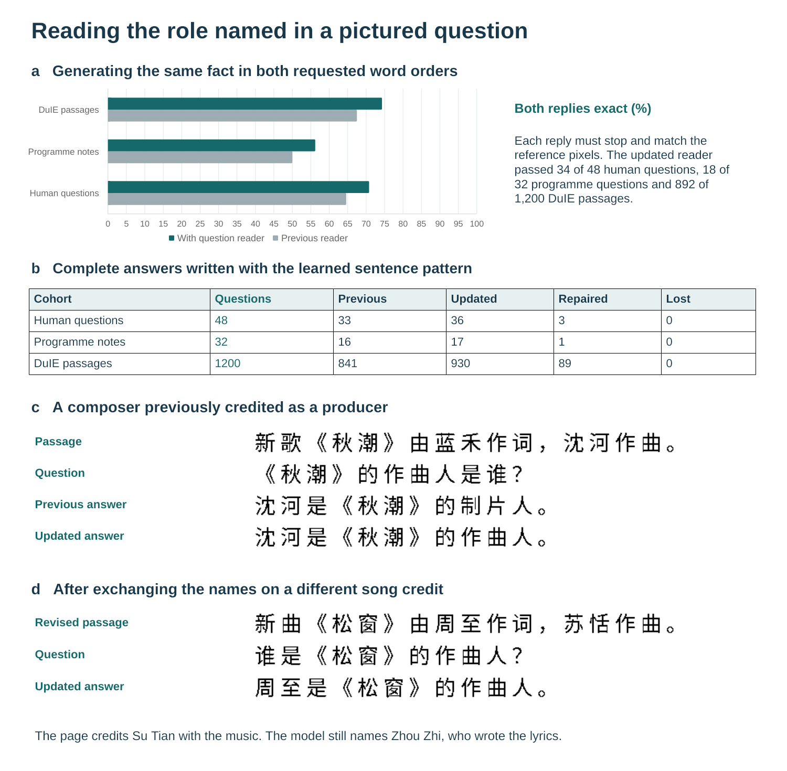
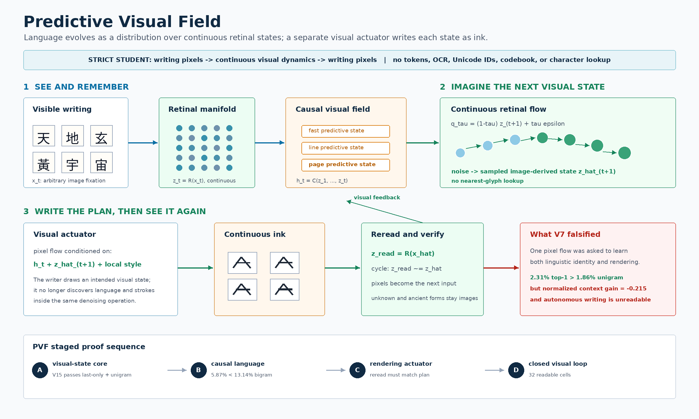

[English](../README.md) · [العربية](README.ar.md) · [Español](README.es.md) · [Français](README.fr.md) · [日本語](README.ja.md) · [한국어](README.ko.md) · [Tiếng Việt](README.vi.md) · [中文 (简体)](README.zh-Hans.md) · [中文（繁體）](README.zh-Hant.md) · [Deutsch](README.de.md) · [Русский](README.ru.md)

Al intercambiar dos nombres en un pasaje chino presentado como imagen, el lector entrenado solo por verosimilitud respondió a todas las preguntas en ambos órdenes de palabras en 79 de 128 pasajes, frente a 29 antes. En 48 preguntas escritas por personas, los aciertos en ambos órdenes bajaron de 34 a 28. [Resultados y modelos](../references/participant_margin_result.md)

[](../publication/ilm-nature/manuscript.pdf#page=126)

De 48 preguntas escritas en chino por personas, el modelo respondió correctamente a 34 en los dos órdenes de palabras solicitados. Identificó al compositor de «秋潮», pero confundió al compositor con el letrista al intercambiar los nombres en otra canción. [Resultados y modelo](../references/pictured_relation_result.md)

[](../publication/ilm-nature/manuscript.pdf#page=125)

Tras entrenarse con 26.890 ejemplos de chino en imágenes, el lector escribió oraciones completas y correctas en 33 de 48 preguntas redactadas por personas. Otro modelo, que genera los glifos uno a uno, expresó el mismo hecho en los dos órdenes solicitados en 31 preguntas. Identificó al director y al guionista en la ficha original, pero copió parte de una oración al intercambiar los nombres. [Resultados y modelo](../references/role_binding_result.md)

[](../publication/ilm-nature/manuscript.pdf#page=124)

¿Cambia la respuesta cuando se intercambian dos nombres en la imagen de un texto? Para pares de funciones que se excluyeron del entrenamiento con dos frases, el modelo que divide la pregunta y reutiliza el mismo generador dio los dos datos en el orden pedido en 70 de 136 casos. El modelo que escribía ambas frases de una vez acertó en tres. En la ficha de una película, dos frases legibles atribuyeron el guion y la dirección a la misma persona. [Resultados y modelo](../references/grounded_proposition_result.md)

[](../publication/ilm-nature/manuscript.pdf#page=123)

¿Quién dibujó el mapa y quién necesitaba indicaciones? El lector revisado devuelve dos nombres distintos. Dio el nombre exacto en 42 de 64 preguntas nuevas presentadas como imágenes. También escribe las formas de 言 en hueso oracular y bronce en el orden solicitado. En 128 preguntas abiertas nuevas que requerían un glifo ausente de la entrada, ninguna respuesta coincidió exactamente con una referencia. [Resultados y modelo](../references/pointing_causal_writer_result.md)

[](../publication/ilm-nature/manuscript.pdf#page=122)

El pasaje en imagen indica quién dibujó el mapa y quién se perdió. El modelo identifica a quien dibujó el mapa, pero repite ese dato cuando se le pregunta quién necesitaba indicaciones. En 300 preguntas cuya respuesta requería un glifo ausente de la entrada, eligió correctamente el primer glifo ausente 18 veces, incluso al recibir la parte anterior de la respuesta correcta. [Resultados e imágenes de las respuestas](../references/causal_glyph_writer_result.md)

[](../publication/ilm-nature/manuscript.pdf#page=121)

El modelo escribe las formas de 言 en huesos oraculares y en bronce en el orden solicitado en la imagen. Acertó ambos órdenes en 94 de 96 comparaciones con caracteres reservados y preguntas de redacción conocida. Con otras fichas y una formulación nueva, acertó en 16 de 96. [Resultados e imágenes](../references/ordered_page_writer_result.md)

[](../publication/ilm-nature/manuscript.pdf#page=120)

**Lectura y respuesta a partir de imágenes de caracteres.** En 64 preguntas en chino sobre dos personas, el modelo acertó 46 con letra normal y 41 en negrita. Qwen3-8B ejecutado localmente acertó 55 con texto como entrada. Con una tipografía de estilo Kai que no se usó en el entrenamiento, el modelo solo acertó una. [Ejecutar el modelo](../docs/visual-page-responder.md)

[](../publication/ilm-nature/manuscript.pdf#page=119)

**¿Distingue a dos personas en una misma oración?** El modelo escribe correctamente los nombres del donante y del arquitecto del edificio Gates. De 864 pares de preguntas, acierta ambas respuestas en 100. En 24 situaciones nuevas con intercambio de nombres, no resuelve por completo ninguna, frente a 20 de Qwen3-8B en local. [Resultados e instrucciones](../references/shared_sentence_writer_result.md)

[](../publication/ilm-nature/manuscript.pdf#page=117)

**¿Por qué el modelo confunde a las personas?** En 387 preguntas en chino sobre la identidad de una persona, seleccionar una oración por los glifos que comparte con la pregunta elevó de 62 a 116 las respuestas completamente correctas. Con el mismo selector, el control con asignación aleatoria en el entrenamiento adicional acertó 127. La figura 85 muestra un nombre de lugar en respuesta a una pregunta por un inventor. [Resultados e instrucciones](../references/inverse_role_writer_result.md)

[](../publication/ilm-nature/manuscript.pdf#page=116)

**¿De quién habla la frase?** Con nombres y complementos nuevos, el modelo escribió correctamente 368 de 404 oraciones chinas completas. Al copiar del pasaje los nombres Qin y Chu en escritura sobre bronce, acertó en 24 de 32 oraciones. Cuando tuvo que dar el nombre a partir de una propiedad, no reprodujo correctamente ningún nombre en esa escritura. [Resultados e instrucciones](../references/visual_role_writer_result.md)

[](../publication/ilm-nature/manuscript.pdf#page=115)

**¿Qué lee el modelo en una imagen de texto?** Ante la misma frase en imagen, «她喝了一口□。» («Tomó un sorbo de □»), el modelo escribió 水 (agua) o 茶 (té) según la bebida del pasaje. Al combinar la red con las frecuencias de los caracteres vecinos, recuperó exactamente 651 de los 2947 fragmentos chinos ocultos. Al intercambiar los papeles de dos personas, no juzgó correctamente ambas versiones en ninguno de los 48 pares. [Resultados y comandos](../references/visual_inference_writer_result.md)

[](../publication/ilm-nature/manuscript.pdf#page=114)

<!-- paired-writing-status:start -->
La comparación de eliminación de márgenes blancos, tras 512 actualizaciones, sigue sin copiar con fiabilidad: coincidencia OCR exacta de 6/32 en entrenamiento y 10/32 en validación (referencias nítidas: 27/32 y 28/32). Las imágenes originales omiten caracteres y repiten letras. El tiempo de entrenamiento baja de 795.624 a 287.182 segundos, pero no demuestra comprensión del lenguaje ni eficiencia con una calidad útil. [Las 64 salidas originales](../references/paired_padding_result.md).
<!-- paired-writing-status:end -->

Estado actual: la escritura lingüística mediante imágenes sigue sin estar validada para su uso. En la última comparación de pérdidas del decodificador con 32 preguntas ya vistas durante el entrenamiento, ambos modelos obtuvieron 0/32 respuestas autónomas idénticas píxel a píxel. La pérdida que considera la sensibilidad del decodificador redujo el F1 de los trazos del 85.984% del control al 70.009%. Incluso con el historial correcto de respuestas, el F1 solo alcanzó el 92.430% y el 75.116%; al proporcionar directamente los códigos de la imagen de respuesta, la reconstrucción llegó al 99.9953% en ambos casos. Fallaron los cuatro criterios de mejora, por lo que se descarta ampliar esta receta de entrenamiento. Estas medidas reflejan coincidencia de imágenes, no precisión semántica; no hay ningún checkpoint ILM validado para uso real. [Resultado y todas las imágenes originales](../references/decoder_metric_v82_result.md). El manuscrito ya incluye la Nota complementaria 39 y la Figura S16 editable. Una línea base adicional con un generador de imágenes externo, sin entrenamiento local, obtuvo coincidencia OCR exacta en 0/12 solicitudes de copia y 0/8 preguntas, con una calibración OCR de referencia de 18/20; se conservan las 40 salidas originales. [FLUX.2-klein-4B](../references/image_edit_baseline_result.md).


[](https://lazying.art)

# Modelo de Lenguaje Imaginizado (ILM)


ILM investiga cómo aprender y generar lenguaje como **escritura visible**: de
imagen a estado visual continuo y de nuevo a imagen, sin un canal simbólico
oculto.


La última comprobación de la interfaz recupera 11/32 respuestas exactas en inglés del modelo preentrenado congelado al redimensionar las mismas páginas de 1024 a 432, frente a 0/32 en el tamaño original. Los dos adaptadores entrenados logran solo 5/32 cada uno a 432. Aún no hay un ILM independiente que genere respuestas como imágenes.

[2026-11-07: English result and full evidence](../references/native_reader_geometry_result.md)

Resultado del 2026-11-08: terminó la evaluación del entrenamiento de 128 actualizaciones y se revisaron las 384 imágenes originales de respuesta. Tanto el modelo inicial como el final obtienen 0/32 respuestas exactas según OCR en cada grupo de preguntas vistas y reservadas, incluso aceptando alternativas de la fuente. La copia exacta en el grupo reservado baja de 19/32 a 16/32. Fallan los seis requisitos fijados previamente; el aprendizaje del lenguaje sigue sin demostrarse.

[Resultado y alcance de la evidencia](../references/native_paired_qa_learning_result.md)

## Leer una oración en chino clásico como imagen y escribirla en chino moderno

En capítulos reservados para la evaluación, el modelo de 2,03 millones de parámetros copió exactamente los 2.045 pasajes que pudieron representarse. Al traducir, 30 de 2.048 respuestas coincidieron con la imagen de referencia. En un caso copió nueve glifos y dibujó dos para sustituir 薨 por 去世. Un método sencillo de edición local obtuvo una distancia de edición menor en el conjunto de la prueba. [Ejecutar el modelo](../models/visual_edit_zh/README.md) · [Imágenes generadas y de referencia](../publication/ilm-nature/figures/Figure_48_visual_edit.png)

## Lectura de formas históricas

A partir de una lámina de cuatro filas, el modelo devolvió las imágenes históricas en el orden solicitado en 9.565 de 9.600 preguntas en chino e inglés sobre familias de caracteres excluidas del entrenamiento. [Ejecutar el modelo](../models/pictured_idiom_zh/README.md) · [Fig. 42](../publication/ilm-nature/figures/Figure_42_historical_plates.png)

## Escribir la expresión china que falta en un pasaje

Un modelo de 2,12 millones de parámetros lee las imágenes de texto a ambos lados de un hueco y dibuja los cuatro caracteres de la expresión que falta. Reprodujo exactamente 134 de las 22.907 respuestas de validación. En 100 de esos aciertos, ninguno de los cuatro caracteres aparecía en el texto visible. Un método de referencia basado en frecuencias locales acertó en 1.012 casos.

[Ejecutar el modelo](../models/pictured_idiom_zh/README.md) · [Figura 40](../publication/ilm-nature/figures/Figure_40_pictured_idioms.png)

Con las predicciones del lector como guía durante el entrenamiento adicional, el modelo acertó en 378 de 22.907 casos. Con el mismo número de actualizaciones y solo las respuestas originales, acertó en 292. En otros 9.135 pasajes que no se habían utilizado, los resultados fueron 163 y 125 aciertos. [Figura 41](../publication/ilm-nature/figures/Figure_41_writer_transfer.png)

Tras entrenar juntos el lector y el generador visuales, el modelo reprodujo 433 expresiones exactas en 17.555 pasajes chinos nuevos. El modelo anterior acertó 276 y el método de frecuencias locales, 789. [Fig. 43](../publication/ilm-nature/figures/Figure_43_expression_preference.png)

## Extraer respuestas de imágenes de caracteres chinos

Un pequeño modelo aprendió a seleccionar respuestas en pasajes chinos en 64 segundos con dos hilos de CPU. En los pasajes reservados para la evaluación, devolvió la imagen exacta de la respuesta en 269 de 1.788 preguntas. Al borrar la pregunta, los aciertos bajaron a 18. El modelo independiente de escritura libre no produjo una explicación legible de la evolución del carácter 言. La escritura de propósito general y la mejora de eficiencia por un factor de 1.000 siguen pendientes de demostración.


[Ejecutar el lector](../references/visual_extractive_reading_result.md) · [Manuscrito](../publication/ilm-nature/manuscript.pdf)

En 565 de 3.170 preguntas en chino, el lector seleccionó el fragmento correcto. El modelo de escritura reprodujo 124 respuestas completas en otra tipografía con coincidencia píxel por píxel. Dos preguntas sobre la misma banda dieron 前卫金属 y 1996年.


[Respuestas en otra tipografía](../references/grounded_detail_writing_result.md)

## Dibujar el siguiente carácter chino

En 668 contextos de desarrollo, predecir primero la distribución general de los trazos elevó de 198 a 649 el número de dibujos que coincidían píxel por píxel con un glifo conocido no vacío. Ambos modelos acertaron el siguiente carácter del texto original en 18 casos. Ante una pregunta sobre el origen de 言, el nuevo modelo repitió una figura parecida a un cero.


[Experimento y modelo entrenado](../references/shared_layout_writing_result.md)

## Ensayo anterior de continuación

2026-11-13

El ensayo con secuencias completas abarca **13,766 secuencias, 41,298 actualizaciones y 6,108,741 posiciones de glifos objetivo**. Se revisaron las **732 imágenes de salida** antes de puntuarlas con respuestas de referencia. Con entradas de composición proporcional, el modelo final logra **7/32 respuestas completas estrictamente exactas, 0/16 pares con ambas preguntas correctas, 14/32 respuestas legibles y 0/12 continuaciones largas de libros coherentes y completas**. No supera los criterios prerregistrados ni la auditoría independiente de los cuatro controles de borrado de pregunta o pasaje.

El entrenamiento utiliza una RTX 4090, con un máximo de **18.568 GiB** de VRAM asignada. El modelo desplegado completo tiene **7,578,390,003 parámetros**, incluidos los pesos de base heredados; aquí se actualizan **20,212,225** parámetros. Se reutiliza un conjunto de desarrollo, revisado por un solo modelo evaluador, sin arbitraje humano independiente. Un ILM ligero utilizable y una ventaja de eficiencia a igual calidad siguen sin demostrarse.

[Resultado completo](../references/visual_continuation_learning_result.md) · [Objetivo técnico](../docs/first-imagized-language-model-goal.md) · [Protocolo fijo](../references/visual_continuation_full_protocol.md)

## Resultados anteriores de V35


V35 es un modelo visual de chino con `129.092.738` parámetros. Completó las
`22.000` actualizaciones BF16 en `2,770` horas sobre una RTX 4090, con un máximo
de `2,899 GiB` de memoria GPU asignada. La ruta desplegada solo recibe píxeles
de escritura y una máscara visual, y genera y relee directamente el ráster. En
ejecución no usa tokenizer, identificadores Unicode/de carácter, OCR,
recuperación, codebook visual ni un modelo docente.

La decisión medida es **`not-qualified`**. La precisión de copia con el prompt
correcto es `0,3125 %`; la precisión de instrucciones es `0,1116 %` y queda por
debajo del control con prompt mezclado. Solo supera `5/12` puertas
visuales-causales y `5/9` puertas semántico-ráster. Las salidas no están vacías
y responden a intervenciones, pero sus trazos están dañados y no se vinculan a
la respuesta solicitada. Por ello no se abrió la partición sellada.

V35 usa aprendizaje por transferencia. El códec continuo V34 es trabajo del
proyecto, mientras que el núcleo causal se inicializa desde el checkpoint
externo PIXAR. PIXAR se acredita como fundamento externo y no se reclama como
contribución del proyecto. “Independiente” significa aquí un artefacto de
despliegue autocontenido, no que todo se entrenó desde cero. Véanse el
[informe medido en inglés](../references/causal_glyph_flow_v35_result.md), la
[guía de implementación](../docs/causal-glyph-flow-v35.md) y el
[artículo](../publication/ilm-image-native/ilm-image-native.pdf).

## Prueba acotada anterior: V23 aprueba el circuito de relación visual


V23 es el primer experimento de este repositorio que supera toda la cadena de
evidencia de instrucción en imagen a respuesta en imagen. El modelo recibe solo
seis imágenes de escritura `32x32` y produce una respuesta `32x32`. Su ruta de
inferencia no contiene cadenas, tokens, ID Unicode, OCR, consulta de glifos,
índice de respuesta ni un modelo de lenguaje externo.

En la única evaluación congelada autorizada, con 98 caracteres chinos no
vistos, 1.024 episodios y 4.096 variantes de instrucción, alcanza `0.99829` en
elección binaria, `0.99609` al cambiar la consulta, `0.99707` al cambiar la
operación, `0.99463` top-1 del glifo generado y `0.78478` F1 de píxel. Los
controles ciegos a consulta y operación permanecen exactamente invariantes al
factor que no pueden ver.

Este resultado solo demuestra seguimiento visual para una gramática fija de
seis roles, dos asociaciones y relación same/other; no demuestra comprensión
libre del lenguaje. V24 eliminará los roles fijos, leerá un flujo 2D de
escritura de longitud variable y generará un segundo cuadro después de releer
el primero. Véase el [informe V23 en inglés](../docs/visual-relation-circuit-v23-result.md).

## Referencia de investigación anterior: origen del campo visual predictivo



El experimento RFLM V7 mostró que un único flujo de píxeles no debe inferir la
identidad lingüística y dibujar los trazos en la misma operación. V7 elevó el
top-1 de contexto completo de `1,20%` a `2,31%`, por encima de last-only
(`2,02%`) y unigram (`1,86%`), pero lejos de bigram (`13,58%`). La ganancia
normalizada de log-probabilidad mejoró de `-0,9066` a `-0,2155`, pero siguió
siendo negativa, y la salida autónoma continuó ilegible. Por eso **V7 queda
rechazado como modelo de lenguaje**.

El siguiente PVF separa un flujo continuo que predice el próximo estado retinal
de un actuador visual que lo renderiza como tinta y lo vuelve a leer. No hay
búsqueda del carácter más cercano ni tabla de salida. El límite sigue siendo
`píxeles de escritura -> dinámica visual continua -> píxeles de tinta`, sin
tokens, Unicode IDs, OCR, codebook visual ni modelo externo. PVF es una hipótesis
V8 falsable, no una capacidad demostrada.

> El repositorio mantiene de forma deliberada un pipeline práctico de etimología y experimentación ILM a largo plazo lado a lado.

## 📌 Visión general

Este repositorio tiene tres líneas conectadas:

1. Modelado de lenguaje nativo de imagen con flujo retinal y evaluación estricta.
2. Ingesta etimológica de glifos chinos con procedencia conservada.
3. Líneas base anteriores de glifos, codebooks, difusión, folio e InkStream para reproducibilidad.

Este README documenta las tres líneas y conserva el flujo de etimología como una ruta reproducible de primera clase.

## 🔗 Enlaces clave

| Área | Ruta |
|---|---|
| Documento conceptual | `docs/imagized-language-model.md` |
| Objetivo de ingeniería actual | `docs/first-imagized-language-model-goal.md` |
| Dossier de investigación y evidencia | `references/image-native-language-model-research.md` |
| Plan de código y métricas | `docs/ilm-visual-diffusion-code-plan.md` |
| Plan de "color" de embeddings | `docs/embedding-color-plan.md` |
| Notas/plan de desarrollo | `docs/development-plan.md` |
| README del módulo de etimología | `ilm/etymology/README.md` |

## ✨ Características

- 🏺 Ingesta de etimología desde fuentes tipo `hanziyuan` y `chineseetymology`.
- 🌐 Ruta de ingesta robusta AJAX + HTML con reintentos, control de ritmo y caché.
- 🧩 Extracción de glifos marcada por etapas, incluyendo `` y datos URI de `background-image` en CSS.
- 🗃️ Almacenamiento en SQLite para metadatos de caracteres/glifos y organización de recursos en el sistema de archivos.
- 🖥️ UI web con Tornado para ingesta ad hoc y vista previa de galería.
- 🔤 Utilidades de renderizado de glifos para imágenes de tokens multilingües.
- 🧠 Módulos de embedding/codebook con estilo de código de producto.
- 🧱 Scripts de entrenamiento/evaluación de empaquetado de frames de frases y difusión/inpainting.
- 📊 Scripts de reporte y visualización para inspección de embeddings y del pipeline.
- 📄 Artefactos de publicación en LaTeX/PDF en `publication/`.

## 🧱 Estructura del proyecto

```text
.
├── README.md
├── AGENTS.md
├── configs/
│   ├── color.yaml
│   └── diffusion.yaml
├── docs/
├── i18n/
├── ilm/
│   ├── code/
│   ├── data/
│   ├── datasets/
│   ├── db/
│   ├── diffusion/
│   ├── encoders/
│   ├── english_tiles/
│   ├── etymology/
│   ├── frames/
│   ├── models/
│   └── utils/
├── scripts/
├── publication/
├── assets/
├── logs/
└── *.ipynb
```

## 🧰 Requisitos previos

| Requisito | Notas |
|---|---|
| Python `3.10+` | Runtime principal |
| `pip` | Instalación de paquetes |
| GPU opcional | Útil para scripts de entrenamiento CUDA de PyTorch |
| Cadena de herramientas LaTeX opcional | Necesaria para builds de publicación |

Nota de supuestos: actualmente no existe un único archivo raíz de dependencia bloqueada (`pyproject.toml`, `requirements.txt`, etc.), por lo que las dependencias se infieren de los imports y del uso en scripts.

## ⚙️ Instalación

### Mínima (herramientas de etimología)

```bash
python -m venv .venv
source .venv/bin/activate
pip install --upgrade pip
pip install requests beautifulsoup4 tornado
```

### Extendida (flujos de modelado/entrenamiento)

```bash
python -m venv .venv
source .venv/bin/activate
pip install --upgrade pip
pip install requests beautifulsoup4 tornado pyyaml numpy pillow matplotlib torch
```

Si un script concreto requiere paquetes adicionales, instálalos según el error de importación mostrado por ese script.

## 🚀 Uso

### Inicio rápido: ingesta de glifos históricos (CLI)

1. Hanziyuan (recomendado): flujo AJAX solo por carácter

```bash
PYTHONPATH=. python scripts/ingest_etymology.py --site hanziyuan --char 中
```

2. ChineseEtymology (URL directa)

```bash
PYTHONPATH=. python scripts/ingest_etymology.py --site chineseetymology --url "https://www.chineseetymology.org/CharacterEtymology.aspx?characterInput=%E4%B8%AD"
```

3. Ingesta por lotes desde archivo (las líneas pueden ser `char\turl`, `url` o `char url`)

```bash
PYTHONPATH=. python scripts/ingest_etymology.py --from-file urls.txt
```

### Salidas

| Tipo de salida | Ubicación |
|---|---|
| Archivos | `data/historic/glyphs/<char>/<stage>/<label>.<ext>` |
| Caché | `data/historic/cache/*.html` |
| DB | `data/historic/etymology.sqlite3` |

### Demo Web (opcional)

```bash
PYTHONPATH=. python scripts/serve_etymology.py
```

Abre `http://127.0.0.1:8888`, elige el sitio e introduce un carácter (por ejemplo `中`).

### Crawling cortés y respeto al sitio

- El colector usa control de ritmo por host, reintentos con backoff y caché.
- Mantén retrasos `>= 0.5s`, evita ráfagas y respeta términos/robots/licencias del sitio.
- No eludas muros de pago ni protecciones interactivas.
- Si ves `403`/`429`, reduce la frecuencia y vuelve a intentarlo más tarde.

### Flujos adicionales de ILM

Estos scripts existen y forman parte activa del repositorio, pero son flujos de investigación y pueden requerir datasets/checkpoints locales preparados.

1. Descarga/preparación de datos

```bash
python scripts/download_alpaca.py --outdir data/raw
python scripts/download_corpora.py --out data/raw
python scripts/sample_paragraphs.py --out data/processed/test_100.jsonl
python scripts/build_images_common_freq.py --out data/processed/images_common_freq --size 128 --en 5000 --zh 5000
```

2. Ciclo de vida de Glyph DB

```bash
python scripts/glyphdb_init.py --db data/glyphdb/glyphs.sqlite3
python scripts/glyphdb_ingest_index.py --db data/glyphdb/glyphs.sqlite3 --index data/processed/images_common_freq/index.tsv
```

3. Entrenamiento de modelos de códigos/color

```bash
python scripts/train_color_codes.py --config configs/color.yaml
python scripts/train_codes_from_qa.py --en-json data/raw/alpaca_en.json --zh-json data/raw/alpaca_zh.json --epochs 1
python scripts/train_ilmglyph_codes.py --en data/raw/alpaca_en.json --zh data/raw/alpaca_zh.json --out artifacts/ilm_glyph_train
```

4. Difusión/inpainting

```bash
python scripts/train_diffusion.py --config configs/diffusion.yaml
python scripts/train_inpaint_frames.py --ckpt-code artifacts/ilm_glyph_train/ckpt_epoch1.pt --out artifacts/inpaint
```

5. Evaluación/reportes

```bash
python scripts/eval_color_codes.py --checkpoint artifacts/color_codes_e1.pt
python scripts/eval_diffusion.py --checkpoint artifacts/diffusion_unet.pt
python scripts/eval_qa_retrieval.py --checkpoint artifacts/color_codes_qa.pt
python scripts/report_ilmglyph_pipeline.py --ckpt artifacts/ilm_glyph_train/ckpt_epoch1.pt --lang en --text "hello world"
```

## 🧩 Configuración

Configuración YAML principal:

- `configs/color.yaml`
  - ruta de datos: `data/processed/images_common_freq/index.tsv`
  - parámetros de modelo/código: `d_glyph`, `d_code`, `K`, `C`, temperature/anneal
  - configuración de optimizador/log

- `configs/diffusion.yaml`
  - JSONL de entrada: `data/processed/test_100.jsonl`
  - ajustes de marco/cuadrícula + tamaño del modelo
  - rango de ratio de máscara de entrenamiento y configuración de checkpoints

Sobrescribe la configuración mediante flags CLI donde se soporte (`--epochs`, `--batch-size`, `--lr`, etc.).

## 🧪 Ejemplos

- Construir un glifo de baldosa en inglés único:

```bash
python scripts/build_english_tile_glyph.py "language" artifacts/language_tile --save-tensor
```

- Ejecutar demo de inpainting con checkpoints entrenados:

```bash
python scripts/inpaint_demo.py \
  --ckpt-code artifacts/ilm_glyph_train/ckpt_epoch1.pt \
  --ckpt-inpaint artifacts/inpaint/ckpt_epoch1.pt \
  --lang en \
  --text "the quick brown fox jumps" \
  --mode infill \
  --out artifacts/inpaint_demo
```

- Ingesta masiva de caracteres comunes desde Hanziyuan:

```bash
PYTHONPATH=. python scripts/bulk_ingest_hanziyuan.py --limit 200 --resume
```

## 📝 Notas de desarrollo

- Este es un repositorio de investigación con CLIs robustos y artefactos exploratorios (incluyendo notebooks y scripts prototipo).
- Los archivos grandes generados están destinados a `data/` y `artifacts/` (ambos ignorados por `.gitignore`).
- El código fuente y los PDF de publicación están en `publication/`; script auxiliar de compilación: `scripts/latex_build.sh`.
- Las convenciones de colaboración y proceso están documentadas en `AGENTS.md`.

## 🛠️ Solución de problemas

- `ModuleNotFoundError: ilm...`
  - Ejecuta los scripts desde la raíz del repositorio.
  - Usa `PYTHONPATH=.` para scripts que esperan resolver paquetes locales.

- `FileNotFoundError` para data/index/checkpoints
  - Ejecuta primero los scripts de datos/compilación necesarios.
  - Confirma que existan los valores por defecto como `data/processed/images_common_freq/index.tsv` y `data/processed/test_100.jsonl`.

- Problemas de CUDA/dispositivo
  - Cambia a CPU con flags/config del script (`device: cpu` o `--device cpu`).

- Errores por dependencias faltantes
  - Instala la dependencia requerida según la ruta de import del script concreto (`torch`, `pyyaml`, `Pillow`, `etc.`).

- HTTP `403` / `429` durante scraping
  - Incrementa `--delay`, reintenta más tarde y mantén solicitudes corteses.

## 🗺️ Hoja de ruta

- Seguir madurando los runbooks de entrenamiento/evaluación de ILM text-as-image más allá del inicio rápido centrado en etimología.
- Mejorar la reproducibilidad del entorno (especificación única y autoritativa de dependencias).
- Expandir pruebas/CI para scripts de investigación y lógica de pipeline.
- Iterar en codebooks jerárquicos, objetivos de difusión y canales de controlabilidad.
- Consolidar la documentación entre `docs/`, textos de ayuda de scripts y artefactos de publicación.

Para obtener detalles conceptuales y de planificación por etapas más profundos, consulta:

- `docs/imagized-language-model.md`
- `docs/ilm-visual-diffusion-code-plan.md`
- `docs/development-plan.md`

## 🤝 Contribución

- Sigue `AGENTS.md` para las convenciones (commits atómicos, push tras cambios, sin credenciales en el código).
- Agrupa cambios relacionados en commits enfocados con mensajes convencionales.
- Prefiere invocaciones de scripts reproducibles con flags e inputs explícitos.
- Para cambios relacionados con scraping, conserva el comportamiento de throttling/caché y las restricciones de respeto al sitio.

## 📄 Licencia

No existe actualmente un archivo de licencia de nivel superior en este repositorio.

Nota de supuestos: trata el proyecto como código de investigación con licencia no especificada hasta que los mantenedores añadan un archivo `LICENSE`.


## ❤️ Support

<!-- support:start -->
[](https://github.com/sponsors/lachlanchen)
[](https://chat.lazying.art/donate)
[](https://paypal.me/RongzhouChen)
[](https://buy.stripe.com/aFadR8gIaflgfQV6T4fw400)
<!-- support:end -->
