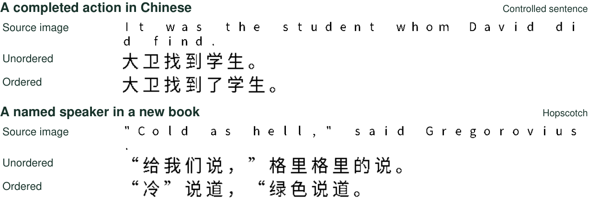
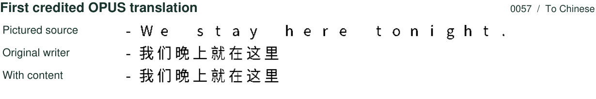
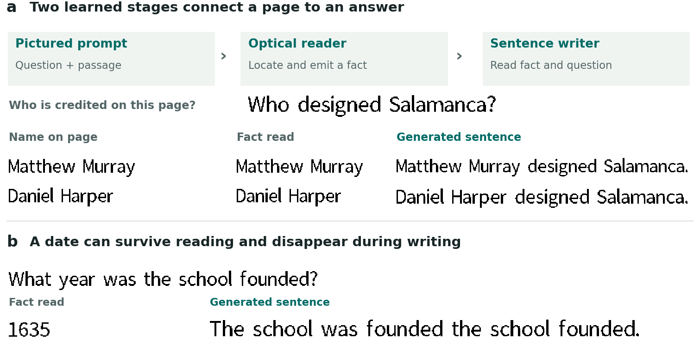
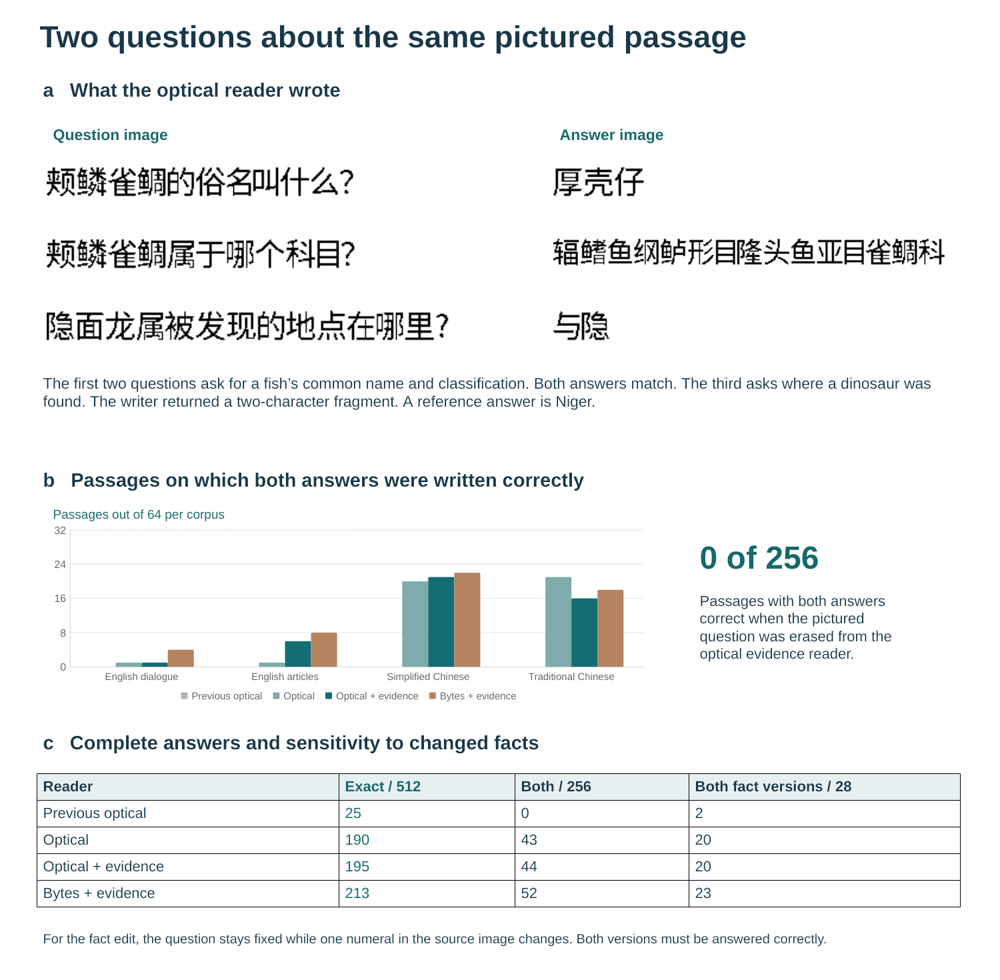
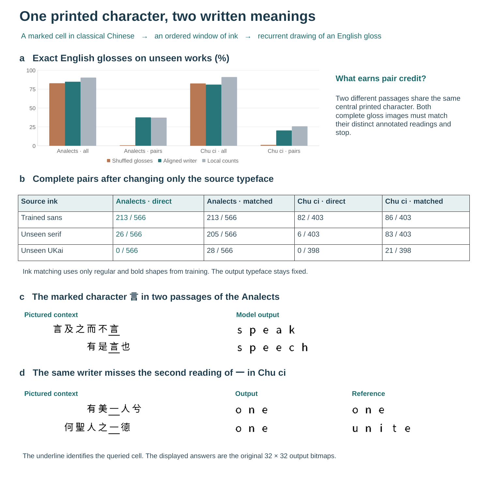
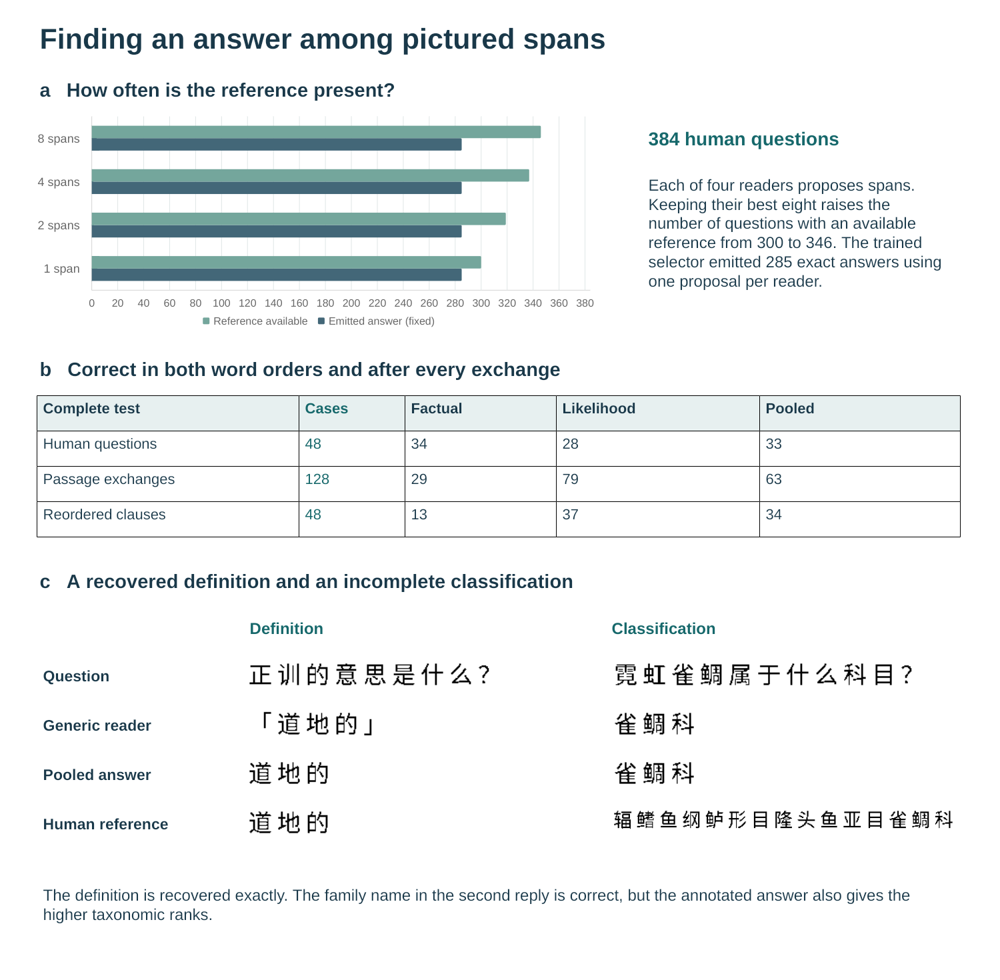
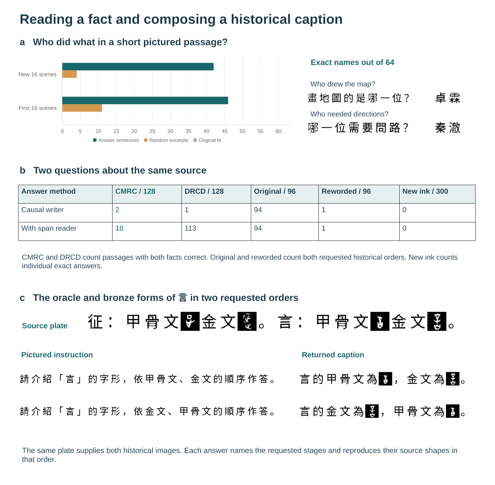
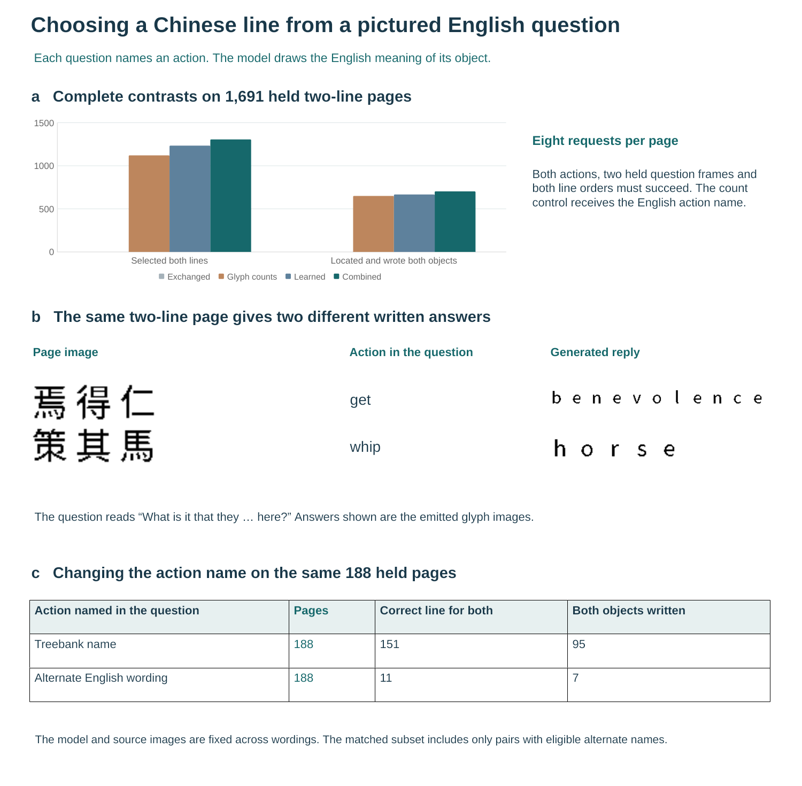
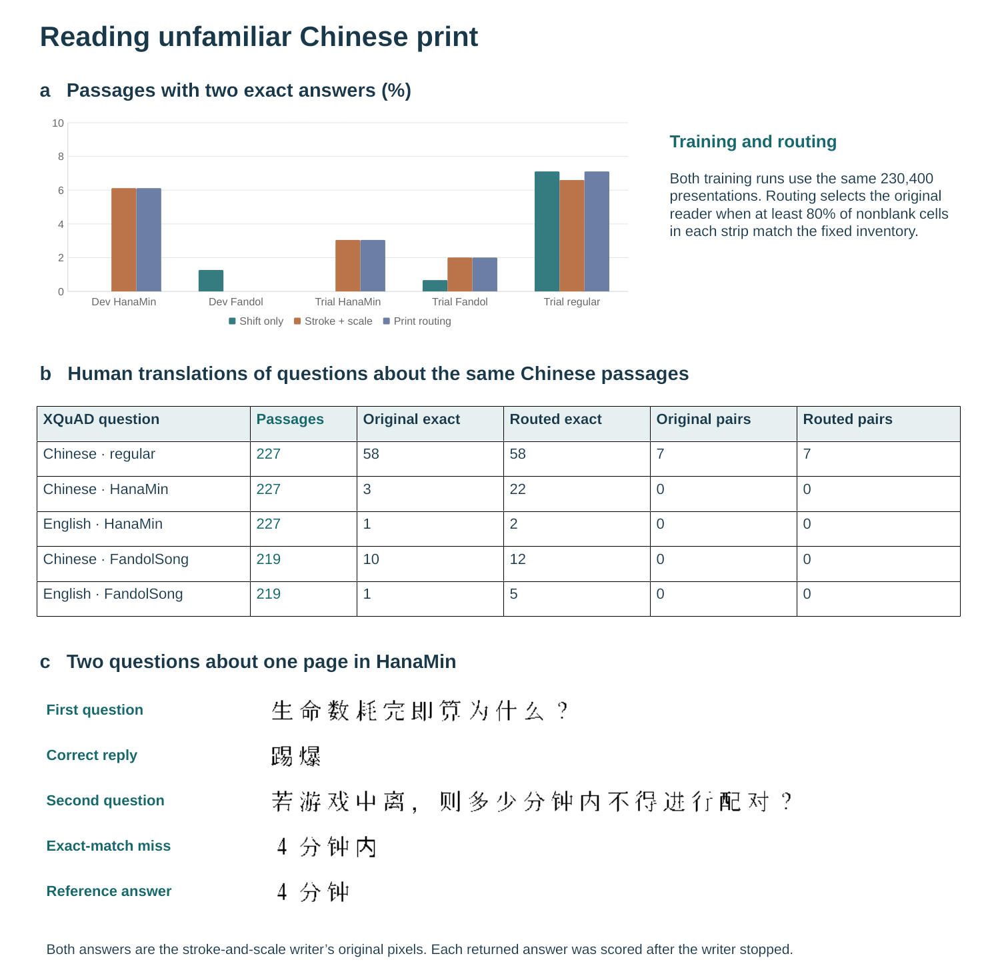
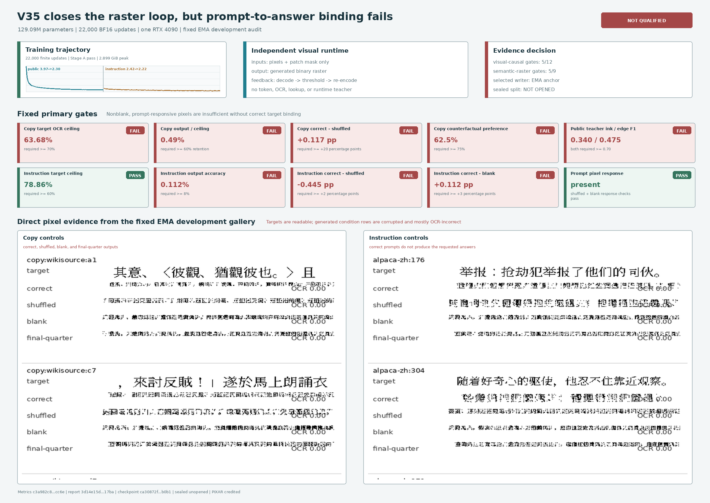

[English](../README.md) · [العربية](README.ar.md) · [Español](README.es.md) · [Français](README.fr.md) · [日本語](README.ja.md) · [한국어](README.ko.md) · [Tiếng Việt](README.vi.md) · [中文 (简体)](README.zh-Hans.md) · [中文（繁體）](README.zh-Hant.md) · [Deutsch](README.de.md) · [Русский](README.ru.md)

Sur quatre nouveaux livres, le modèle visuel a retrouvé le passage original parmi 48 images dans **91 recherches sur 96**. Apprendre à suivre l’ordre du texte source a conservé ce score. En traduction libre, l’évaluation automatique a jugé **0 réponse sur 96** entièrement fidèle au sens, contre 81/96 pour Qwen3-8B quantifié lisant du texte. La figure reproduit les sorties originales. [Résultats et images originales](../references/ordered_alignment_result.md) · [Exécuter le modèle](../models/ordered_alignment/README.md)



Entraîné sur une RTX 4090 D, le lecteur choisit entre deux traductions en image pour chaque extrait. Corriger sa préférence pour certaines formulations fait passer le nombre de paires dont les deux choix sont justes de **21/96 à 77/96**. En rédaction libre, prédire les groupes de glyphes à partir de la source porte de 17/336 à 43/336 le nombre de réponses contenant le prédicat attendu. Une seule des 192 traductions de livres restitue le sens complet. La figure montre la première réponse acceptée sur le test OPUS distinct. [Résultats](../references/source_supported_writing_result.md) · [Exécuter le modèle](../models/source_supported_writing/README.md)



Sur une même page de dictionnaire, deux demandes présentent la glose et la forme ancienne dans des ordres opposés. Le lecteur a réussi les deux demandes dans 332 paires sur 608, contre 138 auparavant. Dans un test distinct de traduction libre, le modèle visuel indépendant a restitué le sens complet dans 1 cas sur 192, contre 154 pour Qwen3-8B avec une entrée texte. [Article de six pages](../publication/ilm-nature/manuscript.pdf) · [Exemple étymologique](../models/origin_instructions/README.md)

### Expériences antérieures

Devant une page illustrant les débuts du chemin de fer, le modèle répond **Matthew Murray designed Salamanca.** Si seul le nom de la personne change dans la page, il écrit **Daniel Harper designed Salamanca.** Sur 96 nouveaux passages, il a retrouvé 25 réponses courtes exactes. Dans un autre cas, il a lu correctement l’année de fondation d’une école puis l’a omise dans la phrase. Les images produites figurent en première page de l’article. [PDF](../publication/ilm-nature/visual_language_paper.pdf) · [PNG](../models/visual_statements/examples/intervention)

Sur 256 nouvelles pages en anglais et en chinois, chacune accompagnée de deux questions rédigées par des humains, l’ILM entraîné par contraste a répondu correctement aux deux questions sur 34 pages. Qwen3-8B quantifié, qui lisait le texte, en a réussi 101. Sur 64 pages présentées aux deux modèles sous forme d’images identiques, l’ILM en a réussi 6 et Qwen3-VL-8B 21. [PDF](../publication/ilm-nature/visual_language_paper.pdf) · [PNG](../models/competing_facts/examples)

[](../publication/ilm-nature/visual_language_paper.pdf)

Sur une page chinoise illustrant un poisson, le lecteur a écrit son nom usuel puis sa classification selon la question posée. Entraîné sur une RTX 4090 D, ce modèle de 2,44 millions de paramètres a répondu correctement aux deux questions pour 44 des 256 passages inédits en anglais et en chinois. Le lecteur précédent en réussissait zéro. Le témoin utilisant des octets en a réussi 52 pour une énergie comparable. Le modèle visuel a échoué à restituer les formes historiques de 言. [Exécuter le modèle](../models/paired_evidence/README.md) · [Lire l’article](../publication/ilm-nature/visual_language_paper.pdf)

[](https://github.com/lachlanchen/ImagizedLanguageModel/blob/203f40812f03afbdfa55cf957a56ee8cfe0f944c/publication/ilm-nature/visual_language_paper.pdf#page=2)

Un modèle de 2,12 millions de paramètres entraîné sur une RTX 4090 D a appris à prédire la suite de passages anglais et chinois à partir de glyphes. À la question sur les économies d’énergie, il a répété une partie de la consigne. Après ajout d’un lecteur visuel, il a produit 11 réponses de référence sur 384 et échoué à répondre correctement aux deux questions sur chacun des 192 passages. La figure 144 montre les pixels produits. [Lire l’article](../publication/ilm-nature/visual_language_paper.pdf) · [Exécuter le modèle](../models/visual_cursor/README.md)

[](https://github.com/lachlanchen/ImagizedLanguageModel/blob/203f40812f03afbdfa55cf957a56ee8cfe0f944c/publication/ilm-nature/visual_language_paper.pdf#page=4)

Un modèle de 1,18 million de paramètres lit un caractère désigné dans une image de chinois classique et dessine son équivalent anglais. Pour 言, il écrit « speak » à la fin de 言及之而不言 et « speech » dans 有是言也. Il retrouve les deux sens dans 213 des 566 paires des Entretiens et 82 des 403 paires des Chants de Chu. Le comptage des caractères voisins en résout 211 et 104. [Exécuter le modèle](../models/visual_word_senses/README.md) · [Résultats](../references/visual_word_sense_result.md)

[](../publication/ilm-nature/manuscript.pdf#page=160)

Le modèle lit en image une question en chinois et un extrait de roman, puis écrit une réponse en deux propositions sous forme d’image. Il reproduit exactement la réponse attendue dans 34 cas sur 48 pour La Pérégrination vers l’Ouest et 42 sur 48 pour Le Rêve dans le pavillon rouge. Pour 9 des 60 familles de caractères réservées à l’évaluation, il reproduit les formes sur os et sur bronze dans toutes les configurations. En anglais, les questions obtiennent respectivement 2 et 10 réponses exactes sur 48. [Exécuter le modèle](../models/grounded_ink_editor/README.md) · [Résultats et exemples](../references/grounded_ink_writing_result.md)

[](../publication/ilm-nature/manuscript.pdf#page=159)

Un lecteur visuel de 86 millions de paramètres a répondu correctement à 38 des 56 questions en chinois présentées sous forme d’images sur les personnages du *Guoyu* (國語). Après permutation des deux noms, il a donné les quatre bonnes réponses sur 4 des 14 extraits, contre 3 pour le lecteur initial et 2 pour le témoin entraîné avec un poids égal pour les deux noms. En anglais, il a donné 16 réponses exactes sans réussir les quatre questions d’un même extrait. L’exemple restitue les glyphes originaux de 密康公 et 恭王. [Guoyu · ILM](../models/optical_role_reader/README.md) · [38/56](../references/optical_role_adapter_result.md)

[](../publication/ilm-nature/manuscript.pdf#page=157)

Ce lecteur de 64 666 paramètres reçoit une question et un passage chinois sous forme d’images, puis renvoie un extrait de la page originale. Entraîné sur 6 439 passages, il a trouvé 104 réponses exactes sur 452 questions en chinois et 45 sur 452 en anglais dans deux romans réservés à l’évaluation. Avec les seules réponses humaines, les scores étaient de 81 et 48. Le lecteur répond encore rarement juste à deux questions différentes sur le même passage. [ILM · 64k](../models/book_span_distillation/README.md) · [104/452](../references/book_span_distillation_result.md)

[](../publication/ilm-nature/manuscript.pdf#page=154)

Le modèle visuel a suivi une permutation des rôles dans des crédits présentés en image pour 175 comparaisons sur 256, contre 19 pour le témoin. Sur douze nouveaux récits, aucun des deux modèles n’a réussi une comparaison complète. Avec deux questions en image et les sections correspondantes du catalogue, le modèle a reproduit quatre formes historiques de 言 dans deux essais sur huit. [↗](../references/individual_clause_writer_result.md)

[](../publication/ilm-nature/manuscript.pdf#page=152)

Après permutation de deux noms dans des crédits présentés en image, le modèle de 87 millions de paramètres a suivi le changement dans les deux ordres de questions pour 165 comparaisons sur 256. Le témoin, exposé aux mêmes exemples, en a réussi cinq. Sur des récits rédigés séparément, les deux modèles ont obtenu 0 sur 24. [Résultats et images originales](../references/role_change_writer_result.md) · [Exécuter le modèle](../models/role_change_writer/README.md)

Après exclusion des passages réservés de DRCD et réentraînement, le lecteur à liste élargie a produit 234 réponses exactes sur 359 questions de développement, contre 242 pour le lecteur généraliste. Des passages réservés au test avaient servi aux évaluations DRCD antérieures. [Résultats et rectification sur les données](../references/span_list_result.md)

[](../publication/ilm-nature/manuscript.pdf#page=138)

Sur 384 nouvelles questions de compréhension en chinois, la mise en commun des réponses en image de quatre lecteurs donne 285 réponses exactes, autant que le lecteur généraliste. Elle réussit intégralement 63 des 128 tests de permutation de noms, contre 79 pour le lecteur spécialisé. [Résultats et poids](../references/span_choice_result.md)

[](../publication/ilm-nature/manuscript.pdf#page=137)

Après permutation de deux noms dans un passage chinois en image, le lecteur entraîné par vraisemblance seule a répondu à toutes les questions dans les deux ordres demandés sur 79 passages sur 128, contre 29 auparavant. Sur 48 questions rédigées par des personnes, ce score est passé de 34 à 28. [Résultats et modèles](../references/participant_margin_result.md)

[](../publication/ilm-nature/manuscript.pdf#page=136)

Sur 48 questions rédigées en chinois, le modèle a écrit 34 réponses exactes dans chacun des deux ordres de mots demandés. Il a correctement nommé le compositeur de « 秋潮 ». Sur une autre chanson, échanger les noms du compositeur et du parolier a suffi à lui faire attribuer la musique à la mauvaise personne. [Résultats et modèle](../references/pictured_relation_result.md)

[](../publication/ilm-nature/manuscript.pdf#page=135)

Entraîné sur 26 890 exemples de chinois en image, le lecteur donne une phrase complète et correcte pour 33 des 48 questions écrites par des personnes. Un second modèle, qui génère les glyphes un à un, exprime le même fait dans les deux ordres demandés pour 31 questions. Il retrouve les deux crédits du film dans la notice originale, mais copie un fragment de phrase de trop après l’échange des noms. [Résultats et modèle](../references/role_binding_result.md)

[](../publication/ilm-nature/manuscript.pdf#page=134)

Si deux noms sont échangés dans un passage présenté en image, la réponse suit-elle ? Pour des paires de rôles exclues de l’entraînement à deux phrases, le modèle qui décompose la question puis utilise le même générateur a donné les deux faits dans l’ordre demandé 70 fois sur 136. Le modèle écrivant les deux phrases en une fois y est parvenu trois fois. Dans la notice de film, deux phrases lisibles attribuent pourtant le scénario et la réalisation à la même personne. [Résultats et modèle](../references/grounded_proposition_result.md)

[](../publication/ilm-nature/manuscript.pdf#page=133)

Qui a dessiné la carte et qui cherchait son chemin ? Le lecteur révisé donne deux noms différents. Sur 64 nouvelles questions présentées en image, il donne 42 noms exacts. Il écrit aussi les formes de 言 sur os et sur bronze dans l’ordre demandé. Sur 128 nouvelles questions ouvertes exigeant un glyphe absent de l’entrée, aucune réponse ne correspond exactement à une référence. [Résultats et modèle](../references/pointing_causal_writer_result.md)

[](../publication/ilm-nature/manuscript.pdf#page=132)

Le passage en image indique qui a dessiné la carte et qui s’est perdu. Le modèle identifie la personne qui a dessiné la carte, puis répète ce fait quand on lui demande qui a dû demander son chemin. Sur 300 questions dont la réponse exigeait un glyphe absent de l’entrée, il a choisi le bon premier glyphe manquant 18 fois, même avec le début correct de la réponse. [Résultats et images des réponses](../references/causal_glyph_writer_result.md)

[](../publication/ilm-nature/manuscript.pdf#page=131)

Le modèle écrit les formes de 言 sur os oraculaires et sur bronze dans l’ordre demandé par la question en image. Il a réussi les deux ordres dans 94 comparaisons sur 96 sur des caractères réservés avec une formulation familière, puis dans 16 sur 96 avec d’autres fiches et une nouvelle formulation. [Résultats et images](../references/ordered_page_writer_result.md)

[](../publication/ilm-nature/manuscript.pdf#page=130)

**Lire et répondre à partir d’images de caractères.** Sur 64 questions en chinois portant sur deux personnes, le modèle a donné 46 réponses exactes en caractères ordinaires et 41 en gras. Qwen3-8B exécuté localement en a donné 55 à partir du texte. Avec une écriture de style Kai absente de l’entraînement, le modèle n’a donné qu’une réponse exacte. [Exécuter le modèle](../docs/visual-page-responder.md)

[](../publication/ilm-nature/manuscript.pdf#page=129)

**Distinguer deux personnes dans une même phrase** Le modèle écrit correctement les noms du donateur et de l’architecte du bâtiment Gates. Il répond juste aux deux questions dans 100 paires sur 864. Sur 24 situations inédites où les noms sont intervertis, il n’en résout aucune entièrement, contre 20 pour Qwen3-8B en local. [Résultats et mode d’emploi](../references/shared_sentence_writer_result.md)

[](../publication/ilm-nature/manuscript.pdf#page=127)

**Pourquoi le modèle se trompe-t-il de personne ?** Sur 387 questions chinoises demandant d’identifier une personne, choisir une phrase selon les glyphes qu’elle partage avec la question fait passer le nombre de réponses exactes de 62 à 116. Avec la même sélection, le témoin aux associations supplémentaires aléatoires atteint 127. La figure 85 montre un nom de lieu donné à la place de celui d’un inventeur. [Résultats et mode d’emploi](../references/inverse_role_writer_result.md)

[](../publication/ilm-nature/manuscript.pdf#page=126)

**De qui parle la phrase ?** Avec des noms et des compléments nouveaux, le modèle a écrit exactement 368 phrases chinoises sur 404. En reprenant les graphies de Qin et Chu dans des inscriptions sur bronze, il a réussi 24 phrases sur 32. Invité à donner le nom à partir de la seule propriété, il n’a restitué exactement aucun nom en graphie ancienne. [Résultats et mode d’emploi](../references/visual_role_writer_result.md)

[](../publication/ilm-nature/manuscript.pdf#page=125)

**Que lit le modèle dans une image de texte ?** Devant la même phrase en image, « 她喝了一口□。 » (« Elle a bu une gorgée de □ »), le modèle a écrit 水 (eau), puis 茶 (thé) quand la boisson a changé dans le passage. En combinant le réseau avec les fréquences des caractères voisins, il a restitué exactement 651 des 2 947 fragments chinois masqués. Lorsque deux personnes ont échangé leurs rôles, il n’a jugé correctement les deux versions dans aucune des 48 paires. [Résultats et commandes](../references/visual_inference_writer_result.md)

[](../publication/ilm-nature/manuscript.pdf#page=124)

<!-- paired-writing-status:start -->
La comparaison après 512 mises à jour avec suppression des marges blanches échoue encore à copier fidèlement : correspondance OCR exacte de 6/32 à l’entraînement et 10/32 en validation (références nettes : 27/32 et 28/32). Les images brutes montrent des caractères omis et des lettres répétées. Le temps d’entraînement passe de 795.624 à 287.182 secondes, sans démonstration de compréhension du langage ni d’efficacité à une qualité utile. [Les 64 sorties brutes](../references/paired_padding_result.md).
<!-- paired-writing-status:end -->

État actuel : la génération de langage sous forme d’images reste non validée pour un usage réel. Dans la dernière comparaison de pertes du décodeur, les deux modèles obtiennent 0/32 réponses autonomes identiques pixel par pixel sur des questions déjà vues à l’entraînement. La perte tenant compte de la sensibilité du décodeur fait baisser le F1 des traits de 85.984% pour le témoin à 70.009%. Même avec l’historique correct des réponses, le F1 n’atteint que 92.430% et 75.116% ; lorsque les codes de l’image réponse sont fournis directement, la reconstruction atteint 99.9953% dans les deux cas. Les quatre critères de réparation échouent : cette méthode ne sera pas étendue à plus grande échelle. Ces mesures portent sur les images, pas sur la justesse sémantique ; aucun checkpoint ILM n’est validé pour un usage réel. [Résultat et toutes les images brutes](../references/decoder_metric_v82_result.md). Le manuscrit comprend désormais la Note complémentaire 39 et la Figure S16 modifiable. Un autre modèle de référence, fondé sur un générateur d’images externe sans entraînement local, obtient 0/12 copies et 0/8 réponses en correspondance OCR exacte, avec une calibration OCR de référence de 18/20 ; les 40 sorties brutes sont conservées. [FLUX.2-klein-4B](../references/image_edit_baseline_result.md).


[](https://lazying.art)

# Modèle de Langage Imagé (ILM)

Devant le même vers 舉杯邀明月, le modèle écrit **cup** si on lui demande ce qui est levé et **moon** si on lui demande qui est invité. Ce vers figurait dans un entraînement antérieur. Sur 971 phrases réservées, le modèle a repéré tous les verbes et leurs compléments et écrit chaque réponse attendue dans 247 cas, contre 11 après permutation des compléments à l’entraînement. Il n’a entièrement réussi aucune des 21 phrases dont toutes les questions naturelles étaient inédites. [Exécuter le modèle](../models/questioned_events/README.md) · [Résultats](../references/questioned_events_result.md)

[](../publication/ilm-nature/manuscript.pdf#page=167)

Lorsque la question décrivait une action en anglais, le modèle visuel a repéré les deux compléments et écrit leur sens en anglais pour 44 des 268 paires de phrases en chinois classique. Le modèle précédent en réussissait 11. Sur dix paires tirées de Pu Songling, le nouveau modèle a choisi les deux bonnes lignes dans quatre cas et n’a écrit les deux bonnes réponses dans aucun cas. La figure 125 montre sa réponse à une question sur une pêche. [Exécuter le modèle](../models/visual_action_meaning/README.md) · [Résultats](../references/visual_action_meaning_result.md)

[](../publication/ilm-nature/manuscript.pdf#page=166)

Une même page présente 焉得仁 et 策其馬. Le modèle écrit **benevolence** si on lui demande ce qu’ils obtiennent et **horse** si on lui demande ce qu’ils fouettent. Sur 703 des 1 691 pages de test, il repère et écrit les deux compléments dans les deux ordres de lignes et avec deux formulations. Sur les mêmes 188 pages, remplacer les noms des actions par d’autres expressions fait passer de 95 à sept le nombre de pages entièrement réussies. [Exécuter le modèle](../models/pictured_action_lookup/README.md) · [Résultats](../references/pictured_action_lookup_result.md)

[](../publication/ilm-nature/manuscript.pdf#page=165)

Le modèle lit le passage en chinois classique et la question sous forme d’images, puis écrit sa réponse en anglais dans une image. Pour 還其珠, il écrit **return** ou **pearl** selon la question. Avec 1,40 million de paramètres, il écrit correctement les deux lectures de 之, *it* et *go*, dans 31 des 40 paires de contextes réservées au test, contre quatre après permutation des réponses d’entraînement. Dans deux autres livres, il répond correctement aux quatre questions pour un seul des 29 extraits. [Exécuter le modèle](../models/pronoun_writer/README.md) · [Résultats](../references/pronoun_writer_result.md)

[](../publication/ilm-nature/manuscript.pdf#page=163)

Pour 執大象, le modèle lit la question en image et dessine **hold** pour le verbe ou **image** pour le complément d’objet. Il a répondu correctement aux huit demandes en chinois et en anglais sur 230 des 539 passages. Un répertoire de traductions attestées porte ce nombre à 247. Les questions en langue courante restent difficiles. [Utiliser le modèle](../models/asked_gloss/README.md) · [Résultats](../references/asked_gloss_result.md)

[](../publication/ilm-nature/manuscript.pdf#page=161)

Avec la représentation visuelle de la question, le lecteur a extrait 41 réponses exactes sur 412 questions anglaises de MLQA, contre 17 auparavant. Sur les 824 questions des deux langues, le générateur a produit 111 réponses exactes avec arrêt autonome à partir des extraits, contre 90 à partir des pages entières. [↗](../references/question_evidence_transfer_result.md)

[](../publication/ilm-nature/manuscript.pdf#page=149)

L’encodeur visuel a apparié correctement les questions anglaises et chinoises pour 364 des 374 passages de romans. Sur 92 questions portant sur cinq autres œuvres, le lecteur a extrait 31 réponses exactes. Le modèle génératif a produit 19 réponses exactes à partir de ces extraits. [↗](../references/bilingual_book_intervals_result.md)

[](../publication/ilm-nature/manuscript.pdf#page=148)

Après un entraînement sur 642 de ses propres erreurs, le modèle visuel a produit 31 réponses en image exactement conformes sur 144 questions portant sur six autres œuvres chinoises. Il a répondu correctement aux deux questions dans les deux langues pour 0 des 36 extraits. [↗](../references/stopped_book_preference_result.md)

[](../publication/ilm-nature/manuscript.pdf#page=147)

Sur 34 extraits de quatre autres œuvres chinoises, le modèle entraîné à donner davantage de poids au premier caractère a fourni 31 réponses exactes aux 136 questions posées en chinois et en anglais. Aucun extrait n’a reçu quatre réponses exactes. [↗](../references/first_glyph_book_result.md)

[](../publication/ilm-nature/manuscript.pdf#page=146)

Deux questions sur chaque extrait de roman chinois ont été posées en chinois et en anglais. Le modèle bilingue a donné quatre réponses exactes pour 3 des 374 extraits, contre 0 pour le témoin entraîné avec les questions anglaises interverties. Sur XQuAD, le modèle bilingue a réussi les quatre réponses pour 1 passages sur 227. [Résultats et images des réponses](../references/bilingual_novel_result.md)

[](../publication/ilm-nature/manuscript.pdf#page=145)

En faisant varier l’épaisseur des traits et les proportions des caractères à l’entraînement, le nombre de réponses exactes en chinois avec la police HanaMin est passé de 15 à 43 sur 394. Le modèle a réussi les deux questions de 6 passages sur 197. Sur un autre jeu de lecture, XQuAD, il n’a réussi les deux questions d’aucun des 227 passages composés dans cette police. [Résultats et images des réponses](../references/stroke_scale_result.md)

[](../publication/ilm-nature/manuscript.pdf#page=144)

Sur de nouveaux passages chinois composés en HanaMin, une police exclue de l’entraînement, le modèle a donné 15 réponses exactes sur 394, contre 3 avec le seul entraînement sur plusieurs polices. Il a répondu aux deux questions de 0 passages sur 197. Le catalogue hors ligne permet de demander les formes historiques d’un caractère comme 中 et de recevoir la réponse en image. [Utiliser le modèle et le catalogue](../models/typeface_writer/README.md)

[](../publication/ilm-nature/manuscript.pdf#page=143)

Sur 196 questions portant sur 98 passages chinois présentés en images, le modèle distillé a donné 72 réponses exactes, contre 63 après entraînement ordinaire. Chacun a répondu correctement aux deux questions pour 11 passages. Qwen3-8B, qui a reçu les mêmes passages en texte, y est parvenu pour 55 passages. [Résultats et modèle](../references/interval_teacher_result.md)

[](../publication/ilm-nature/manuscript.pdf#page=142)

Le même modèle a répondu exactement à 114 des 359 questions de lecture en chinois. À partir d’une planche, il a aussi reproduit dans les deux ordres demandés les formes de 言 attestées sur os et sur bronze. Sur 128 autres passages accompagnés de deux questions chacun, il a donné les deux bonnes réponses pour 15 passages, contre 49 pour le lecteur extractif. [Exécuter le modèle](../models/mixed_visual_answers/README.md)

[](../publication/ilm-nature/manuscript.pdf#page=141)

À partir de textes chinois présentés en images, le modèle a donné le bon nom et la bonne année pour chaque modification et trois nouvelles formulations sur 34 des 64 passages simples et 8 des 48 cas à deux paragraphes. Il a fourni sept réponses exactes sur 359 questions plus générales rédigées par des humains.

[](../publication/ilm-nature/manuscript.pdf#page=139)


ILM étudie l'apprentissage et la génération du langage comme **écriture
visible** : de l'image vers un état visuel continu, puis de nouveau vers
l'image, sans canal symbolique caché.


Le dernier contrôle de l’interface donne 11/32 réponses anglaises exactes avec le modèle préentraîné gelé après redimensionnement des mêmes pages de 1024 à 432, contre 0/32 au format initial. Les deux adaptateurs entraînés obtiennent seulement 5/32 chacun à 432. Un ILM indépendant générant ses réponses en images reste à démontrer.

[2026-11-07: English result and full evidence](../references/native_reader_geometry_result.md)

Résultat du 2026-11-08 : l’évaluation de l’entraînement de 128 mises à jour est terminée et les 384 images originales de réponse ont été examinées. Le modèle initial comme le modèle final obtiennent 0/32 réponses exactes selon l’OCR dans chacun des groupes de questions vues et réservées, même avec les variantes acceptées par la source. La copie exacte sur le groupe réservé passe de 19/32 à 16/32. Les six critères fixés à l’avance échouent ; l’apprentissage du langage reste non démontré.

[Résultat et portée des observations](../references/native_paired_qa_learning_result.md)

## Lire une phrase de chinois classique en image et la réécrire en chinois moderne

Sur des chapitres réservés au test, le modèle de 2,03 millions de paramètres a recopié exactement les 2 045 passages affichables. Pour la traduction, 30 réponses sur 2 048 correspondaient exactement à l’image de référence. Dans un exemple, il a copié neuf glyphes et en a dessiné deux pour remplacer 薨 par 去世. Une méthode simple de réécriture locale a obtenu une distance d’édition globale plus faible. [Exécuter le modèle](../models/visual_edit_zh/README.md) · [Sorties et références](../publication/ilm-nature/figures/Figure_48_visual_edit.png)

## Lire les formes historiques

À partir d’une planche de quatre lignes, le modèle a restitué les images historiques dans l’ordre demandé pour 9 565 des 9 600 questions en chinois et en anglais portant sur des familles de caractères exclues de l’entraînement. [Exécuter le modèle](../models/pictured_idiom_zh/README.md) · [Fig. 42](../publication/ilm-nature/figures/Figure_42_historical_plates.png)

## Écrire le chengyu manquant à partir du passage en image

Un modèle de 2,12 millions de paramètres lit le texte en image de part et d’autre d’une lacune et dessine les quatre caractères de l’expression chinoise manquante. Sur 22 907 exemples de validation, il restitue exactement 134 expressions. Dans 100 de ces cas, aucun des quatre caractères ne figure dans le passage visible. Une méthode de référence fondée sur les fréquences locales donne 1 012 réponses exactes.

[Exécuter le modèle](../models/pictured_idiom_zh/README.md) · [Figure 40](../publication/ilm-nature/figures/Figure_40_pictured_idioms.png)

Avec les prédictions du lecteur comme cibles supplémentaires, le modèle restitue 378 expressions sur 22 907. À nombre égal de mises à jour sur les seules réponses originales, il en restitue 292. Sur 9 135 passages jusque-là inutilisés, les deux modèles obtiennent respectivement 163 et 125 réponses exactes. [Figure 41](../publication/ilm-nature/figures/Figure_41_writer_transfer.png)

Après entraînement conjoint du lecteur et du générateur visuels, le modèle a reproduit exactement 433 expressions sur 17 555 nouveaux passages chinois, contre 276 pour le modèle précédent et 789 pour le comptage local. [Fig. 43](../publication/ilm-nature/figures/Figure_43_expression_preference.png)

## Extraire une réponse à partir de glyphes chinois

En 64 secondes sur deux threads CPU, un petit modèle a appris à sélectionner des réponses dans des passages en chinois. Sur des passages réservés à l’évaluation, 269 réponses sur 1 788 sont identiques à la référence au pixel près. Quand on efface la question, ce nombre tombe à 18. Le modèle distinct de génération libre n’a produit aucune explication lisible de l’évolution du caractère 言. La rédaction libre et le gain d’efficacité d’un facteur 1 000 restent à démontrer.


[Exécuter le modèle](../references/visual_extractive_reading_result.md) · [Manuscrit](../publication/ilm-nature/manuscript.pdf)

Sur 3 170 questions en chinois, le lecteur a sélectionné le bon passage 565 fois. Le modèle d’écriture a reproduit 124 réponses complètes dans une autre police, au pixel près. Deux questions sur le même groupe de musique ont donné 前卫金属 et 1996年.


[Réponses dans une autre police](../references/grounded_detail_writing_result.md)

## Dessiner le prochain caractère chinois

Sur 668 contextes de développement, prédire la répartition générale des traits a fait passer de 198 à 649 le nombre de dessins identiques, pixel par pixel, à un glyphe connu et non vide. Les deux modèles ont produit le caractère suivant du texte source dans 18 cas. Interrogé sur l’origine de 言, le nouveau modèle a répété un signe en forme de zéro.


[Expérience et modèle entraîné](../references/shared_layout_writing_result.md)

## Expérience antérieure de continuation

2026-11-13

L’essai sur séquences complètes couvre **13,766 séquences, 41,298 mises à jour et 6,108,741 positions de glyphes cibles**. Les **732 images produites** ont toutes été examinées avant la notation avec les réponses de référence. Avec les entrées à composition proportionnelle, le modèle final obtient **7/32 réponses complètes strictement exactes, 0/16 paires correctes aux deux questions, 14/32 réponses lisibles et 0/12 continuations longues de livres cohérentes et complètes**. Il échoue aux critères préenregistrés et à l’audit indépendant des quatre contrôles avec effacement de question ou de passage.

L’entraînement utilise une RTX 4090, avec **18.568 GiB** de VRAM allouée au maximum. Le modèle déployé entier compte **7,578,390,003 paramètres**, poids de fondation hérités compris ; **20,212,225** paramètres sont mis à jour ici. Ces résultats réutilisent un jeu de développement, examiné par un seul modèle évaluateur, sans arbitrage humain indépendant. Un ILM léger utilisable et un avantage d’efficacité à qualité comparable restent à démontrer.

[Résultat complet](../references/visual_continuation_learning_result.md) · [Objectif technique](../docs/first-imagized-language-model-goal.md) · [Protocole fixe](../references/visual_continuation_full_protocol.md)

## Résultats antérieurs de V35



V35 est un modèle visuel chinois de `129 092 738` paramètres. Il a effectué les
`22 000` mises à jour BF16 en `2,770` heures sur une RTX 4090, avec `2,899 GiB`
de mémoire GPU allouée au maximum. Le chemin déployé ne reçoit que les pixels
d'écriture et un masque visuel, puis génère et relit directement le raster. Il
n'utilise à l'exécution ni tokenizer, ni identifiant Unicode/de caractère, ni
OCR, ni recherche, ni codebook visuel, ni modèle enseignant.

La décision mesurée est **`not-qualified`**. La précision de copie avec la bonne
instruction est de `0,3125 %`; la précision d'instruction est de `0,1116 %`,
inférieure au contrôle avec instruction mélangée. Seuls `5/12` tests
visuo-causaux et `5/9` tests sémantique-raster passent. Les sorties sont non
vides et réagissent aux interventions, mais leurs marques sont corrompues et ne
correspondent pas à la réponse demandée. Le jeu scellé n'a donc pas été ouvert.

V35 repose sur un transfert. Le codec continu V34 est un travail du projet,
mais le cœur causal est initialisé depuis le checkpoint PIXAR externe. PIXAR
est crédité comme fondation externe et n'est pas revendiqué comme contribution
du projet. « Indépendant » signifie ici un artefact déployé autonome, et non un
entraînement intégral depuis zéro. Voir le [rapport mesuré en anglais](../references/causal_glyph_flow_v35_result.md),
le [guide d'implémentation](../docs/causal-glyph-flow-v35.md) et
l'[article](../publication/ilm-image-native/ilm-image-native.pdf).

## Test d'instruction borné antérieur : le circuit visuel V23 est accepté


V23 est la première expérience de ce dépôt à franchir toute la chaîne de preuve
image-instruction vers image-réponse. Le modèle ne reçoit que six images
d'écriture `32x32` et produit une image-réponse `32x32`. Son chemin déployé ne
contient ni chaîne, token, identifiant Unicode, OCR, recherche de glyphe, indice
de réponse, ni modèle de langage externe.

Lors de l'unique évaluation gelée autorisée, sur 98 caractères chinois jamais
vus, 1 024 épisodes et 4 096 variantes d'instruction, il atteint `0.99829` en
choix binaire, `0.99609` au changement de requête, `0.99707` au changement
d'opération, `0.99463` en top-1 du glyphe produit et `0.78478` en F1 pixel. Les
contrôles aveugles à la requête et à l'opération restent exactement invariants
au facteur qu'ils ne voient pas.

Ce résultat prouve seulement le suivi d'une grammaire visuelle fixe à six rôles,
deux associations et relation same/other; il ne prouve pas la compréhension
libre du langage. V24 supprimera les rôles de trame fixes, lira un flux 2D
d'écriture de longueur variable et produira une seconde trame après relecture
de la première. Voir le [rapport V23 en anglais](../docs/visual-relation-circuit-v23-result.md).

## Référence de recherche antérieure : origine du champ visuel prédictif


L'expérience RFLM V7 montre qu'un seul flux de pixels ne doit pas inférer
l'identité linguistique et dessiner les traits dans la même opération. V7 fait
passer le top-1 en contexte complet de `1,20 %` à `2,31 %`, au-dessus de
last-only (`2,02 %`) et de l'unigramme (`1,86 %`), mais loin du bigramme
(`13,58 %`). Le gain normalisé de log-probabilité progresse de `-0,9066` à
`-0,2155`, mais reste négatif, et la sortie autonome reste illisible. **V7 est
donc rejeté comme modèle de langage**.

Le prochain PVF sépare un flux continu prédisant l'état rétinien suivant d'un
actionneur visuel qui le rend en encre puis le relit. Il n'existe ni recherche
du caractère le plus proche ni table de sortie. La frontière reste `pixels
d'écriture -> dynamique visuelle continue -> pixels d'encre`, sans tokens,
identifiants Unicode, OCR, codebook visuel ou modèle externe. PVF est une
hypothèse V8 réfutable, pas une capacité démontrée.

> Le dépôt maintient volontairement une pipeline d’étymologie pratique et des expérimentations ILM à horizon long côte à côte.

## 📌 Aperçu

Ce dépôt suit trois axes liés :

1. Modélisation rétinienne image-native et évaluation stricte hors entraînement.
2. Ingestion de glyphes chinois historiques avec conservation de la provenance.
3. Anciennes bases glyphes, codebooks, diffusion, folio et InkStream conservées pour la reproductibilité.

Ce README documente les trois axes et maintient le workflow d’étymologie comme parcours reproductible.

## 🔗 Liens clés

| Domaine | Chemin |
|---|---|
| Présentation conceptuelle | `docs/imagized-language-model.md` |
| Objectif d'ingénierie actuel | `docs/first-imagized-language-model-goal.md` |
| Dossier de recherche et preuves | `references/image-native-language-model-research.md` |
| Plan de code et métriques | `docs/ilm-visual-diffusion-code-plan.md` |
| Plan de « couleur » des embeddings | `docs/embedding-color-plan.md` |
| Notes de plan de développement | `docs/development-plan.md` |
| README du module d’étymologie | `ilm/etymology/README.md` |

## ✨ Fonctionnalités

- 🏺 Ingestion d’étymologies depuis des sources de type `hanziyuan` et `chineseetymology`.
- 🌐 Parcours d’ingestion AJAX + HTML robuste avec retries, throttling et cache.
- 🧩 Extraction de glyphes étiquetés par étape incluant les données URI `` et CSS `background-image`.
- 🗃️ Stockage basé sur SQLite pour les métadonnées de caractères/glyphes ainsi que l’organisation des actifs sur le système de fichiers.
- 🖥️ UI web Tornado pour ingestion ad hoc + prévisualisation en galerie.
- 🔤 Utilitaires de rendu de glyphes pour images de tokens multilingues.
- 🧠 Modules d’embedding/codebook de style product-code.
- 🧱 Script de prépa et de calcul : empaquetage de cadres de phrase et entraînement/évaluation diffusion/inpainting.
- 📊 Scripts de reporting et de visualisation pour inspection des embeddings et du pipeline.
- 📄 Artefacts de publication en LaTeX/PDF sous `publication/`.

## 🧱 Structure du projet

```text
.
├── README.md
├── AGENTS.md
├── configs/
│   ├── color.yaml
│   └── diffusion.yaml
├── docs/
├── i18n/
├── ilm/
│   ├── code/
│   ├── data/
│   ├── datasets/
│   ├── db/
│   ├── diffusion/
│   ├── encoders/
│   ├── english_tiles/
│   ├── etymology/
│   ├── frames/
│   ├── models/
│   └── utils/
├── scripts/
├── publication/
├── assets/
├── logs/
└── *.ipynb
```

## 🧰 Prérequis

| Exigence | Notes |
|---|---|
| Python `3.10+` | Runtime principal |
| `pip` | Installation des paquets |
| GPU facultatif | Utile pour les scripts d’entraînement PyTorch CUDA |
| Chaîne d’outils LaTeX facultative | Nécessaire pour les builds de publication |

Note : il n’existe actuellement aucun fichier de verrouillage/spécification de dépendances unique à la racine (`pyproject.toml`, `requirements.txt`, etc.), les dépendances sont donc inférées depuis les imports et l’usage des scripts.

## ⚙️ Installation

### Minimal (boîte à outils d’étymologie)

```bash
python -m venv .venv
source .venv/bin/activate
pip install --upgrade pip
pip install requests beautifulsoup4 tornado
```

### Étendu (workflows de modélisation/entraînement)

```bash
python -m venv .venv
source .venv/bin/activate
pip install --upgrade pip
pip install requests beautifulsoup4 tornado pyyaml numpy pillow matplotlib torch
```

Si un script spécifique nécessite des paquets supplémentaires, installez-les depuis l’erreur d’import affichée par ce script.

## 🚀 Utilisation

### Démarrage rapide : ingestion de glyphes historiques (CLI)

1. Hanziyuan (recommandé) : flux AJAX en caractères seuls

```bash
PYTHONPATH=. python scripts/ingest_etymology.py --site hanziyuan --char 中
```

2. ChineseEtymology (URL directe)

```bash
PYTHONPATH=. python scripts/ingest_etymology.py --site chineseetymology --url "https://www.chineseetymology.org/CharacterEtymology.aspx?characterInput=%E4%B8%AD"
```

3. Ingestion par lot depuis un fichier (les lignes peuvent être `char\turl`, `url` ou `char url`)

```bash
PYTHONPATH=. python scripts/ingest_etymology.py --from-file urls.txt
```

### Sorties

| Type de sortie | Emplacement |
|---|---|
| Fichiers | `data/historic/glyphs/<char>/<stage>/<label>.<ext>` |
| Cache | `data/historic/cache/*.html` |
| Base | `data/historic/etymology.sqlite3` |

### Démo web (facultative)

```bash
PYTHONPATH=. python scripts/serve_etymology.py
```

Ouvrez `http://127.0.0.1:8888`, choisissez le site, saisissez un caractère (par exemple `中`).

### Crawling poli et respect des sites

- Le fetcher applique un throttling par hôte, des tentatives avec backoff et un cache.
- Gardez un délai de `>= 0.5s`, évitez les rafales et respectez les conditions/robots/licences des sites.
- Ne contournez pas les paywalls ni les protections interactives.
- Si vous voyez `403`/`429`, ralentissez et réessayez plus tard.

### Workflows ILM supplémentaires

Ces scripts existent et font partie active du dépôt, mais il s’agit de workflows de recherche qui peuvent nécessiter des jeux de données/checkpoints locaux préparés.

1. Téléchargement/préparation des données

```bash
python scripts/download_alpaca.py --outdir data/raw
python scripts/download_corpora.py --out data/raw
python scripts/sample_paragraphs.py --out data/processed/test_100.jsonl
python scripts/build_images_common_freq.py --out data/processed/images_common_freq --size 128 --en 5000 --zh 5000
```

2. Cycle de vie de la base de glyphes

```bash
python scripts/glyphdb_init.py --db data/glyphdb/glyphs.sqlite3
python scripts/glyphdb_ingest_index.py --db data/glyphdb/glyphs.sqlite3 --index data/processed/images_common_freq/index.tsv
```

3. Entraînement modèle code/couleur

```bash
python scripts/train_color_codes.py --config configs/color.yaml
python scripts/train_codes_from_qa.py --en-json data/raw/alpaca_en.json --zh-json data/raw/alpaca_zh.json --epochs 1
python scripts/train_ilmglyph_codes.py --en data/raw/alpaca_en.json --zh data/raw/alpaca_zh.json --out artifacts/ilm_glyph_train
```

4. Diffusion/inpainting

```bash
python scripts/train_diffusion.py --config configs/diffusion.yaml
python scripts/train_inpaint_frames.py --ckpt-code artifacts/ilm_glyph_train/ckpt_epoch1.pt --out artifacts/inpaint
```

5. Évaluation/reporting

```bash
python scripts/eval_color_codes.py --checkpoint artifacts/color_codes_e1.pt
python scripts/eval_diffusion.py --checkpoint artifacts/diffusion_unet.pt
python scripts/eval_qa_retrieval.py --checkpoint artifacts/color_codes_qa.pt
python scripts/report_ilmglyph_pipeline.py --ckpt artifacts/ilm_glyph_train/ckpt_epoch1.pt --lang en --text "hello world"
```

## 🧩 Configuration

Configurations YAML principales :

- `configs/color.yaml`
  - chemin des données : `data/processed/images_common_freq/index.tsv`
  - paramètres modèle/code : `d_glyph`, `d_code`, `K`, `C`, temperature/anneal
  - paramètres optimizeur/logs

- `configs/diffusion.yaml`
  - entrée JSONL : `data/processed/test_100.jsonl`
  - réglages de frame/grille et taille de modèle
  - plage du taux de masque d’entraînement et réglages de checkpoint

Remplacez les paramètres via des flags CLI quand pris en charge (`--epochs`, `--batch-size`, `--lr`, etc.).

## 🧪 Exemples

- Construire un glyphe tile anglais unique :

```bash
python scripts/build_english_tile_glyph.py "language" artifacts/language_tile --save-tensor
```

- Exécuter la démo d’inpainting avec des checkpoints entraînés :

```bash
python scripts/inpaint_demo.py \
  --ckpt-code artifacts/ilm_glyph_train/ckpt_epoch1.pt \
  --ckpt-inpaint artifacts/inpaint/ckpt_epoch1.pt \
  --lang en \
  --text "the quick brown fox jumps" \
  --mode infill \
  --out artifacts/inpaint_demo
```

- Ingestion en masse des caractères courants depuis Hanziyuan :

```bash
PYTHONPATH=. python scripts/bulk_ingest_hanziyuan.py --limit 200 --resume
```

## 📝 Notes de développement

- Il s’agit d’un dépôt de recherche avec des CLI robustes et des artefacts exploratoires (dont notebooks et scripts prototypes).
- Les fichiers volumineux générés visent `data/` et `artifacts/` (tous deux ignorés dans `.gitignore`).
- Les sources de publication et PDF sont sous `publication/` ; script de build : `scripts/latex_build.sh`.
- Les conventions de collaboration/processus sont documentées dans `AGENTS.md`.

## 🛠️ Dépannage

- `ModuleNotFoundError: ilm...`
  - Exécutez les scripts depuis la racine du dépôt.
  - Utilisez `PYTHONPATH=.` pour les scripts qui attendent une résolution locale des modules.

- `FileNotFoundError` pour data/index/checkpoints
  - Exécutez d’abord les scripts de préparation des données requis.
  - Vérifiez que des chemins par défaut comme `data/processed/images_common_freq/index.tsv` et `data/processed/test_100.jsonl` existent.

- Problèmes CUDA/device
  - Passez sur le CPU via les flags/configurations du script (`device: cpu` ou `--device cpu`).

- Erreurs de paquets manquants
  - Installez la dépendance requise depuis le chemin d’import indiqué par le script (`torch`, `pyyaml`, `Pillow`, etc.).

## 🗺️ Feuille de route

- Poursuivre le maturage des runbooks d’entraînement/évaluation ILM text-as-image au-delà du démarrage rapide orienté étymologie.
- Améliorer la reproductibilité de l’environnement (spécification unique et autoritaire des dépendances).
- Étendre les tests/CI pour les scripts de recherche et le glue de pipeline.
- Itérer sur les codebooks hiérarchiques, les objectifs de diffusion et les canaux de contrôlabilité.
- Consolider la documentation entre `docs/`, l’aide des scripts et les artefacts de publication.

Pour des détails conceptuels plus profonds et une planification par étapes, voyez :

- `docs/imagized-language-model.md`
- `docs/ilm-visual-diffusion-code-plan.md`
- `docs/development-plan.md`

## 🤝 Contribuer

- Suivez `AGENTS.md` pour les conventions (commits atomiques, push après modification, pas d’identifiants dans le code).
- Regroupez les modifications connexes en commits ciblés avec des messages conventionnels.
- Privilégiez des invocations de scripts reproductibles avec des flags et chemins d’entrée explicites.
- Pour les modifications liées au scraping, conservez le comportement de throttling/cache et le respect des sites.

## 📄 Licence

Aucun fichier de licence de niveau supérieur n’est actuellement présent dans ce dépôt.

Note d’hypothèse : traitez ce projet comme du code de recherche à licence non spécifiée jusqu’à l’ajout d’un fichier `LICENSE` par les mainteneurs.


## ❤️ Support

<!-- support:start -->
[](https://github.com/sponsors/lachlanchen)
[](https://chat.lazying.art/donate)
[](https://paypal.me/RongzhouChen)
[](https://buy.stripe.com/aFadR8gIaflgfQV6T4fw400)
<!-- support:end -->
