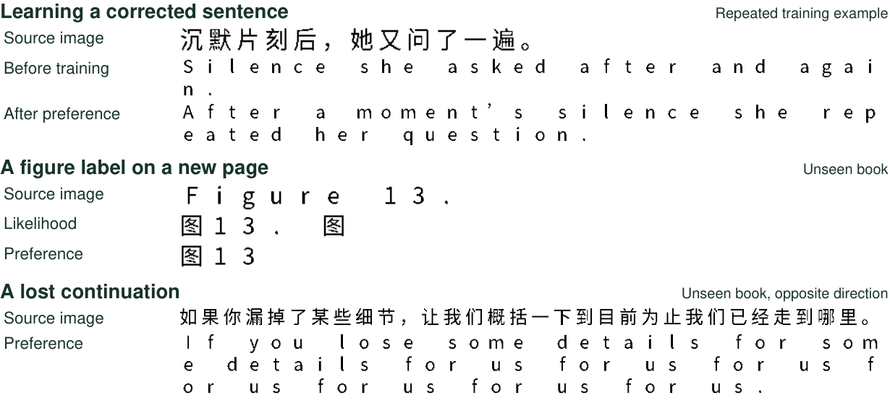
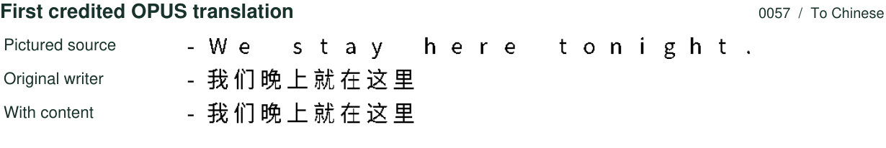
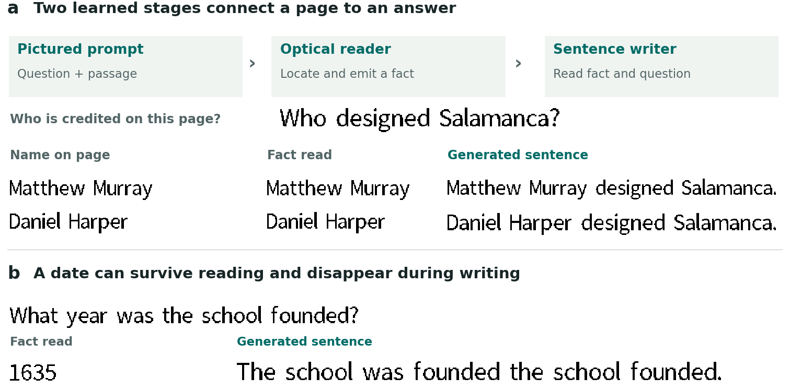
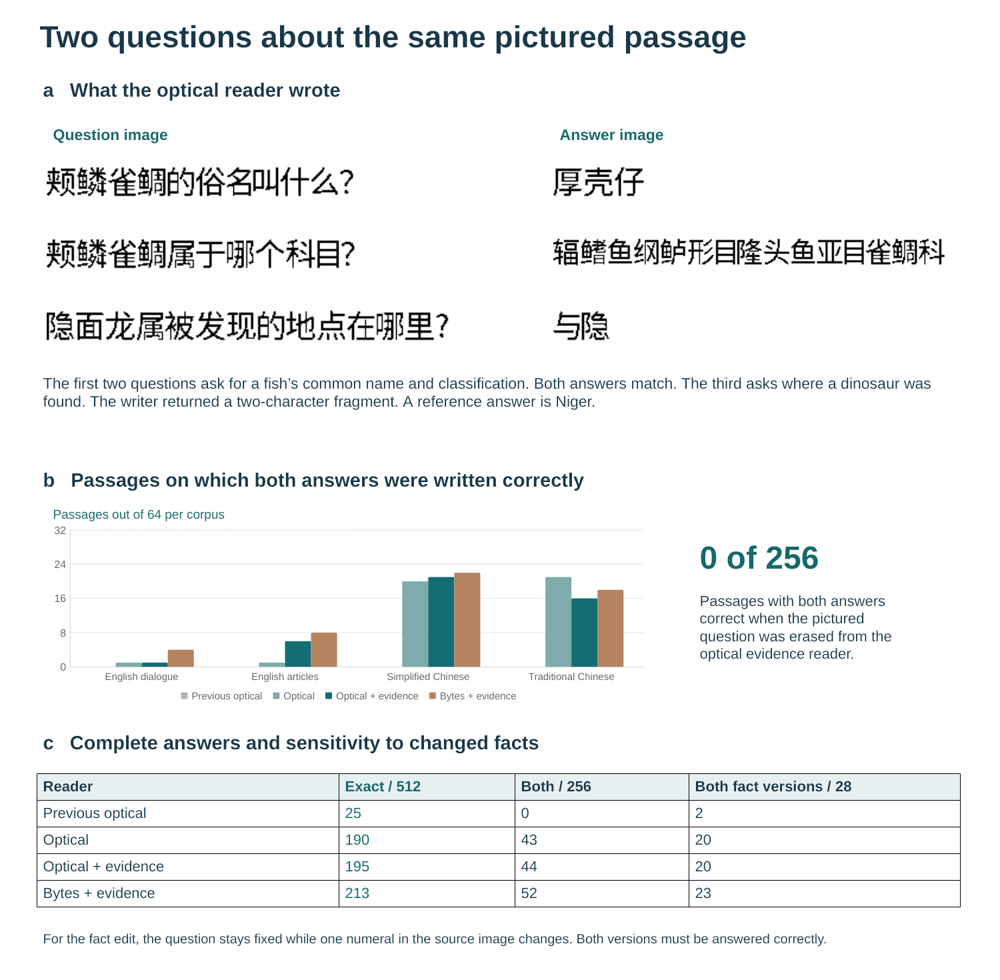
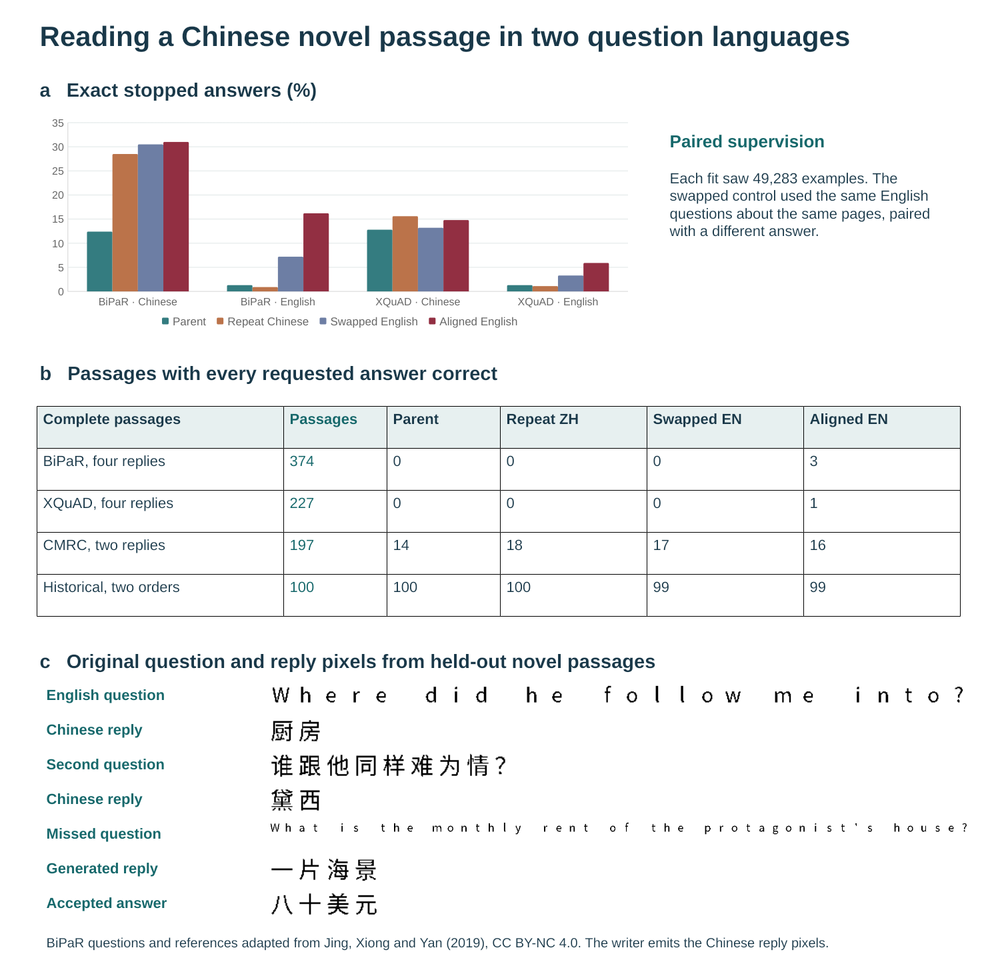
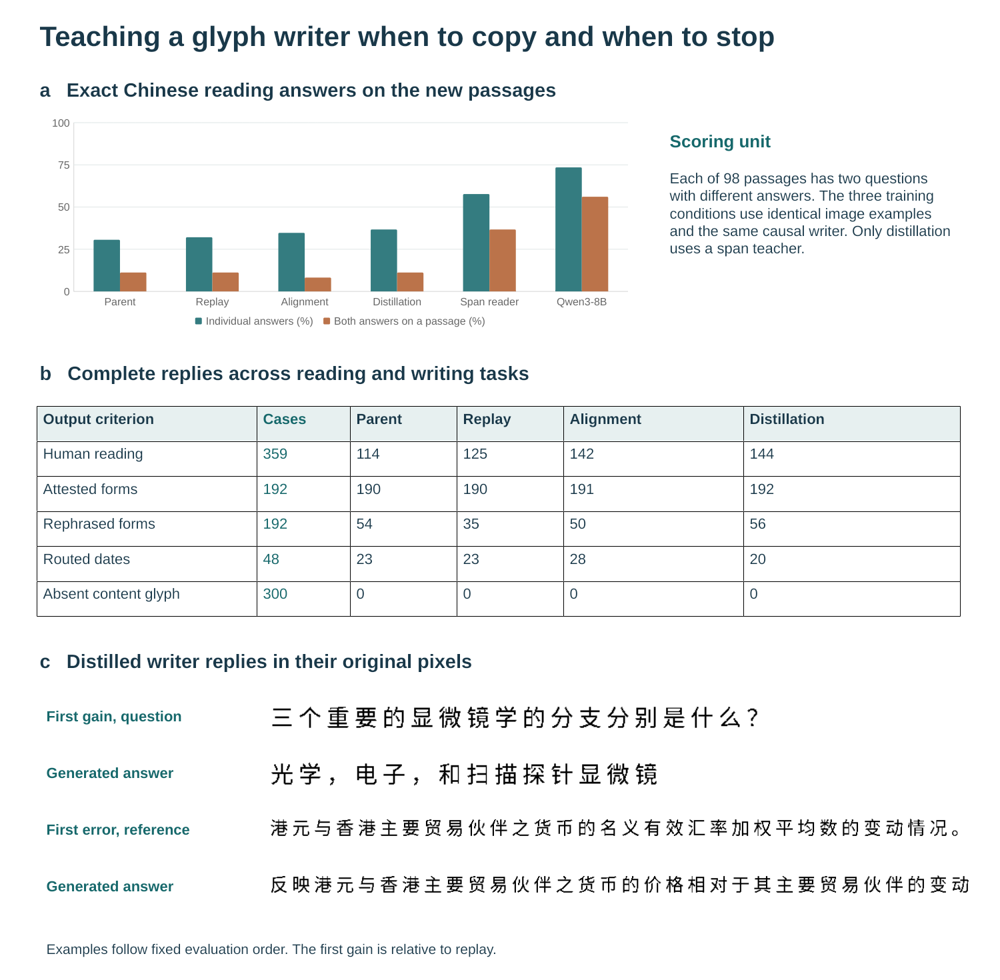
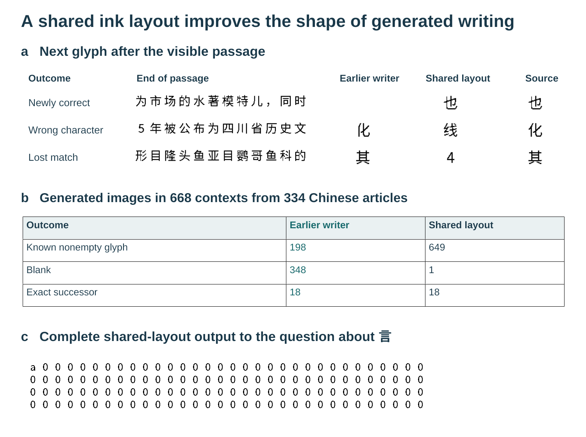

[English](../README.md) · [العربية](README.ar.md) · [Español](README.es.md) · [Français](README.fr.md) · [日本語](README.ja.md) · [한국어](README.ko.md) · [Tiếng Việt](README.vi.md) · [中文 (简体)](README.zh-Hans.md) · [中文（繁體）](README.zh-Hant.md) · [Deutsch](README.de.md) · [Русский](README.ru.md)

単一の RTX 4090 D で訓練した視覚モデルは、繰り返し学習した英中翻訳96問のうち **65問**で意味を正しく伝えました。尤度だけで学習した対照モデルは61問でした。他の学習済み例文では **8/96**、未見の4冊では **1/96** でした。図には実際に書けるようになった文、新しいページで正しく書いた図番号、翻訳に失敗した文を示します。 [出力画像と評価](../references/visual_sequence_preference_result.md) · [モデルの実行](../models/visual_sequence_preference/README.md)



別の4冊から選んだ96問では、約50万組の対訳から関連例を検索すると、意味を伝えたと判定された訳は2件だった。無作為に検索した場合と元のモデルは各1件、テキスト入力の比較モデルは83件だった。 [実験と出力画像](../references/retrieved_glyph_writer_result.md)

RTX 4090 D 1枚で学習したモデルに、原文画像と二つの訳文画像を与えた。特定の訳文を好む傾向を補正すると、二つの原文について両方とも正しく選べた組数は **21/96から77/96** に増えた。自由生成では、原文から字形列を予測することで指定の述語を含む回答が17/336から43/336に増えたが、書籍の意味を完全に伝えたのは192件中1件だった。図は別のOPUSテストで最初に正答と判定された出力。 [実験結果](../references/source_supported_writing_result.md) · [モデルの実行](../models/source_supported_writing/README.md)



同じ辞書ページに対し、語義と古文字の字形を逆の順序で求めました。両方の指示に正しく答えたのは改良前の138組から332組に増えました（全608組）。別の自由翻訳試験で意味を保てたのは、独立した画像モデルが192問中1問、文字入力のQwen3-8Bが154問でした。 [論文（全6ページ）](../publication/ilm-nature/manuscript.pdf) · [字源の実行例](../models/origin_instructions/README.md)

### これまでの実験

鉄道の記事を画像で見せて Salamanca の設計者を尋ねると、モデルは **Matthew Murray designed Salamanca.** と書いた。記事の人名だけを Daniel Harper に変えると、答えの主語も変わった。新しい記事 96 件で事実を正しく読み取れたのは 25 件だった。創立年を正しく読み取っても、文にする際に年を落とした例もある。論文の冒頭に実際の出力画像を掲載した。 [PDF](../publication/ilm-nature/visual_language_paper.pdf) · [PNG](../models/visual_statements/examples/intervention)

英語と中国語の新たな 256 ページに、人が作成した質問を各 2 問用意しました。対照学習した ILM が両方に正答したのは 34 ページで、テキストを読む量子化 Qwen3-8B は 101 ページでした。64 ページの部分集合で同じ画像を与えると、ILM は 6 ページ、Qwen3-VL-8B は 21 ページで両問に正答しました。 [PDF](../publication/ilm-nature/visual_language_paper.pdf) · [PNG](../models/competing_facts/examples)

[](../publication/ilm-nature/visual_language_paper.pdf)

同じ魚の解説ページから、質問に応じて通称と分類を書き分けました。RTX 4090 D 1枚で学習した244万パラメータのモデルは、未見の英語・中国語の文章256件のうち44件で、二つの質問に両方正答しました。従来の画像モデルは0件、同程度の消費電力量で学習したバイト入力モデルは52件でした。「言」の古い字形を求める問いには正答できませんでした。 [モデルを実行](../models/paired_evidence/README.md) · [論文](../publication/ilm-nature/visual_language_paper.pdf)

[](https://github.com/lachlanchen/ImagizedLanguageModel/blob/203f40812f03afbdfa55cf957a56ee8cfe0f944c/publication/ilm-nature/visual_language_paper.pdf#page=2)

212万パラメータのモデルを RTX 4090 D 1枚で学習させたところ、初見の英語・中国語の文章で次の字形を予測する精度が向上しました。一方、省エネルギーの方法を尋ねると、質問の文言を繰り返しました。視覚読解モジュールを追加したモデルは、人が作成した384問中11問に正答しました。同じ文章に関する2問にともに正答したのは192組中0組です。図144に実際の出力画像を示します。 [論文を読む](../publication/ilm-nature/visual_language_paper.pdf) · [画像モデルを実行](../models/visual_cursor/README.md)

[](https://github.com/lachlanchen/ImagizedLanguageModel/blob/203f40812f03afbdfa55cf957a56ee8cfe0f944c/publication/ilm-nature/visual_language_paper.pdf#page=4)

118万パラメータのモデルが、漢文の画像で指定された字の英訳を画像で書く。「言及之而不言」の末字には speak、「有是言也」の「言」には speech と答えた。同じ字の異なる語義を両方正しく書けたのは『論語』で566組中213組、『楚辞』で403組中82組。近接文字の頻度を使う方法では211組と104組だった。 [モデルの実行](../models/visual_word_senses/README.md) · [実験結果](../references/visual_word_sense_result.md)

[](../publication/ilm-nature/manuscript.pdf#page=160)

モデルは中国語の質問と小説の一節を画像で読み、二つの節からなる回答を画像で書く。参照画像と完全に一致した回答は『西遊記』で48件中34件、『紅楼夢』で48件中42件だった。評価用の60字族のうち9字族では、配置と質問順を変えても甲骨文と金文の両方を正しく書けた。英語の質問ではそれぞれ48件中2件と10件だった。 [モデルの実行](../models/grounded_ink_editor/README.md) · [結果と出力例](../references/grounded_ink_writing_result.md)

[](../publication/ilm-nature/manuscript.pdf#page=159)

8,600 万パラメータの画像読解モデルは、『国語』の登場人物について画像で示した中国語の質問 56 問のうち 38 問に正答した。二人の名を入れ替える前後で各 2 問にすべて正答したのは 14 篇中 4 篇で、元のモデルは 3 篇、二人を同じ重みで学習した対照モデルは 2 篇だった。英語では 16 問に正答したが、4 問すべてに正答した篇はなかった。実行例では原文から「密康公」と「恭王」の字形を返す。 [Guoyu · ILM](../models/optical_role_reader/README.md) · [38/56](../references/optical_role_adapter_result.md)

[](../publication/ilm-nature/manuscript.pdf#page=157)

64,666 パラメータの読解モデルが、画像として与えられた質問と中国語の文章を読み、答えにあたる字形を元の画像から返します。6,439 段落で学習し、評価用に残した小説 2 作品について、中国語の質問では 452 問中 104 問、英語では 452 問中 45 問に正答しました。人手の正解だけで学習した場合はそれぞれ 81 問と 48 問でした。同じ段落について異なる二問の両方に正答することはまだまれです。 [ILM · 64k](../models/book_span_distillation/README.md) · [104/452](../references/book_span_distillation_result.md)

[](../publication/ilm-nature/manuscript.pdf#page=154)

画像で提示したクレジットで二人の担当を入れ替えると、視覚モデルは256件中175件で両方の担当を追跡できた。対照モデルは19件だった。新作の短い物語12編では、どちらも比較の全条件を満たせなかった。二つの質問を画像で示し、それぞれに対応する目録の部分を添えると、8試行中2試行で「言」の歴史的字形4種を順番どおりに再現した。 [↗](../references/individual_clause_writer_result.md)

[](../publication/ilm-nature/manuscript.pdf#page=152)

作品のクレジットを画像で示し、登場する二人の名前を入れ替えた。8700万パラメータのモデルは、質問の順序を変えても両方の画像に正答できた比較が256組中165組だった。同じ事例で学習した対照モデルは5組だった。別に書き起こした物語では、どちらも24組中0組だった。 [結果と実際の出力画像](../references/role_change_writer_result.md) · [モデルの実行](../models/role_change_writer/README.md)

予約済みの DRCD 資料を除いて再学習した結果、候補を増やしたモデルは開発用359問中234問で正解画像と完全に一致し、汎用モデルは242問で一致した。以前の DRCD 評価には予約済みのテスト文章が含まれていた。 [結果とデータ出典の訂正](../references/span_list_result.md)

[](../publication/ilm-nature/manuscript.pdf#page=138)

中国語の新たな読解問題384問で、4つの読み取りモデルが提示した画像候補をまとめると、汎用モデルと同じ285問で正解画像と完全に一致した。人名を入れ替える128組のテストでは全問正解が63組で、専用モデルは79組だった。 [結果と重み](../references/span_choice_result.md)

[](../publication/ilm-nature/manuscript.pdf#page=137)

画像内の中国語の文章で二人の名前を入れ替えると、尤度だけで訓練したモデルは128件中79件で、すべての質問に二通りの語順で正しく答えた。従来は29件だった。一方、人が書いた48問では両方の語順で正解した数が34問から28問に減った。 [実験結果とモデル](../references/participant_margin_result.md)

[](../publication/ilm-nature/manuscript.pdf#page=136)

人が書いた中国語の質問48問のうち34問で、画像を出力するモデルが同じ事実を指定された二通りの語順で正しく書けた。「秋潮」の作曲者は正しく答えたが、別の曲で作詞者と作曲者の名前を入れ替えると、人名を取り違えた。 [実験結果とモデル](../references/pictured_relation_result.md)

[](../publication/ilm-nature/manuscript.pdf#page=135)

26,890件の中国語画像で学習したモデルは、人が書いた48問のうち33問に完全な文で正しく答えた。字形を一つずつ生成する別のモデルは、そのうち31問で、同じ内容を指定された二通りの語順で書けた。映画紹介では元の監督と脚本家を正しく挙げたが、名前を入れ替えると余分な箇所まで写した。 [実験結果とモデル](../references/role_binding_result.md)

[](../publication/ilm-nature/manuscript.pdf#page=134)

画像の文章で二人の名前を入れ替えると、答えも正しく変わるだろうか。二文を組み合わせる訓練では見せなかった役割の組合せについて、問いを分けて同じ画像生成器で書くモデルは136問中70問で二つの事実を指定順に記した。一度に二文を書く従来モデルは3問だった。映画の例では、文は読めるものの監督と脚本家に同じ人を挙げた。 [実験結果とモデル](../references/grounded_proposition_result.md)

[](../publication/ilm-nature/manuscript.pdf#page=133)

地図を描いたのは誰か、道に迷ったのは誰か。改良したモデルは、それぞれ別の名前を答えた。新たな画像の問い64問では42問で正しい人名を返した。「言」の甲骨文と金文も指定順に書ける。一方、入力にない字形を必要とする新たな自由回答128問では、参照解答と完全に一致した例はなかった。 [実験結果とモデル](../references/pointing_causal_writer_result.md)

[](../publication/ilm-nature/manuscript.pdf#page=132)

画像の文章には、地図を描いた人と道に迷った人が登場します。モデルは地図を描いた人を正しく答えましたが、道を尋ねたのは誰かと聞くと、また地図の話をしました。入力にない字形を必要とする300問では、それまでの正しい解答を与えても、最初に必要な新しい字形を選べたのは18問でした。 [実験結果と実際の解答画像](../references/causal_glyph_writer_result.md)

[](../publication/ilm-nature/manuscript.pdf#page=131)

画像で指示すると、「言」の甲骨文と金文を指定した順序で出力できる。未学習の字例を使い、同じ二字形を順方向と逆方向の両方で正しく出せたのは、見慣れた質問文で96組中94組、別の字例と新しい質問文では96組中16組だった。 [結果と出力画像](../references/ordered_page_writer_result.md)

[](../publication/ilm-nature/manuscript.pdf#page=130)

**字形画像を読んで答える.** 二人の人物に関する中国語の設問64問のうち、通常の書体では46問、太字では41問に正答しました。ローカルのQwen3-8Bはテキスト入力で55問に正答しました。学習に使わなかった楷書体では正答は1問でした。 [モデルを実行](../docs/visual-page-responder.md)

[](../publication/ilm-nature/manuscript.pdf#page=129)

**一文に登場する二人を区別できるか** ゲイツ棟の寄付者と建築家はどちらも正しく書けた。864組の質問のうち両方に正答したのは100組だった。名前を入れ替える24の新しい場面では全問正解が0場面で、ローカルのQwen3-8Bは20場面だった。 [結果と実行方法](../references/shared_sentence_writer_result.md)

[](../publication/ilm-nature/manuscript.pdf#page=127)

**なぜ人物を取り違えるのか** 中国語の「誰」を問う387問では、文章全体を読ませると62問、質問と共通する字形から一文を選ぶと116問に正答した。同じ選文法で、追加訓練の割り当てをランダムにした対照モデルは127問に正答した。図85は発明者の名前の代わりに地名を書いた例を示す。 [結果と実行方法](../references/inverse_role_writer_result.md)

[](../publication/ilm-nature/manuscript.pdf#page=126)

**誰について書いているか.** 新しい名前と補語を用いた中国語の文は 404 件中 368 件で完全に一致した。秦と楚の金文の字形を入力から写した文は 32 件中 24 件で正解したが、性質だけを示して名前を尋ねると、金文の名前を正しく返した例はなかった。 [結果と実行方法](../references/visual_role_writer_result.md)

[](../publication/ilm-nature/manuscript.pdf#page=125)

**字形から何を読み取れるか** 同じ画像の文「她喝了一口□。」（彼女は□を一口飲んだ）に対し、先行文の飲み物を水から茶に変えると、出力も「水」から「茶」に変わった。ニューラルモデルと隣接字形の頻度を組み合わせると、中国語の穴埋め 2,947 問中 651 問で原文と一致した。一方、二人の役割を入れ替えた 48 組では、両方の文について正しく判定できた組はなかった。 [実験結果と実行コマンド](../references/visual_inference_writer_result.md)

[](../publication/ilm-nature/manuscript.pdf#page=124)

<!-- paired-writing-status:start -->
512 回更新の余白削減比較でも、安定した書き写しには至っていません。OCR 完全一致は訓練 6/32、検証 10/32（鮮明な参照画像は 27/32、28/32）で、生成画像には文字の欠落や重複が見られます。訓練時間は 795.624 秒から 287.182 秒に短縮しましたが、言語理解と実用品質での効率は未実証です。 [全 64 件の生成画像](../references/paired_padding_result.md).
<!-- paired-writing-status:end -->

現在の状況：画像による言語生成は、実用水準に達していません。直近のデコーダ損失の比較実験では、学習に使用した32問に対し、両モデルとも画素単位で完全一致した自律生成回答は0/32でした。デコーダ感度を考慮した損失により、前景F1は対照群の85.984%から70.009%に低下しました。正しい回答履歴を与えても92.430%と75.116%にとどまり、正解の画像コードを直接与えた場合の再構成は両群とも99.9953%です。修正の判定基準は4項目すべて不合格で、この学習方式の規模拡大は行いません。これは画像一致度であり意味の正確さではなく、実用性を検証済みのILMチェックポイントはありません。[結果と全未加工画像](../references/decoder_metric_v82_result.md)。 論文には補足ノート39と編集可能な図S16を反映しました。 外部画像生成器を使った別のベースラインも、ローカル学習なしではOCR完全一致が複写0/12、質問0/8でした（参照画像のOCR校正は18/20）。全40件の未加工出力を保存しています。 [FLUX.2-klein-4B](../references/image_edit_baseline_result.md).


[](https://lazying.art)

# Imagized Language Model (ILM)

「舉杯邀明月」という同じ行を見て、何を上げるのかと聞けば **cup**、誰を招くのかと聞けば **moon** と画像で答えます。この詩句は以前の学習に含まれています。別の評価用の971句では、すべての動詞と目的語を特定し、目的語の英訳をすべて書けたのは247句でした。学習時に目的語を入れ替えると11句でした。自然な質問がすべて未知だった21句では全問正解はありませんでした。 [モデルを実行](../models/questioned_events/README.md) · [結果](../references/questioned_events_result.md)

[](../publication/ilm-nature/manuscript.pdf#page=167)

英語で動作を説明した質問に対し、画像モデルは漢文の268組中44組で両方の目的語を特定し、英語の意味を書けました。従来モデルは11組でした。蒲松齢の作品から選んだ10組では、両方の行を正しく選べたのは4組で、両方の答えを書けた組はありませんでした。図125に桃について尋ねた際の出力を示します。 [モデルの実行](../models/visual_action_meaning/README.md) · [結果](../references/visual_action_meaning_result.md)

[](../publication/ilm-nature/manuscript.pdf#page=166)

同じページに「焉得仁」と「策其馬」があります。何を得るのかと英語で尋ねると **benevolence**、何に鞭を打つのかと尋ねると **horse** と画像で答えます。未学習の1,691ページのうち703ページで、2通りの行順と質問形式のすべてで両方の目的語を正しく特定して書きました。同じ188ページで動作の表現を言い換えると、全問正解は95ページから7ページに減りました。 [実行方法](../models/pictured_action_lookup/README.md) · [実験結果](../references/pictured_action_lookup_result.md)

[](../publication/ilm-nature/manuscript.pdf#page=165)

このモデルは漢文と質問を画像で読み、英語の答えを画像で書きます。「還其珠」では質問に応じて **return** または **pearl** と書きます。約140万パラメータのモデルは「之」を *it* と *go* に書き分ける課題で、評価用の40組中31組に正答しました。教師データの答えを入れ替えた対照では4組でした。別の2冊では、四つの質問すべてに正答したのは29節中1節でした。 [実行方法](../models/pronoun_writer/README.md) · [実験結果](../references/pronoun_writer_result.md)

[](../publication/ilm-nature/manuscript.pdf#page=163)

「執大象」に画像で質問すると、モデルは動詞には **hold**、目的語には **image** と画像で答えます。中国語と英語の計8問すべてに正解したのは、評価用539節のうち230節でした。訓練で見た訳語に出力を限定すると247節に増えました。日常的な言い換えにはまだ弱さがあります。 [モデルを実行](../models/asked_gloss/README.md) · [実験結果](../references/asked_gloss_result.md)

[](../publication/ilm-nature/manuscript.pdf#page=161)

質問画像の表現を使うと、MLQAの英語412問で正しい箇所を特定できた数が17から41に増えた。中英合わせた824問では、生成モデルが抜粋を受け取った場合に111問、元のページを受け取った場合に90問で、正答して自ら生成を終了した。 [↗](../references/question_evidence_transfer_result.md)

[](../publication/ilm-nature/manuscript.pdf#page=149)

視覚エンコーダーは小説374節のうち364節で英語と中国語の質問を正しく対応付けた。別の5作品への92問では、読解モデルが31問で正しい箇所を抜き出し、その抜粋を受け取った生成モデルは19問に正答した。 [↗](../references/bilingual_book_intervals_result.md)

[](../publication/ilm-nature/manuscript.pdf#page=148)

自身が誤答した642例で追加学習したモデルは、別の中国語作品6点への144回の質問に対し、31回で正しい画像を出力した。36の抜粋のうち、中国語と英語の両方で2問とも正答したのは0件だった。 [↗](../references/stopped_book_preference_result.md)

[](../publication/ilm-nature/manuscript.pdf#page=147)

別の中国語作品4冊から選んだ34の抜粋で、先頭字形の学習を強めたモデルは中国語・英語による136回の質問のうち31回に完全正答しました。4問すべてに正答した抜粋はありませんでした。 [↗](../references/first_glyph_book_result.md)

[](../publication/ilm-nature/manuscript.pdf#page=146)

中国語の小説の各抜粋に、中国語と英語でそれぞれ同じ2問を提示しました。4問すべてに正答したのは374編中、対訳で学習したモデルが3編、英語の質問を入れ替えた対照モデルが0編でした。XQuADでは対訳モデルが227編中1編で全問正答しました。 [結果と回答画像](../references/bilingual_novel_result.md)

[](../publication/ilm-nature/manuscript.pdf#page=145)

字形の縦横比と線幅を変えて学習すると、花園明朝の中国語読解問題で正答数が394問中15問から43問に増えました。各文章の2問とも正解したのは197件中6件で、別のXQuAD読解問題では同じ書体で227件中0件でした。 [結果と実際の出力](../references/stroke_scale_result.md)

[](../publication/ilm-nature/manuscript.pdf#page=144)

学習に使っていない花園明朝で中国語の新しい文章を表示すると、画像モデルは394問中15問に正答しました。複数書体での追加学習だけでは3問でした。各文章の2問とも正解したのは197件中0件です。オフラインの字形目録では、「中」などの見出し字を指定して古い字形を画像で回答させることもできます。 [モデルと字形目録の使い方](../models/typeface_writer/README.md)

[](../publication/ilm-nature/manuscript.pdf#page=143)

中国語の文章画像98件に各2問を出したところ、蒸留モデルは196問中72問、通常の訓練を行ったモデルは63問に正答しました。2問とも正解した文章はどちらも11件でした。同じ文章をテキストで入力したQwen3-8Bでは55件でした。 [実験結果とモデル](../references/interval_teacher_result.md)

[](../publication/ilm-nature/manuscript.pdf#page=142)

同じモデルが字形画像を読み、中国語の読解問題 359 問中 114 問に正答しました。図版にある「言」の甲骨文と金文も、指定された順に出力できました。別の 128 文章に各 2 問を出すと、両方に正答したのは 15 文章で、抽出型の読解モデルは 49 文章でした。 [画像モデルの実行方法](../models/mixed_visual_answers/README.md)

[](../publication/ilm-nature/manuscript.pdf#page=141)

中国語の字形画像を読むモデルは、年を変更し、質問を三通りに言い換えても、単一段落の64組中34組、二段落の48組中8組で、すべての回答に正しい人物名と年を書けた。より広い分野から人が作成した359問では、完全一致は7問だった。

[](../publication/ilm-nature/manuscript.pdf#page=139)


ILM は言語を **目に見える書字** として学習・生成します。画像から連続視覚状態へ、
そして画像へ戻る経路を研究し、隠れた記号列を中核に置きません。


最新のインターフェース検証では、同じページを1024から432に縮小すると、凍結済み事前学習モデルの英語完全一致回答が0/32から11/32に改善しました。学習済みの二つのアダプターは432でも各5/32です。画像で回答を生成する独立したILMは、まだ実証できていません。

[2026-11-07: English result and full evidence](../references/native_reader_geometry_result.md)

2026-11-08の結果：128回更新した学習の評価が完了し、384枚すべての元の回答画像を確認しました。初期モデルと最終モデルはともに、学習済みの質問と保留した質問の各群でOCR完全一致が0/32でした。元データが認める別解を含めても同じです。保留群の書き写し完全一致は19/32から16/32に低下しました。事前に定めた6条件はすべて未達で、言語学習はまだ実証できていません。

[結果と証拠の範囲](../references/native_paired_qa_learning_result.md)

## 漢文の画像から現代中国語を書く

約203万パラメータのモデルは、学習に使わなかった章で、描画可能な2,045件の原文をすべて正確に書き写した。現代中国語訳は2,048件中30件が参照画像と完全に一致した。一例では九つの字形を写し、二つを新たに描いて「薨」を「去世」に置き換えた。字形の編集距離では、単純な局所編集の方が全体として良好だった。 [モデルを実行](../models/visual_edit_zh/README.md) · [出力と参照画像](../publication/ilm-nature/figures/Figure_48_visual_edit.png)

## 古い字形を資料から読み取る

4 行の資料を与えると、学習に使わなかった字族についての中国語・英語の質問 9,600 件のうち 9,565 件で、指定された字形を正しい順序で返しました。 [実行例](../models/pictured_idiom_zh/README.md) · [Fig. 42](../publication/ilm-nature/figures/Figure_42_historical_plates.png)

## 前後の文章を画像で読み、抜けた四字熟語を書く

212万パラメータのモデルが空欄の前後にある文章の画像を読み、抜けた中国語の四字熟語を一字ずつ描きます。検証用の22,907例のうち134例で原文と完全に一致しました。そのうち100例では、答えの四文字がどれも入力に含まれていませんでした。周辺の文字の出現頻度に基づく手法は1,012例で正解しました。

[モデルの実行](../models/pictured_idiom_zh/README.md) · [図40](../publication/ilm-nature/figures/Figure_40_pictured_idioms.png)

読取モデルの予測を追加訓練に使うと、22,907例のうち378例で原文と一致しました。原文の正解だけで同じ回数だけ追加訓練した場合は292例でした。別に確保した未使用の9,135例では、それぞれ163例と125例でした。 [図41](../publication/ilm-nature/figures/Figure_41_writer_transfer.png)

読み取りと書き出しを一緒に学習したモデルは、新しい中国語の穴埋め問題 17,555 件のうち 433 件で正確な画像を生成しました。従来モデルは 276 件、周辺文字の頻度に基づく手法は 789 件でした。 [Fig. 43](../publication/ilm-nature/figures/Figure_43_expression_preference.png)

## 中国語の字形画像から答えを選ぶ

小型の読解モデルを CPU の 2 スレッドで 64 秒間学習させました。学習に使わなかった中国語の文章に対する 1,788 問のうち、269 問で正解と画素単位で一致する回答画像を選びました。質問を白紙にすると正解は 18 問でした。別の自由生成モデルは「言」の字形の変遷を読める形で説明できませんでした。汎用的な文章生成と 1,000 倍の学習効率は引き続き検証課題です。


[読解モデルを実行](../references/visual_extractive_reading_result.md) · [論文](../publication/ilm-nature/manuscript.pdf)

中国語の質問3,170件のうち、読解モデルは565件で正しい箇所を選び、書字モデルは124件の答え全体を別の書体で正確に描いた。同じバンドに関する二つの問いへの出力は「前卫金属」と「1996年」だった。


[別書体で描いた回答](../references/grounded_detail_writing_result.md)

## 文脈から次の漢字を描く

開発用の668例で、字形全体のおおまかな配置を先に予測すると、既知の空白でない字形と画素単位で一致した出力は198例から649例に増えた。原文の次の文字と一致したのは、どちらのモデルでも18例だった。「言」の成り立ちを尋ねると、新しいモデルはゼロに似た形を繰り返した。



[実験結果と学習済みモデル](../references/shared_layout_writing_result.md)

## 以前の続きを生成する実験

2026-11-13

完全系列の試行は **13,766 系列、41,298 更新、6,108,741 の目標字形位置**を処理しました。参照回答による採点前に、**732 枚すべての出力画像**を確認しました。最終モデルは比例配置の入力で、**厳密な完全正答 7/32、同一文章の両問正答 0/16 組、読み取れる回答 14/32、首尾一貫した完全な長い書籍続文 0/12**でした。事前登録した基準と、四つの質問・文章消去対照を対象とする独立監査の双方を満たしませんでした。

RTX 4090 1 枚での学習時ピーク割当 VRAM は **18.568 GiB**です。継承した基盤重みを含む実行モデル全体は **7,578,390,003 パラメータ**で、今回更新したのは **20,212,225**です。再利用した開発集合を一つのモデル評価者が判定しており、独立した人間の判定はありません。実用的な軽量 ILM と同等品質での効率優位は未証明です。

[全結果](../references/visual_continuation_learning_result.md) · [開発目標](../docs/first-imagized-language-model-goal.md) · [固定プロトコル](../references/visual_continuation_full_protocol.md)

## 以前の V35 の結果


V35 は `129,092,738` パラメータの中国語視覚言語モデルです。RTX 4090 1 枚で
`22,000` 回の BF16 更新をすべて完了し、所要時間は `2.770` 時間、ピーク GPU
メモリは `2.899 GiB` でした。実行経路が受け取るのは書字ピクセルと視覚マスク
だけで、ラスターを直接生成して再読します。実行時に tokenizer、Unicode/文字
ID、OCR、検索、視覚コードブック、教師モデルは使いません。

実測判定は **`not-qualified`** です。正しいプロンプトでの複写精度は
`0.3125%`、指示精度は `0.1116%` で、後者はシャッフル対照より低い値です。
視覚因果ゲートは `5/12`、意味ラスターゲートは `5/9` のみ通過しました。出力は
非空でプロンプト変化に反応しますが、描線は崩れ、要求された答えに束縛されて
いません。このため封印済み分割は開いていません。

V35 は転移学習です。V34 連続書字コーデックは本プロジェクトの成果ですが、因果
コアは外部 PIXAR チェックポイントから初期化しています。PIXAR は外部基盤として
明示的に帰属し、本プロジェクトの貢献とは主張しません。「独立」は自己完結した
実行物を意味し、全要素のゼロからの学習を意味しません。詳細は
[英語の実測報告](../references/causal_glyph_flow_v35_result.md)、[実装ガイド](../docs/causal-glyph-flow-v35.md)、
[論文](../publication/ilm-image-native/ilm-image-native.pdf)を参照してください。

## 以前の限定プロンプト実験：V23 視覚関係回路を採択


V23 は、このリポジトリで証拠手順を最後まで通過した最初の
画像プロンプト入力・画像回答出力実験です。モデルは 6 枚の `32x32` 書字画像だけを
受け取り、1 枚の `32x32` 回答画像を出力します。実行経路には文字列、token、
Unicode ID、OCR、字形検索、回答インデックス、外部言語モデルがありません。

一度だけ許可された凍結評価では、未見の漢字 98 字、1,024 エピソード、4,096
プロンプト変種に対して、二者選択 `0.99829`、問い合わせ切替 `0.99609`、操作切替
`0.99707`、出力字形 top-1 `0.99463`、pixel F1 `0.78478` を得ました。
問い合わせ盲検・操作盲検の対照は、それぞれ見えない要因に対して厳密に切替ゼロです。

これは固定された 6 役、2 組の束縛、same/other 関係に限る視覚プロンプト追従の
証明であり、自由形式の言語理解ではありません。V24 では固定フレーム役を外し、可変長の
2D 書字画像ストリームを読み、最初の出力を再読して 2 枚目を生成します。詳細は
[英語版 V23 結果記録](../docs/visual-relation-circuit-v23-result.md)を参照してください。

## 以前の研究基準：Predictive Visual Field の出発点


RFLM V7 は、1つのピクセルフローに言語的同一性の推論と字形描画を同時に任せる
設計の限界を示しました。全履歴 top-1 は `1.20%` から `2.31%` に上がり、
last-only (`2.02%`) と unigram (`1.86%`) を超えましたが、bigram
(`13.58%`) には遠く及びません。正規化対数確率の利得も `-0.9066` から
`-0.2155` に改善したものの負のままで、自律出力も読めません。したがって
**V7 は言語モデルとして不合格** です。

次の PVF は、次の網膜状態を予測する連続フローと、その状態をインク画像として
描いて再読する視覚アクチュエータを分離します。最近傍文字検索や出力表は使いません。
境界は `書字ピクセル -> 連続視覚ダイナミクス -> インクピクセル` のままで、
token、Unicode ID、OCR、視覚コードブック、外部 LLM は入りません。PVF は
検証可能な V8 仮説であり、実証済み能力ではありません。

> リポジトリは実用的な語源パイプラインと長期の ILM 実験を意図的に並行して維持しています。

## 📌 概要

このリポジトリには3つの関連トラックがあります。

1. Retinal Flow による画像ネイティブ言語モデリングと厳密な外部評価。
2. 出典を保持した歴史的漢字字形の語源データ取り込み。
3. 再現性のために残す旧グリフ、コードブック、拡散、folio、InkStream ベースライン。

この README は3トラックを記載し、語源ワークフローを再現可能な主要経路として扱います。

## 🔗 主要リンク

| 領域 | パス |
|---|---|
| 概念説明 | `docs/imagized-language-model.md` |
| 現在の工学目標 | `docs/first-imagized-language-model-goal.md` |
| 研究資料と実験証拠 | `references/image-native-language-model-research.md` |
| コード計画と指標 | `docs/ilm-visual-diffusion-code-plan.md` |
| 埋め込み「カラー」計画 | `docs/embedding-color-plan.md` |
| 開発ノート/計画 | `docs/development-plan.md` |
| 語源モジュール README | `ilm/etymology/README.md` |

## ✨ 特徴

- 🏺 `hanziyuan` と `chineseetymology` 形式の語源データ取り込み。
- 🌐 リトライ、間引き（throttling）、キャッシュを備えた堅牢な AJAX + HTML 取り込みフロー。
- 🧩 ステージラベル付きのグリフ抽出で、`` と CSS `background-image` の data URI を扱う。
- 🗃️ 文字／グリフメタデータとファイルシステム資産レイアウトを管理する SQLite バックエンド。
- 🖥️ アドホック取り込みとギャラリープレビュー向け Tornado Web UI。
- 🔤 多言語トークン画像向けのグリフ描画ユーティリティ。
- 🧠 製品コード（Product-code）風の埋め込み/コードブックモジュール。
- 🧱 文フレームのパッキングと拡散／インペインティングの学習・評価スクリプト。
- 📊 埋め込みとパイプライン検査用のレポート・可視化スクリプト。
- 📄 `publication/` 配下の LaTeX/PDF 形式の公開用成果物。

## 🧱 プロジェクト構成

```text
.
├── README.md
├── AGENTS.md
├── configs/
│   ├── color.yaml
│   └── diffusion.yaml
├── docs/
├── i18n/
├── ilm/
│   ├── code/
│   ├── data/
│   ├── datasets/
│   ├── db/
│   ├── diffusion/
│   ├── encoders/
│   ├── english_tiles/
│   ├── etymology/
│   ├── frames/
│   ├── models/
│   └── utils/
├── scripts/
├── publication/
├── assets/
├── logs/
└── *.ipynb
```

## 🧰 前提条件

| 要件 | 補足 |
|---|---|
| Python `3.10+` | コア実行環境 |
| `pip` | パッケージ導入 |
| GPU（任意） | PyTorch CUDA 学習スクリプトの実行に有効 |
| LaTeX ツールチェーン（任意） | 公開物のビルドに必要 |

前提メモ: 現時点で、`pyproject.toml` や `requirements.txt` のような単一のルート依存ファイルはありません。依存関係は import とスクリプト利用例から推定します。

## ⚙️ インストール

### 最小構成（語源ツールキット）

```bash
python -m venv .venv
source .venv/bin/activate
pip install --upgrade pip
pip install requests beautifulsoup4 tornado
```

### 拡張構成（モデリング／学習ワークフロー）

```bash
python -m venv .venv
source .venv/bin/activate
pip install --upgrade pip
pip install requests beautifulsoup4 tornado pyyaml numpy pillow matplotlib torch
```

特定スクリプトで追加パッケージが必要な場合は、そのスクリプトの import エラー表示に従って個別に導入してください。

## 🚀 使用方法

### クイックスタート: 歴史的グリフ取り込み（CLI）

1. Hanziyuan（推奨）: 文字のみの AJAX フロー

```bash
PYTHONPATH=. python scripts/ingest_etymology.py --site hanziyuan --char 中
```

2. ChineseEtymology（URL を直接指定）

```bash
PYTHONPATH=. python scripts/ingest_etymology.py --site chineseetymology --url "https://www.chineseetymology.org/CharacterEtymology.aspx?characterInput=%E4%B8%AD"
```

3. バッチファイル取り込み（各行は `char\turl`、`url`、`char url` のいずれか）

```bash
PYTHONPATH=. python scripts/ingest_etymology.py --from-file urls.txt
```

### 出力

| 出力タイプ | 保存場所 |
|---|---|
| ファイル | `data/historic/glyphs/<char>/<stage>/<label>.<ext>` |
| キャッシュ | `data/historic/cache/*.html` |
| DB | `data/historic/etymology.sqlite3` |

### Web デモ（任意）

```bash
PYTHONPATH=. python scripts/serve_etymology.py
```

`http://127.0.0.1:8888` を開き、サイトを選択して文字（例: `中`）を入力します。

### スクレイピングの礼儀とサイトの尊重

- フェッチャーはホストごとの間引き、指数バックオフ付きリトライ、キャッシュを使用します。
- 遅延は `>= 0.5s` を維持し、短時間の連続リクエストを避け、サイトの利用規約・robots・ライセンスを尊重してください。
- ペイウォールや対話式の保護を回避してはいけません。
- `403` / `429` が発生した場合は、リトライ間隔を延ばしてしばらく待ってから再実行してください。

### 追加の ILM ワークフロー

これらのスクリプトは現在リポジトリ上で公開されており、研究向けのワークフローです。ローカルで準備済みのデータセットやチェックポイントが必要になる場合があります。

1. データ取得 / 前処理

```bash
python scripts/download_alpaca.py --outdir data/raw
python scripts/download_corpora.py --out data/raw
python scripts/sample_paragraphs.py --out data/processed/test_100.jsonl
python scripts/build_images_common_freq.py --out data/processed/images_common_freq --size 128 --en 5000 --zh 5000
```

2. Glyph DB のライフサイクル

```bash
python scripts/glyphdb_init.py --db data/glyphdb/glyphs.sqlite3
python scripts/glyphdb_ingest_index.py --db data/glyphdb/glyphs.sqlite3 --index data/processed/images_common_freq/index.tsv
```

3. コード/カラー モデルの学習

```bash
python scripts/train_color_codes.py --config configs/color.yaml
python scripts/train_codes_from_qa.py --en-json data/raw/alpaca_en.json --zh-json data/raw/alpaca_zh.json --epochs 1
python scripts/train_ilmglyph_codes.py --en data/raw/alpaca_en.json --zh data/raw/alpaca_zh.json --out artifacts/ilm_glyph_train
```

4. 拡散／インペインティング

```bash
python scripts/train_diffusion.py --config configs/diffusion.yaml
python scripts/train_inpaint_frames.py --ckpt-code artifacts/ilm_glyph_train/ckpt_epoch1.pt --out artifacts/inpaint
```

5. 評価／レポート

```bash
python scripts/eval_color_codes.py --checkpoint artifacts/color_codes_e1.pt
python scripts/eval_diffusion.py --checkpoint artifacts/diffusion_unet.pt
python scripts/eval_qa_retrieval.py --checkpoint artifacts/color_codes_qa.pt
python scripts/report_ilmglyph_pipeline.py --ckpt artifacts/ilm_glyph_train/ckpt_epoch1.pt --lang en --text "hello world"
```

## 🧩 設定

主要な YAML 設定:

- `configs/color.yaml`
  - データパス: `data/processed/images_common_freq/index.tsv`
  - モデル・コードパラメータ: `d_glyph`, `d_code`, `K`, `C`, temperature/anneal
  - optimizer / ログ設定

- `configs/diffusion.yaml`
  - 入力 JSONL: `data/processed/test_100.jsonl`
  - フレーム・グリッドとモデルサイズの設定
  - 学習時マスク率の範囲およびチェックポイント設定

対応する場合は CLI フラグ（`--epochs`, `--batch-size`, `--lr` など）で設定を上書きできます。

## 🧪 例

- 英語 1 文字タイルのグリフを作成:

```bash
python scripts/build_english_tile_glyph.py "language" artifacts/language_tile --save-tensor
```

- 学習済みチェックポイントを使ってインペインティングデモを実行:

```bash
python scripts/inpaint_demo.py \
  --ckpt-code artifacts/ilm_glyph_train/ckpt_epoch1.pt \
  --ckpt-inpaint artifacts/inpaint/ckpt_epoch1.pt \
  --lang en \
  --text "the quick brown fox jumps" \
  --mode infill \
  --out artifacts/inpaint_demo
```

- Hanziyuan から高頻度文字を一括取り込み:

```bash
PYTHONPATH=. python scripts/bulk_ingest_hanziyuan.py --limit 200 --resume
```

## 📝 開発ノート

- このリポジトリは、堅牢な CLI と探索的アーティファクト（ノートブックや試作スクリプトを含む）を併せ持つ研究用コードベースです。
- 大きな生成ファイルは `data/` と `artifacts/` に置く想定です（どちらも `.gitignore` で除外）。
- 公開用ソースと PDF は `publication/` 配下にあり、補助スクリプトは `scripts/latex_build.sh`。
- 協業・進行ルールは `AGENTS.md` に記載されています。

## 🛠️ トラブルシューティング

- `ModuleNotFoundError: ilm...`
  - リポジトリのルートからスクリプトを実行してください。
  - ローカルパッケージ解決を期待するスクリプトでは `PYTHONPATH=.` を使います。

- `FileNotFoundError`（data / index / チェックポイント）
  - 先に前提となるデータ作成スクリプトを実行してください。
  - `data/processed/images_common_freq/index.tsv` や `data/processed/test_100.jsonl` が存在することを確認してください。

- CUDA / デバイスに関する問題
  - スクリプトのフラグまたは設定（`device: cpu` または `--device cpu`）で CPU 実行に切り替えてください。

- パッケージ不足エラー
  - 該当スクリプトの import が示す不足パッケージ（`torch`、`pyyaml`、`Pillow` など）をインストールしてください。

- スクレイピング時の HTTP `403` / `429`
  - `--delay` を増やし、時間を空けて再試行してください。

## 🗺️ ロードマップ

- まずは歴史的語源の高速スタートを越えて、text-as-image ILM の学習・評価ランブックを成熟させる。
- 環境の再現性を改善（単一の権威ある依存定義の整備）。
- 研究スクリプトとパイプライン結合部のテスト/CI を拡充する。
- 階層的コードブック、拡散目的関数、制御性チャネルを継続的に改善する。
- `docs/`、スクリプトのヘルプ、公開成果物でドキュメントを統合する。

より深いコンセプトと段階別計画については、次を参照してください。

- `docs/imagized-language-model.md`
- `docs/ilm-visual-diffusion-code-plan.md`
- `docs/development-plan.md`

## 🤝 コントリビュート

- `AGENTS.md` の規約（原則コミット、変更後の push、コードへの認証情報埋め込みなし）を守ってください。
- 関連作業は論理的に関連する変更を1コミットにまとめます。
- 再現可能性の高いスクリプト実行（明示的フラグと入力パス指定）を優先します。
- スクレイピングに関する変更は、レート制御・キャッシュ挙動・サイト尊重の制約を維持します。

## 📄 ライセンス

トップレベルのライセンスファイルは現在このリポジトリにありません。

前提メモ: `LICENSE` ファイルが追加されるまで、保守者側で未確定のライセンスとして扱ってください。


## ❤️ Support

<!-- support:start -->
[](https://github.com/sponsors/lachlanchen)
[](https://chat.lazying.art/donate)
[](https://paypal.me/RongzhouChen)
[](https://buy.stripe.com/aFadR8gIaflgfQV6T4fw400)
<!-- support:end -->
