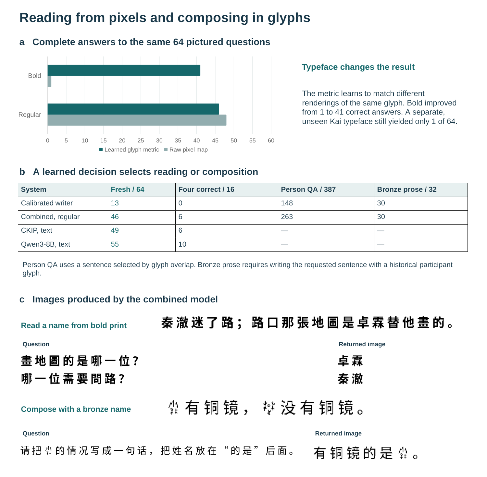

[English](../README.md) · [العربية](README.ar.md) · [Español](README.es.md) · [Français](README.fr.md) · [日本語](README.ja.md) · [한국어](README.ko.md) · [Tiếng Việt](README.vi.md) · [中文 (简体)](README.zh-Hans.md) · [中文（繁體）](README.zh-Hant.md) · [Deutsch](README.de.md) · [Русский](README.ru.md)

После обучения на 26 890 примерах китайского текста в виде изображений модель правильно ответила полным предложением на 33 из 48 вопросов, написанных людьми. Другая модель, рисующая знаки по одному, выразила тот же факт в обоих заданных порядках в 31 случае. В исходном описании фильма режиссёр и сценарист названы верно, но после перестановки имён модель скопировала лишнюю часть предложения. [Результаты и модель](../references/role_binding_result.md)

[](../publication/ilm-nature/manuscript.pdf#page=124)

Изменится ли ответ, если поменять местами два имени на изображении страницы? Для сочетаний ролей, исключённых из обучения ответам в два предложения, модель с разбором вопроса и общим генератором изображений верно указала оба факта в заданном порядке в 70 из 136 случаев. Модель, писавшая оба предложения за один раз, справилась трижды. В примере с фильмом оба предложения читаются, но сценарий и режиссура приписаны одному человеку. [Результаты и модель](../references/grounded_proposition_result.md)

[](../publication/ilm-nature/manuscript.pdf#page=123)

Кто нарисовал карту и кому нужно было спросить дорогу? Обновлённая модель вернула два разных имени. В 64 новых вопросах в виде изображений она точно назвала имя 42 раза. Она также воспроизводит формы 言 на гадательных костях и бронзе в заданном порядке. Ни один из 128 новых открытых вопросов, требовавших отсутствующего во входных данных знака, не получил ответа, точно совпадающего с эталоном. [Результаты и модель](../references/pointing_causal_writer_result.md)

[](../publication/ilm-nature/manuscript.pdf#page=122)

В тексте на изображении сказано, кто нарисовал карту и кто заблудился. Модель верно назвала автора карты, но повторила тот же факт в ответ на вопрос о том, кому нужно было спросить дорогу. В 300 вопросах ответ требовал знака, отсутствующего во входных данных. Даже получив верное начало ответа, модель правильно выбрала первый недостающий знак лишь 18 раз. [Результаты и исходные изображения ответов](../references/causal_glyph_writer_result.md)

[](../publication/ilm-nature/manuscript.pdf#page=121)

Модель выводит формы 言 в надписях на гадательных костях и бронзе в порядке, заданном вопросом на изображении. При знакомой формулировке оба порядка оказались верны в 94 из 96 сравнений на отложенных знаках. На других карточках с новой формулировкой результат составил 16 из 96. [Результаты и изображения ответов](../references/ordered_page_writer_result.md)

[](../publication/ilm-nature/manuscript.pdf#page=120)

**Чтение и ответы по изображениям иероглифов.** Из 64 вопросов на китайском о двух людях модель правильно ответила на 46 при обычном начертании и на 41 при полужирном. Локальная Qwen3-8B дала 55 правильных ответов на текстовый ввод. При использовании незнакомого шрифта в стиле кайшу правильным оказался лишь один ответ. [Запуск модели](../docs/visual-page-responder.md)

[](../publication/ilm-nature/manuscript.pdf#page=119)

**Различает ли модель двух людей в одном предложении?** Модель правильно назвала и спонсора, и архитектора здания Гейтса. Из 864 пар вопросов она дала оба верных ответа в 100 случаях. При перестановке имён в 24 новых ситуациях модель не решила полностью ни одной, а локальная Qwen3-8B решила 20. [Результаты и запуск](../references/shared_sentence_writer_result.md)

[](../publication/ilm-nature/manuscript.pdf#page=117)

**Почему модель путает имена?** На 387 китайских вопросах о том, кто совершил действие, выбор предложения по общим с вопросом начертаниям знаков увеличил число полностью верных ответов с 62 до 116. При том же выборе предложения контрольная модель со случайным распределением дополнительных обучающих ответов дала 127 верных ответов. На рисунке 85 показано, как вместо имени изобретателя модель написала географическое название. [Результаты и запуск](../references/inverse_role_writer_result.md)

[](../publication/ilm-nature/manuscript.pdf#page=116)

**О ком говорится в предложении?** С новыми именами и дополнениями модель полностью правильно написала 368 из 404 китайских предложений. Скопировав имена Цинь и Чу в начертании с бронзовых надписей, она правильно написала 24 из 32 предложений. Когда требовалось назвать участника лишь по его признаку, модель ни разу не воспроизвела нужное древнее имя точно. [Результаты и запуск](../references/visual_role_writer_result.md)

[](../publication/ilm-nature/manuscript.pdf#page=115)

**Что модель может прочитать на изображении текста?** Для одного и того же предложения «她喝了一口□。» («Она сделала глоток □») модель написала 水 (вода), а после замены напитка в исходном отрывке — 茶 (чай). Нейросеть в сочетании с частотами соседних знаков точно восстановила 651 из 2947 пропущенных китайских фрагментов. Когда два человека менялись ролями, ни в одной из 48 пар модель не оценила верно обе версии. [Результаты и команды](../references/visual_inference_writer_result.md)

[](../publication/ilm-nature/manuscript.pdf#page=114)

<!-- paired-writing-status:start -->
Сравнение после 512 обновлений с удалением белых полей всё ещё не даёт надёжного копирования: точное совпадение OCR — 6/32 на обучении и 10/32 на валидации (чёткие эталоны: 27/32 и 28/32). В исходных изображениях пропущены символы и повторяются буквы. Время обучения снизилось с 795.624 до 287.182 секунды, но понимание языка и эффективность при полезном качестве не доказаны. [Все 64 исходных результата](../references/paired_padding_result.md).
<!-- paired-writing-status:end -->

Текущее состояние: генерация языка в виде изображений пока не прошла проверку пригодности к практическому использованию. В последнем сравнении функций потерь декодера на 32 уже встречавшихся при обучении вопросах обе модели дали 0/32 автономных ответов с полным попиксельным совпадением. Функция потерь, учитывающая чувствительность декодера, снизила F1 штрихов с 85.984% у контрольной модели до 70.009%. Даже с правильной предысторией ответа F1 достигает лишь 92.430% и 75.116%; при непосредственной подаче кодов изображения правильного ответа реконструкция даёт 99.9953% в обоих случаях. Все четыре критерия улучшения провалены, поэтому масштабирование этой схемы обучения отклонено. Это совпадение изображений, а не семантическая точность; пригодного к использованию контрольного состояния ILM пока нет. [Результат и все исходные изображения](../references/decoder_metric_v82_result.md). В рукопись включены дополнительное примечание 39 и редактируемый рисунок S16. Дополнительный базовый вариант с внешним генератором изображений без локального обучения дал точное OCR-совпадение в 0/12 запросов на копирование и 0/8 вопросов при калибровке OCR на эталонах 18/20; все 40 исходных результатов сохранены. [FLUX.2-klein-4B](../references/image_edit_baseline_result.md).


[](https://lazying.art)

# Imagized Language Model (ILM)


ILM — это исследовательская кодовая база для **генерации текста как изображения**: она кодирует язык в компактные тензоры, похожие на изображения, и генерирует текст с итеративным уточнением в стиле диффузионных моделей. Представление раскладывает предложения на мета-элементы (грамматика, семантика, тон, эмоция) и иерархические, память-подобные коды для слов и символов. Это объединяет идеи дискретной диффузии, суперпозиции/разделения факторов, структурированных эмбеддингов и glyph-aware моделирования символов.


Последняя проверка интерфейса: при уменьшении тех же страниц с 1024 до 432 замороженная предобученная модель даёт 11/32 точных английских ответов вместо 0/32 в исходном размере. Оба обученных адаптера при размере 432 дают лишь по 5/32. Независимая ILM, генерирующая ответы в виде изображений, пока не подтверждена.

[2026-11-07: English result and full evidence](../references/native_reader_geometry_result.md)

Результат от 2026-11-08: оценка обучения из 128 обновлений завершена; проверены все 384 исходных изображения ответов. Исходная и финальная модели получают по 0/32 точных совпадений по OCR в каждой группе изученных и отложенных вопросов, включая допустимые источником альтернативы. Точное копирование на отложенных примерах снизилось с 19/32 до 16/32. Все шесть заранее заданных требований не выполнены; обучение языку пока не доказано.

[Результат и границы выводов](../references/native_paired_qa_learning_result.md)

## Чтение изображения классического китайского текста и перевод на современный китайский

На отложенных главах модель с 2,03 млн параметров точно переписала все 2 045 фрагментов, которые удалось отобразить. При переводе с эталонным изображением полностью совпали 30 ответов из 2 048. В одном случае модель скопировала девять знаков и нарисовала два новых, заменив 薨 на 去世. По суммарному редакционному расстоянию простой метод локальных замен оказался точнее. [Запуск модели](../models/visual_edit_zh/README.md) · [Результаты и эталонные изображения](../publication/ilm-nature/figures/Figure_48_visual_edit.png)

## Чтение исторических начертаний

Получив таблицу из четырёх строк, модель вернула нужные исторические начертания в заданном порядке для 9 565 из 9 600 вопросов на китайском и английском о семействах знаков, исключённых из обучения. [Запуск модели](../models/pictured_idiom_zh/README.md) · [Fig. 42](../publication/ilm-nature/figures/Figure_42_historical_plates.png)

## Восстановление китайского выражения по изображению текста

Модель с 2,12 млн параметров читает изображения текста по обе стороны пропуска и рисует четыре иероглифа недостающего выражения. Из 22 907 примеров проверочной выборки в 134 ответ в точности совпал с оригиналом. В 100 из этих случаев ни один из четырёх иероглифов не встречался в видимом тексте. Базовый метод, использующий локальные частоты, дал 1 012 точных ответов.

[Запустить модель](../models/pictured_idiom_zh/README.md) · [Рисунок 40](../publication/ilm-nature/figures/Figure_40_pictured_idioms.png)

При дополнительном обучении с подсказками модели чтения точное совпадение получено в 378 из 22 907 примеров. При том же числе обновлений только на исходных ответах совпадений было 292. На 9 135 ранее не использованных фрагментах результаты составили 163 и 125 соответственно. [Рисунок 41](../publication/ilm-nature/figures/Figure_41_writer_transfer.png)

После совместного обучения визуального чтения и письма модель точно заполнила 433 пропуска в 17 555 новых китайских отрывках. Предыдущая модель дала 276 точных ответов, метод локальных частот — 789. [Fig. 43](../publication/ilm-nature/figures/Figure_43_expression_preference.png)

## Выбор ответа по изображениям китайских знаков

Небольшая модель за 64 секунды обучения на двух потоках ЦП научилась выбирать ответы в китайских текстах. На отложенных отрывках она дала ответ, пиксель в пиксель совпадающий с эталоном, в 269 из 1 788 случаев. При замене вопроса белым полем число правильных ответов упало до 18. Отдельная модель свободного письма не смогла разборчиво объяснить историю знака 言. Свободное письмо и рост эффективности обучения в тысячу раз остаются открытыми задачами.


[Запустить модель](../references/visual_extractive_reading_result.md) · [Рукопись](../publication/ilm-nature/manuscript.pdf)

В 565 из 3 170 вопросов на китайском языке модель чтения выбрала верный фрагмент. Модель письма воспроизвела 124 полных ответа другим шрифтом с попиксельной точностью. На два вопроса об одной группе она написала 前卫金属 и 1996年.


[Ответы другим шрифтом](../references/grounded_detail_writing_result.md)

## Как модель рисует следующий китайский иероглиф

На 668 контекстах проверочной выборки предварительный прогноз общего расположения штрихов увеличил число попиксельных совпадений с известным непустым знаком со 198 до 649. Обе модели верно воспроизвели следующий знак исходного текста в 18 случаях. В ответ на вопрос о происхождении 言 новая модель повторяла овал, похожий на ноль.


[Эксперимент и обученная модель](../references/shared_layout_writing_result.md)

## Предыдущий эксперимент по продолжению текста

2026-11-13

Эксперимент с полными последовательностями охватывает **13,766 последовательностей, 41,298 обновлений и 6,108,741 целевых позиций глифов**. Все **732 выходных изображения** просмотрены до оценки по эталонным ответам. На входах с пропорциональной вёрсткой итоговая модель даёт **7/32 строго точных полных ответов, 0/16 пар с верными ответами на оба вопроса, 14/32 читаемых ответов и 0/12 связных завершённых длинных продолжений книг**. Предварительно зарегистрированные критерии и независимая проверка всех четырёх контролей со стиранием вопроса или отрывка не пройдены.

Обучение использует одну RTX 4090 с пиковым выделением **18.568 GiB** VRAM. Вся развёрнутая модель содержит **7,578,390,003 параметра**, включая унаследованные базовые веса; здесь обновляются **20,212,225** параметров. Повторно используется набор разработки, а оценку выполняет одна модель без независимой проверки человеком. Пригодная к использованию лёгкая ILM и преимущество эффективности при равном качестве ещё не доказаны.

[Полный результат](../references/visual_continuation_learning_result.md) · [Инженерная цель](../docs/first-imagized-language-model-goal.md) · [Фиксированный протокол](../references/visual_continuation_full_protocol.md)

## Предыдущие результаты V23


V23 — первый эксперимент в этом репозитории, прошедший всю цепочку проверки от
инструкции-изображения до ответа-изображения. Модель получает только шесть
изображений письма `32x32` и выдаёт одно изображение ответа `32x32`. В пути
инференса нет строк, токенов, Unicode ID, OCR, поиска глифов, индекса ответа или
внешней языковой модели.

В единственной разрешённой замороженной оценке на 98 невиденных китайских
знаках, 1 024 эпизодах и 4 096 вариантах инструкции получены: бинарный выбор
`0.99829`, переключение запроса `0.99609`, переключение операции `0.99707`,
top-1 выходного глифа `0.99463` и pixel F1 `0.78478`. Контроли без запроса и
без операции остаются строго инвариантными к фактору, которого они не видят.

Результат доказывает только следование визуальной инструкции для фиксированной
грамматики из шести ролей, двух связок и отношения same/other, а не свободное
понимание языка. V24 должен убрать фиксированные роли кадров, читать 2D-поток
письма переменной длины и создавать второй кадр после повторного чтения первого.
См. [английский отчёт V23](../docs/visual-relation-circuit-v23-result.md).

> Репозиторий сознательно держит практичный пайплайн этимологии и долгосрочные ILM-эксперименты рядом друг с другом.

## 📌 Обзор

В этом репозитории есть два активных направления:

1. Загрузка исторической этимологии китайских иероглифов (scraping/parsing/storage/preview).
2. Эксперименты по glyph/image-моделированию в ILM (рендеринг глифов токенов, codebooks, упаковка фреймов, diffusion/inpainting, оценка и отчётность).

Этот README описывает оба направления и делает workflow по этимологии полноценным воспроизводимым потоком.

## 🔗 Ключевые ссылки

| Область | Путь |
|---|---|
| Концептуальный обзор | `docs/imagized-language-model.md` |
| План кода и метрик | `docs/ilm-visual-diffusion-code-plan.md` |
| План «color» эмбеддингов | `docs/embedding-color-plan.md` |
| Заметки/план разработки | `docs/development-plan.md` |
| Readme модуля этимологии | `ilm/etymology/README.md` |

## ✨ Возможности

- 🏺 Загрузка этимологии из источников формата `hanziyuan` и `chineseetymology`.
- 🌐 Надёжный путь AJAX + HTML ingestion с повторами, троттлингом и кэшем.
- 🧩 Извлечение глифов с пометками этапа, включая `` и data URI из CSS `background-image`.
- 🗃️ Хранение метаданных символов/глифов на SQLite и файловая структура ассетов.
- 🖥️ Tornado UI для ad-hoc ingestion и предпросмотра галереи.
- 🔤 Утилиты рендеринга глифов для мультиязычных токен-изображений.
- 🧠 Embedding/codebook-модули в стиле product-code.
- 🧱 Упаковка фреймов предложений и скрипты обучения/оценки для diffusion/inpainting.
- 📊 Скрипты отчётности и визуализации для проверки эмбеддингов и конвейера.
- 📄 Артефакты публикаций в LaTeX/PDF в `publication/`.

## 🧱 Структура проекта

```text
.
├── README.md
├── AGENTS.md
├── configs/
│   ├── color.yaml
│   └── diffusion.yaml
├── docs/
├── i18n/
├── ilm/
│   ├── code/
│   ├── data/
│   ├── datasets/
│   ├── db/
│   ├── diffusion/
│   ├── encoders/
│   ├── english_tiles/
│   ├── etymology/
│   ├── frames/
│   ├── models/
│   └── utils/
├── scripts/
├── publication/
├── assets/
├── logs/
└── *.ipynb
```

## 🧰 Требования

| Требование | Примечания |
|---|---|
| Python `3.10+` | Основная среда исполнения |
| `pip` | Установка пакетов |
| Опционально GPU | Полезно для скриптов обучения на PyTorch CUDA |
| Опционально LaTeX toolchain | Нужна для сборки публикаций |

Примечание: в корне пока нет единого файла с зафиксированными зависимостями (`pyproject.toml`, `requirements.txt` и т. д.), поэтому зависимости выводятся из импортов и фактического использования скриптов.

## ⚙️ Установка

### Минимальная (этимологический toolkit)

```bash
python -m venv .venv
source .venv/bin/activate
pip install --upgrade pip
pip install requests beautifulsoup4 tornado
```

### Расширенная (workflow моделирования/обучения)

```bash
python -m venv .venv
source .venv/bin/activate
pip install --upgrade pip
pip install requests beautifulsoup4 tornado pyyaml numpy pillow matplotlib torch
```

Если конкретному скрипту нужны дополнительные зависимости, установите их по сообщению об ошибке импорта этого скрипта.

## 🚀 Использование

### Быстрый старт: загрузка исторических глифов (CLI)

1. Hanziyuan (рекомендуется): поток только по символу через AJAX

```bash
PYTHONPATH=. python scripts/ingest_etymology.py --site hanziyuan --char 中
```

2. ChineseEtymology (прямая ссылка)

```bash
PYTHONPATH=. python scripts/ingest_etymology.py --site chineseetymology --url "https://www.chineseetymology.org/CharacterEtymology.aspx?characterInput=%E4%B8%AD"
```

3. Пакетная загрузка из файла (строки могут быть в форматах `char\turl`, `url` или `char url`)

```bash
PYTHONPATH=. python scripts/ingest_etymology.py --from-file urls.txt
```

### Выходные данные

| Тип результата | Местоположение |
|---|---|
| Файлы | `data/historic/glyphs/<char>/<stage>/<label>.<ext>` |
| Кэш | `data/historic/cache/*.html` |
| БД | `data/historic/etymology.sqlite3` |

### Web Demo (опционально)

```bash
PYTHONPATH=. python scripts/serve_etymology.py
```

Откройте `http://127.0.0.1:8888`, выберите сайт и введите символ (например, `中`).

### Вежливый краулинг и уважение к сайтам

- Fetcher использует лимитирование запросов по хосту, повторы с backoff и кэширование.
- Держите задержки `>= 0.5s`, избегайте всплесков и соблюдайте правила сайтов, robots и лицензии.
- Не обходите paywall и интерактивную защиту.
- Если встречаете `403`/`429`, снизьте частоту и повторите позже.

### Дополнительные ILM workflow

Эти скрипты есть в репозитории и активно используются, но это исследовательские пайплайны; им могут потребоваться подготовленные локальные датасеты и checkpoints.

1. Загрузка и подготовка данных

```bash
python scripts/download_alpaca.py --outdir data/raw
python scripts/download_corpora.py --out data/raw
python scripts/sample_paragraphs.py --out data/processed/test_100.jsonl
python scripts/build_images_common_freq.py --out data/processed/images_common_freq --size 128 --en 5000 --zh 5000
```

2. Жизненный цикл Glyph DB

```bash
python scripts/glyphdb_init.py --db data/glyphdb/glyphs.sqlite3
python scripts/glyphdb_ingest_index.py --db data/glyphdb/glyphs.sqlite3 --index data/processed/images_common_freq/index.tsv
```

3. Обучение code/color моделей

```bash
python scripts/train_color_codes.py --config configs/color.yaml
python scripts/train_codes_from_qa.py --en-json data/raw/alpaca_en.json --zh-json data/raw/alpaca_zh.json --epochs 1
python scripts/train_ilmglyph_codes.py --en data/raw/alpaca_en.json --zh data/raw/alpaca_zh.json --out artifacts/ilm_glyph_train
```

4. Diffusion/inpainting

```bash
python scripts/train_diffusion.py --config configs/diffusion.yaml
python scripts/train_inpaint_frames.py --ckpt-code artifacts/ilm_glyph_train/ckpt_epoch1.pt --out artifacts/inpaint
```

5. Оценка и отчётность

```bash
python scripts/eval_color_codes.py --checkpoint artifacts/color_codes_e1.pt
python scripts/eval_diffusion.py --checkpoint artifacts/diffusion_unet.pt
python scripts/eval_qa_retrieval.py --checkpoint artifacts/color_codes_qa.pt
python scripts/report_ilmglyph_pipeline.py --ckpt artifacts/ilm_glyph_train/ckpt_epoch1.pt --lang en --text "hello world"
```

## 🧩 Конфигурация

Основные конфиги YAML:

- `configs/color.yaml`
  - путь к данным: `data/processed/images_common_freq/index.tsv`
  - параметры модели/кодов: `d_glyph`, `d_code`, `K`, `C`, temperature/anneal
  - настройки оптимизатора и логов

- `configs/diffusion.yaml`
  - входной JSONL: `data/processed/test_100.jsonl`
  - настройки размера кадра/сетки и модели
  - диапазон train mask ratio и параметры чекпойнтов

Перезаписывайте настройки через CLI-флаги, где это поддерживается (`--epochs`, `--batch-size`, `--lr` и т. д.).

## 🧪 Примеры

- Соберите одну английскую tile-glyph:

```bash
python scripts/build_english_tile_glyph.py "language" artifacts/language_tile --save-tensor
```

- Запустите демонстрацию inpainting с обученными чекпойнтами:

```bash
python scripts/inpaint_demo.py \
  --ckpt-code artifacts/ilm_glyph_train/ckpt_epoch1.pt \
  --ckpt-inpaint artifacts/inpaint/ckpt_epoch1.pt \
  --lang en \
  --text "the quick brown fox jumps" \
  --mode infill \
  --out artifacts/inpaint_demo
```

- Пакетно загрузите частые символы из Hanziyuan:

```bash
PYTHONPATH=. python scripts/bulk_ingest_hanziyuan.py --limit 200 --resume
```

## 📝 Заметки по разработке

- Это исследовательский репозиторий с надежными CLI и экспериментальными артефактами (включая ноутбуки и прототипные скрипты).
- Большие сгенерированные файлы предназначены для `data/` и `artifacts/` (оба каталога обычно в `.gitignore`).
- Исходники публикаций и PDF лежат в `publication/`; вспомогательный скрипт сборки: `scripts/latex_build.sh`.
- Процессы и конвенции сотрудничества описаны в `AGENTS.md`.

## 🛠️ Устранение неполадок

- `ModuleNotFoundError: ilm...`
  - Запускайте скрипты из корня репозитория.
  - Используйте `PYTHONPATH=.` для скриптов, которым нужен локальный механизм разрешения пакетов.

- `FileNotFoundError` для data/index/checkpoints
  - Сначала выполните обязательные скрипты подготовки и сборки данных.
  - Проверьте, что существуют пути по умолчанию, например `data/processed/images_common_freq/index.tsv` и `data/processed/test_100.jsonl`.

- Проблемы с CUDA/устройством
  - Переключитесь на CPU через флаги/конфиги скрипта (`device: cpu` или `--device cpu`).

- Ошибки отсутствующих пакетов
  - Установите недостающую зависимость по конкретному пути импорта скрипта (`torch`, `pyyaml`, `Pillow` и др.).

- HTTP `403`/`429` при scraping
  - Увеличьте `--delay`, повторите позже и ведите запросы в вежливом режиме.

## 🗺️ Дорожная карта

- Доработать ILM text-as-image runbooks для обучения и оценки за пределами этнографического quick-start.
- Повысить воспроизводимость окружения (единый авторитетный список зависимостей).
- Расширить тесты и CI для исследовательских скриптов и логики пайплайна.
- Продолжить итерации по иерархическим codebooks, целям диффузии и каналам контролируемости.
- Консолидировать документацию между `docs/`, справкой скриптов и публикационными артефактами.

Для более глубоких концептуальных и пошаговых деталей см.:

- `docs/imagized-language-model.md`
- `docs/ilm-visual-diffusion-code-plan.md`
- `docs/development-plan.md`

## 🤝 Участие

- Следуйте `AGENTS.md` по конвенциям (атомарные коммиты, push после изменений, никаких учётных данных в коде).
- Группируйте связанные изменения в сфокусированные коммиты с конвенционными сообщениями.
- Предпочитайте воспроизводимые вызовы скриптов с явными флагами и входными путями.
- Для изменений, связанных со скрапингом, сохраняйте поведение троттлинга/кэша и соблюдение ограничений сайтов.

## 📄 Лицензия

На уровне верхнего каталога пока отсутствует файл лицензии.

Примечание: считаем проект исследовательским кодом с неуточненной лицензией до тех пор, пока мейнтейнеры не добавят `LICENSE`.


## ❤️ Support

<!-- support:start -->
[](https://github.com/sponsors/lachlanchen)
[](https://chat.lazying.art/donate)
[](https://paypal.me/RongzhouChen)
[](https://buy.stripe.com/aFadR8gIaflgfQV6T4fw400)
<!-- support:end -->
