[English](../README.md) · [العربية](README.ar.md) · [Español](README.es.md) · [Français](README.fr.md) · [日本語](README.ja.md) · [한국어](README.ko.md) · [Tiếng Việt](README.vi.md) · [中文 (简体)](README.zh-Hans.md) · [中文（繁體）](README.zh-Hant.md) · [Deutsch](README.de.md) · [Русский](README.ru.md)

Sau khi học từ 864 cuốn sách, mô hình thị giác dự đoán đúng từ cuối trong 590 trên 3.949 đoạn LAMBADA. Mô hình trước đạt 109 và quy tắc dựa trên tần suất đạt 662. Khi dùng chính đầu ra để viết tiếp, mô hình không khớp đủ ba từ trong cả 402 trường hợp đủ điều kiện. Hình minh họa giữ nguyên các điểm ảnh do mô hình xuất ra. [PDF](../publication/ilm-nature/manuscript.pdf) · [CLI](../models/optical_passage_selector/)

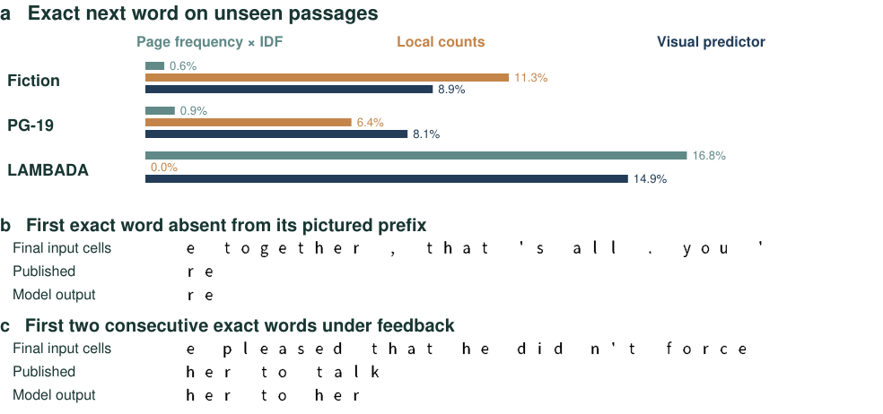

Trên 3.949 đoạn sách tiếng Anh, mô hình thị giác đoán đúng từ cuối 109 lần khi thấy cả đoạn và 56 lần khi chỉ thấy 96 ký tự cuối. Quy tắc dựa trên tần suất từ đoán đúng 662 lần. [PDF](../publication/ilm-nature/manuscript.pdf)

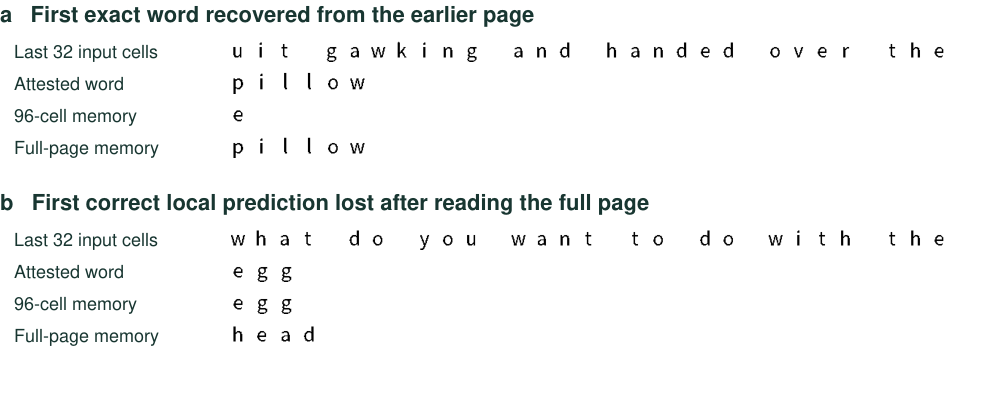

Mô hình thị giác 1,82 triệu tham số học từ 96 cuốn sách trên một GPU RTX 4090 D. Giữ nguyên thứ tự từ giúp giảm độ mất mát khi dự đoán hình dạng ký tự kế tiếp trên 16 cuốn sách chưa từng thấy, từ 2,166 xuống 1,973 bit. Khi dịch 128 câu tin tức mới từ tiếng Trung sang tiếng Anh, mỗi mô hình chỉ có một bản dịch được chấm là truyền đạt trọn nghĩa. Hình bên dưới dùng ảnh do mô hình thực sự viết tiếp. [Bài báo](../publication/ilm-nature/manuscript.pdf) · [Mô hình và cách chạy](../models/book_order_prior/)

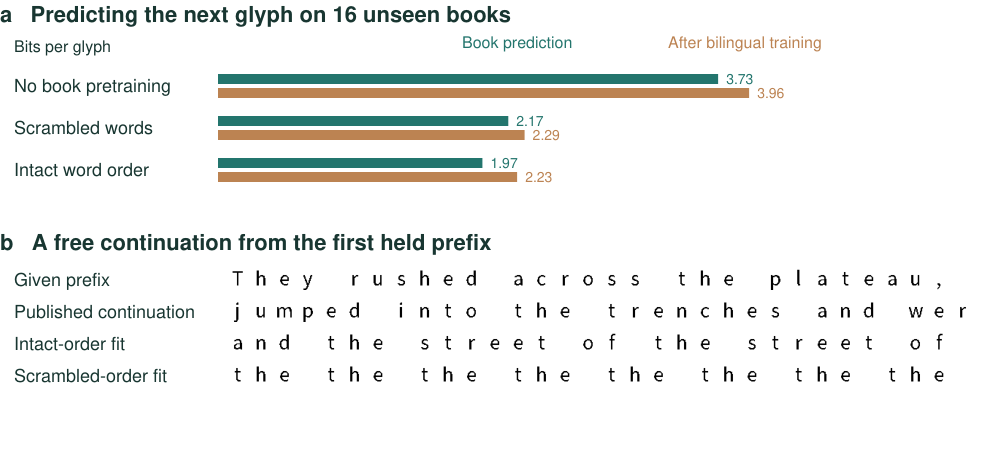

Khi người được gọi trong ảnh câu tiếng Trung thay đổi, mô hình đổi “Mom” thành “Harry” trong ảnh trả lời bằng tiếng Anh. Nhưng nó cũng viết “a nice dream” khi gặp từ chỉ cơn ác mộng. Mô hình giữ được sự khác biệt về nghĩa ở cả hai chiều dịch cho 3 trong 77 cặp câu từ ngữ liệu huấn luyện và 46 trong 51 cặp câu tạo theo mẫu.

Mô hình thị giác nay nhận được cả những dạng chữ in ngoài bộ hình chữ ban đầu. Sau khi học từ 1.368 cặp câu dịch đã qua đánh giá chuyên môn, mô hình truyền đạt trọn nghĩa khi dịch tin tiếng Trung sang tiếng Anh ở 0/96 câu có dạng chữ lạ và 2/96 câu chỉ có dạng chữ quen. Hiển thị nét của chữ lạ làm thay đổi 93 ảnh trả lời. Hình dưới giữ nguyên đầu ra của mô hình. [Thí nghiệm và trọng số](../references/reviewed_news_writer_result.md)

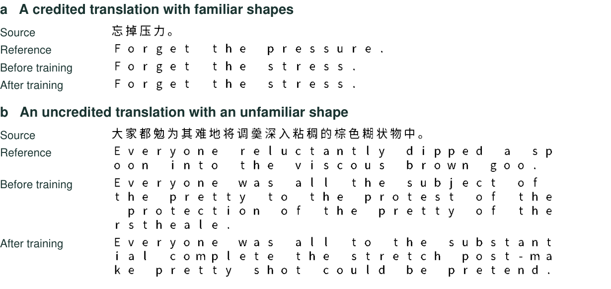

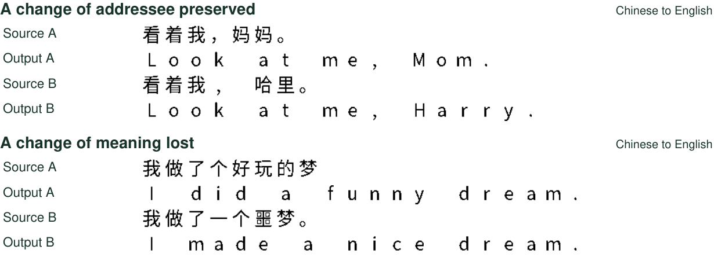

Với ảnh chụp câu “我理解你的痛苦。” từ một cuốn sách chưa dùng khi huấn luyện, mô hình thị giác độc lập viết “I understand your pain.”. Trên một RTX 4090 D, với cùng ngân sách huấn luyện, 147.456 cặp câu khác nhau cho 6/96 bản dịch đủ nghĩa; lặp lại 24.576 cặp cho 4/96 và mô hình ban đầu đạt 5/96. Mô hình văn bản lượng tử hóa Qwen3-8B đạt 88/96. Khoảng ước lượng chênh lệch theo sách bao gồm 0. [Thí nghiệm và trọng số](../references/visual_training_breadth_result.md)

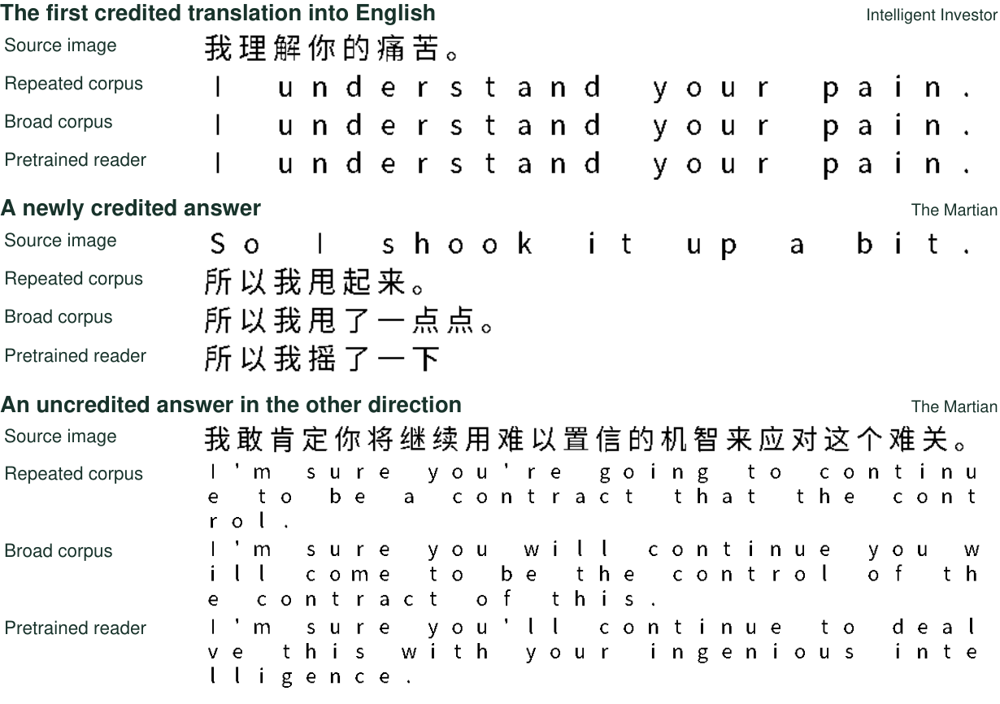

[Các thí nghiệm sửa và tra cứu trước đây](../references/visual_sequence_preference_result.md) · [2/96](../references/retrieved_glyph_writer_result.md)

Mô hình huấn luyện trên một RTX 4090 D chọn giữa hai bản dịch dạng ảnh cho từng đoạn sách. Sau khi hiệu chỉnh thiên hướng ưu tiên một số cách diễn đạt, số cặp đúng cả hai lựa chọn tăng từ **21/96 lên 77/96**. Khi tự viết, dự đoán các dải ký tự từ ảnh nguồn giúp số câu chứa vị từ cần thiết tăng từ 17/336 lên 43/336, nhưng chỉ 1/192 bản dịch sách truyền đạt trọn nghĩa. Hình dưới là câu trả lời đầu tiên được chấm đúng trong phép thử OPUS riêng. [Kết quả](../references/source_supported_writing_result.md) · [Chạy mô hình](../models/source_supported_writing/README.md)

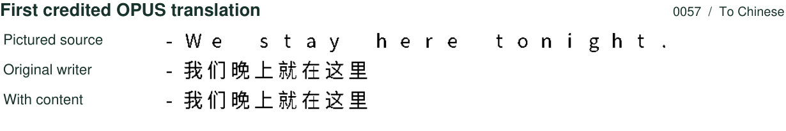

Trên cùng một trang từ điển, hai câu hỏi yêu cầu nghĩa gốc và dạng chữ cổ theo hai thứ tự ngược nhau. Số cặp được trả lời đúng cả hai lần tăng từ 138 lên 332 trong 608 cặp. Trong phép thử dịch tự do riêng biệt, mô hình ảnh độc lập truyền đạt trọn nghĩa 1/192 câu, so với 154/192 khi Qwen3-8B đọc văn bản. [Bài báo sáu trang](../publication/ilm-nature/manuscript.pdf) · [Chạy ví dụ từ nguyên](../models/origin_instructions/README.md)

### Các thí nghiệm trước

Khi được hỏi ai thiết kế Salamanca trên ảnh một trang viết về đường sắt, mô hình viết **Matthew Murray designed Salamanca.** Chỉ đổi tên trên trang thành Daniel Harper cũng làm chủ ngữ trong câu trả lời thay đổi. Trong 96 trang mới, mô hình đọc đúng đáp án ngắn ở 25 trang. Ở một ví dụ khác, nó đọc đúng năm thành lập trường rồi bỏ mất năm khi viết câu. Trang đầu bài báo trình bày ảnh đầu ra thực tế. [PDF](../publication/ilm-nature/visual_language_paper.pdf) · [PNG](../models/visual_statements/examples/intervention)

Trên 256 đoạn văn tiếng Anh và tiếng Trung mới, mỗi đoạn có hai câu hỏi do con người đặt, ILM được huấn luyện đối sánh trả lời đúng cả hai ở 34 đoạn. Qwen3-8B lượng tử hóa đọc văn bản đạt 101 đoạn. Khi hai mô hình nhận cùng ảnh trên 64 đoạn, ILM đạt 6 và Qwen3-VL-8B đạt 21. [PDF](../publication/ilm-nature/visual_language_paper.pdf) · [PNG](../models/competing_facts/examples)

[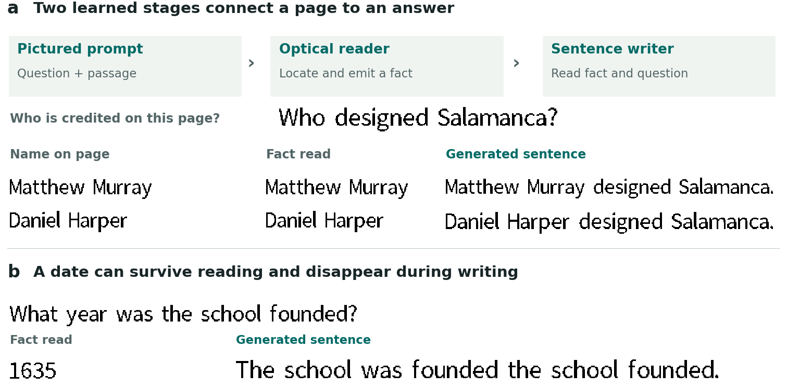](../publication/ilm-nature/visual_language_paper.pdf)

Trên cùng một trang tiếng Trung về một loài cá, mô hình viết tên thường gọi hoặc phân loại tùy theo câu hỏi. Mô hình 2,44 triệu tham số được huấn luyện trên một RTX 4090 D và trả lời đúng cả hai câu hỏi ở 44 trong 256 đoạn văn tiếng Trung và tiếng Anh chưa từng thấy. Mô hình thị giác trước đó đạt 0, còn mô hình đối chứng nhận byte đạt 52 với mức tiêu thụ năng lượng tương đương. Mô hình vẫn chưa tái hiện được các dạng cổ của chữ 言. [Chạy mô hình](../models/paired_evidence/README.md) · [Bài báo](../publication/ilm-nature/visual_language_paper.pdf)

[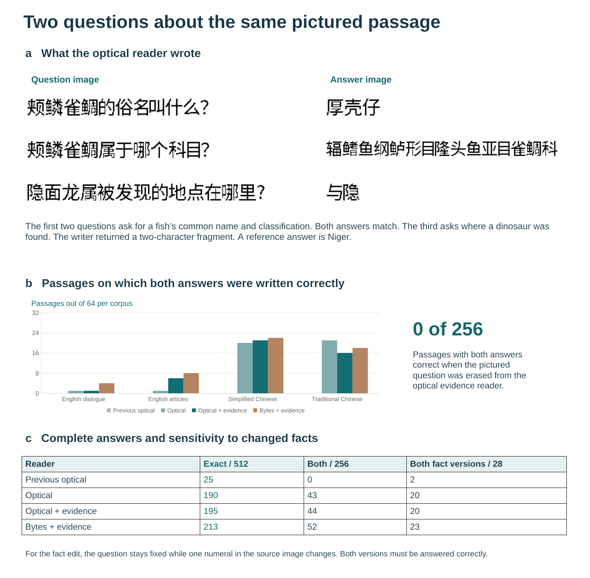](https://github.com/lachlanchen/ImagizedLanguageModel/blob/203f40812f03afbdfa55cf957a56ee8cfe0f944c/publication/ilm-nature/visual_language_paper.pdf#page=2)

Mô hình 2,12 triệu tham số được huấn luyện trên một RTX 4090 D đã học cách dự đoán hình dạng ký tự tiếp theo trong văn bản tiếng Anh và tiếng Trung chưa từng thấy. Khi được hỏi cách tiết kiệm năng lượng, mô hình lặp lại câu hỏi. Sau khi bổ sung bộ đọc hình ảnh, mô hình trả lời đúng 11 trong 384 câu hỏi do con người đặt ra. Trong 192 đoạn văn, không có đoạn nào mà mô hình trả lời đúng cả hai câu hỏi. Hình 144 trình bày ảnh đầu ra thực tế. [Đọc bài báo](../publication/ilm-nature/visual_language_paper.pdf) · [Chạy mô hình](../models/visual_cursor/README.md)

[](https://github.com/lachlanchen/ImagizedLanguageModel/blob/203f40812f03afbdfa55cf957a56ee8cfe0f944c/publication/ilm-nature/visual_language_paper.pdf#page=4)

Mô hình 1,18 triệu tham số đọc một chữ được đánh dấu trong ảnh văn bản cổ rồi viết nghĩa tiếng Anh dưới dạng ảnh. Với chữ 言, nó viết “speak” ở cuối câu 言及之而不言 và “speech” trong 有是言也. Mô hình viết đúng cả hai nghĩa ở 213/566 cặp trong Luận ngữ và 82/403 cặp trong Sở từ. Phương pháp đếm các chữ lân cận đạt 211 và 104 cặp. [Chạy mô hình](../models/visual_word_senses/README.md) · [Kết quả](../references/visual_word_sense_result.md)

[](../publication/ilm-nature/manuscript.pdf#page=160)

Mô hình đọc ảnh câu hỏi tiếng Trung cùng một đoạn tiểu thuyết rồi viết câu trả lời gồm hai vế dưới dạng ảnh. Số ảnh trả lời khớp hoàn toàn với mẫu là 34/48 cho Tây du ký và 42/48 cho Hồng lâu mộng. Với 9 trong 60 họ chữ dành cho đánh giá, mô hình viết đúng cả dạng giáp cốt và dạng kim văn ở mọi cách sắp xếp. Khi câu hỏi bằng tiếng Anh, số câu đúng lần lượt là 2/48 và 10/48. [Chạy mô hình](../models/grounded_ink_editor/README.md) · [Kết quả và ví dụ](../references/grounded_ink_writing_result.md)

[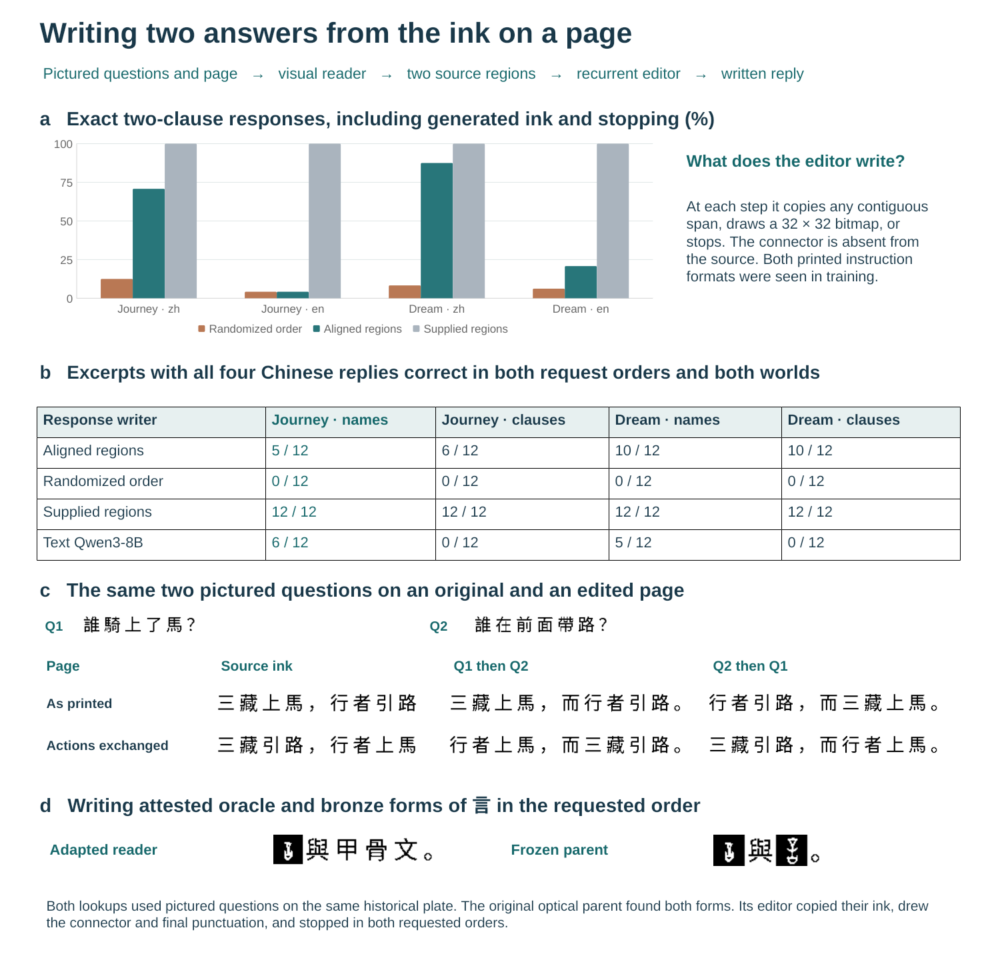](../publication/ilm-nature/manuscript.pdf#page=159)

Mô hình đọc ảnh với 86 triệu tham số trả lời đúng 38/56 câu hỏi tiếng Trung về các nhân vật trong *Quốc ngữ* (國語). Khi đổi chỗ hai tên người rồi hỏi lại, mô hình trả lời đúng cả bốn câu ở 4/14 đoạn. Mô hình ban đầu đạt 3 đoạn, còn đối chứng huấn luyện với hai tên có trọng số bằng nhau đạt 2. Với câu hỏi tiếng Anh, mô hình trả lời đúng 16 câu nhưng không đúng hết cả bốn ở đoạn nào. Ví dụ trả về hình chữ 密康公 và 恭王 từ trang gốc. [Guoyu · ILM](../models/optical_role_reader/README.md) · [38/56](../references/optical_role_adapter_result.md)

[](../publication/ilm-nature/manuscript.pdf#page=157)

Mô hình đọc có 64.666 tham số nhận ảnh câu hỏi và đoạn văn tiếng Trung rồi trả về ảnh phần văn bản chứa câu trả lời. Sau khi học từ 6.439 đoạn văn, mô hình trả lời đúng 104/452 câu hỏi tiếng Trung và 45/452 câu hỏi tiếng Anh về hai tiểu thuyết dành riêng cho đánh giá. Khi chỉ học từ đáp án của con người, kết quả tương ứng là 81 và 48. Mô hình vẫn hiếm khi trả lời đúng cả hai câu hỏi khác nhau về cùng một đoạn. [ILM · 64k](../models/book_span_distillation/README.md) · [104/452](../references/book_span_distillation_result.md)

[](../publication/ilm-nature/manuscript.pdf#page=154)

Khi đổi vai của hai người trong phần ghi công được trình bày dưới dạng ảnh, mô hình thị giác xác định đúng cả hai vai trong 175 trên 256 phép so sánh, còn mô hình đối chứng đạt 19. Trên mười hai truyện mới, cả hai đều không hoàn thành phép so sánh nào. Khi nhận hai câu hỏi bằng hình ảnh cùng các mục tương ứng trong danh mục, mô hình tái hiện đúng bốn dạng chữ 言 cổ trong hai trên tám lần thử. [↗](../references/individual_clause_writer_result.md)

[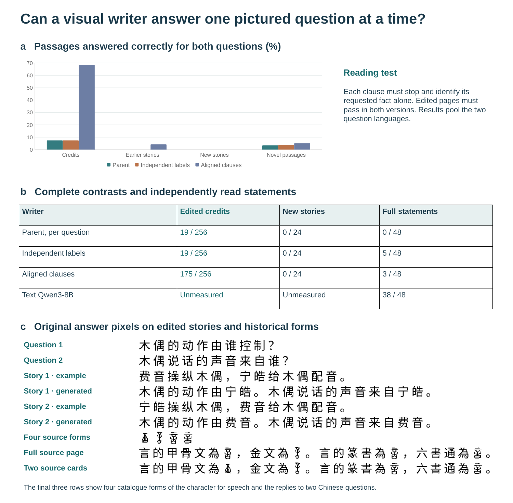](../publication/ilm-nature/manuscript.pdf#page=152)

Khi hai tên đổi vai trò trong phần ghi công dưới dạng ảnh, mô hình 87 triệu tham số trả lời đúng theo cả hai thứ tự câu hỏi ở 165 trong 256 phép so sánh. Mô hình đối chứng được xem cùng các ví dụ và đạt 5 trên 256. Với các câu chuyện được viết riêng, cả hai mô hình đều đạt 0 trên 24. [Kết quả và ảnh đầu ra gốc](../references/role_change_writer_result.md) · [Chạy mô hình](../models/role_change_writer/README.md)

Sau khi loại tài liệu DRCD đã dành riêng và huấn luyện lại, mô hình xét nhiều đáp án hơn trả lời khớp hoàn toàn 234 trong 359 câu hỏi phát triển. Bộ đọc đa dụng trả lời đúng 242 câu. Các đánh giá DRCD trước đây đã sử dụng đoạn văn dành riêng cho kiểm thử. [Kết quả và đính chính về nguồn dữ liệu](../references/span_list_result.md)

[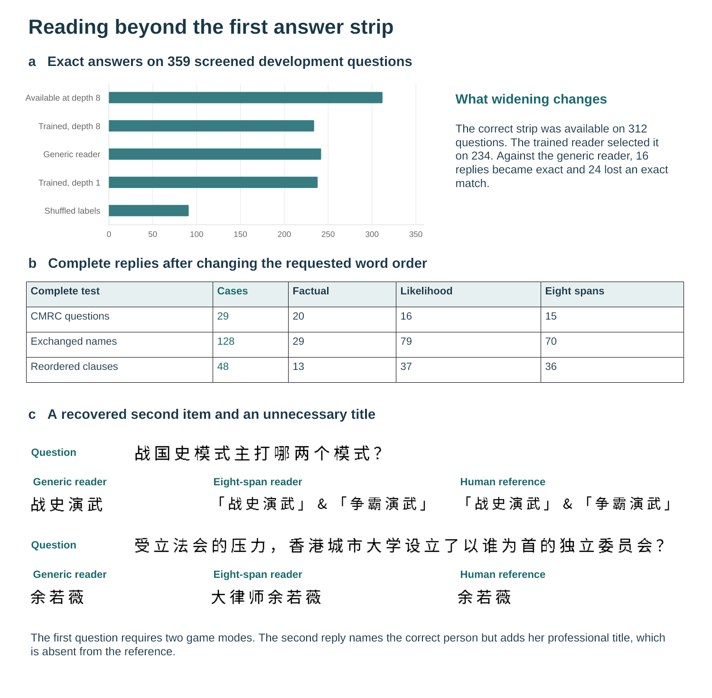](../publication/ilm-nature/manuscript.pdf#page=138)

Trên 384 câu hỏi đọc hiểu tiếng Trung mới được đánh giá, mô hình kết hợp các đáp án bằng hình ảnh từ bốn bộ đọc trả lời đúng hoàn toàn 285 câu, ngang với bộ đọc đa dụng. Mô hình vượt qua trọn vẹn 63 trong 128 phép thử đổi tên, so với 79 của bộ đọc chuyên biệt. [Kết quả và trọng số](../references/span_choice_result.md)

[](../publication/ilm-nature/manuscript.pdf#page=137)

Khi đổi chỗ hai tên trong đoạn văn tiếng Trung dạng ảnh, mô hình huấn luyện chỉ bằng hàm hợp lý trả lời đúng mọi câu hỏi theo cả hai trật tự từ ở 79 trong 128 đoạn, so với 29 đoạn trước đây. Với 48 câu hỏi do người viết, số câu đúng theo cả hai trật tự giảm từ 34 xuống 28. [Kết quả và mô hình](../references/participant_margin_result.md)

[](../publication/ilm-nature/manuscript.pdf#page=136)

Với 34 trong số 48 câu hỏi tiếng Trung do người viết, mô hình đã viết đúng cùng một sự kiện theo cả hai trật tự từ được yêu cầu. Mô hình nêu đúng tên người soạn nhạc cho bài 《秋潮》, nhưng vẫn nhầm tên khi đổi vai người viết lời và người soạn nhạc trong một bài khác. [Kết quả và mô hình](../references/pictured_relation_result.md)

[](../publication/ilm-nature/manuscript.pdf#page=135)

Sau khi học từ 26.890 ví dụ tiếng Trung dưới dạng ảnh, mô hình viết đúng câu trả lời hoàn chỉnh cho 33 trong 48 câu hỏi do người viết. Một mô hình khác sinh từng hình chữ và diễn đạt đúng cùng một sự việc theo cả hai trật tự được yêu cầu ở 31 câu. Trong ví dụ về phim, mô hình ghi đúng đạo diễn và người viết kịch bản trong bản gốc, nhưng chép thừa cả một đoạn sau khi hai tên được đổi chỗ. [Kết quả và mô hình](../references/role_binding_result.md)

[](../publication/ilm-nature/manuscript.pdf#page=134)

Khi đổi chỗ hai tên người trong một đoạn văn dưới dạng ảnh, mô hình có đổi câu trả lời đúng theo không? Với những cặp vai trò chưa xuất hiện cùng nhau khi luyện viết hai câu, mô hình tách câu hỏi rồi dùng chung một bộ viết ảnh đã trả lời đúng thứ tự ở 70 trong 136 câu hỏi. Mô hình viết liền hai câu chỉ đạt 3. Ở ví dụ về phim, cả hai câu đều dễ đọc nhưng lại ghi cùng một người làm đạo diễn và biên kịch. [Kết quả và mô hình](../references/grounded_proposition_result.md)

[](../publication/ilm-nature/manuscript.pdf#page=133)

Ai vẽ bản đồ và ai cần hỏi đường? Mô hình cải tiến trả về hai tên khác nhau. Với 64 câu hỏi mới dưới dạng ảnh, mô hình trả lời đúng tên 42 lần. Nó cũng viết được dạng giáp cốt và kim văn của chữ 言 theo thứ tự yêu cầu. Trong 128 câu hỏi mở mới cần dạng chữ không có trong đầu vào, không câu trả lời nào trùng khớp hoàn toàn với đáp án tham chiếu. [Kết quả và mô hình](../references/pointing_causal_writer_result.md)

[](../publication/ilm-nature/manuscript.pdf#page=132)

Đoạn văn trong ảnh cho biết ai vẽ bản đồ và ai bị lạc. Mô hình xác định đúng người vẽ bản đồ, nhưng khi được hỏi ai cần hỏi đường, nó lại kể chuyện vẽ bản đồ. Trong 300 câu cần dùng một mặt chữ không xuất hiện trong đầu vào, mô hình chỉ chọn đúng mặt chữ mới đầu tiên 18 lần, dù đã được cung cấp phần đầu đáp án đúng. [Kết quả và ảnh câu trả lời gốc](../references/causal_glyph_writer_result.md)

[](../publication/ilm-nature/manuscript.pdf#page=131)

Mô hình viết dạng giáp cốt văn và kim văn của chữ 言 theo thứ tự nêu trong câu hỏi bằng hình ảnh. Với cách hỏi quen thuộc và các chữ dành riêng cho đánh giá, mô hình viết đúng cả hai thứ tự ở 94 trong 96 phép so sánh. Khi đổi thẻ và cách hỏi, kết quả là 16 trên 96. [Kết quả và hình ảnh](../references/ordered_page_writer_result.md)

[](../publication/ilm-nature/manuscript.pdf#page=130)

**Đọc và trả lời bằng hình ảnh chữ viết.** Với 64 câu hỏi tiếng Trung về hai người, mô hình trả lời đúng 46 câu ở kiểu chữ thường và 41 câu ở kiểu chữ đậm. Qwen3-8B chạy cục bộ trả lời đúng 55 câu khi nhận văn bản. Ở kiểu chữ Khải chưa dùng để huấn luyện, mô hình chỉ trả lời đúng một câu. [Chạy mô hình](../docs/visual-page-responder.md)

[](../publication/ilm-nature/manuscript.pdf#page=129)

**Mô hình có phân biệt được hai người trong cùng một câu?** Mô hình viết đúng tên người tài trợ và kiến trúc sư của tòa nhà Gates. Trong 864 cặp câu hỏi, có 100 cặp đúng cả hai đáp án. Khi hoán đổi tên trong 24 tình huống mới, mô hình không giải đúng trọn vẹn tình huống nào. Qwen3-8B chạy cục bộ giải đúng 20. [Kết quả và cách chạy](../references/shared_sentence_writer_result.md)

[](../publication/ilm-nature/manuscript.pdf#page=127)

**Vì sao mô hình chọn nhầm người?** Trong 387 câu hỏi tiếng Trung về danh tính, số câu trả lời đúng hoàn toàn tăng từ 62 lên 116 khi chọn trước một câu dựa trên hình dạng chữ trùng nhau. Mô hình đối chứng với cách gán ngẫu nhiên trong phần huấn luyện bổ sung đạt 127 với cùng cách chọn câu. Hình 85 cho thấy mô hình viết một địa danh khi được hỏi tên nhà phát minh. [Kết quả và cách chạy](../references/inverse_role_writer_result.md)

[](../publication/ilm-nature/manuscript.pdf#page=126)

**Câu này nói về ai?** Với tên và bổ ngữ mới, mô hình viết đúng trọn vẹn 368 trong 404 câu tiếng Trung. Khi chép hai tên Tần và Sở từ hình chữ khắc trên đồ đồng, mô hình viết đúng 24 trong 32 câu. Khi chỉ biết đặc điểm và phải tự nêu tên, mô hình không trả về đúng tên nào ở dạng chữ khắc. [Kết quả và cách chạy](../references/visual_role_writer_result.md)

[](../publication/ilm-nature/manuscript.pdf#page=125)

**Mô hình đọc được gì từ hình ảnh chữ viết?** Với cùng một ảnh câu “她喝了一口□。” (Cô ấy uống một ngụm □), khi đồ uống trong đoạn văn đổi từ nước sang trà, câu trả lời cũng đổi từ 水 sang 茶. Kết hợp mạng nơ-ron với tần suất của các chữ liền kề giúp khôi phục chính xác 651 trong 2.947 cụm chữ bị che. Khi hoán đổi vai trò của hai người, mô hình không đánh giá đúng cả hai phiên bản ở bất kỳ cặp nào trong 48 cặp. [Kết quả và lệnh chạy](../references/visual_inference_writer_result.md)

[](../publication/ilm-nature/manuscript.pdf#page=124)

<!-- paired-writing-status:start -->
Thử nghiệm loại bỏ khoảng trắng với 512 bước cập nhật vẫn chưa sao chép đáng tin cậy: OCR khớp hoàn toàn 6/32 mẫu huấn luyện và 10/32 mẫu kiểm định (ảnh tham chiếu rõ: 27/32 và 28/32). Ảnh đầu ra còn thiếu ký tự và lặp chữ. Thời gian huấn luyện giảm từ 795.624 xuống 287.182 giây, nhưng khả năng hiểu ngôn ngữ và hiệu quả ở chất lượng hữu ích vẫn chưa được chứng minh. [Toàn bộ 64 ảnh đầu ra](../references/paired_padding_result.md).
<!-- paired-writing-status:end -->

Tình trạng hiện tại: khả năng sinh ngôn ngữ dưới dạng ảnh chưa được xác nhận là có thể sử dụng thực tế. Trong phép so sánh hàm mất mát bộ giải mã mới nhất với 32 câu hỏi đã dùng để huấn luyện, cả hai mô hình đều có 0/32 câu trả lời tự sinh trùng khớp từng điểm ảnh. Hàm mất mát xét độ nhạy của bộ giải mã làm F1 nét chữ giảm từ 85.984% ở nhóm đối chứng xuống 70.009%. Khi được cung cấp phần trả lời trước đó chính xác, F1 chỉ đạt 92.430% và 75.116%; khi được cung cấp trực tiếp mã ảnh đáp án, cả hai đều tái tạo đạt 99.9953%. Cả bốn tiêu chí sửa mô hình đều thất bại, nên không mở rộng quy mô phương án này. Đây là độ khớp ảnh, không phải độ chính xác ngữ nghĩa; chưa có checkpoint ILM nào được xác nhận là hữu dụng. [Kết quả và toàn bộ ảnh gốc](../references/decoder_metric_v82_result.md). Bản thảo hiện đã có Ghi chú bổ sung 39 và Hình S16 có thể chỉnh sửa. Một mô hình đối chứng khác dùng bộ sinh ảnh bên ngoài, không huấn luyện cục bộ, cũng chỉ đạt khớp OCR chính xác 0/12 yêu cầu sao chép và 0/8 câu hỏi, với hiệu chuẩn OCR ảnh tham chiếu 18/20; cả 40 ảnh đầu ra gốc đều được giữ lại. [FLUX.2-klein-4B](../references/image_edit_baseline_result.md).


[](https://lazying.art)

# Imagized Language Model (ILM)

Với cùng câu thơ 舉杯邀明月, mô hình viết **cup** khi được hỏi vật gì được nâng lên và **moon** khi được hỏi ai được mời. Câu thơ này đã xuất hiện trong dữ liệu huấn luyện trước đó. Trong 971 câu để riêng, mô hình xác định mọi động từ và tân ngữ, rồi viết đúng nghĩa tiếng Anh của từng tân ngữ ở 247 câu. Khi hoán đổi tân ngữ trong lúc huấn luyện, kết quả là 11 câu. Trong 21 câu mà mọi cách hỏi tự nhiên đều mới, mô hình không trả lời đúng trọn vẹn câu nào. [Chạy mô hình](../models/questioned_events/README.md) · [Kết quả](../references/questioned_events_result.md)

[](../publication/ilm-nature/manuscript.pdf#page=167)

Khi câu hỏi mô tả hành động bằng tiếng Anh, mô hình tìm đúng cả hai tân ngữ và viết nghĩa tiếng Anh cho 44 trong 268 cặp câu Hán văn. Mô hình trước đạt 11 cặp. Trong 10 cặp chọn từ truyện của Bồ Tùng Linh, mô hình mới chọn đúng cả hai dòng ở bốn cặp, nhưng không viết đúng cả hai đáp án ở cặp nào. Hình 125 cho thấy câu trả lời thực tế khi hỏi về quả đào. [Chạy mô hình](../models/visual_action_meaning/README.md) · [Kết quả](../references/visual_action_meaning_result.md)

[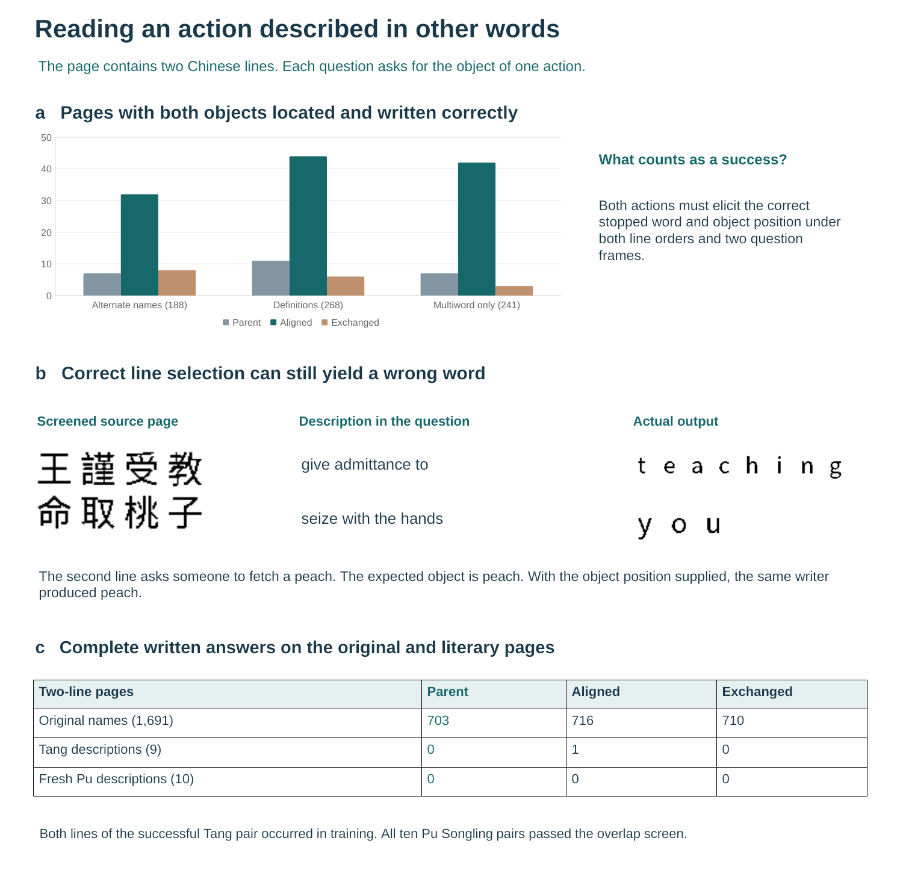](../publication/ilm-nature/manuscript.pdf#page=166)

Trên cùng một trang có 焉得仁 và 策其馬. Khi được hỏi họ đạt được gì, mô hình viết **benevolence**. Khi được hỏi họ quất con gì, nó viết **horse**. Mô hình xác định và viết đúng cả hai tân ngữ trên 703/1.691 trang kiểm tra ở cả hai thứ tự dòng và hai mẫu câu hỏi. Đổi cách diễn đạt hành động trên cùng 188 trang làm số trang đúng hoàn toàn giảm từ 95 xuống 7. [Chạy mô hình](../models/pictured_action_lookup/README.md) · [Kết quả](../references/pictured_action_lookup_result.md)

[](../publication/ilm-nature/manuscript.pdf#page=165)

Mô hình đọc đoạn Hán văn và câu hỏi dưới dạng ảnh, rồi viết câu trả lời tiếng Anh thành ảnh. Với 還其珠, mô hình viết **return** hoặc **pearl** tùy câu hỏi. Mô hình 1,40 triệu tham số viết đúng cả *it* và *go* cho chữ 之 ở 31/40 cặp ngữ cảnh kiểm tra, so với 4/40 khi xáo trộn đáp án huấn luyện. Trong hai cuốn sách khác, chỉ 1/29 đoạn có cả bốn câu trả lời đúng. [Chạy mô hình](../models/pronoun_writer/README.md) · [Kết quả](../references/pronoun_writer_result.md)

[](../publication/ilm-nature/manuscript.pdf#page=163)

Với câu 執大象, mô hình đọc câu hỏi dưới dạng ảnh rồi viết **hold** cho động từ hoặc **image** cho tân ngữ. Mô hình trả lời đúng cả tám câu hỏi tiếng Trung và tiếng Anh trên 230 trong số 539 đoạn kiểm tra. Khi giới hạn đầu ra ở những nghĩa đã gặp lúc huấn luyện, con số tăng lên 247. Các cách hỏi thường ngày vẫn còn khó. [Chạy mô hình](../models/asked_gloss/README.md) · [Kết quả](../references/asked_gloss_result.md)

[](../publication/ilm-nature/manuscript.pdf#page=161)

Biểu diễn học từ ảnh câu hỏi giúp tăng số đoạn trích chính xác từ 17 lên 41 trong 412 câu hỏi MLQA tiếng Anh. Với 824 câu hỏi ở cả hai ngôn ngữ, mô hình sinh trả lời chính xác và tự dừng 111 lần khi nhận đoạn trích, so với 90 lần khi nhận cả trang. [↗](../references/question_evidence_transfer_result.md)

[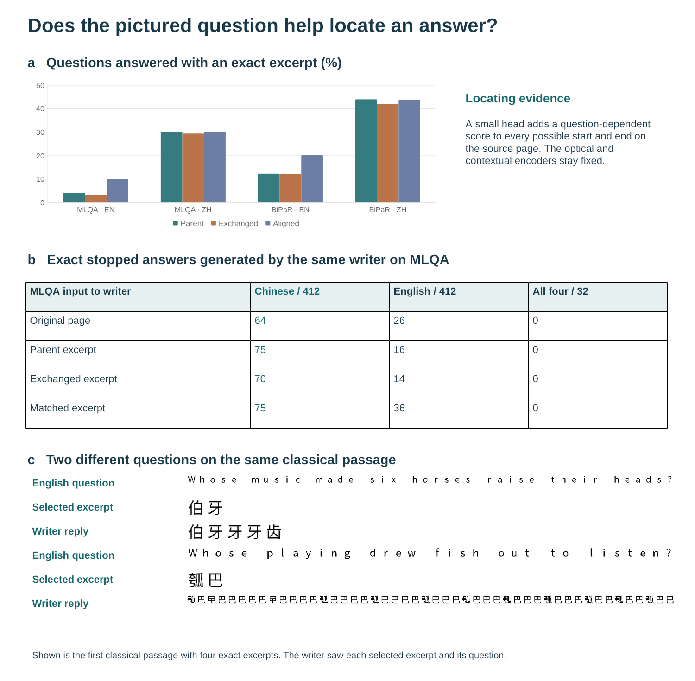](../publication/ilm-nature/manuscript.pdf#page=149)

Bộ mã hóa thị giác ghép đúng câu hỏi tiếng Anh và tiếng Trung ở 364 trong 374 đoạn tiểu thuyết. Với 92 câu hỏi về năm tác phẩm khác, mô hình đọc trích đúng 31 câu trả lời. Mô hình sinh nhận các trích đoạn ấy và trả lời chính xác 19 câu. [↗](../references/bilingual_book_intervals_result.md)

[](../publication/ilm-nature/manuscript.pdf#page=148)

Sau khi học từ 642 câu trả lời sai của chính mình, mô hình đưa ra 31 câu trả lời bằng hình ảnh khớp hoàn toàn trong 144 lượt hỏi về sáu tác phẩm tiếng Trung khác. Mô hình trả lời đúng cả hai câu hỏi bằng cả hai ngôn ngữ ở 0 trong 36 đoạn văn. [↗](../references/stopped_book_preference_result.md)

[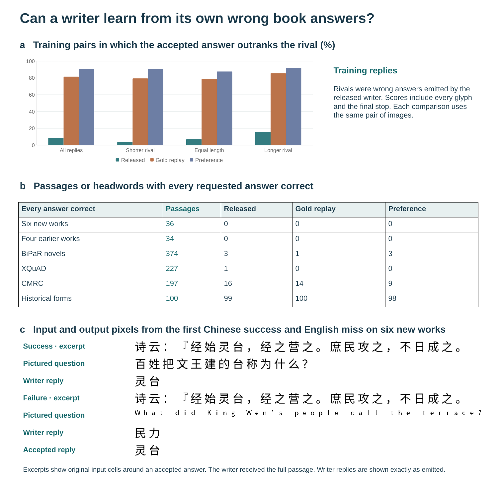](../publication/ilm-nature/manuscript.pdf#page=147)

Trên 34 đoạn trích từ bốn tác phẩm tiếng Trung khác, mô hình được huấn luyện với trọng số lớn hơn cho chữ đầu tiên đã trả lời chính xác 31 trong 136 lượt hỏi bằng tiếng Trung và tiếng Anh. Không đoạn nào có đủ bốn câu trả lời đúng. [↗](../references/first_glyph_book_result.md)

[](../publication/ilm-nature/manuscript.pdf#page=146)

Mỗi đoạn tiểu thuyết tiếng Trung có hai câu hỏi, mỗi câu được hỏi bằng tiếng Trung và tiếng Anh. Mô hình song ngữ trả lời đúng cả bốn lượt ở 3/374 đoạn, so với 0/374 ở mô hình đối chứng được huấn luyện với câu hỏi tiếng Anh ghép sai. Trên XQuAD, mô hình song ngữ đạt 1/227 đoạn. [Kết quả và ảnh câu trả lời](../references/bilingual_novel_result.md)

[](../publication/ilm-nature/manuscript.pdf#page=145)

Khi thay đổi độ dày nét và tỷ lệ chữ trong lúc huấn luyện, số câu đọc hiểu tiếng Trung trả lời đúng bằng phông HanaMin tăng từ 15 lên 43 trên 394 câu. Mô hình trả lời đúng cả hai câu ở 6 trong 197 đoạn. Trên bộ XQuAD riêng dùng cùng phông chữ, kết quả là 0 trên 227 đoạn. [Kết quả và ảnh câu trả lời](../references/stroke_scale_result.md)

[](../publication/ilm-nature/manuscript.pdf#page=144)

Với các đoạn tiếng Trung mới dùng HanaMin, một phông chữ được giữ riêng khi huấn luyện, mô hình ảnh trả lời chính xác 15 trong 394 câu. Chỉ huấn luyện thêm trên nhiều phông chữ cho 3 câu đúng. Mô hình đúng cả hai câu ở 0 trong 197 đoạn. Danh mục ngoại tuyến cho phép tra một chữ như 中 và nhận ảnh trả lời với những dạng chữ cổ được yêu cầu. [Dùng mô hình và danh mục](../models/typeface_writer/README.md)

[](../publication/ilm-nature/manuscript.pdf#page=143)

Với hai câu hỏi khác nhau cho mỗi ảnh trong 98 đoạn văn tiếng Trung, mô hình chưng cất trả lời chính xác 72 trong 196 câu, so với 63 câu khi huấn luyện thông thường. Cả hai mô hình đều đúng cả hai câu ở 11 đoạn. Qwen3-8B nhận cùng nội dung dưới dạng văn bản và đúng cả hai câu ở 55 đoạn. [Kết quả và mô hình](../references/interval_teacher_result.md)

[](../publication/ilm-nature/manuscript.pdf#page=142)

Cùng một mô hình đọc ảnh chữ đã trả lời chính xác 114 trong 359 câu hỏi tiếng Trung và viết lại hai dạng giáp cốt văn và kim văn của chữ 言 theo thứ tự yêu cầu từ thẻ hình. Với 128 đoạn đọc khác, mỗi đoạn có hai câu hỏi, mô hình trả lời đúng cả hai ở 15 đoạn. Mô hình trích xuất đáp án đạt 49 đoạn. [Chạy mô hình](../models/mixed_visual_answers/README.md)

[](../publication/ilm-nature/manuscript.pdf#page=141)

Mô hình đọc các đoạn văn tiếng Trung dưới dạng ảnh. Khi đổi năm và đặt câu hỏi theo ba cách mới, mô hình ghi đúng tên và năm trong mọi câu trả lời ở 34/64 trường hợp một đoạn và 8/48 trường hợp hai đoạn. Với 359 câu hỏi đọc hiểu đa dạng hơn do con người viết, có bảy câu trả lời trùng khớp hoàn toàn.

[](../publication/ilm-nature/manuscript.pdf#page=139)


ILM nghiên cứu cách học và sinh ngôn ngữ dưới dạng **chữ viết nhìn thấy được**:
từ ảnh sang trạng thái thị giác liên tục rồi trở lại ảnh, không có kênh ký hiệu
ẩn làm lõi.


Kiểm tra giao diện mới nhất cho thấy mô hình tiền huấn luyện đóng băng đạt 11/32 câu trả lời tiếng Anh khớp chính xác khi thu nhỏ cùng các trang từ 1024 xuống 432, so với 0/32 ở kích thước ban đầu. Hai bộ điều chỉnh đã huấn luyện chỉ đạt 5/32 mỗi bộ ở kích thước 432. ILM độc lập sinh câu trả lời dưới dạng ảnh vẫn chưa được chứng minh.

[2026-11-07: English result and full evidence](../references/native_reader_geometry_result.md)

Kết quả ngày 2026-11-08: đã hoàn tất đánh giá lần học 128 cập nhật và xem xét cả 384 ảnh trả lời gốc. Mô hình ban đầu và cuối cùng đều đạt 0/32 câu trả lời khớp chính xác theo OCR trong từng nhóm câu hỏi đã học và giữ lại, kể cả các đáp án thay thế được nguồn chấp nhận. Kết quả chép chính xác ở nhóm giữ lại giảm từ 19/32 xuống 16/32. Cả sáu điều kiện định trước đều không đạt; khả năng học ngôn ngữ vẫn chưa được chứng minh.

[Kết quả và phạm vi bằng chứng](../references/native_paired_qa_learning_result.md)

## Đọc ảnh câu văn ngôn và viết lại bằng tiếng Trung hiện đại

Trên các chương dành riêng để đánh giá, mô hình 2,03 triệu tham số chép đúng cả 2.045 đoạn có thể biểu diễn bằng ảnh. Khi dịch, 30 trong số 2.048 câu khớp hoàn toàn với ảnh tham chiếu. Trong một câu, mô hình chép chín mặt chữ và vẽ thêm hai chữ, đổi 薨 thành 去世. Xét theo khoảng cách chỉnh sửa trên toàn bộ kết quả, phương pháp đơn giản dùng ngữ cảnh gần vẫn tốt hơn. [Chạy mô hình](../models/visual_edit_zh/README.md) · [Ảnh đầu ra và ảnh tham chiếu](../publication/ilm-nature/figures/Figure_48_visual_edit.png)

## Đọc dạng chữ cổ từ bảng tư liệu

Với bảng tư liệu gồm bốn hàng, mô hình trả về đúng hình dạng chữ theo thứ tự yêu cầu trong 9.565 trên 9.600 câu hỏi tiếng Trung và tiếng Anh về các họ chữ chưa dùng để huấn luyện. [Chạy mô hình](../models/pictured_idiom_zh/README.md) · [Fig. 42](../publication/ilm-nature/figures/Figure_42_historical_plates.png)

## Đọc ảnh văn bản và viết thành ngữ còn thiếu

Mô hình 2,12 triệu tham số đọc ảnh văn bản ở hai bên chỗ trống rồi vẽ từng chữ của thành ngữ tiếng Trung. Trong 22.907 trường hợp kiểm định, 134 đáp án khớp hoàn toàn với nguyên văn. Ở 100 trường hợp trong số đó, cả bốn chữ của đáp án đều vắng mặt trong đầu vào. Phương pháp đối chứng dựa vào tần suất trong ngữ cảnh gần trả lời đúng 1.012 trường hợp.

[Chạy mô hình](../models/pictured_idiom_zh/README.md) · [Hình 40](../publication/ilm-nature/figures/Figure_40_pictured_idioms.png)

Khi dùng dự đoán của mô hình đọc để hướng dẫn huấn luyện thêm, mô hình viết đúng 378 trong 22.907 trường hợp. Huấn luyện thêm cùng số lượt chỉ với đáp án gốc cho 292 trường hợp đúng. Trên 9.135 đoạn văn chưa từng sử dụng, hai kết quả lần lượt là 163 và 125. [Hình 41](../publication/ilm-nature/figures/Figure_41_writer_transfer.png)

Khi bộ đọc và bộ viết được huấn luyện cùng nhau, mô hình điền đúng 433 trong 17.555 chỗ trống tiếng Trung mới. Mô hình trước đạt 276, còn phương pháp đếm theo ngữ cảnh gần đạt 789. [Fig. 43](../publication/ilm-nature/figures/Figure_43_expression_preference.png)

## Chọn câu trả lời từ ảnh chữ Hán

Sau 64 giây huấn luyện trên hai luồng CPU, mô hình đọc nhỏ đã chọn đúng toàn bộ ảnh đáp án cho 269 trong 1.788 câu hỏi về các đoạn văn tiếng Trung dành riêng để đánh giá. Khi thay câu hỏi bằng ảnh trắng, số câu đúng giảm còn 18. Mô hình viết tự do riêng biệt vẫn chưa tạo được lời giải thích đọc được về lịch sử của chữ 言. Khả năng viết tổng quát và mục tiêu tăng hiệu quả huấn luyện 1.000 lần vẫn cần được kiểm chứng.


[Chạy mô hình đọc](../references/visual_extractive_reading_result.md) · [Bản thảo](../publication/ilm-nature/manuscript.pdf)

Trong 3.170 câu hỏi tiếng Trung, mô hình đọc chọn đúng đoạn trả lời cho 565 câu. Mô hình viết tái tạo chính xác 124 câu trả lời trọn vẹn bằng một kiểu chữ khác. Với hai câu hỏi về cùng một ban nhạc, kết quả là 前卫金属 và 1996年.


[Viết câu trả lời bằng kiểu chữ khác](../references/grounded_detail_writing_result.md)

## Vẽ chữ Hán tiếp theo từ ngữ cảnh

Trong 668 ngữ cảnh của tập phát triển, việc dự đoán bố cục nét tổng thể trước khi vẽ đã nâng số ảnh khớp từng điểm ảnh với một tự dạng đã biết, có nét, từ 198 lên 649. Cả hai mô hình đều viết đúng ký tự kế tiếp trong nguyên văn 18 lần. Khi được hỏi về nguồn gốc của chữ 言, mô hình mới liên tục vẽ một hình giống số 0.


[Kết quả và mô hình đã huấn luyện](../references/shared_layout_writing_result.md)

## Thử nghiệm viết tiếp trước đây

2026-11-13

Thử nghiệm chuỗi đầy đủ đã xử lý **13,766 chuỗi, 41,298 lượt cập nhật và 6,108,741 vị trí chữ đích**. Toàn bộ **732 ảnh đầu ra** được xem trước khi chấm theo đáp án tham chiếu. Với đầu vào dàn chữ theo tỷ lệ, mô hình cuối đạt **7/32 câu trả lời hoàn chỉnh khớp nghiêm ngặt, 0/16 cặp đúng cả hai câu hỏi, 14/32 câu trả lời đọc được và 0/12 phần viết tiếp sách dài vừa mạch lạc vừa hoàn chỉnh**. Cả tiêu chí đăng ký trước và kiểm toán độc lập bốn đối chứng xóa câu hỏi/đoạn văn đều không đạt.

Huấn luyện dùng một RTX 4090 với VRAM cấp phát đỉnh **18.568 GiB**. Toàn bộ mô hình triển khai có **7,578,390,003 tham số**, gồm trọng số nền tảng kế thừa; lần huấn luyện này cập nhật **20,212,225 tham số**. Đây là tập phát triển được dùng lại, do một mô hình đánh giá, chưa có người đánh giá độc lập. ILM nhẹ có thể sử dụng và lợi thế hiệu quả ở cùng chất lượng vẫn chưa được chứng minh.

[Kết quả đầy đủ](../references/visual_continuation_learning_result.md) · [Mục tiêu kỹ thuật](../docs/first-imagized-language-model-goal.md) · [Quy trình cố định](../references/visual_continuation_full_protocol.md)

## Kết quả V35 trước đây


V35 là mô hình ngôn ngữ thị giác tiếng Trung có `129.092.738` tham số. Mô hình
hoàn tất toàn bộ `22.000` cập nhật BF16 trong `2,770` giờ trên một RTX 4090, với
bộ nhớ GPU đỉnh `2,899 GiB`. Đường triển khai chỉ nhận pixel chữ viết và mặt nạ
thị giác, rồi trực tiếp sinh và đọc lại raster. Khi chạy, mô hình không dùng
tokenizer, ID Unicode/ký tự, OCR, truy xuất, codebook thị giác hay mô hình giáo viên.

Kết luận đo được là **`not-qualified`**. Độ chính xác sao chép với prompt đúng là
`0,3125%`; độ chính xác chỉ dẫn là `0,1116%` và thấp hơn đối chứng prompt bị xáo
trộn. Mô hình chỉ vượt `5/12` cổng nhân quả thị giác và `5/9` cổng raster ngữ
nghĩa. Đầu ra không trắng và phản ứng với thay đổi prompt, nhưng nét bị hỏng và
không gắn với câu trả lời yêu cầu. Vì vậy tập niêm phong không được mở.

V35 dùng học chuyển giao. Codec chữ viết liên tục V34 là công việc của dự án;
lõi nhân quả được khởi tạo từ checkpoint PIXAR bên ngoài. PIXAR được ghi công
như nền tảng bên ngoài, không được tuyên bố là đóng góp của dự án. “Độc lập” ở
đây nghĩa là gói triển khai tự chứa, không có nghĩa mọi thành phần được huấn
luyện từ đầu. Xem [báo cáo đo bằng tiếng Anh](../references/causal_glyph_flow_v35_result.md),
[hướng dẫn triển khai](../docs/causal-glyph-flow-v35.md) và [bài báo](../publication/ilm-image-native/ilm-image-native.pdf).

## Thử nghiệm prompt giới hạn trước đây: V23 vượt qua mạch quan hệ thị giác


V23 là thử nghiệm đầu tiên trong kho này hoàn tất toàn bộ chuỗi bằng chứng từ
prompt ảnh đến câu trả lời ảnh. Mô hình chỉ nhận sáu ảnh chữ viết `32x32` và xuất
một ảnh trả lời `32x32`. Đường suy luận không có chuỗi ký tự, token, Unicode ID,
OCR, tra cứu glyph, chỉ số đáp án hay mô hình ngôn ngữ bên ngoài.

Trong lần đánh giá đóng băng duy nhất được cho phép trên 98 chữ Hán chưa thấy,
1.024 episode và 4.096 biến thể prompt, độ chính xác chọn nhị phân là `0.99829`,
đổi truy vấn `0.99609`, đổi thao tác `0.99707`, top-1 glyph đầu ra `0.99463` và
pixel F1 `0.78478`. Hai đối chứng che truy vấn và che thao tác có mức chuyển đổi
chính xác bằng không đối với yếu tố mà chúng không nhìn thấy.

Kết quả này chỉ chứng minh việc làm theo prompt thị giác cho ngữ pháp cố định gồm
sáu vai, hai cặp ràng buộc và quan hệ same/other; đây chưa phải hiểu ngôn ngữ tự
do. V24 sẽ bỏ vai khung cố định, đọc luồng ảnh chữ viết 2D có độ dài thay đổi và
sinh khung thứ hai sau khi đọc lại khung đầu tiên. Xem
[biên bản V23 bằng tiếng Anh](../docs/visual-relation-circuit-v23-result.md).

## Mốc nghiên cứu trước đây: khởi điểm Predictive Visual Field


Thử nghiệm RFLM V7 cho thấy một pixel flow không nên vừa suy ra định danh ngôn
ngữ vừa vẽ nét trong cùng một thao tác. Top-1 toàn ngữ cảnh tăng từ `1,20%` lên
`2,31%`, vượt last-only (`2,02%`) và unigram (`1,86%`) nhưng còn xa bigram
(`13,58%`). Mức tăng log-xác suất chuẩn hóa cải thiện từ `-0,9066` lên
`-0,2155` nhưng vẫn âm, và đầu ra tự trị vẫn không đọc được. Vì vậy **V7 bị bác
bỏ với tư cách mô hình ngôn ngữ**.

PVF tiếp theo tách dòng liên tục dự đoán trạng thái võng mạc kế tiếp khỏi bộ
chấp hành thị giác vẽ trạng thái đó thành mực rồi đọc lại. Không có tra cứu ký
tự gần nhất hay bảng đầu ra. Biên vẫn là `pixel chữ viết -> động lực thị giác
liên tục -> pixel mực`, không token, Unicode ID, OCR, codebook thị giác hay mô
hình ngoài. PVF là giả thuyết V8 có thể kiểm chứng, chưa phải năng lực đã chứng minh.

> Kho lưu trữ duy trì cùng lúc đường ống ngữ nguyên lịch sử có tính thực dụng và các thử nghiệm ILM tầm xa trong cùng một nơi.

## 📌 Tổng quan

Repo này gồm ba hướng liên kết:

1. Mô hình ngôn ngữ ảnh Retinal Flow và đánh giá ngoài tập huấn luyện nghiêm ngặt.
2. Thu thập chữ Hán lịch sử có lưu nguồn gốc.
3. Các đường chuẩn glyph, codebook, diffusion, folio và InkStream cũ được giữ để tái lập.

README này ghi nhận cả ba hướng và giữ luồng etymology như một phần cốt lõi có thể lặp lại.

## 🔗 Liên kết chính

| Khu vực | Đường dẫn |
|---|---|
| Bài viết khái niệm | `docs/imagized-language-model.md` |
| Mục tiêu kỹ thuật hiện tại | `docs/first-imagized-language-model-goal.md` |
| Hồ sơ nghiên cứu và bằng chứng | `references/image-native-language-model-research.md` |
| Kế hoạch mã nguồn và chỉ số | `docs/ilm-visual-diffusion-code-plan.md` |
| Kế hoạch "màu" embedding | `docs/embedding-color-plan.md` |
| Ghi chú/kế hoạch phát triển | `docs/development-plan.md` |
| README module Etymology | `ilm/etymology/README.md` |

## ✨ Tính năng

- 🏺 Thu thập etymology từ các nguồn kiểu `hanziyuan` và `chineseetymology`.
- 🌐 Luồng thu thập AJAX + HTML ổn định với retry, throttle và cache.
- 🧩 Trích xuất glyph có gắn nhãn theo giai đoạn, gồm dữ liệu URI của `` và `background-image` trong CSS.
- 🗃️ Lưu trữ bằng SQLite cho metadata ký tự/glyph kèm bố cục tài nguyên trên filesystem.
- 🖥️ Giao diện web Tornado cho ingest theo yêu cầu và xem trước gallery.
- 🔤 Công cụ render glyph cho token đa ngôn ngữ.
- 🧠 Module embedding/codebook theo phong cách product-code.
- 🧱 Đóng gói frame câu và scripts huấn luyện/đánh giá khuếch tán/phục hồi.
- 📊 Scripts báo cáo và trực quan hóa cho kiểm tra embedding và pipeline.
- 📄 Tài liệu phát hành bằng LaTeX/PDF trong `publication/`.

## 🧱 Cấu trúc dự án

```text
.
├── README.md
├── AGENTS.md
├── configs/
│   ├── color.yaml
│   └── diffusion.yaml
├── docs/
├── i18n/
├── ilm/
│   ├── code/
│   ├── data/
│   ├── datasets/
│   ├── db/
│   ├── diffusion/
│   ├── encoders/
│   ├── english_tiles/
│   ├── etymology/
│   ├── frames/
│   ├── models/
│   └── utils/
├── scripts/
├── publication/
├── assets/
├── logs/
└── *.ipynb
```

## 🧰 Điều kiện tiên quyết

| Yêu cầu | Ghi chú |
|---|---|
| Python `3.10+` | Môi trường chạy chính |
| `pip` | Cài đặt gói |
| GPU tùy chọn | Có ích cho các script huấn luyện PyTorch CUDA |
| Chuỗi công cụ LaTeX tùy chọn | Cần cho build publication |

Lưu ý giả định: hiện chưa có một file khóa phụ thuộc gốc tại root (`pyproject.toml`, `requirements.txt`, ...), nên dependency được suy ra từ `import` và cách dùng script.

## ⚙️ Cài đặt

### Tối thiểu (bộ công cụ etymology)

```bash
python -m venv .venv
source .venv/bin/activate
pip install --upgrade pip
pip install requests beautifulsoup4 tornado
```

### Mở rộng (quy trình mô hình hóa/huấn luyện)

```bash
python -m venv .venv
source .venv/bin/activate
pip install --upgrade pip
pip install requests beautifulsoup4 tornado pyyaml numpy pillow matplotlib torch
```

Nếu một script cụ thể cần thêm gói, hãy cài từ lỗi import mà script đó báo ra.

## 🚀 Cách dùng

### Khởi động nhanh: Thu thập glyph lịch sử (CLI)

1. Hanziyuan (khuyến nghị): luồng AJAX chỉ theo ký tự

```bash
PYTHONPATH=. python scripts/ingest_etymology.py --site hanziyuan --char 中
```

2. ChineseEtymology (URL trực tiếp)

```bash
PYTHONPATH=. python scripts/ingest_etymology.py --site chineseetymology --url "https://www.chineseetymology.org/CharacterEtymology.aspx?characterInput=%E4%B8%AD"
```

3. Nhập hàng loạt từ file (mỗi dòng có thể là `char\turl`, `url`, hoặc `char url`)

```bash
PYTHONPATH=. python scripts/ingest_etymology.py --from-file urls.txt
```

### Kết quả đầu ra

| Loại đầu ra | Vị trí |
|---|---|
| Tệp tin | `data/historic/glyphs/<char>/<stage>/<label>.<ext>` |
| Cache | `data/historic/cache/*.html` |
| Cơ sở dữ liệu | `data/historic/etymology.sqlite3` |

### Demo web (tùy chọn)

```bash
PYTHONPATH=. python scripts/serve_etymology.py
```

Mở `http://127.0.0.1:8888`, chọn site, nhập ký tự (ví dụ `中`).

### Crawl lịch sự và tôn trọng site

- Bộ lấy dữ liệu dùng throttle theo host, retry có backoff và cache.
- Giữ độ trễ `>= 0.5s`, tránh burst và tuân thủ điều khoản/robots/licensing của site.
- Không vượt rào cản bản quyền hay các cơ chế bảo vệ tương tác.
- Nếu thấy `403`/`429`, hãy giảm tốc và thử lại sau.

### Luồng làm việc ILM bổ sung

Các script này hiện có trong repo và đang hoạt động trong thực tiễn nghiên cứu, nhưng thường đòi hỏi dữ liệu/checkpoint địa phương đã chuẩn bị sẵn.

1. Tải/xử lý dữ liệu

```bash
python scripts/download_alpaca.py --outdir data/raw
python scripts/download_corpora.py --out data/raw
python scripts/sample_paragraphs.py --out data/processed/test_100.jsonl
python scripts/build_images_common_freq.py --out data/processed/images_common_freq --size 128 --en 5000 --zh 5000
```

2. Chu trình Glyph DB

```bash
python scripts/glyphdb_init.py --db data/glyphdb/glyphs.sqlite3
python scripts/glyphdb_ingest_index.py --db data/glyphdb/glyphs.sqlite3 --index data/processed/images_common_freq/index.tsv
```

3. Huấn luyện mã/màu

```bash
python scripts/train_color_codes.py --config configs/color.yaml
python scripts/train_codes_from_qa.py --en-json data/raw/alpaca_en.json --zh-json data/raw/alpaca_zh.json --epochs 1
python scripts/train_ilmglyph_codes.py --en data/raw/alpaca_en.json --zh data/raw/alpaca_zh.json --out artifacts/ilm_glyph_train
```

4. Khuếch tán/phục hồi một phần

```bash
python scripts/train_diffusion.py --config configs/diffusion.yaml
python scripts/train_inpaint_frames.py --ckpt-code artifacts/ilm_glyph_train/ckpt_epoch1.pt --out artifacts/inpaint
```

5. Đánh giá/báo cáo

```bash
python scripts/eval_color_codes.py --checkpoint artifacts/color_codes_e1.pt
python scripts/eval_diffusion.py --checkpoint artifacts/diffusion_unet.pt
python scripts/eval_qa_retrieval.py --checkpoint artifacts/color_codes_qa.pt
python scripts/report_ilmglyph_pipeline.py --ckpt artifacts/ilm_glyph_train/ckpt_epoch1.pt --lang en --text "hello world"
```

## 🧩 Cấu hình

Các cấu hình YAML chính:

- `configs/color.yaml`
  - Đường dẫn dữ liệu: `data/processed/images_common_freq/index.tsv`
  - Tham số model/mã: `d_glyph`, `d_code`, `K`, `C`, temperature/anneal
  - Cài đặt optimizer/log

- `configs/diffusion.yaml`
  - JSONL đầu vào: `data/processed/test_100.jsonl`
  - Khung lưới + cài đặt kích thước model
  - Khoảng tỉ lệ che mask trong huấn luyện và cài đặt checkpoint

Ghi đè cài đặt qua CLI flags nếu hỗ trợ (`--epochs`, `--batch-size`, `--lr`, ...).

## 🧪 Ví dụ

- Tạo glyph tile tiếng Anh đơn lẻ:

```bash
python scripts/build_english_tile_glyph.py "language" artifacts/language_tile --save-tensor
```

- Chạy demo inpainting với checkpoint đã huấn luyện:

```bash
python scripts/inpaint_demo.py \
  --ckpt-code artifacts/ilm_glyph_train/ckpt_epoch1.pt \
  --ckpt-inpaint artifacts/inpaint/ckpt_epoch1.pt \
  --lang en \
  --text "the quick brown fox jumps" \
  --mode infill \
  --out artifacts/inpaint_demo
```

- Nhập hàng loạt ký tự phổ biến từ Hanziyuan:

```bash
PYTHONPATH=. python scripts/bulk_ingest_hanziyuan.py --limit 200 --resume
```

## 📝 Ghi chú phát triển

- Đây là repo nghiên cứu với cả CLI ổn định và các artifact thăm dò (kể cả notebook và script nguyên mẫu).
- Các file lớn được đặt trong `data/` và `artifacts/` (cả hai đều bị bỏ qua trong `.gitignore`).
- Tài liệu và PDF phát hành nằm trong `publication/`; script hỗ trợ build: `scripts/latex_build.sh`.
- Các quy ước hợp tác/quy trình được ghi trong `AGENTS.md`.

## 🛠️ Khắc phục sự cố

- `ModuleNotFoundError: ilm...`
  - Chạy scripts từ thư mục gốc repository.
  - Dùng `PYTHONPATH=.` cho các script đòi hỏi giải quyết gói nội bộ.

- `FileNotFoundError` cho dữ liệu/index/checkpoint
  - Chạy trước các script chuẩn bị dữ liệu/build.
  - Kiểm tra chắc chắn các mặc định như `data/processed/images_common_freq/index.tsv` và `data/processed/test_100.jsonl` tồn tại.

- Vấn đề CUDA/device
  - Chuyển sang CPU bằng cờ cấu hình/script (`device: cpu` hoặc `--device cpu`).

- Lỗi thiếu gói phụ thuộc
  - Cài dependency cần thiết theo đường dẫn import của script (`torch`, `pyyaml`, `Pillow`, ...).

- HTTP `403` / `429` khi crawl
  - Tăng `--delay`, retry lại sau và giữ yêu cầu lịch sự.

## 🗺️ Lộ trình

- Tiếp tục làm giàu quy trình chạy thử nghiệm huấn luyện/đánh giá ILM text-as-image ngoài luồng khởi tạo nhanh etymology.
- Cải thiện khả năng tái lập môi trường (một file khóa dependency chuẩn duy nhất).
- Mở rộng test/CI cho script nghiên cứu và phần ghép pipeline.
- Lặp lại về codebook phân cấp, hàm mục tiêu khuếch tán và kênh controllability.
- Hợp nhất tài liệu giữa `docs/`, help text trong script và các artifact publication.

Để biết chi tiết kế hoạch khái niệm theo giai đoạn sâu hơn, xem:

- `docs/imagized-language-model.md`
- `docs/ilm-visual-diffusion-code-plan.md`
- `docs/development-plan.md`

## 🤝 Đóng góp

- Tuân thủ `AGENTS.md` cho các quy ước (commit nguyên tử, đẩy sau mỗi lần thay đổi, không để credential trong code).
- Gom các thay đổi liên quan vào commit tập trung với thông điệp theo chuẩn.
- Ưu tiên gọi script tái lập có cờ rõ ràng và đường dẫn đầu vào xác định.
- Với thay đổi liên quan đến scraping, giữ nguyên hành vi throttle/cache và tôn trọng điều kiện site.

## ❤️ Support

<!-- support:start -->
[](https://github.com/sponsors/lachlanchen)
[](https://chat.lazying.art/donate)
[](https://paypal.me/RongzhouChen)
[](https://buy.stripe.com/aFadR8gIaflgfQV6T4fw400)
<!-- support:end -->

## 📄 License

Không có tệp giấy phép cấp cao ở root repository hiện tại.

Lưu ý giả định: hãy coi dự án như mã nghiên cứu với giấy phép chưa xác định cho đến khi maintainers thêm file `LICENSE`.
