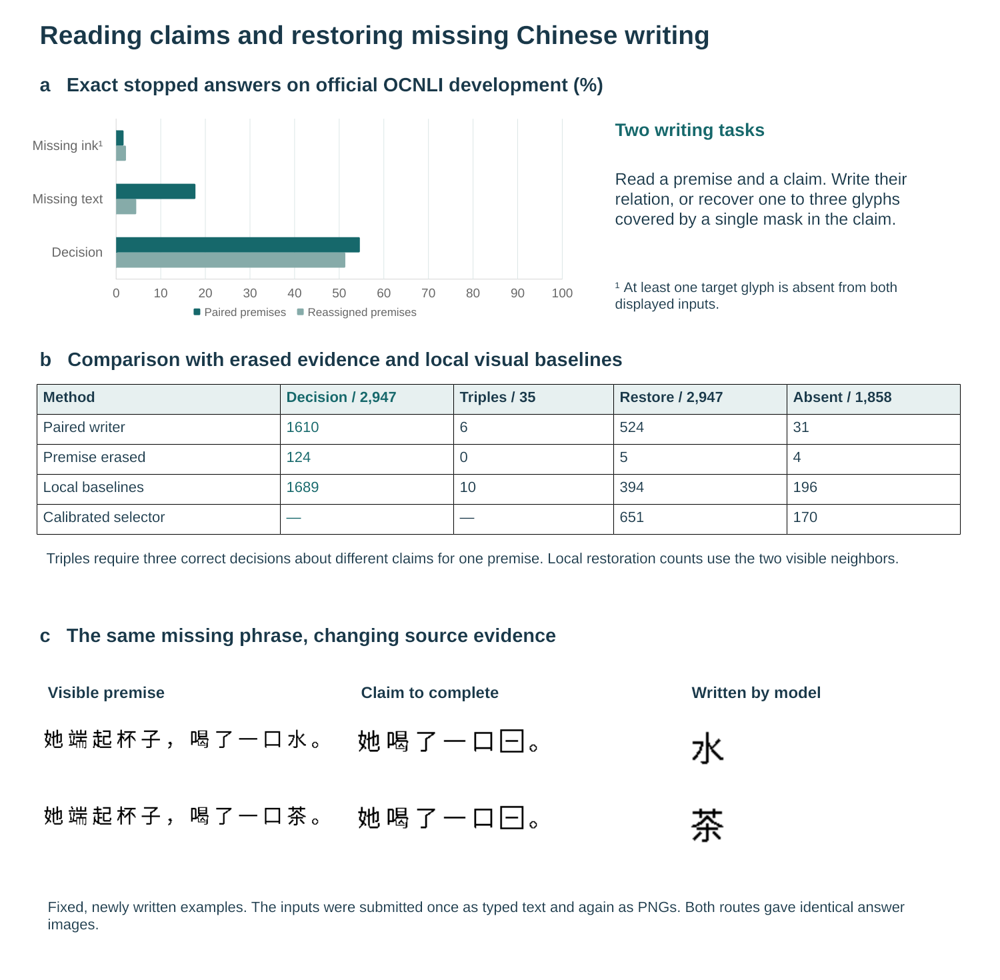
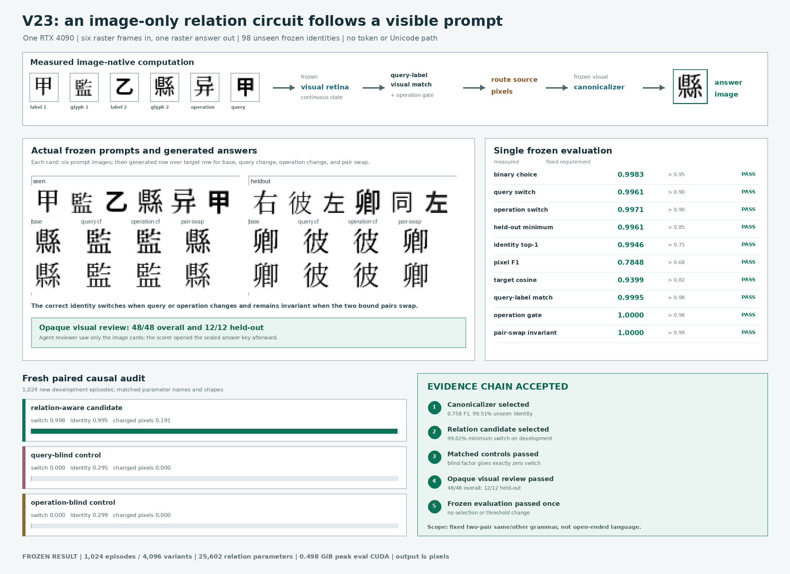

[English](../README.md) · [العربية](README.ar.md) · [Español](README.es.md) · [Français](README.fr.md) · [日本語](README.ja.md) · [한국어](README.ko.md) · [Tiếng Việt](README.vi.md) · [中文 (简体)](README.zh-Hans.md) · [中文（繁體）](README.zh-Hant.md) · [Deutsch](README.de.md) · [Русский](README.ru.md)

谁画了地图，谁需要问路？改进后的模型给出了两个不同的人名。在另外 64 道图像问题中，它准确答出了 42 个人名。它也能按指定顺序写出「言」的甲骨文和金文。不过，在需要写出输入中未出现字形的 128 道新开放题中，没有一个回答与参考答案完全相符。 [实验结果与模型](../references/pointing_causal_writer_result.md)

[](../publication/ilm-nature/manuscript.pdf#page=121)

图中的短文交代了谁画地图、谁迷了路。模型答对了画图的人，但问它谁需要问路，它又说了一遍画图的事。在 300 道答案需要写出题面以外字形的问题中，即使给出前面正确的答案，模型也只在 18 道题上选对了第一个新字形。 [实验结果与回答原图](../references/causal_glyph_writer_result.md)

[](../publication/ilm-nature/manuscript.pdf#page=120)

模型现在能按图片中的提问，以相反顺序写出「言」的甲骨文和金文。在未参与训练的字例上，采用熟悉的问法时，96 组测试中有 94 组的两种顺序均正确。换用新的字例和问法后，正确组数为 16。 [结果与实际输出](../references/ordered_page_writer_result.md)

[](../publication/ilm-nature/manuscript.pdf#page=119)

**从字形图像阅读和作答.** 在关于两个人物的 64 道题中，模型用常规中文字体答对 46 道，换成粗体后答对 41 道。以文本作答的本地 Qwen3-8B 答对 55 道。换用训练中未见的楷体后，模型只答对了一道。 [运行模型](../docs/visual-page-responder.md)

[](../publication/ilm-nature/manuscript.pdf#page=118)

**同一句话里的两个人，模型分得清吗？** 模型正确写出了盖茨大楼的捐赠者和建筑师。在 864 对问题中，有 100 对的两个答案都正确。另有 24 个新情境交换了人名，模型没有一个情境全部答对，本地 Qwen3-8B 全部答对了其中 20 个。 [结果与模型用法](../references/shared_sentence_writer_result.md)

[](../publication/ilm-nature/manuscript.pdf#page=116)

**为什么会答错人？** 在 387 道中文「谁」字问句中，模型读整段答对 62 道，按字形重合度选一句后答对 116 道。随机分配额外训练答案的对照模型用同一方法答对 127 道。图 85 展示了一个真实错误：题目问发明者，模型却写出了地名。 [结果与用法](../references/inverse_role_writer_result.md)

[](../publication/ilm-nature/manuscript.pdf#page=115)

**模型能写对人物吗？** 换用新名字和补语后，模型完整写对了 404 句中的 368 句。把名字换成金文「秦」「楚」，32 句中有 24 句写对；问题中去掉名字、只给条件让模型指出是谁时，32 个答案均未写对。图 84 展示了同一问题下的一次张冠李戴和一次正确回答。 [结果与模型用法](../references/visual_role_writer_result.md)

[](../publication/ilm-nature/manuscript.pdf#page=114)

**模型能从字形中读出什么？** 面对同一句「她喝了一口□。」，当上文中的饮料从水换成茶时，模型也把答案从「水」改为「茶」。结合神经网络和相邻字形统计的方法准确补出了 2,947 处缺文中的 651 处。但在交换两个人物角色的 48 组对照中，没有一组的两次判断都正确。 [实验结果与运行命令](../references/visual_inference_writer_result.md)

[](../publication/ilm-nature/manuscript.pdf#page=113)

<!-- paired-writing-status:start -->
完成 512 次更新的去空白对比实验仍未实现可靠抄写：OCR 完全匹配为训练集 6/32、验证集 10/32（清晰参考图为 27/32、28/32）。原始输出可见漏字和字母重复。训练时间由 795.624 秒降至 287.182 秒，但语言理解及达到实用质量时的效率仍未得到证明。 [全部 64 个原始输出](../references/paired_padding_result.md).
<!-- paired-writing-status:end -->

当前状态：图像语言生成仍未达到可用标准。最新的解码器损失对照实验使用32道已见训练题，两组逐像素完全一致的自主回答均为0/32；解码器敏感损失使前景F1从对照组的85.984%降至70.009%。即使给出正确的前文，F1也仅为92.430%和75.116%；直接提供答案编码时，两组的解码重建均达到99.9953%。四项修复标准全部未通过，不再扩大这一训练方案。这些是图像一致性指标，不是语义正确率，尚无通过可用性验证的ILM检查点。[完整结果及全部原始图片](../references/decoder_metric_v82_result.md)。 论文已纳入补充说明39和可编辑的图S16。 另一个外部图像生成器基线未经本地训练，OCR完全匹配为复制请求0/12、问答0/8（参考图OCR校准18/20），全部40张原始输出均已保留。 [FLUX.2-klein-4B](../references/image_edit_baseline_result.md).


[](https://lazying.art)

# Imagized Language Model (ILM)


ILM 研究如何把语言作为**可见书写图像**来学习和生成：从图像进入连续视觉状态，
再直接回到图像，不把隐藏的符号序列当作语言核心。


最新接口检查：将同一批页面从1024缩放到原生432尺寸后，冻结的预训练模型英文回答完全正确数从0/32升到11/32；两个已训练适配器在432尺寸下均只有5/32。接口存在实质问题，但仍未实现独立生成图像答案的ILM。

[2026-11-07: English result and full evidence](../references/native_reader_geometry_result.md)

2026-11-08 实测：128次更新后的完整评估已结束，全部384张原始答案图像均已检查。初始模型和最终模型在已见、保留问题两组中的OCR完全一致答案数均为0/32，计入原始数据允许的其他答案后仍为零。保留组的复制完全一致数从19/32降到16/32。预先规定的六项要求全部未通过，尚未证明语言学习。

[结果及证据范围](../references/native_paired_qa_learning_result.md)

## 看古文图像，写现代汉语

这个含 203 万个参数的模型在独立测试篇章中完整抄出了全部 2,045 段可渲染的原文。要求改写为白话时，2,048 个译文中有 30 个与参考图像完全一致。其中一例保留九个字形，新写两个字，把“薨”改成了“去世”。按整体字形编辑距离衡量，简单的局部改写方法仍然更好。 [运行模型](../models/visual_edit_zh/README.md) · [对照输出与参考图像](../publication/ilm-nature/figures/Figure_48_visual_edit.png)

## 从图表读取历史字形

给定四行字形图表，在针对训练时未见字族的 9,600 个中英文问题中，模型有 9,565 次按指定顺序返回了正确字形。「言」的示例可以直接输出甲骨文和金文图像。 [运行示例](../models/pictured_idiom_zh/README.md) · [Fig. 42](../publication/ilm-nature/figures/Figure_42_historical_plates.png)

## 看上下文，写出缺失的成语

这个有 212 万个参数的模型读取空缺两侧的文字图像，再逐字画出成语。在 22,907 个验证样本中，134 个答案与原文完全一致。其中 100 个样本的上下文里连答案的一个字都没有。按相邻字统计训练集频次的基线方法答对了 1,012 个。

[运行模型](../models/pictured_idiom_zh/README.md) · [图 40](../publication/ilm-nature/figures/Figure_40_pictured_idioms.png)

训练时加入阅读器的指导后，模型在 22,907 个样本中答对 378 个；只用原文答案追加相同轮数训练，答对 292 个。在另外 9,135 个此前未使用的样本中，两种方法分别答对 163 个和 125 个。 [图 41](../publication/ilm-nature/figures/Figure_41_writer_transfer.png)

联合训练视觉阅读器和书写器后，模型在 17,555 个新的中文填空中完整写对了 433 个，原模型写对 276 个，局部计数基线写对 789 个。 [Fig. 43](../publication/ilm-nature/figures/Figure_43_expression_preference.png)

## 从汉字图像中选出答案

一个小型阅读模型用两个 CPU 线程训练了 64 秒，在留出的中文篇章上答对了 1,788 道题中的 269 道，输出的完整答案图像与参考答案逐像素相同。把问题遮成空白后，只答对了 18 道。另一套自由书写模型仍未能写出可读的「言」字演变说明。通用书写能力和千倍训练效率仍待验证。


[运行阅读模型](../references/visual_extractive_reading_result.md) · [论文](../publication/ilm-nature/manuscript.pdf)

在 3,170 道中文问题中，阅读模型有 565 次在原文中选对了答案片段。书写模型用另一种字体准确写出了 124 个完整答案。针对同一支乐队的两个问题，它分别写出了「前卫金属」和「1996年」。


[跨字体书写答案](../references/grounded_detail_writing_result.md)

## 从上文生成下一个汉字

在 668 个开发集上下文中，先预测整字的粗略布局，使与已知非空字形逐像素相同的输出从 198 个增至 649 个。两种模型都只有 18 次写出了原文中的下一个字。询问「言」的演变时，新模型反复写出形似数字零的符号。


[实验结果与训练模型](../references/shared_layout_writing_result.md)

## 此前的续写实验

2026-11-13

完整序列实验已完成 **13,766 条序列、41,298 次更新和 6,108,741 个目标字形位置**。全部 **732 张输出图像**均在参考答案评分前完成审阅。最终模型在比例排版提示下获得 **7/32 个严格完整正确答案、0/16 组双题同时正确、14/32 个可读答案，以及 0/12 个连贯完整的长篇书籍续写**。预先注册的标准及涵盖四种问答擦除对照的独立审计均未通过。

训练使用一张 RTX 4090，峰值已分配显存为 **18.568 GiB**。部署模型总计 **7,578,390,003 个参数**，包含继承的基础模型权重；本次训练更新 **20,212,225 个参数**。结果来自重复使用的开发集，由一名模型审阅者评判，未经独立人工复核。可用的轻量 ILM 及同等质量下的效率优势仍未得到证明。

[完整结果](../references/visual_continuation_learning_result.md) · [工程目标](../docs/first-imagized-language-model-goal.md) · [固定实验方案](../references/visual_continuation_full_protocol.md)

## 较早的 V35 结果


V35 是一个 `129,092,738` 参数的中文视觉语言模型。它在一张 RTX 4090
上完成了全部 `22,000` 次 BF16 更新，耗时 `2.770` 小时，峰值显存
`2.899 GiB`。部署路径只接收书写像素和视觉掩码，并直接生成和重读栅格；运行时
不使用 tokenizer、Unicode/字符 ID、OCR、检索、视觉码本或教师模型。

实测结论为 **`not-qualified`**。正确提示下的复制准确率为 `0.3125%`，指令
准确率为 `0.1116%`，且低于打乱提示的对照。视觉因果与语义栅格门分别仅通过
`5/12` 和 `5/9`。输出非空且会响应提示变化，但其字形损坏，未与目标答案绑定，
因此封存测试集没有开启。

V35 采用迁移学习：V34 连续书写编解码器是本项目工作，因果核心则初始化自外部
PIXAR 检查点。PIXAR 是明确署名的外部基础，并非本项目贡献。“独立”只表示部署
产物可自包含运行，不表示所有组件均从零训练。详见[英文实测报告](../references/causal_glyph_flow_v35_result.md)、
[实现说明](../docs/causal-glyph-flow-v35.md)和[论文](../publication/ilm-image-native/ilm-image-native.pdf)。

## 早期受限提示实验：V23 视觉关系电路通过



V23 是本仓库第一个通过完整证据链的“图像提示到图像答案”实验。学生只接收六张
`32x32` 书写图像并输出一张 `32x32` 答案图像；部署路径中没有字符串、token、
Unicode ID、OCR、字形查询、答案索引或外部语言模型。

在唯一一次获准的冻结评估中，98 个未见汉字、1,024 个样本和 4,096 个提示变体的
二选一正确率为 `0.99829`，查询切换为 `0.99609`，操作切换为 `0.99707`，输出
字形 top-1 为 `0.99463`，像素 F1 为 `0.78478`。查询盲与操作盲对照对各自看不到
的因素保持严格零切换，说明候选模型确实使用了两种可见信息。

这个结果只证明固定六角色、二组绑定、同/异关系的视觉提示跟随，不等于开放式语言
理解。V24 将去掉固定帧角色，读取可变长度的二维图像文字流，并在重读第一帧输出后
生成第二帧。完整证据见[英文 V23 结果记录](../docs/visual-relation-circuit-v23-result.md)。

## 早期研究基线：预测视觉场的起点


RFLM V7 证明了现有结构的一个关键问题：不应让同一个像素 flow 同时推断下一项
语言身份并完成笔画渲染。V7 将完整上下文 top-1 从 `1.20%` 提升到 `2.31%`，
超过 last-only (`2.02%`) 和 unigram (`1.86%`)，但仍远低于 bigram
(`13.58%`)。归一化目标对数概率增益从 `-0.9066` 改善到 `-0.2155`，但仍为
负值；32 格自主输出仍不可读。因此，**V7 作为语言模型未通过验收**。

下一代 PVF 将“预测下一连续视网膜状态”与“把该状态绘制为墨迹并重新读取”分开。
部署时没有最近字符检索，也没有字符输出表。严格边界仍是：`书写像素 -> 连续视觉
动力学 -> 墨迹像素`；学生不接收 token、Unicode ID、OCR、视觉码本或外部语言
模型。PVF 是可证伪的 V8 假设，不是已经实现的能力。

> 该仓库有意将可复现的语源流程与面向长跨度的 ILM 实验并置。

## 📌 概览

该仓库目前有三条互相关联的主线：

1. 视网膜流图像原生语言建模及严格的训练外评估。
2. 保留来源证据的历史中文字形语源数据摄取。
3. 为复现而保留的早期字形、码本、扩散、folio 与 InkStream 对照基线。

本 README 记录三条主线，并将语源流程作为一等公民、可复现的路线保留。

## 🔗 关键链接

| 区域 | 路径 |
|---|---|
| 概念文档 | `docs/imagized-language-model.md` |
| 当前工程目标 | `docs/first-imagized-language-model-goal.md` |
| 研究档案与实验证据 | `references/image-native-language-model-research.md` |
| 代码计划与指标 | `docs/ilm-visual-diffusion-code-plan.md` |
| Embedding "color" 计划 | `docs/embedding-color-plan.md` |
| 开发说明/计划 | `docs/development-plan.md` |
| 语源模块 readme | `ilm/etymology/README.md` |

## ✨ 特性

- 🏺 来自 `hanziyuan` 与 `chineseetymology` 风格来源的语源数据摄取。
- 🌐 稳健的 AJAX + HTML 摄取流程，带有重试、节流与缓存。
- 🧩 分阶段标注的字形提取，包含 `` 与 CSS `background-image` data URI。
- 🗃️ SQLite 支持的字符/字形元数据存储，以及文件系统资源布局。
- 🖥️ Tornado Web UI，可进行临时摄取与图库预览。
- 🔤 多语言 token 图像的字形渲染工具。
- 🧠 Product-code 风格的 embedding/码本模块。
- 🧱 句子 frame 打包与 diffusion/inpainting 训练与评估脚本。
- 📊 嵌入与流程检查的报告与可视化脚本。
- 📄 `publication/` 下的 LaTeX/PDF 发布素材。

## 🧱 项目结构

```text
.
├── README.md
├── AGENTS.md
├── configs/
│   ├── color.yaml
│   └── diffusion.yaml
├── docs/
├── i18n/
├── ilm/
│   ├── code/
│   ├── data/
│   ├── datasets/
│   ├── db/
│   ├── diffusion/
│   ├── encoders/
│   ├── english_tiles/
│   ├── etymology/
│   ├── frames/
│   ├── models/
│   └── utils/
├── scripts/
├── publication/
├── assets/
├── logs/
└── *.ipynb
```

## 🧰 先决条件

| 要求 | 说明 |
|---|---|
| Python `3.10+` | 核心运行时 |
| `pip` | 安装依赖 |
| 可选 GPU | 有助于运行 PyTorch CUDA 训练脚本 |
| 可选 LaTeX 工具链 | 用于构建发布物 |

假设说明：目前尚无单一的根级依赖锁定/规范文件（如 `pyproject.toml`、`requirements.txt` 等），因此依赖关系需根据 import 和脚本使用推断。

## ⚙️ 安装

### 最小安装（语源工具链）

```bash
python -m venv .venv
source .venv/bin/activate
pip install --upgrade pip
pip install requests beautifulsoup4 tornado
```

### 扩展安装（建模/训练工作流）

```bash
python -m venv .venv
source .venv/bin/activate
pip install --upgrade pip
pip install requests beautifulsoup4 tornado pyyaml numpy pillow matplotlib torch
```

若某个具体脚本需要额外依赖，请按该脚本报出的导入错误逐一安装。

## 🚀 使用方式

### 快速开始：历史字形摄取（CLI）

1. Hanziyuan（推荐）：仅字符 AJAX 流程

```bash
PYTHONPATH=. python scripts/ingest_etymology.py --site hanziyuan --char 中
```

2. ChineseEtymology（直接 URL）

```bash
PYTHONPATH=. python scripts/ingest_etymology.py --site chineseetymology --url "https://www.chineseetymology.org/CharacterEtymology.aspx?characterInput=%E4%B8%AD"
```

3. 批量文件摄取（每行可为 `char\turl`、`url` 或 `char url`）

```bash
PYTHONPATH=. python scripts/ingest_etymology.py --from-file urls.txt
```

### 输出

| 输出类型 | 位置 |
|---|---|
| 文件 | `data/historic/glyphs/<char>/<stage>/<label>.<ext>` |
| 缓存 | `data/historic/cache/*.html` |
| 数据库 | `data/historic/etymology.sqlite3` |

### Web 演示（可选）

```bash
PYTHONPATH=. python scripts/serve_etymology.py
```

打开 `http://127.0.0.1:8888`，选择站点并输入一个字符（例如 `中`）。

### 礼貌抓取与站点约束

- 抓取器使用按主机节流、带退避重试与缓存。
- 保持延迟 `>= 0.5s`，避免突发请求，并遵守站点条款/robots/授权约束。
- 不要绕过付费墙或交互式保护。
- 如果你看到 `403`/`429`，请放慢速率后稍后重试。

### 额外的 ILM 工作流

这些脚本均已存在并是仓库可见面向研究的流程的一部分，但它们是研究流程，可能需要本地预先准备的数据集/检查点。

1. 数据下载与预处理

```bash
python scripts/download_alpaca.py --outdir data/raw
python scripts/download_corpora.py --out data/raw
python scripts/sample_paragraphs.py --out data/processed/test_100.jsonl
python scripts/build_images_common_freq.py --out data/processed/images_common_freq --size 128 --en 5000 --zh 5000
```

2. 字形数据库生命周期

```bash
python scripts/glyphdb_init.py --db data/glyphdb/glyphs.sqlite3
python scripts/glyphdb_ingest_index.py --db data/glyphdb/glyphs.sqlite3 --index data/processed/images_common_freq/index.tsv
```

3. Code/color 模型训练

```bash
python scripts/train_color_codes.py --config configs/color.yaml
python scripts/train_codes_from_qa.py --en-json data/raw/alpaca_en.json --zh-json data/raw/alpaca_zh.json --epochs 1
python scripts/train_ilmglyph_codes.py --en data/raw/alpaca_en.json --zh data/raw/alpaca_zh.json --out artifacts/ilm_glyph_train
```

4. Diffusion/inpainting

```bash
python scripts/train_diffusion.py --config configs/diffusion.yaml
python scripts/train_inpaint_frames.py --ckpt-code artifacts/ilm_glyph_train/ckpt_epoch1.pt --out artifacts/inpaint
```

5. 评估与报告

```bash
python scripts/eval_color_codes.py --checkpoint artifacts/color_codes_e1.pt
python scripts/eval_diffusion.py --checkpoint artifacts/diffusion_unet.pt
python scripts/eval_qa_retrieval.py --checkpoint artifacts/color_codes_qa.pt
python scripts/report_ilmglyph_pipeline.py --ckpt artifacts/ilm_glyph_train/ckpt_epoch1.pt --lang en --text "hello world"
```

## 🧩 配置

主要 YAML 配置文件：

- `configs/color.yaml`
  - 数据路径：`data/processed/images_common_freq/index.tsv`
  - 模型/code 参数：`d_glyph`、`d_code`、`K`、`C`、temperature/anneal
  - optimizer/log 设置

- `configs/diffusion.yaml`
  - 输入 JSONL：`data/processed/test_100.jsonl`
  - frame/grid 与模型规模设置
  - 训练掩码比例范围与 checkpoint 设置

在支持的情况下，可用 CLI 标志覆盖配置（如 `--epochs`、`--batch-size`、`--lr`）。

## 🧪 示例

- 构建单个英语 tile 字形：

```bash
python scripts/build_english_tile_glyph.py "language" artifacts/language_tile --save-tensor
```

- 使用训练完成的检查点运行 inpainting 演示：

```bash
python scripts/inpaint_demo.py \
  --ckpt-code artifacts/ilm_glyph_train/ckpt_epoch1.pt \
  --ckpt-inpaint artifacts/inpaint/ckpt_epoch1.pt \
  --lang en \
  --text "the quick brown fox jumps" \
  --mode infill \
  --out artifacts/inpaint_demo
```

- 从 Hanziyuan 批量摄取常见字符：

```bash
PYTHONPATH=. python scripts/bulk_ingest_hanziyuan.py --limit 200 --resume
```

## 📝 开发备注

- 这是一个研究型仓库，同时包含稳健 CLI 与探索性成果（包括 notebook 与原型脚本）。
- 大文件输出应写入 `data/` 和 `artifacts/`（二者均在 `.gitignore` 中）。
- 发布源码与 PDF 位于 `publication/`；辅助构建脚本为 `scripts/latex_build.sh`。
- 协作与流程约定记录在 `AGENTS.md`。

## 🛠️ 故障排查

- `ModuleNotFoundError: ilm...`
  - 从仓库根目录运行脚本。
  - 对需要本地包解析的脚本使用 `PYTHONPATH=.`。

- 数据/index/checkpoints 的 `FileNotFoundError`
  - 先运行前置的数据/构建脚本。
  - 确认默认项存在，例如 `data/processed/images_common_freq/index.tsv` 与 `data/processed/test_100.jsonl`。

- CUDA/设备问题
  - 用脚本参数/配置改为 CPU（`device: cpu` 或 `--device cpu`）。

- 缺少依赖错误
  - 按照具体脚本的 import 路径安装所需依赖（`torch`、`pyyaml`、`Pillow` 等）。

- 抓取时出现 HTTP `403` / `429`
  - 提高 `--delay`，稍后重试，并保持抓取行为礼貌。

## 🗺️ 路线图

- 在语源优先快速起步之外，继续完善 text-as-image ILM 的训练/评估 runbook。
- 改进环境可复现性（统一、权威的依赖规范）。
- 扩展研究脚本与 pipeline glue 的测试/CI 覆盖。
- 在分层码本、diffusion 目标与可控通道上持续迭代。
- 统一 `docs/`、脚本帮助文本与发布素材中的文档。

更深入的概念与分阶段规划细节可参见：

- `docs/imagized-language-model.md`
- `docs/ilm-visual-diffusion-code-plan.md`
- `docs/development-plan.md`

## 🤝 贡献

- 按 `AGENTS.md` 的约定执行（原子提交、变更后推送、代码中不包含凭证）。
- 将相关修改聚合为聚焦提交，并使用规范化提交信息。
- 优先使用可复现的脚本调用，明确传入标志和输入路径。
- 进行抓取相关修改时，保留节流/缓存行为及站点尊重约束。

## 📄 许可证

仓库当前未包含顶层许可证文件。

假设说明：在维护者添加 `LICENSE` 文件前，请将该项目按未明确指定许可证的研究代码对待。


## ❤️ Support

<!-- support:start -->
[](https://github.com/sponsors/lachlanchen)
[](https://chat.lazying.art/donate)
[](https://paypal.me/RongzhouChen)
[](https://buy.stripe.com/aFadR8gIaflgfQV6T4fw400)
<!-- support:end -->
