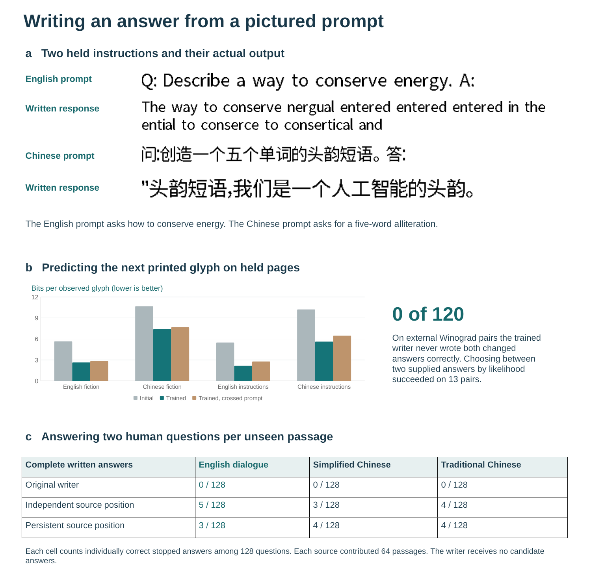
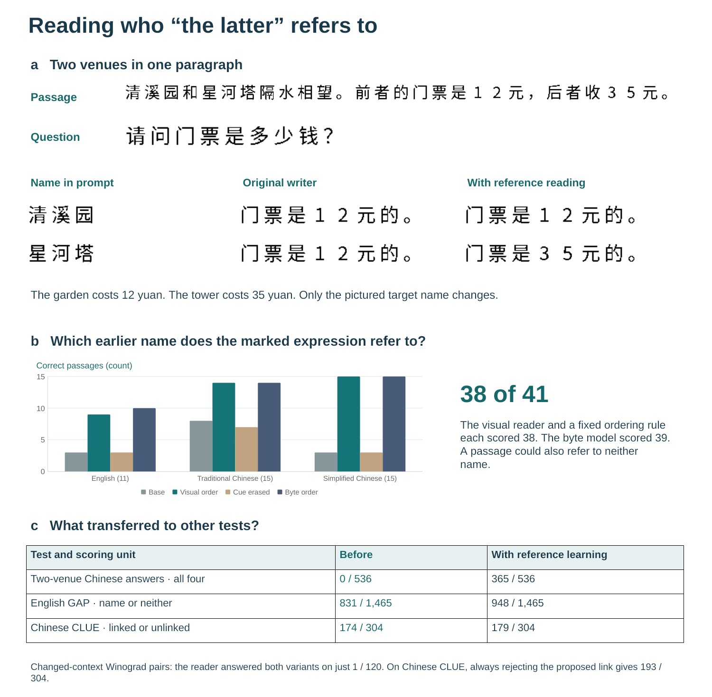
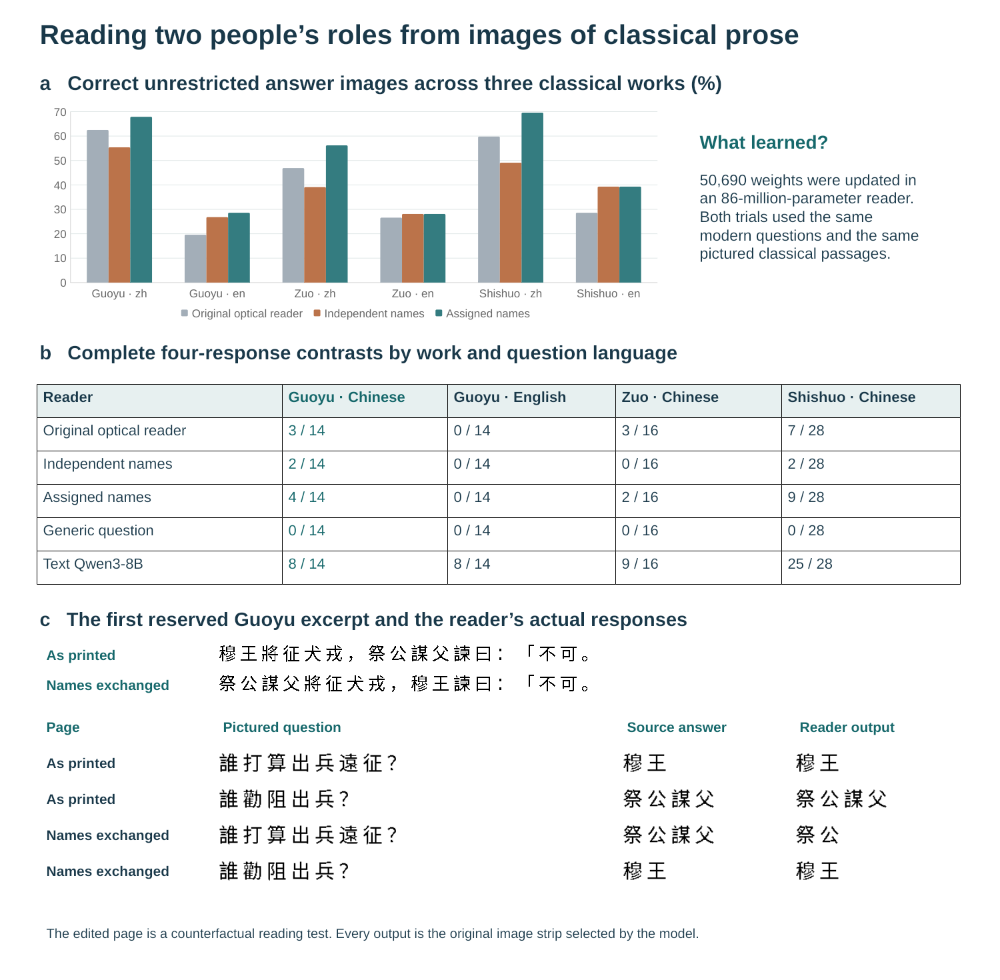
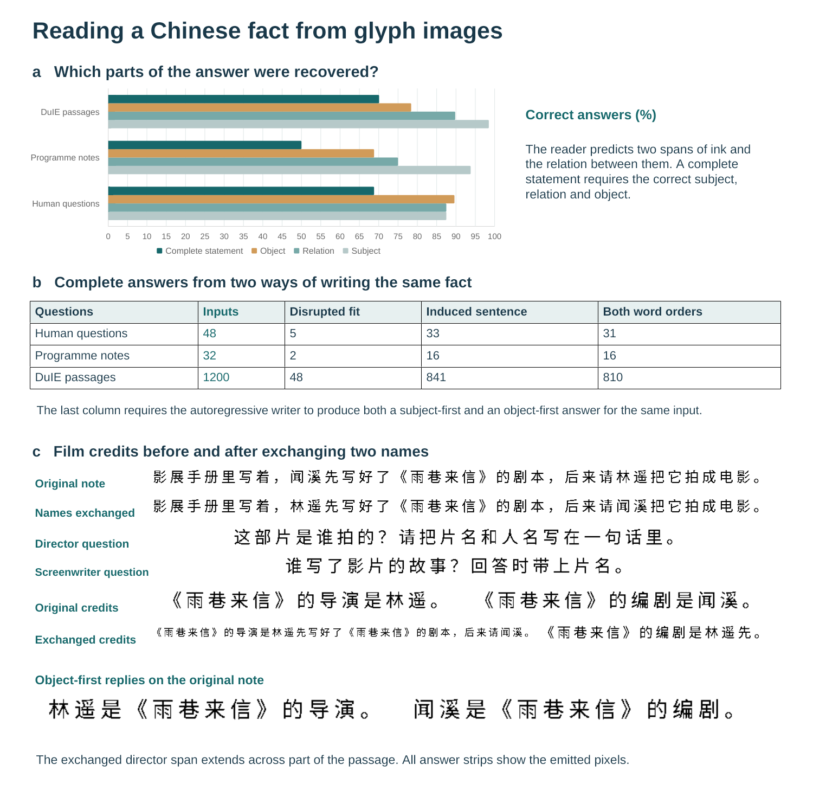
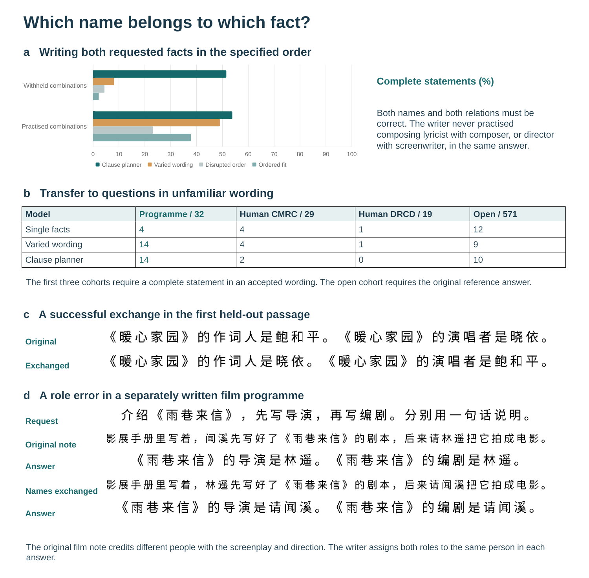
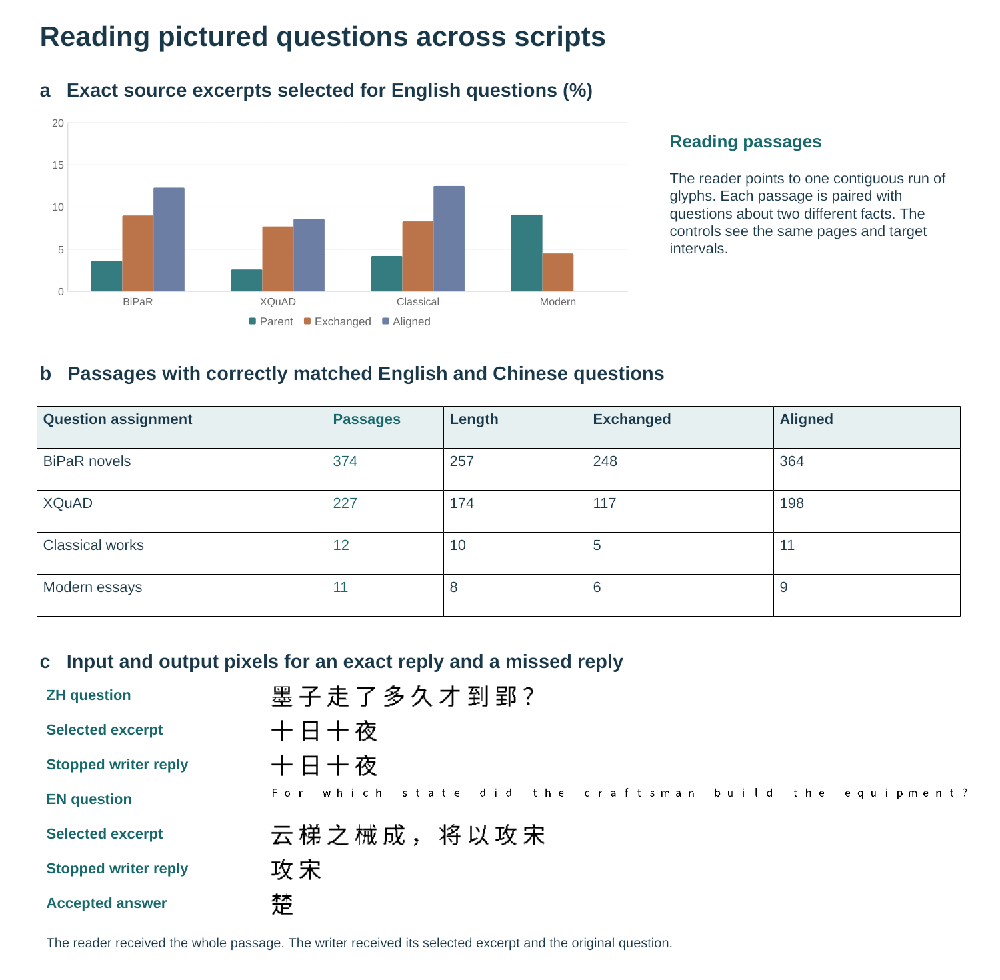
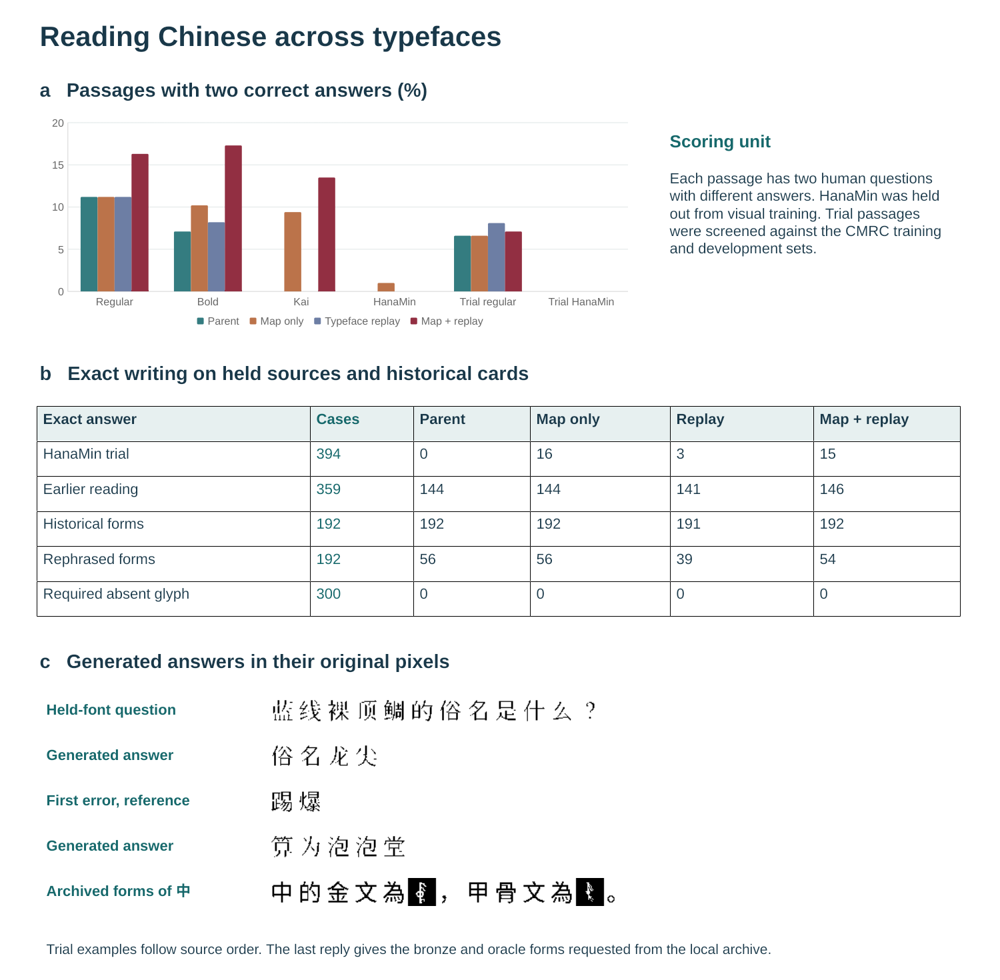
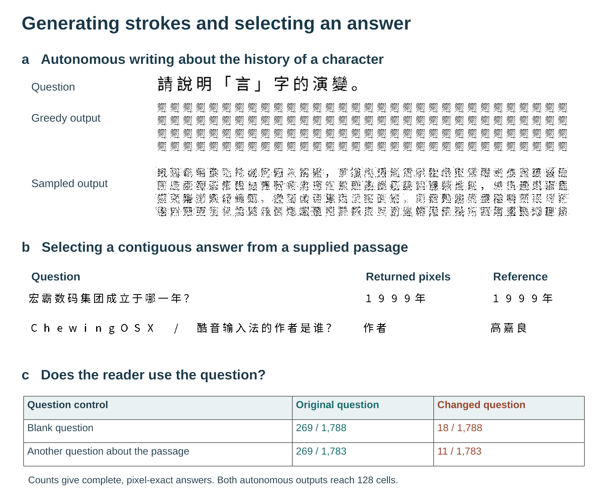
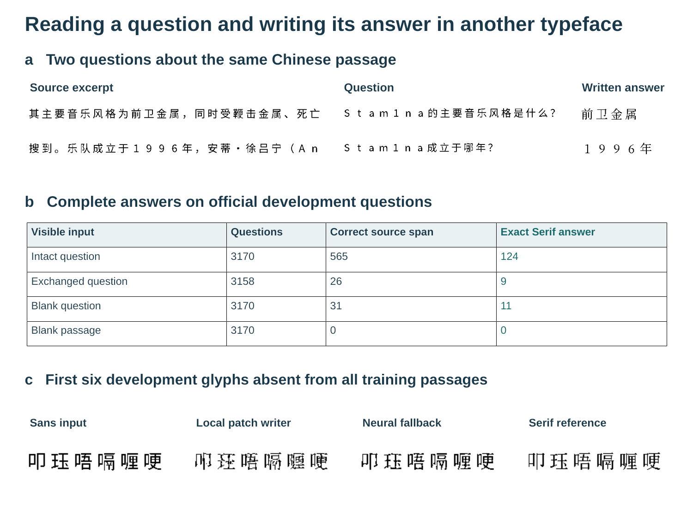

[English](../README.md) · [العربية](README.ar.md) · [Español](README.es.md) · [Français](README.fr.md) · [日本語](README.ja.md) · [한국어](README.ko.md) · [Tiếng Việt](README.vi.md) · [中文 (简体)](README.zh-Hans.md) · [中文（繁體）](README.zh-Hant.md) · [Deutsch](README.de.md) · [Русский](README.ru.md)

用圖像提問，模型能以字形寫出有意義的回答嗎？一個 212 萬參數的模型在單張 RTX 4090 D 上學會了預測未見過的中英文段落。面對如何節能的問題，它反覆抄寫題幹。加入視覺閱讀模組後，384 道由人提出的問題中答對 11 道，同一段落的兩道題皆答對的為 0/192。圖 144 保留了模型實際寫出的像素。 [閱讀論文](../publication/ilm-nature/visual_language_paper.pdf) · [執行影像模型](../models/visual_cursor/README.md)

[](../publication/ilm-nature/visual_language_paper.pdf#page=2)

清溪園和星河塔只在段首各出現一次，下文用「前者」「後者」說明票價。問題圖保持相同，只換要問的地點，模型分別寫出 **门票是12元的。** 和 **门票是35元的。** 舊模型兩次都答 12 元。在 536 組由真實對話改寫的測試裡，兩處地點、兩種順序的四個問題全部答對了 365 組。換成需要依靠上下文推斷指代的英文配對題，兩問全對的只有 1/120 組。

[](../publication/ilm-nature/visual_language_paper.pdf#page=4)

一個有 118 萬個參數的模型從古文影像讀取指定漢字，再以影像寫出英文釋義。它將「言及之而不言」的末字寫作 speak，將「有是言也」的「言」寫作 speech。在同字異義的對照中，《論語》有 213/566 對兩義全對，《楚辭》有 82/403 對。按鄰近字形計數的方法分別答對 211 和 104 對。模型在一張 RTX 4090 D 上從頭訓練。 [執行模型](../models/visual_word_senses/README.md) · [實驗結果](../references/visual_word_sense_result.md)

[](../publication/ilm-nature/manuscript.pdf#page=160)

模型直接閱讀中文問題與小說片段的影像，再以影像寫出兩個分句。在《西遊記》和《紅樓夢》的測試中，分別有 34/48 和 42/48 個回答與參考影像完全相同。例如，它能依提問順序寫出「行者引路，而三藏上馬。」。在 60 個保留作評估的漢字字族中，有 9 個字族在所有排列下都寫對了甲骨文與金文。改用英文提問後，兩部小說分別只答對 2/48 和 10/48。 [執行模型](../models/grounded_ink_editor/README.md) · [結果與實例](../references/grounded_ink_writing_result.md)

[](../publication/ilm-nature/manuscript.pdf#page=159)

這個有 8,600 萬參數的視覺模型直接閱讀《國語》的段落與問題影像。在 56 個中文問題中，它答對了 38 個。將兩個人名對調後再次提問，模型在 14 段中有 4 段四問全對，原模型為 3 段，兩個名字權重相同的對照模型為 2 段。英文提問答對 16 題，沒有一段四問全對。範例傳回原文中「密康公」和「恭王」的字形。 [Guoyu · ILM](../models/optical_role_reader/README.md) · [38/56](../references/optical_role_adapter_result.md)

[](../publication/ilm-nature/manuscript.pdf#page=157)

這個含 64,666 個參數的閱讀模型接收問題和中文段落的影像，直接擷取原文中的字形作答。在 6,439 個段落上訓練後，面對兩部保留作評估的小說，它在各 452 道題中答對了 104 道中文題和 45 道英文題。只用人工答案訓練的模型分別答對 81 道和 48 道。同一段落換一個問題後，兩題都答對的情況仍然很少。 [ILM · 64k](../models/book_span_distillation/README.md) · [104/452](../references/book_span_distillation_result.md)

[](../publication/ilm-nature/manuscript.pdf#page=154)

把作品署名表做成圖像，再交換兩人的分工，視覺模型在 256 組比較中有 175 組答對了交換前後的兩個角色，對照模型答對 19 組。在 12 篇新故事中，兩者都沒有完整答對一組。把兩個問題分別配上對應的圖錄片段後，模型在 8 次測試中有 2 次按要求的順序重現了「言」的四種歷史字形。 [↗](../references/individual_clause_writer_result.md)

[](../publication/ilm-nature/manuscript.pdf#page=152)

在以圖像呈現的作品署名中交換兩個人名後，8,700 萬參數的模型在 256 組比較中有 165 組能按兩種提問順序正確作答。訓練樣本相同、答案獨立分配的對照模型通過了 5 組。在另行撰寫的故事中，兩個模型的成績都是 0/24。 [結果與原始輸出圖像](../references/role_change_writer_result.md) · [執行模型](../models/role_change_writer/README.md)

剔除預留的 DRCD 材料並重新訓練後，擴大候選範圍的閱讀器在359道開發集問題中精確答對234道，通用閱讀器答對242道。先前的 DRCD 評測使用了預留測試段落。 [結果與資料來源更正](../references/span_list_result.md)

[](../publication/ilm-nature/manuscript.pdf#page=138)

在384道新評測的中文閱讀題中，模型合併四個閱讀器對圖像答案的預測，精確答對285道，與通用閱讀器持平。在128組人名互換測試中，它完全答對63組，專項閱讀器答對79組。 [結果與權重](../references/span_choice_result.md)

[](../publication/ilm-nature/manuscript.pdf#page=137)

在中文圖文段落中交換兩個人名後，只用概似目標訓練的模型在 128 段中有 79 段能用兩種語序正確回答全部問題，原模型為 29 段。在人工編寫的 48 道問題上，兩種語序都答對的題數從 34 降至 28。 [實驗結果與模型](../references/participant_margin_result.md)

[](../publication/ilm-nature/manuscript.pdf#page=136)

在人工編寫的 48 道中文問題中，模型有 34 道能依要求用兩種語序寫出正確事實。它能正確寫出《秋潮》的作曲者。另一首歌的測試顯示，交換作曲者和作詞者後，模型仍可能答錯人名。 [實驗結果與模型](../references/pictured_relation_result.md)

[](../publication/ilm-nature/manuscript.pdf#page=135)

模型用 26,890 筆中文圖像樣本學習辨認陳述中的主體、關係和對象，在 48 道由人撰寫的問題中寫出了 33 個完整正確的句子。另一個逐字形生成的模型在其中 31 題上能按兩種指定語序作答。在電影介紹的例子中，模型在原文上正確寫出了導演和編劇，但在人名互換後多抄了一段原文。 [實驗結果與模型](../references/role_binding_result.md)

[](../publication/ilm-nature/manuscript.pdf#page=134)

把圖像文章中的兩個人名互換，模型能跟著改答案嗎？在 136 道角色組合未曾出現在雙句訓練中的問題上，模型先辨識提問順序，再呼叫同一個圖像書寫模型，正確寫出了 70 組雙句答案。此前一次寫完兩句的模型只答對 3 組。電影手冊的例子也保留了一個錯誤：兩句話都清楚可讀，卻把導演和編劇都寫成了同一個人。 [實驗結果與模型](../references/grounded_proposition_result.md)

[](../publication/ilm-nature/manuscript.pdf#page=133)

誰畫了地圖，誰需要問路？改進後的模型給出了兩個不同的人名。在另外 64 道以圖像呈現的問題中，它準確答出了 42 個人名。它也能按指定順序寫出「言」的甲骨文和金文。不過，在需要寫出輸入中未出現字形的 128 道新開放題中，沒有一個回答與參考答案完全相符。 [實驗結果與模型](../references/pointing_causal_writer_result.md)

[](../publication/ilm-nature/manuscript.pdf#page=132)

圖中的短文交代了誰畫地圖、誰迷了路。模型答對了畫圖的人，但問它誰需要問路，它又說了一遍畫圖的事。在 300 道答案需要寫出題面以外字形的問題中，即使給出前面正確的答案，模型也只在 18 道題上選對了第一個新字形。 [實驗結果與回答原圖](../references/causal_glyph_writer_result.md)

[](../publication/ilm-nature/manuscript.pdf#page=131)

模型現在能根據圖片中的提問，以相反順序寫出「言」的甲骨文和金文。在未參與訓練的字例上，採用熟悉的問法時，96 組測試中有 94 組的兩種順序均正確。換用新的字例和問法後，正確組數為 16。 [結果與實際輸出](../references/ordered_page_writer_result.md)

[](../publication/ilm-nature/manuscript.pdf#page=130)

**從字形影像閱讀與作答.** 在關於兩個人物的 64 道題中，模型用一般中文字體答對 46 道，換成粗體後答對 41 道。本機 Qwen3-8B 讀取文字後答對 55 道。換用訓練時未見的楷體後，模型只答對一道。 [執行模型](../docs/visual-page-responder.md)

[](../publication/ilm-nature/manuscript.pdf#page=129)

**同一句話裡的兩個人，模型分得清嗎？** 模型正確寫出了蓋茨大樓的捐贈者和建築師。在 864 對問題中，有 100 對的兩個答案都正確。另有 24 個新情境交換了人名，模型沒有一個情境全部答對，本機 Qwen3-8B 全部答對了其中 20 個。 [結果與模型用法](../references/shared_sentence_writer_result.md)

[](../publication/ilm-nature/manuscript.pdf#page=127)

**為什麼會答錯人？** 在 387 道中文「誰」字問句中，模型讀整段答對 62 道，依字形重合程度選一句後答對 116 道。隨機分配額外訓練答案的對照模型用同一方法答對 127 道。圖 85 顯示一個實際錯誤：題目問發明者，模型卻寫出了地名。 [結果與用法](../references/inverse_role_writer_result.md)

[](../publication/ilm-nature/manuscript.pdf#page=126)

**模型能寫對人物嗎？** 換用新名字和補語後，模型完整寫對了 404 句中的 368 句。把名字換成金文「秦」「楚」，32 句中有 24 句寫對；問題中去掉名字、只給條件讓模型指出是誰時，32 個答案均未寫對。圖 84 展示了同一問題下的一次張冠李戴和一次正確回答。 [結果與模型用法](../references/visual_role_writer_result.md)

[](../publication/ilm-nature/manuscript.pdf#page=125)

**模型能從字形中讀出什麼？** 面對同一句「她喝了一口□。」，當上文中的飲料從水換成茶時，模型也把答案從「水」改為「茶」。結合神經網路和相鄰字形統計的方法準確補出了 2,947 處缺文中的 651 處。但在交換兩個人物角色的 48 組對照中，沒有一組的兩次判斷都正確。 [實驗結果與執行指令](../references/visual_inference_writer_result.md)

[](../publication/ilm-nature/manuscript.pdf#page=124)

<!-- paired-writing-status:start -->
完成 512 次更新的去空白對比實驗仍未實現可靠抄寫：OCR 完全匹配為訓練集 6/32、驗證集 10/32（清晰參考圖為 27/32、28/32）。原始輸出可見漏字和字母重複。訓練時間由 795.624 秒降至 287.182 秒，但語言理解及達到實用品質時的效率仍未得到證明。 [全部 64 個原始輸出](../references/paired_padding_result.md).
<!-- paired-writing-status:end -->

目前狀態：圖像語言生成仍未達到可用標準。最新的解碼器損失對照實驗使用32道已見訓練題，兩組逐像素完全一致的自主回答均為0/32；解碼器敏感損失使前景F1從對照組的85.984%降至70.009%。即使給出正確的前文，F1也僅為92.430%和75.116%；直接提供答案編碼時，兩組的解碼重建均達到99.9953%。四項修復標準全部未通過，不再擴大這一訓練方案。這些是圖像一致性指標，不是語義正確率，尚無通過可用性驗證的ILM檢查點。[完整結果及全部原始圖片](../references/decoder_metric_v82_result.md)。 論文已納入補充說明39和可編輯的圖S16。 另一個外部圖像生成器基線未經本地訓練，OCR完全匹配為複製請求0/12、問答0/8（參考圖OCR校準18/20），全部40張原始輸出均已保留。 [FLUX.2-klein-4B](../references/image_edit_baseline_result.md).


[](https://lazying.art)

# Imagized Language Model (ILM)

面對同一句「舉杯邀明月」，影像模型在被問到舉起什麼時寫出 **cup**，被問到邀請誰時寫出 **moon**。這句詩在早期訓練中出現過。在另外保留的 971 句中，有 247 句的每個動詞和受詞都定位正確，並寫對了每個受詞的英語釋義。交換訓練中的受詞後僅有 11 句達標。若一句話的所有自然問法均未出現過，則 21 句中沒有一句全部答對。 [執行模型](../models/questioned_events/README.md) · [實驗結果](../references/questioned_events_result.md)

[](../publication/ilm-nature/manuscript.pdf#page=167)

以英語描述動作時，圖像模型能在 268 組文言短句中的 44 組找出兩個受詞，並寫出正確的英語釋義。舊模型答對了 11 組。在蒲松齡作品中另選的 10 組裡，新模型有 4 組能選對兩句，但沒有一組寫對兩個答案。圖 125 展示了問到桃子時的實際輸出。 [執行模型](../models/visual_action_meaning/README.md) · [實驗結果](../references/visual_action_meaning_result.md)

[](../publication/ilm-nature/manuscript.pdf#page=166)

同一頁上有「焉得仁」和「策其馬」。用英語問得到什麼，模型寫出 **benevolence**；問鞭策什麼，就寫出 **horse**。在 1,691 張保留的測試頁中，有 703 張在兩種行序和兩種問法下都能找對位置、寫對兩個受詞。在 188 張相同頁面上改用近義表達後，全部答對的頁數從 95 降至 7。 [執行模型](../models/pictured_action_lookup/README.md) · [實驗結果](../references/pictured_action_lookup_result.md)

[](../publication/ilm-nature/manuscript.pdf#page=165)

模型讀取文言文和問題的圖像，再以圖像寫出英語答案。對於「還其珠」，它能按問題寫出 **return** 或 **pearl**。這個約 140 萬參數的模型在 40 對保留語境中，有 31 對能分辨「之」的代詞義和動詞義，分別寫出 *it* 和 *go*；打亂訓練答案後為 4 對。在另兩本書的 29 個片段中，只有 1 個片段的四道課堂問題全部答對。 [執行模型](../models/pronoun_writer/README.md) · [實驗結果](../references/pronoun_writer_result.md)

[](../publication/ilm-nature/manuscript.pdf#page=163)

給模型看「執大象」和一張問題圖片，問動詞，它寫出 **hold**；問賓語，它寫出 **image**。在 539 個測試片段中，有 230 個片段的八道中英文問題全部答對。把輸出限定為訓練中見過的釋義後，增至 247 個。換成日常問法，準確率仍然很低。 [執行模型](../models/asked_gloss/README.md) · [實驗結果](../references/asked_gloss_result.md)

[](../publication/ilm-nature/manuscript.pdf#page=161)

利用問題圖像的表示定位答案後，MLQA 的 412 道英語問題中，準確摘錄數從 17 增至 41。中英文合計 824 次提問，獨立生成模型根據摘錄給出 111 個完全正確且自行結束的回答，直接閱讀原頁面時為 90 個。 [↗](../references/question_evidence_transfer_result.md)

[](../publication/ilm-nature/manuscript.pdf#page=149)

從零訓練的視覺編碼器在 374 段小說中正確配對了 364 段的中英文問題。在另外五部作品的 92 次提問中，閱讀模型準確摘錄了 31 次，生成模型根據摘錄給出了 19 個完全正確的回答。 [↗](../references/bilingual_book_intervals_result.md)

[](../publication/ilm-nature/manuscript.pdf#page=148)

用 642 個模型曾答錯的例子訓練後，視覺模型在另外六部中文作品的 144 次提問中給出了 31 個完全正確的圖像回答。36 段文字中，有 0 段的兩道題用中英文提問時都答對了。 [↗](../references/stopped_book_preference_result.md)

[](../publication/ilm-nature/manuscript.pdf#page=147)

在另外四部中文作品的 34 段文字上，加強首字訓練的模型對 136 次中英文提問給出了 31 個完全正確的回答。沒有一段的四次提問全部答對。 [↗](../references/first_glyph_book_result.md)

[](../publication/ilm-nature/manuscript.pdf#page=146)

針對同一篇中文小說片段，用中英文分別提兩個問題。雙語模型在 374 篇中有 3 篇四問全對，訓練時調換英文問題的對照模型為 0 篇。在 XQuAD 中，雙語模型有 1/227 篇四問全對。 [結果與原始回答](../references/bilingual_novel_result.md)

[](../publication/ilm-nature/manuscript.pdf#page=145)

訓練時改變筆畫粗細和字形比例後，模型在花園明朝體的 394 道中文閱讀題中從答對 15 道提高到 43 道。197 篇文章中有 6 篇兩問全對。在另一組同字體的 XQuAD 閱讀題中，227 篇均未做到兩問全對。 [結果與原始回答](../references/stroke_scale_result.md)

[](../publication/ilm-nature/manuscript.pdf#page=144)

將另選的中文材料排成訓練時未使用的 HanaMin 字體，影像模型在 394 道閱讀題中準確回答了 15 道，只用不同字體擴充訓練資料的模型答對 3 道。197 篇文章中有 0 篇兩問全對。離線字形目錄也可按字頭查詢，例如輸入「中」即可要求模型以影像呈現指定的古文字形。 [執行模型與字形目錄](../models/typeface_writer/README.md)

[](../publication/ilm-nature/manuscript.pdf#page=143)

對 98 篇中文材料的影像各提兩個不同的問題，蒸餾模型在 196 問中準確回答了 72 問，一般訓練模型答對 63 問。兩個模型都是 11 篇兩問全對。同樣的材料以文字輸入 Qwen3-8B 時，有 55 篇兩問全對。 [實驗結果與模型](../references/interval_teacher_result.md)

[](../publication/ilm-nature/manuscript.pdf#page=142)

同一個模型直接讀取字形圖像，在 359 道中文閱讀題中準確回答了 114 道，還能依指定順序從圖卡中寫出「言」的甲骨文和金文。另選的 128 篇材料每篇各有兩問，模型有 15 篇兩問全對，擷取式閱讀模型則有 49 篇。 [執行圖像問答模型](../models/mixed_visual_answers/README.md)

[](../publication/ilm-nature/manuscript.pdf#page=141)

模型直接讀取漢字圖像。在三種新問法下，它對每次年份改動都能寫出正確的人名與年份，單段材料通過了 34/64 組，雙段材料通過了 8/48 組。在 359 道題材更廣的人工閱讀題中，7 道答案與參考完全一致。

[](../publication/ilm-nature/manuscript.pdf#page=139)


ILM 研究如何把語言當作**可見書寫影像**來學習與生成：由影像進入連續視覺狀態，
再直接回到影像，不把隱藏的符號序列當作語言核心。


最新介面檢查：將同一批頁面從1024縮放到原生432尺寸後，凍結的預訓練模型英文回答完全正確數從0/32升到11/32；兩個已訓練適配器在432尺寸下均只有5/32。介面存在實質問題，但仍未實現獨立生成圖像答案的ILM。

[2026-11-07: English result and full evidence](../references/native_reader_geometry_result.md)

2026-11-08 實測：128次更新後的完整評估已結束，全部384張原始答案影像均已檢查。初始模型與最終模型在已見、保留問題兩組中的OCR完全一致答案數均為0/32，計入原始資料允許的其他答案後仍為零。保留組的複製完全一致數從19/32降到16/32。預先規定的六項要求全部未通過，尚未證明語言學習。

[結果與證據範圍](../references/native_paired_qa_learning_result.md)

## 讀古文圖像，寫現代漢語

這個含 203 萬個參數的模型在獨立測試篇章中完整抄出了全部 2,045 段可繪製的原文。要求改寫為白話時，2,048 個譯文中有 30 個與參考圖像完全一致。其中一例保留九個字形，新寫兩個字，把「薨」改成了「去世」。以整體字形編輯距離衡量，簡單的局部改寫方法仍然較好。 [執行模型](../models/visual_edit_zh/README.md) · [對照輸出與參考圖像](../publication/ilm-nature/figures/Figure_48_visual_edit.png)

## 從圖表讀取歷史字形

給定四行字形圖表，在針對訓練時未見字族的 9,600 個中英文問題中，模型有 9,565 次依指定順序傳回正確字形。「言」的範例可直接輸出甲骨文和金文圖像。 [執行範例](../models/pictured_idiom_zh/README.md) · [Fig. 42](../publication/ilm-nature/figures/Figure_42_historical_plates.png)

## 看上下文，寫出缺失的成語

這個有 212 萬個參數的模型讀取空缺兩側的文字影像，再逐字畫出成語。在 22,907 個驗證樣本中，134 個答案與原文完全一致。其中 100 個樣本的上下文裡連答案的一個字都沒有。按相鄰字統計訓練集頻次的基準方法答對了 1,012 個。

[執行模型](../models/pictured_idiom_zh/README.md) · [圖 40](../publication/ilm-nature/figures/Figure_40_pictured_idioms.png)

訓練時加入閱讀器的指導後，模型在 22,907 個樣本中答對 378 個；只用原文答案追加相同輪數訓練，答對 292 個。在另外 9,135 個先前未使用的樣本中，兩種方法分別答對 163 個和 125 個。 [圖 41](../publication/ilm-nature/figures/Figure_41_writer_transfer.png)

聯合訓練視覺閱讀器和書寫器後，模型在 17,555 個新的中文填空中完整寫對了 433 個，原模型寫對 276 個，局部計數基準寫對 789 個。 [Fig. 43](../publication/ilm-nature/figures/Figure_43_expression_preference.png)

## 從漢字影像中選出答案

一個小型閱讀模型用兩個 CPU 執行緒訓練了 64 秒，在保留的中文篇章上答對了 1,788 題中的 269 題，輸出的完整答案影像與參考答案逐像素相同。把問題遮成空白後，只答對了 18 題。另一套自由書寫模型仍未能寫出可讀的「言」字演變說明。通用書寫能力與千倍訓練效率仍待驗證。



[執行閱讀模型](../references/visual_extractive_reading_result.md) · [論文](../publication/ilm-nature/manuscript.pdf)

在 3,170 道中文問題中，閱讀模型有 565 次在原文中選對答案片段。書寫模型用另一種字體準確寫出了 124 個完整答案。兩個關於同一樂團的問題，分別得到原文簡體字形「前卫金属」與「1996年」。



[跨字體書寫答案](../references/grounded_detail_writing_result.md)

## 從上文生成下一個漢字

在開發集的 668 個上下文中，先預測整字的粗略布局，使與已知非空字形逐像素相同的輸出從 198 個增至 649 個。兩種模型都只有 18 次寫出原文中的下一個字。詢問「言」的演變時，新模型反覆寫出形似數字零的符號。


[實驗結果與訓練模型](../references/shared_layout_writing_result.md)

## 先前的續寫實驗

2026-11-13

完整序列實驗已完成 **13,766 條序列、41,298 次更新及 6,108,741 個目標字形位置**。全部 **732 張輸出影像**均在參考答案評分前完成審閱。最終模型在比例排版提示下取得 **7/32 個嚴格完整正確答案、0/16 組雙題同時正確、14/32 個可讀答案，以及 0/12 個連貫完整的長篇書籍續寫**。預先註冊的標準及涵蓋四種問答擦除對照的獨立稽核均未通過。

訓練使用一張 RTX 4090，峰值已配置顯示記憶體為 **18.568 GiB**。部署模型共 **7,578,390,003 個參數**，包含繼承的基礎模型權重；本次訓練更新 **20,212,225 個參數**。結果來自重複使用的開發集，由一名模型審閱者評判，未經獨立人工複核。可用的輕量 ILM 及同等品質下的效率優勢仍未獲證實。

[完整結果](../references/visual_continuation_learning_result.md) · [工程目標](../docs/first-imagized-language-model-goal.md) · [固定實驗方案](../references/visual_continuation_full_protocol.md)

## 較早的 V35 結果


V35 是一個 `129,092,738` 參數的中文視覺語言模型。它在一張 RTX 4090
上完成全部 `22,000` 次 BF16 更新，耗時 `2.770` 小時，峰值顯示記憶體
`2.899 GiB`。部署路徑只接收書寫像素與視覺遮罩，並直接生成及重讀柵格；執行時
不使用 tokenizer、Unicode/字元 ID、OCR、檢索、視覺碼本或教師模型。

實測結論為 **`not-qualified`**。正確提示下的複製準確率為 `0.3125%`，指令
準確率為 `0.1116%`，且低於打亂提示的對照。視覺因果與語義柵格閘門分別只通過
`5/12` 與 `5/9`。輸出非空且會回應提示變化，但字形已損壞，未與目標答案綁定，
因此封存測試集沒有開啟。

V35 採用遷移學習：V34 連續書寫編解碼器是本專案工作，因果核心則初始化自外部
PIXAR 檢查點。PIXAR 是明確署名的外部基礎，並非本專案貢獻。「獨立」只表示部署
產物可自包含執行，不表示所有元件均從零訓練。詳見[英文實測報告](../references/causal_glyph_flow_v35_result.md)、
[實作說明](../docs/causal-glyph-flow-v35.md)與[論文](../publication/ilm-image-native/ilm-image-native.pdf)。

## 早期受限提示實驗：V23 視覺關係電路通過


V23 是本儲存庫第一個通過完整證據鏈的「影像提示到影像答案」實驗。學生只接收六張
`32x32` 書寫影像並輸出一張 `32x32` 答案影像；部署路徑中沒有字串、token、
Unicode ID、OCR、字形查詢、答案索引或外部語言模型。

在唯一一次獲准的凍結評估中，98 個未見漢字、1,024 個樣本與 4,096 個提示變體的
二選一正確率為 `0.99829`，查詢切換為 `0.99609`，操作切換為 `0.99707`，輸出
字形 top-1 為 `0.99463`，像素 F1 為 `0.78478`。查詢盲與操作盲對照對各自看不到
的因素保持嚴格零切換，顯示候選模型確實使用了兩種可見資訊。

此結果只證明固定六角色、兩組綁定、同/異關係的視覺提示跟隨，不等於開放式語言
理解。V24 將移除固定幀角色，讀取可變長度的二維影像文字流，並在重讀第一幀輸出後
生成第二幀。完整證據見[英文 V23 結果記錄](../docs/visual-relation-circuit-v23-result.md)。

## 早期研究基線：預測視覺場的起點


RFLM V7 證明了現行結構的一個關鍵問題：不應讓同一個像素 flow 同時推斷下一項
語言身分並完成筆畫渲染。V7 把完整上下文 top-1 從 `1.20%` 提升到 `2.31%`，
超過 last-only (`2.02%`) 與 unigram (`1.86%`)，但仍遠低於 bigram
(`13.58%`)。正規化目標對數機率增益從 `-0.9066` 改善到 `-0.2155`，但仍為
負值；32 格自主輸出仍不可讀。因此，**V7 作為語言模型未通過驗收**。

下一代 PVF 將「預測下一連續視網膜狀態」與「把該狀態繪製為墨跡並重新讀取」分開。
部署時沒有最近字元檢索，也沒有字元輸出表。嚴格邊界仍是：`書寫像素 -> 連續視覺
動力學 -> 墨跡像素`；學生不接收 token、Unicode ID、OCR、視覺碼本或外部語言
模型。PVF 是可證偽的 V8 假設，不是已實現的能力。

> 該儲存庫有意讓「可實際執行的語源工作流程」與「長程 ILM 實驗」保持並行。

## 📌 概覽

這個儲存庫目前有三條互相關聯的主線：

1. 視網膜流影像原生語言建模與嚴格的訓練外評估。
2. 保留來源證據的歷史漢字字形語源資料擷取。
3. 為重現而保留的早期字形、碼本、擴散、folio 與 InkStream 對照基線。

本 README 記錄三條主線，並將語源流程維持為可重現的主流程之一。

## 🔗 關鍵連結

| 項目 | 路徑 |
|---|---|
| 概念性說明 | `docs/imagized-language-model.md` |
| 現行工程目標 | `docs/first-imagized-language-model-goal.md` |
| 研究檔案與實驗證據 | `references/image-native-language-model-research.md` |
| 程式規劃與量測 | `docs/ilm-visual-diffusion-code-plan.md` |
| 嵌入「色彩」計畫 | `docs/embedding-color-plan.md` |
| 開發筆記與規劃 | `docs/development-plan.md` |
| 語源模組說明文件 | `ilm/etymology/README.md` |

## ✨ 功能

- 🏺 從 `hanziyuan` 與 `chineseetymology` 類型來源進行語源擷取。
- 🌐 穩健的 AJAX + HTML 擷取流程，具重試、節流與快取。
- 🧩 有階段標籤的字形擷取，包含 `` 與 CSS `background-image` data URI。
- 🗃️ 使用 SQLite 儲存字元/字形中繼資料，搭配檔案系統資產配置。
- 🖥️ Tornado 網頁介面，支援臨時擷取與圖庫預覽。
- 🔤 多語系 token 影像的字形渲染工具。
- 🧠 product-code 風格的嵌入/碼本模組。
- 🧱 句子 frame 打包與 diffusion / inpainting 訓練與評估腳本。
- 📊 嵌入與流程檢視用的報告與視覺化腳本。
- 📄 `publication/` 下的 LaTeX/PDF 發表成果。

## 🧱 專案結構

```text
.
├── README.md
├── AGENTS.md
├── configs/
│   ├── color.yaml
│   └── diffusion.yaml
├── docs/
├── i18n/
├── ilm/
│   ├── code/
│   ├── data/
│   ├── datasets/
│   ├── db/
│   ├── diffusion/
│   ├── encoders/
│   ├── english_tiles/
│   ├── etymology/
│   ├── frames/
│   ├── models/
│   └── utils/
├── scripts/
├── publication/
├── assets/
├── logs/
└── *.ipynb
```

## 🧰 先決條件

| 項目 | 說明 |
|---|---|
| Python `3.10+` | 核心執行環境 |
| `pip` | 套件安裝 |
| 可選 GPU | 有助於 PyTorch CUDA 訓練腳本 |
| 可選 LaTeX 工具鏈 | 發表建置所需 |

注意：目前尚未有單一的根目錄相依性鎖定/規格檔（如 `pyproject.toml`、`requirements.txt`），因此相依性是從匯入與腳本使用情境中推斷。

## ⚙️ 安裝

### 最小安裝（語源工具鏈）

```bash
python -m venv .venv
source .venv/bin/activate
pip install --upgrade pip
pip install requests beautifulsoup4 tornado
```

### 擴充安裝（建模與訓練工作流程）

```bash
python -m venv .venv
source .venv/bin/activate
pip install --upgrade pip
pip install requests beautifulsoup4 tornado pyyaml numpy pillow matplotlib torch
```

若某個腳本需要額外套件，請依該腳本回報的 import error 再安裝。

## 🚀 使用

### 快速開始：歷史字形擷取（CLI）

1. Hanziyuan（建議）：僅字元 AJAX 流程

```bash
PYTHONPATH=. python scripts/ingest_etymology.py --site hanziyuan --char 中
```

2. ChineseEtymology（直接 URL）

```bash
PYTHONPATH=. python scripts/ingest_etymology.py --site chineseetymology --url "https://www.chineseetymology.org/CharacterEtymology.aspx?characterInput=%E4%B8%AD"
```

3. 批次檔案擷取（每行可為 `char\turl`、`url`，或 `char url`）

```bash
PYTHONPATH=. python scripts/ingest_etymology.py --from-file urls.txt
```

### 輸出

| 輸出類型 | 位置 |
|---|---|
| 檔案 | `data/historic/glyphs/<char>/<stage>/<label>.<ext>` |
| 快取 | `data/historic/cache/*.html` |
| 資料庫 | `data/historic/etymology.sqlite3` |

### 網頁示範（可選）

```bash
PYTHONPATH=. python scripts/serve_etymology.py
```

開啟 `http://127.0.0.1:8888`，選擇網站並輸入一個字元（例如 `中`）。

### 禮貌爬取與網站尊重

- 擷取器使用每個主機的節流、帶退避的重試與快取。
- 請保留 `>= 0.5s` 的延遲、避免突發流量，並遵守網站條款與 robots / 授權規範。
- 勿繞過付費牆或互動式保護機制。
- 若出現 `403` / `429`，請放慢速度並稍後重試。

### 其他 ILM 工作流程

這些腳本目前皆在版本庫中，且仍屬研究流程，可能需要事先準備本地資料集與檢查點。

1. 資料下載與預處理

```bash
python scripts/download_alpaca.py --outdir data/raw
python scripts/download_corpora.py --out data/raw
python scripts/sample_paragraphs.py --out data/processed/test_100.jsonl
python scripts/build_images_common_freq.py --out data/processed/images_common_freq --size 128 --en 5000 --zh 5000
```

2. 字形資料庫生命週期

```bash
python scripts/glyphdb_init.py --db data/glyphdb/glyphs.sqlite3
python scripts/glyphdb_ingest_index.py --db data/glyphdb/glyphs.sqlite3 --index data/processed/images_common_freq/index.tsv
```

3. 代碼/色彩模型訓練

```bash
python scripts/train_color_codes.py --config configs/color.yaml
python scripts/train_codes_from_qa.py --en-json data/raw/alpaca_en.json --zh-json data/raw/alpaca_zh.json --epochs 1
python scripts/train_ilmglyph_codes.py --en data/raw/alpaca_en.json --zh data/raw/alpaca_zh.json --out artifacts/ilm_glyph_train
```

4. Diffusion / inpainting

```bash
python scripts/train_diffusion.py --config configs/diffusion.yaml
python scripts/train_inpaint_frames.py --ckpt-code artifacts/ilm_glyph_train/ckpt_epoch1.pt --out artifacts/inpaint
```

5. 評估 / 報告

```bash
python scripts/eval_color_codes.py --checkpoint artifacts/color_codes_e1.pt
python scripts/eval_diffusion.py --checkpoint artifacts/diffusion_unet.pt
python scripts/eval_qa_retrieval.py --checkpoint artifacts/color_codes_qa.pt
python scripts/report_ilmglyph_pipeline.py --ckpt artifacts/ilm_glyph_train/ckpt_epoch1.pt --lang en --text "hello world"
```

## 🧩 組態

主要 YAML 設定檔：

- `configs/color.yaml`
  - 資料路徑：`data/processed/images_common_freq/index.tsv`
  - 模型 / 代碼參數：`d_glyph`、`d_code`、`K`、`C`、temperature/anneal
  - optimizer / log 設定

- `configs/diffusion.yaml`
  - 輸入 JSONL：`data/processed/test_100.jsonl`
  - frame / grid 與模型大小設定
  - 訓練遮罩比例範圍與 checkpoint 設定

可在支援 CLI 的情況下使用旗標覆寫設定（`--epochs`、`--batch-size`、`--lr` 等）。

## 🧪 範例

- 建立單一英文字 token 字形：

```bash
python scripts/build_english_tile_glyph.py "language" artifacts/language_tile --save-tensor
```

- 使用已訓練 checkpoint 執行 inpainting 示範：

```bash
python scripts/inpaint_demo.py \
  --ckpt-code artifacts/ilm_glyph_train/ckpt_epoch1.pt \
  --ckpt-inpaint artifacts/inpaint/ckpt_epoch1.pt \
  --lang en \
  --text "the quick brown fox jumps" \
  --mode infill \
  --out artifacts/inpaint_demo
```

- 從 Hanziyuan 批次擷取常用字：

```bash
PYTHONPATH=. python scripts/bulk_ingest_hanziyuan.py --limit 200 --resume
```

## 📝 開發備註

- 這是個研究型版本庫，兼具穩定可用的 CLI 與探索性產物（包含 notebooks 與原型腳本）。
- 產生的大型檔案預期放在 `data/` 與 `artifacts/`（兩者皆在 `.gitignore` 中）。
- 發表來源與 PDF 位於 `publication/`；輔助建置腳本為 `scripts/latex_build.sh`。
- 協作與流程規範記載於 `AGENTS.md`。

## 🛠️ 除錯

- `ModuleNotFoundError: ilm...`
  - 從版本庫根目錄執行腳本。
  - 對需要本地套件解析的腳本使用 `PYTHONPATH=.`。

- `FileNotFoundError`（資料 / index / checkpoint）
  - 先執行先決資料／建置腳本。
  - 確認預設檔案存在，例如 `data/processed/images_common_freq/index.tsv` 與 `data/processed/test_100.jsonl`。

- CUDA / 裝置問題
  - 透過腳本旗標或設定改為 CPU（`device: cpu` 或 `--device cpu`）。

- 缺少套件
  - 依腳本的 import 路徑安裝所需套件（如 `torch`、`pyyaml`、`Pillow`）。

- 爬取時出現 HTTP `403` / `429`
  - 提高 `--delay`，稍後再試，並維持禮貌請求。

## 🗺️ 路線圖

- 繼續將文字即影像 ILM 的訓練／評估 runbook 從以語源為先的快速開始擴展。
- 改善環境重現性（建立單一權威相依性規格）。
- 擴大研究腳本與 pipeline glue 的測試與 CI 覆蓋。
- 持續優化階層式碼本、diffusion 目標與可控性通道。
- 彙整 `docs/`、腳本說明與發表物件中的文件。

若需更深入的概念與分階段規劃細節，請參考：

- `docs/imagized-language-model.md`
- `docs/ilm-visual-diffusion-code-plan.md`
- `docs/development-plan.md`

## 🤝 貢獻

- 依 `AGENTS.md` 的規範操作（原子提交、每次變更後推送、程式碼中不包含憑證）。
- 將相關修改集中到聚焦提交，並使用慣用提交訊息。
- 優先使用可重現的腳本呼叫，並明確指定旗標與輸入路徑。
- 若修改關係到爬取，請保留節流 / 快取機制與網站尊重限制。

## 📄 授權

目前這個版本庫尚未放置頂層授權檔。

注意：在維護者補上 `LICENSE` 檔前，請將此專案視為尚未明確授權的研究程式碼。


## ❤️ Support

<!-- support:start -->
[](https://github.com/sponsors/lachlanchen)
[](https://chat.lazying.art/donate)
[](https://paypal.me/RongzhouChen)
[](https://buy.stripe.com/aFadR8gIaflgfQV6T4fw400)
<!-- support:end -->
