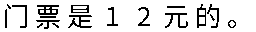
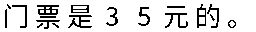

# Reading references from glyph images

Two Chinese attractions share a paragraph. It gives the price of the former and the latter. Changing only the target name produces these answer images.

| Garden | Tower |
|---|---|
|  |  |

The released reader takes a pictured question, property domain, target name and paragraph, plus a second PNG listing the candidate names. The PNGs have 32-pixel cells. Source and candidate spellings must match physically. The terminal output can include a transcription. No OCR, text tokenizer, external language model or text renderer is called to interpret the PNG inputs. The deployed reference and property models together have 567,759 parameters. CPU inference is supported.

Run at the repository root using a fresh output directory.

```bash
python -m scripts.write_referred_fact \
  --input models/story_mentions/examples/fee-2/input.png \
  --cast-image models/story_mentions/examples/fee-2/cast.png \
  --output /tmp/ilm-tower-reply
```

The output includes the sentence image, its packed glyphs and the source interval used for attribution. For a typed example, save this JSON and use `--record example.json` in place of the two input flags.

```json
{"q":"请问门票是多少钱？","domain":"景点","name":"星河塔","text":"清溪园和星河塔隔水相望。前者的门票是12元，后者收35元。","cast":["清溪园","星河塔"]}
```

The general reference reader takes a passage with a blue underline on the reference. Its output is a source name or an abstention. For example, the English target below is “Star Tower”.

```bash
python -m scripts.write_masked_mentions --order \
  --image models/story_mentions/examples/english-2/question.png \
  --cast-image models/story_mentions/examples/english-2/cast.png \
  --output /tmp/ilm-english-name
```

The fee writer searches for learned cue spellings, then restricts the paragraph when exactly two cues resolve to distinct names. For other inputs it uses the preceding property reader. The general reference reader needs a marked expression. Omitting its candidate panel uses a much weaker story-trained proposal model. The experiments use aligned printed glyphs. Scanned-book segmentation, unrestricted prompts, historical script understanding and general English answer writing are outside this checkpoint's measured capability.

## Reproduce fitting and evaluation

Use the repository's PyTorch environment with its preparation font. The training commands select the project GPU launcher. Set `ILM_MENTION_RUN` to a fresh directory to fit new checkpoints without altering the released ones. Raw source data are hashed and cached under `data/raw/`. The existing Chinese property writer and its upstream weights are needed for sentence output.

```bash
export ILM_MENTION_RUN=/tmp/ilm-mention-fit
python -m scripts.prepare_story_mentions
python -m scripts.train_story_mentions
python -m scripts.evaluate_story_mentions
python -m scripts.train_masked_mentions
python -m scripts.evaluate_masked_mentions
python -m scripts.check_mention_transfer
python -m scripts.train_story_cast
python -m scripts.evaluate_story_cast
python -m scripts.score_story_cast_pairs
python -m scripts.audit_story_cast
python -m scripts.train_reference_order
python -m scripts.evaluate_reference_order
python -c 'from scripts.write_referred_fact import export_cues; export_cues()'
python -m scripts.prepare_prose_fields
python -m scripts.evaluate_referred_facts
python -m scripts.audit_ordered_replies
python -m scripts.score_ordinal_rule
python -m scripts.check_winograd_images
python -m scripts.audit_winograd_context
```

Training data, test exclusions and both successful and failed transfer tests are described in the [result report](../../references/story_mentions_result.md). The [Chinese property writer](../prose_fields/README.md) documents the source of the generated clause structure.
