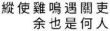
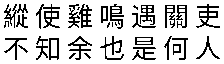
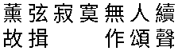
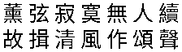

# Restore a pictured line of Tang verse

The top row is a five- or seven-glyph line. The bottom row is its damaged companion. The writer fills blank cells, preserves the supplied ink and returns a PNG. On this held example from Li She (李涉), the second line was missing its opening 不知. The model recovered both glyphs. Exchanging the top row changed its completion to 不是.

| Input page | Model output |
|---|---|
|  |  |

From the repository root, run the released checkpoint on CPU or on one CUDA device. On the shared workstation the project interpreter is `/home/lachlan/miniconda3/bin/python`.

```bash
scripts/with_ilm_gpu python -m scripts.write_verse_canvas --binding --device cuda \
  --page models/verse_canvas/examples/li-she-damaged.png --output restored.png

python -m scripts.write_verse_canvas --binding --text '一年一日雨' --output response.png
```

The page interface accepts a 160 × 64 or 224 × 64 image with 32-pixel aligned cells and dark ink on a light background. It composites transparency on white for reading and adds black strokes only at missing lower cells. For separate strips use `--input first.png --template damaged.png`. Omit the template to write from a blank second line. The writer reads image densities directly. The optional typed interface first renders a picture. Output uses 8,414 canonical training bitmaps and a length fixed by the supplied metre. Historical calligraphy, arbitrary page layouts and free-length replies require other models.

The `--binding` model learned both to recover visible shapes and to write missing ones. Omit the flag to use the original masked writer. The default decoding order fills the most confident remaining cell. Use `--order left` for the same weights with left-first filling. All four model files include the complete neural weights. A visual release needs one ink checkpoint, its manifest and the shared palette.

## What it learned

On 6,362 line pairs from 156 reserved poet attributions, the identity-supervised reader recovered 1,392/37,442 cells from a blank second line, versus 340 after exchanging the first line. It recovered 17 complete two-cell gaps and zero whole blank-line references. Reference matching measures literal restoration. The sample above is the first source-sensitive exact two-cell recovery in the fixed order. The first ordinary blank-line example generated 一里一年春 where the record reads 底事太多晴. [Full results](../../references/verse_canvas_result.md)

## Reproduce the experiment

The project downloads and verifies 58 pinned Tang poetry shards and the accompanying MIT licence. Raw texts and derived rendering caches live locally. The original digitized collection is maintained by the Chinese Poetry project. [Source revision](https://github.com/chinese-poetry/chinese-poetry/tree/b8594f81a89752241442f2ce267d6f66f96704ee) · [Corpus licence](CORPUS_LICENSE)

```bash
export ILM_VERSE_RUN="$PWD/artifacts/verse-independent"
python -m scripts.prepare_verse_canvas
scripts/with_ilm_gpu python -m scripts.train_verse_canvas
scripts/with_ilm_gpu python -m scripts.evaluate_verse_canvas
python -m scripts.audit_verse_canvas
scripts/with_ilm_gpu python -m scripts.train_verse_canvas --binding
scripts/with_ilm_gpu python -m scripts.evaluate_verse_binding
```

The fresh directory contains its own model, evidence and artifacts. Each training command fits the image and byte versions in sequence on GPU 0. The primary and confirmation cohorts use different author partitions. All evaluation PNGs and saved arrays derive from actual final weights.

## Restoring an ordered pair

The phrase-trained writers can expand eight candidate first glyphs and score the second glyph conditional on each. Use an aligned page with exactly two adjacent missing lower cells. This command starts CUDA through the project's driver launcher when run directly.

```bash
python -m scripts.write_verse_canvas --device cuda --phrase contrast --order pair \
  --page models/verse_canvas/examples/li-liu-damaged.png --output song-restored.png
```

| Damaged Song page | Output from the image writer |
|---|---|
|  |  |

On 3,854 held Song pages the contrastive writer supplied both recorded glyphs eight times. The paired control supplied both 12 times. Use `--phrase paired` to run that control. Both accept raw page images. All four continuation checkpoints and their parent identifiers are released. [Comparison and training costs](../../references/verse_contrast_result.md)

To reproduce the comparison, first prepare the original Tang corpus as above. Then run these commands in order. The first reserves the Song cases before any new fitting. Training reuses completed fit receipts after checking the checkpoint, parent weights, training corpus, held corpus and example count.

```bash
python -m scripts.prepare_verse_contrast
python -m scripts.train_verse_contrast
python -m scripts.evaluate_verse_contrast
```

The CUDA commands for pictured verse use the matching NVIDIA libraries selected by `scripts/with_ilm_gpu`. On a shared machine the kernel driver can remain at its running version after a newer user-space library is installed. The launcher also works with other project Python commands. To check device energy metering in the same environment, run `scripts/with_ilm_gpu python -m scripts.measure_writer_energy`.
