# Language in continuous image space

This compact research article separates measured visual prediction, glyph
synthesis and conditional generation. Its reading layout follows the Lamp+LCD
V-SPICE v13.7 manuscript template: a two-column article, a matching review
copy, separate Methods and Supplementary Information, and evidence figures.
The earlier 96-page research record remains in `../ilm-image-native/`.

The [change-marked article](redlined_manuscript.pdf) compares the completed
compact diagnostics with the compact-sequence draft at `97aa1588`. The
[supplement redline](redlined_supplementary_information.pdf) uses the
preserved `2ca07ea0` baseline. The [glyph-feedback builder](glyph_step_publication.py)
and earlier baselines remain available for reproduction.

## Current result

Both compact complete-sequence fits give **0/32 complete exact QA answers**
and **0/16 both-correct pairs** at all five checkpoints. The wider writer
removes a measured rank restriction but does not repair language. A frozen
diagnostic finds writing failure before generated feedback, despite near-exact
codec reconstruction. Additional sampling steps do not fix it. The reader
also has a measured affine target-alignment restriction. These results do not
establish a usable visual language model.

The current package contains a **27-page article**, **47-page review** and
**47-page article redline**. Figures 12–15 preserve the compact V1 trajectory
and fixed raw examples. [Figures 16–18](figures/Compact_diagnosis_figures.pptx)
add three editable slides with seven native measured charts and original
diagnostic glyphs. The supplied-reference diagnostic scores remain separate
from autonomous language accuracy. See the
[wider result](../../references/compact_visual_span_full_rank_result.md) and
[failure localization](../../references/compact_visual_span_diagnosis_result.md).
The 100-page supplement and 57-slide composite deck remain unchanged.

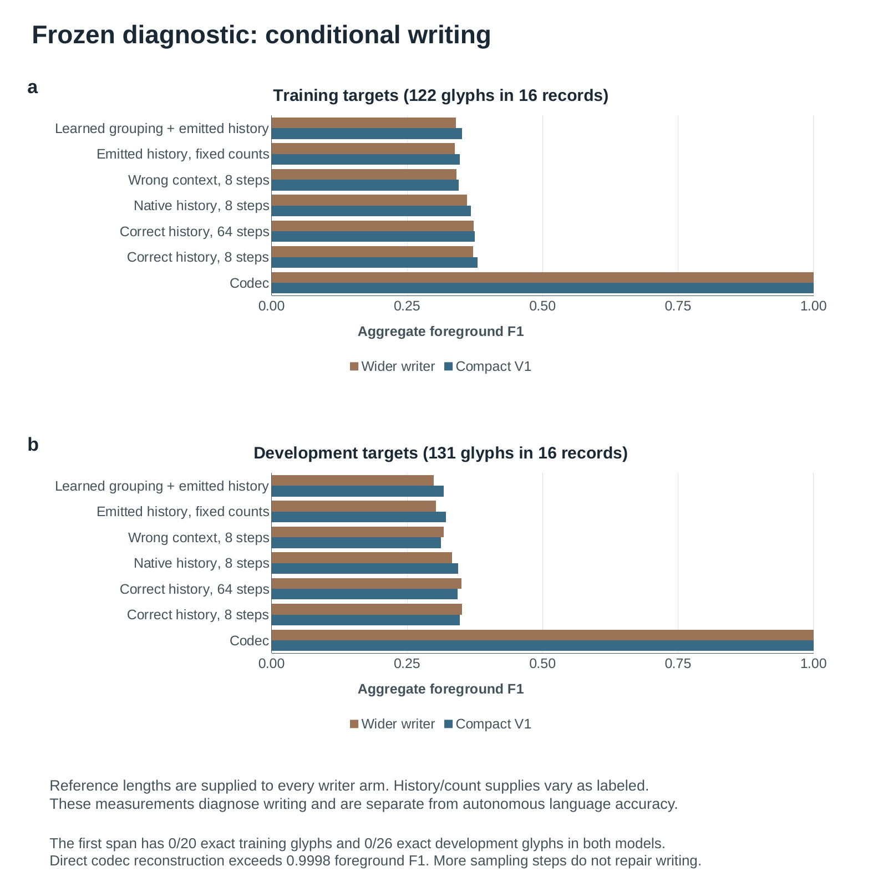

The current local delivery is `ILM_NatureStyle_20261111_CompactDiagnosis` in
Projects/ILM. Source and copy receipts verify local files, not cloud propagation.
The previous versioned packages remain available.

## Earlier restricted answer results

Contextual adaptation gives **16/32 clear complete answers versus 11/32** for
a fixed-body readout control, on sixteen reserved contexts with two questions
each. Both questions are correct in 5/16 versus 2/16 contexts. Neither arm
passes the preset answer pilot or training-pixel qualification. A subsequent
balanced writer passes physical qualification but gives **18/32 versus 19/32**
for its unchanged parent on a different new cohort; training fidelity alone
does not establish answer generalization. All actual streams, damaged glyphs,
caps, qualification results and cold-replay receipts remain available in the
[paired adaptation result](../../references/glyph_tail_paired_answers_result.md)
and [writer refinement result](../../references/balanced_glyph_writer_result.md).
**Notes 60–62 and Figures S39–S42** add the completed controls and results.

**Figure 11** records historical glyph reconstruction. Twenty of 27 selected
single-tile forms round-trip exactly through the fixed codec. The five tiled
bronze crops average 0.939 foreground F1 and retain visible stroke errors.
The figure includes actual source and decoded images. Its chart and labels
are editable in the [Figure 11 PowerPoint file](figures/Figure_11_historical_forms.pptx).

## Earlier experiments

The [512-question study](../../references/pixel_language_diversity_final_result.md)
fits **495/512 complete training answers** but **0/24 normal development
answers**. A [matched diagnostic reader](../../references/pixel_language_source_reader_result.md)
recovers literal reference answers on **12/16 Chinese questions**, using the
same image-memory fingerprints. This helper-only text baseline localizes
substantial lost capability to the learned writing interface.

The subsequent [complete-glyph loop](../../references/semantic_glyph_language_result.md)
uses a neural readout and decoder, with feedback encoded from actual emitted
pixels. It produces readable new short answers, but **11/16 broader Chinese
streams still reach the safety cap**; only one is canonical pixel-exact.
On two question templates selected from these successes,
[frozen date interventions](../../references/semantic_glyph_counterfactual_result.md)
give **11/14 clear matching output-first transcriptions**, two canonical-exact
images and fourteen natural stops. All three damaged/wrong date outputs are
retained. Manual readings are non-independent; this is restricted composition,
not general language qualification. The independent
[PNG inference interface](../../docs/semantic-glyph-language.md) loads no
training corpus, font, lexical output head or external teacher.

The runtime retains an externally pretrained **7.5B visual/contextual body**
and a **47.1M neural bridge**. The small bridge training costs exclude this
body's acquisition and pretraining. Historical scripts, English transfer,
unknown glyphs and an efficiency advantage at matched language quality remain
unvalidated. **Notes 58–59 and Figures S36–S38** report the measurements.

That earlier package contains an **18-page article, 34-page review and 100-page
supplement**, with matching redlines (34/100 pages). The composite editable deck has
**57 slides and 65 native charts**. All 53 previous slide appearances and
57 chart parts are preserved. The new figures use actual unrepaired model
outputs and editable charts with linked workbooks. LibreOffice rendering uses
Liberation Sans in place of Arial; PowerPoint-app inspection is not claimed.

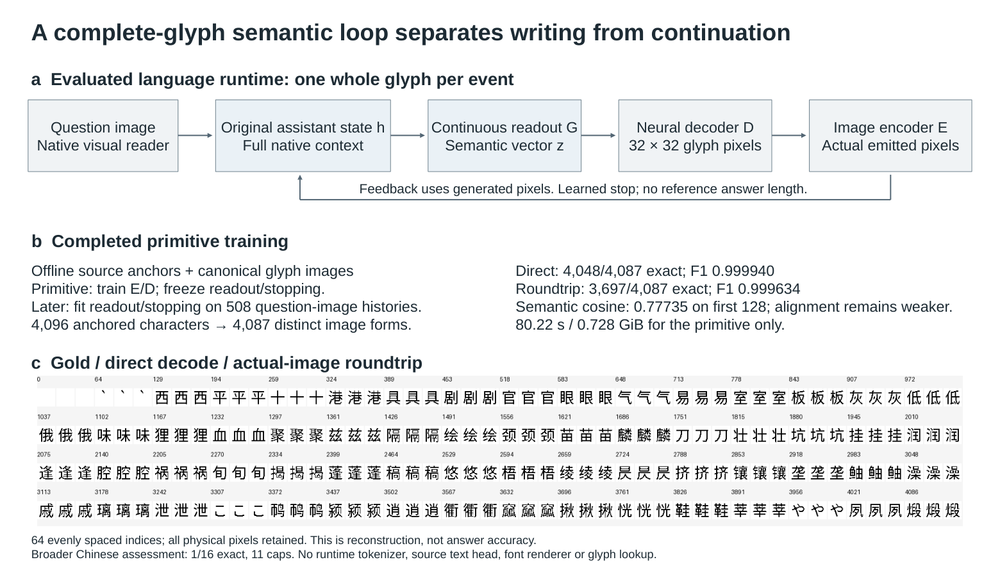

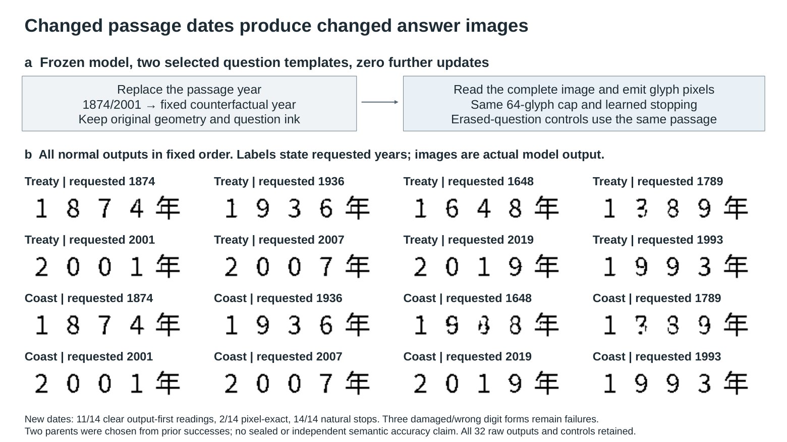

The Figure 11 source and rendered manuscript are bound by the
[build receipt](evidence/historical_forms_build.json). The local manuscript
delivery is `ILM_NatureStyle_20261111_HistoricalForms` in Projects/ILM. The
supplement and composite deck are also available in
`ILM_NatureStyle_20261111_GlyphFeedbackControls`.

The two supplement PDFs use Git LFS because their losslessly retained figure
evidence exceeds GitHub's per-file limit. After cloning, run `git lfs pull` to
retrieve them. The main article is available directly as [manuscript.pdf](manuscript.pdf).

## Earlier ink-mass and full-page controls

The [matched ink-mass comparison](../../references/ink_mass_comparison_result.md)
gives **18/32 seen and 19/32 held-out OCR-exact copies**, including **6/16
held-out Chinese**, versus 16/32, 16/32 and 4/16 in control. Both arms use
identical weights, optimizer states, examples and noise for 32 updates; only
the physical loss changes. All three prospective exploratory conditions pass,
but raw omissions, repetitions and copied instructions still reject reliable
writing. This single schedule uses development data already inspected.
**Note 50 and Figure S27** distinguish the numerical loss audit from actual
model improvement. Neither arm trains or evaluates natural QA.

The [full-page preflight](../../references/native_paired_language_preflight_result.md)
reconstructs four complete 1024-square pages with 97.834–98.180% foreground F1.
Two actual gradient updates fit at **12.203 GiB**, then are discarded.
Independent inference reloads the fixed earlier checkpoint: **0/4 normal
questions** are answered correctly, and all four erased-input controls fail.
**Note 51 and Figure S28** report execution feasibility and this failed small
baseline; they do not establish semantic learning.

The earlier [balanced continuation](../../references/balanced_autonomous_writer_result.md)
gets 13/32 seen and 17/32 held-out copies, including 4/16 held-out Chinese.
Its Chinese and seen-retention conditions fail. The separate
[additional-training control](../../references/autonomous_writing_control_result.md)
gives 5/32 seen and 10/32 held-out copies. Note 49 retains both results.
Its case-026 description is corrected: the balanced output already has one
line; the duplicated-line example belongs to the earlier pilot. No measured
score or output pixel changes.

This earlier runtime retains an externally pretrained **3.900B transformer
plus 84.046M VAE**. Its 24.359M trained adapters do not establish a small
foundation model. The independent image-language goal remains unachieved.

That earlier package contains a **16-page article, 29-page review and 68-page
supplement**, with matching redlines (29/68 pages). The editable deck has
**43 slides and 51 native charts**. All 41 prior slide parts and appearances,
130 prior figure assets, the first 57 supplement pages and old Figure S26
on page 59 are preserved. Page 58 is the explicit factual-correction exception.

Its historical entry points, run from this directory, are:

```bash
python ink_mass_writing_figures.py --stage generate
python ink_mass_writing_figures.py --stage verify
python ink_mass_writing_figures.py --stage render
python build_ink_mass_writing_publication.py --stage build
# After actual PDF/PNG inspection and its bound visual-review receipt:
python build_ink_mass_writing_publication.py --stage sync
```

The new slides use native editable charts, embedded workbooks and unchanged
actual evidence pixels. Only declared reference whitespace and a question
inset are cropped; every displayed model output is complete. Rendering uses
LibreOffice; Arial is substituted with Liberation Sans. Artifact Tool and
PowerPoint-app inspection were unavailable. Earlier builders retain historical
slide counts and must not overwrite the current 53-slide deck.

Local delivery uses `ILM_NatureStyle_20261108_InkMass` and five `LATEST`
aliases in the ILM Nutstore project folder. Source/destination hashes verify
local copying; cloud propagation is not independently verified.

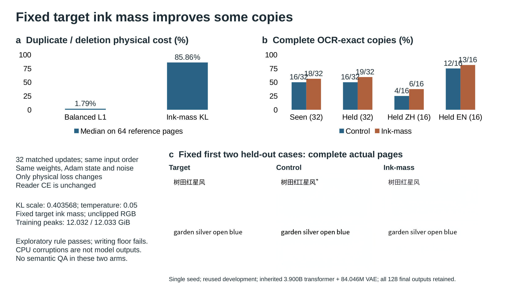

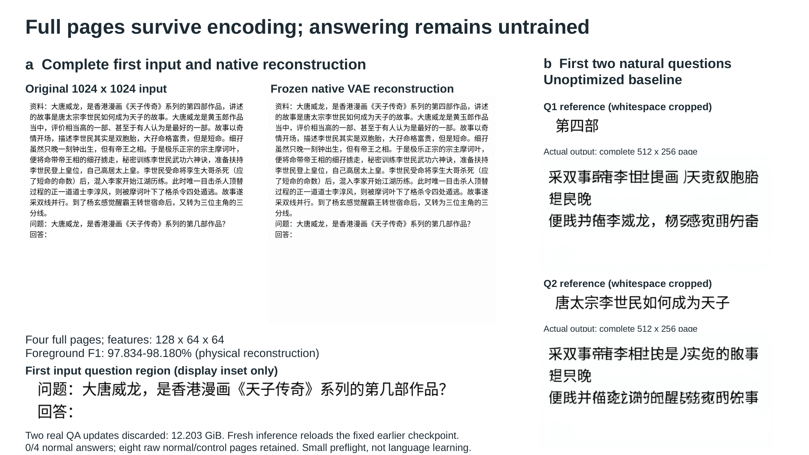

## Earlier contextual reading and history controls

The independent image-language goal remains unachieved. In the completed
[matched contextual-learning comparison](../../references/contextual_pixel_adaptation_result.md),
control and adaptation copy **32/32 new Chinese/English strings**, but answer
only **23/64 and 26/64 unseen Chinese questions** exactly. Both solve both
questions in just **3/32 paragraph pairs**. Both fail the natural-answer and
paired-answer requirements; gains of three answers and zero complete pairs
miss the prospective improvement rule. Outputs remain original source crops,
so this component cannot compose answers absent from its input.

Each arm completes **3,257 updates and 13,028 training draws**. The complete
runtime retains **7.531B externally pretrained parameters**; control learns
2.378M head parameters and adaptation learns 8.572M head/attention parameters.
Optimization takes 126.665 and 30,856.570 seconds on one RTX 4090 D, excluding
source preparation and external pretraining. The
[execution receipt](evidence/contextual_pixel_adaptation_execution_notes.json)
separates measured stage costs from incomplete assessment/reload timing.
All 512 raw answer images are independently reconstructed and scored; eight
standalone calls reproduce pixels and events exactly. None of these checks
establishes free writing or an efficiency advantage at matched language quality.

The separate [earlier-head memory substitution](../../references/contextual_query_memory_result.md)
changes 53/64 development selections while its original score remains 9/64.
These are hybrid features, not native new prompts. The
[history-prefix audit](../../references/history_prefix_alignment_result.md)
finds only 2/75 intermediate image boundaries with matching saved helper
states. It makes no new neural calls and tests no alignment repair.
**Notes 45–46 and Figures S22–S23** retain both diagnostics, all comparison
counts, original example rasters and their limitations. The earlier source-pixel
result remains in Note 44/Figure S21 and is distinct from the new control.

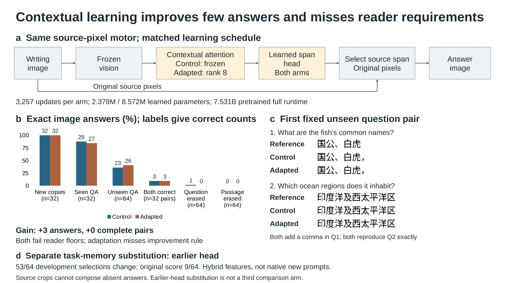

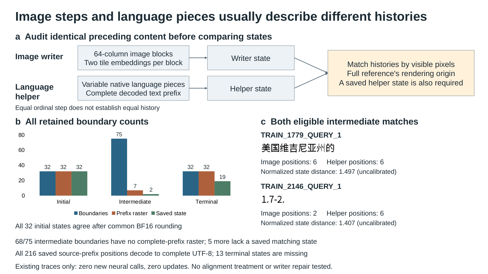

## Earlier state and canvas controls

The [completed visual-state learner](../../references/native_state_alignment_result.md)
improves English QA from **11/32 to 16/32** and English copying from **7/16
to 16/16**, while Chinese QA remains **0/32** and copying **0/16**. Four of
six reader requirements fail. A [seen-prompt check](../../references/native_state_fit_result.md)
corrupts every one of eight tested Chinese training strings.

A separate [attention-only learner](../../references/native_reader_attention_result.md)
keeps the calibrated dense visual frontend fixed and trains 4,358,144 new
attention parameters. Its complete 2,560-update run retains **29/32 copies**
(13/16 Chinese, 16/16 English), but leaves QA at **0/32 in both languages**.
All six requirements fail. These are auxiliary Unicode-head observations;
no continuous image-answer model is qualified.

The [fixed-weight canvas control](../../references/native_canvas_control_result.md)
replays all 160 original responses exactly. Adding only white bottom padding
to the original 1024-by-256 copying strips reduces copying from **29/32 to
7/32**, with Chinese falling from **13/16 to 0/16**. Tight whole-request
cropping also fails, despite retaining every ink pixel. Layout changes affect
features and context jointly; their unique internal cause is not isolated.
The [earlier native-scale English recovery](../../references/native_reader_geometry_result.md)
and all preceding failures remain in Notes 41–42.

The subsequent [128-call feature/context intervention](../../references/native_canvas_factorization_result.md)
replays all 64 original strip/square responses before its hybrids. Square
top features in the short context still give **0/16 Chinese and 6/16 English
copies**. Strip features in the long context give **2/16 Chinese and 16/16
English copies**. Shortening context alone fails, and restoring the strip
feature block alone is insufficient for Chinese in this layout. Note 43
retains all four arms and their limitations; the hybrids need not encode
real images. No natural QA or image answers are measured in this comparison.

The earlier observations remain in Note 43 and Figure S20. Historical entry
points are `state_alignment_figures.py` and
`build_state_alignment_publication.py`. Their 35-slide package is preserved
in Git and its named local delivery; use the current entry points above.

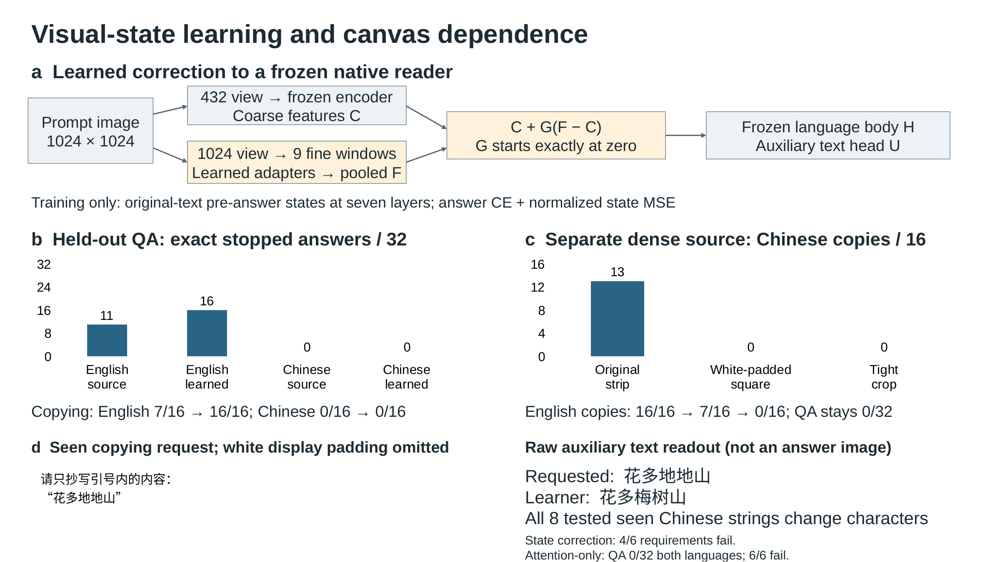

## Earlier paired copying

The completed [native paired-copying comparison](../../references/paired_padding_result.md)
still fails reliable writing: **6/32 training and 10/32 validation strings**
are OCR-exact, with visible omissions and repetitions. Clean references score
27/32 and 28/32. Reducing white input padding lowers one 512-update training
invocation from 795.624 to 287.182 seconds, while changing VAE features.
There is no QA optimization in these runs and no language-efficiency claim.
The abstract, article, Note 40 and Figure S17 report the result and retain all
64 raw outputs. That historical editable deck contains 32 slides, preserving all
31 previous native slides and 73 earlier figure assets. Its entry points
are `paired_writing_figures.py` and `build_paired_writing_publication.py`;
use the geometry builders above for the current package.

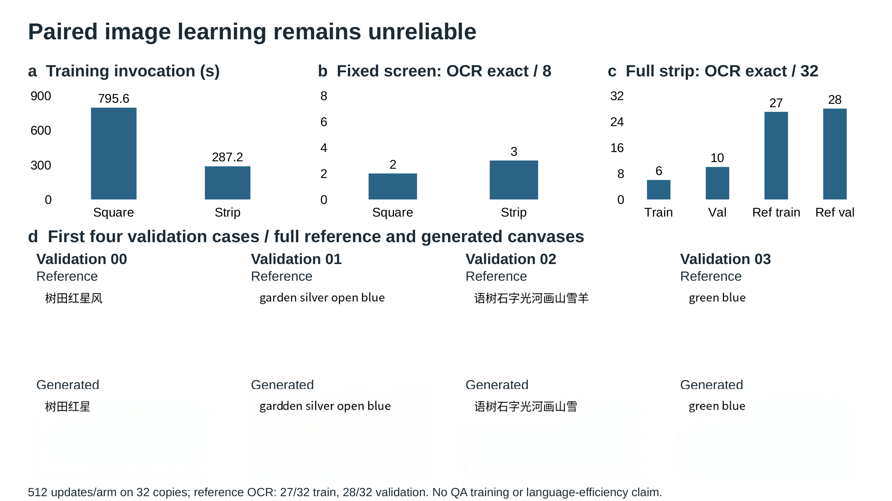

The [matched decoder-sensitive comparison](../../references/decoder_metric_v82_result.md)
fails all four original repair criteria. Both arms retain **0/32 exact
autonomous answers** on seen training questions. The added loss lowers
foreground F1 from **85.984% to 70.009%**; correct history gives 92.430% and
75.116%, while supplied-code reconstruction remains 99.9953%. The abstract,
article, Note 39 and Figure S16 report this failed result and reject scaling
the repair. That historical deck has 31 slides, preserving its 30 earlier native
slides and 70 earlier figure assets. Its historical entry points are
`decoder_metric_figures.py` and `build_decoder_metric_publication.py`; use
the visual-access builders above for the current package.

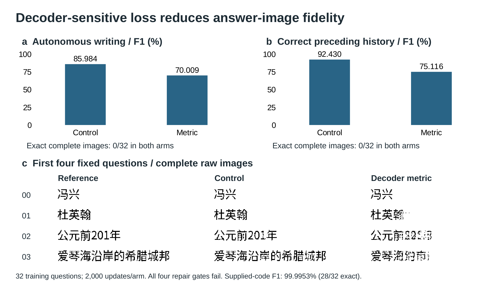

The [matched readout repair](../../references/adaptive_readout_v81_result.md)
also fails. On the same 32 training questions, control and adapted models
produce **0/32 exact autonomous images**, at **71.177% and 72.748% foreground
F1**. Correct-history prediction reaches 77.372% and 79.629%, again without
any exact complete images. Supplied-code decoding remains at 99.9953% and
28/32 exact images. Note 38 and Figure S15 retain this rejected comparison,
its separate evaluation amendment and the first four unmodified outputs.
Its historical builders are `readout_failure_figures.py` and
`build_readout_failure_publication.py`, for that 30-slide package. Use the
visual-access builders above for the current deck and PDFs.

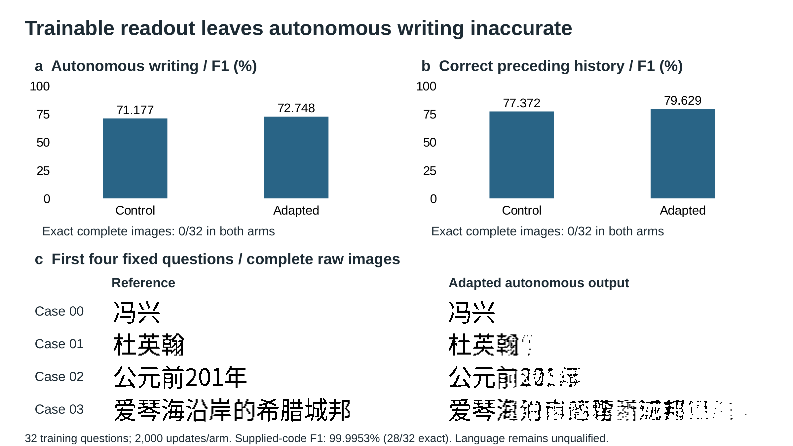

The completed [native-context model](../../references/native_chinese_v80_result.md)
fails after 40,000 updates over 3,193 Chinese examples: **0/128 exact Chinese
development images**, **36.504% foreground F1**, and **0/64 both-correct pairs**.
Question erasure gives 25.404% F1. On the fixed 32 training questions,
correct-history prediction still gives 0/32 exact images and 50.241% F1,
compared with 99.9953% from supplied-code reconstruction. Note 37 and Figure
S14 report this failure, with native editable charts and unmodified output
images. Its historical builders are `native_failure_figures.py` and
`build_native_failure_publication.py`. These are image-agreement measurements,
not a separately measured semantic accuracy score.

The earlier [context-visibility diagnostic](../../references/native_context_v80_result.md)
is retained in Supplementary Note 36 and Figure S13. Masking older source
keys reduces exact copy/training answers from 8/12 and 19/32 to 0/12 and 2/32.
The figure also shows the implemented native-context image actor, explicitly
labelled as its original untrained execution check. The subsequent trained
native actor also fails, as reported above. The earlier builders
`native_context_figures.py` and `build_native_context_publication.py` remain
historical entry points for that execution/visibility package.

The full clean writer fails after 40,000 updates on all 12,976 admitted
examples: **2/128 exact Chinese answers**, **37.631% foreground F1**, and
**0/64 both-correct pairs**. All 12 new Chinese/English/numeric copying
requests fail. The full model also produces no exact answers on the earlier
32 training questions, even with correct preceding answer codes and supplied
answer length. Supplied-code rendering reaches 99.9953% F1. The abstract,
article and Note 33 report these failures separately from the small-set fit.
See the [full result](../../references/clean_corpus_v75_result.md) and
[writing diagnosis](../../references/corpus_fit_v75_result.md).
The matched denoising-time repair also fails: assisted near-clean fidelity
improves, while free-answer F1 falls from 48.726% to 45.028%, with no exact
answers in either arm. Note 34 retains both outcomes and the rejected decision.

The offline source-reader diagnostic recovers **8/12 exact copy answers** and
**19/32 exact training answers** from the same images, with all 44 prefill
memories matching the failed image actor. Later source decoding uses full KV
history; the compact image-writer memory has not been shown sufficient.
Note 35 and Figure S12 report this boundary, with both native count charts and
an editable diagram. Its historical build entry point is
build_reader_content_publication.py; reader_content_figures.py appends and
verifies slide 27 while preserving all earlier 26 native/canonical slides.

Numeric source-derived task controls retain bounded image reading in the
imported vocabulary-free contextual body: four of eight checked Chinese
answers are exact at the declared native sampling budget, versus zero with
question ink erased. A separate temporary text projection produces these
diagnostic answers. All 742 helper projection decisions replay exactly;
the whole visual forward pass is not independently replayed. This is reader
evidence, not successful image writing. Supplementary Note 29 reports the
full comparison and limitations.

A 38.65M-parameter causal velocity writer completes 40,000 updates on all
12,976 examples and fails the original autonomous audit: 0/128 exact Chinese
answers, 29.386% foreground F1 and four failed requirements out of six.
Supplementary Note 30 reports the completed pipeline. Note 31 derives an
affine-span obstruction that leaves 767 noise directions and records its
CPU numerical check. Full-dimensional velocity repairs still fail a fresh
known-image control. Clean-code prediction then reproduces one learned
Chinese image exactly on 256 fresh noise draws.

The complete clean writer subsequently learns 32 seen training questions,
producing 29 original answer images exactly and 31 frozen-codec reference
images exactly, with 99.9967% original-image F1. It stops correctly on all
32. This is learning capacity after 2,000 training-set passes, not unseen
reading comprehension or a useful general ILM. Note 32 specifies selection,
objective, numerical sampler, inference, independent scoring and costs.
The paper keeps the rejected development result separate from these narrow
generation and memorization controls.

Figure S10 retains the measured reader comparison and helper boundary.
Figure S11 retains the actual failed velocity computation, with its status
corrected to the completed result. Both remain native editable slides.
All preceding 25 slide parts and canonical appearances are preserved.
The [figure verifier](verify_semantic_transfer_figures.py) checks source
scores, chart workbooks, native parts and rendered figures. The
[earlier publication builder](build_clean_writing_publication.py) authenticates
the completed experiment receipts and rebuilds all five paper/redline PDFs.

A complete conditional-writing actor finishes 10,000 updates on all 12,976
admitted Chinese/English instruction examples. It adapts 9.352M of 7.539B
parameters on one RTX 4090 D, peaking at 16.965 GiB allocated memory. The fixed
autonomous audit fails: 0/128 exact Chinese answers, 32.671% foreground F1 and
0/64 complete question pairs. Question pixels have a resolved 13.163-point
effect [10.933, 15.730], and all 128 normal Chinese outputs stop through the
learned decision. Three answer-quality requirements fail; input dependence
and stopping do not qualify language. Figure 10 and Supplementary Note 27
show the original six decisions and the complete first two raw outputs.

A frozen 32-case diagnosis finds poor prediction even with exact history
and known answer length, including on training examples. Supplied-code F1 is
99.95–100%, while assisted prediction reaches only 21.8–35.6%. No first predicted
block is exact. Figure S9 and Note 28 localize a failure preceding generated
history without identifying a unique repair. The diagnostic makes no optimizer
updates; CPU verification checks retained tensors and pixels rather than
independently replaying the native neural forward pass. Development data are
reused; sealed evaluation remains unopened. External foundation pretraining
and prior codec learning are outside the reported local adaptation cost.

A separate continuous output space qualifies supplied-code reconstruction.
The original frozen writing codec reaches 99.998% foreground F1 and 126/128
exact development blocks, versus 21.413% F1 with shuffled codes. The broader
direct writer fails fidelity at 56.563% and 3/128 exact blocks, despite fitting
63/64 training blocks in a smaller diagnostic. Figure 9 and Notes 24–25 show
the actual training/development distinction and the first fixed raw images.
The two native charts retain editable, source-matched workbooks.

The complete actor connects contextual states to those separate writing
coordinates. It retains 7.539B total parameters, trains 9.352M, and passes all
24 GPU execution checks at 16.953 GiB peak allocated memory. Figure S8 and
Note 26 give the image-only feedback loop, detached target-code supervision,
loss and numerical checks. Two-update output remains fragmented. These are
execution and reconstruction results; autonomous language is unqualified.
That revision extends the deck to 24 slides, preserving all preceding 22 slide
renders and original slide/chart parts. Three native charts have source-matched
embedded workbooks. Earlier source figures remain unchanged.

A matched question--answer assignment term weakens free image writing.
Control and aligned actors each train 490M parameters for 2,000 updates from
identical weights and sample draws. Exact answers are 2/256 and 1/256; neither
arm has a fully correct pair among 393. Raster F1 is 3.229% and 2.417%, with
aligned minus control -0.812 percentage points, 95% article-bootstrap interval
[-1.504, -0.202]. Both question effects resolve positively, but both absolute
reading gates fail. Figure 8, Supplementary Note 22 and native slides 18–19
show the method, paired uncertainty and first two unrepaired answers.

A separate inherited 7.548B actor passes complete execution checks at
17.181 GiB with 25.58M trainable parameters and no deployed vocabulary module.
Its writer-only 10,000-update test fails reconstruction: 34.000% foreground F1
under correct image conditions versus 21.420% shuffled, zero exact blocks.
This does not qualify prompt-to-answer language. Figure S7, Note 23 and native
slide 20 distinguish the executed mechanism from language capability. All
256 raw writer image scores were independently recomputed. Local 4090 work
does not include external foundation pretraining.

A matched conditional bitmap mixture improves pixel fit while failing the
language gates. K=8 lowers held-out NLL to 0.1248 versus 0.1542 for K=1 and
raises strict-raster F1 from 0.234% to 0.815%. Both have zero exact primary
answers and zero both-correct question pairs. The K=8 question effect remains
unresolved, so the registered density intervention and both reading gates
fail. Both standalone offline bundles reproduce their outputs exactly.
Figure 7, Supplementary Note 21 and native editable slides 16–17 give the
probability law, mechanism, full comparison and first two raw answers.
The complete V61 package is preserved in `baselines/v61/`.

The auxiliary vision reader passes reference calibration but returns three
invalid actor responses, so its original fixed-case diagnostic fails.
An explicitly post-hoc table in Supplementary Note 21 bounds every missing
score without dropping cases: K=8 has zero exact transcript agreements and no
resolved character-accuracy question effect. The primary rejection is unchanged.
The earlier primary-only V62 package is preserved in `baselines/v62-primary/`.

Full native image-language adaptation now provides a free-writing test. All
477.15M externally pretrained parameters receive answer-image gradients for
1,000 updates on one RTX 4090 D, taking 1,501.1 seconds at 9.912 GiB allocated
memory. Held-out pixel NLL improves from 0.6842 to 0.1548 nats, yet exact answers
remain 0/256 and both-correct pairs 0/393. Raster F1 is 0.149%; raw answers
remain fragmented. Five of ten gates pass, and the registered reading decision
is rejection. Independent native-PNG export/replay passes. Figure 6,
Supplementary Note 20 and editable slide 15 report the failure without output
repair. V60 is preserved in `baselines/v60/`.

Complete observed image blocks improve answer structure. The 19.60M model
answers 25/256 questions exactly (9.766%), versus 3/256 blanked-question and
21/256 matched additional glyph-answer training. Raster F1 is 27.033%; its
4.893-point gain over the matched control has interval [0.469, 9.047], while
the exact-answer difference remains unresolved. Only 4/393 paragraph pairs
have both answers correct, failing the registered paired gate. Figure 5,
Supplementary Note 17 and slide 12 show the law, scores and raw first answers.

Two registered interventions also fail. Frozen MIXAR features give 6/256
exact answers and 11.588% F1, versus 24/256 and 25.340% on frozen student
features. This shifted-interface probe does not rank native encoder quality
or count external pretraining as local work. Moving the question first gives
21/256 exact answers and 23.765% F1, versus 27/256 and 26.908% for matched
context-first continuation; the difference is unresolved. Supplementary
Notes 18–19, Figures S5–S6 and slides 13–14 report both negative results.
All local phases use only physical GPU 0. The general language goal remains
unachieved. The V57 baseline is preserved in `baselines/v57/`.

Grounded visual reading now provides a direct language-use test. The 19.01M
copy/raster model answers 10/256 held-out natural questions exactly, versus
1/256 with question pixels blanked and 0/256 for matched no-copy training.
Raster F1 is 15.718%; its question-dependent gain is 10.165 points
[7.043, 13.371]. Only 1/393 shared-paragraph question pairs has both answers
correct. The reading model fails three of seven gates and remains rejected.
Figure 4, Supplementary Note 16 and slide 11 show the full comparison and
unselected raw failures. V56's readable baseline remains in `baselines/v56/`.

With unchanged V55 weights, raw-pixel beam search improves exact next-image
match from 8.252% greedy to 11.621% on 2,048 prefixes. Earlier-history shuffling
reduces beam accuracy to 9.863%. All beam outputs exactly match a canonical
form, but eight-step visible feedback repeats adjacent images at 25.446%,
against 0.112% in the observed futures. The decoder fails its rollout gate and
remains rejected. Supplementary Notes 14–15, Figures S3–S4 and slides 9–10
separate form validity, immediate choice and sequence failure. V55's readable
baseline is preserved in `baselines/v55/`.

Joint reader–density learning improves held-out exact image NLL to 7.026
nats/glyph versus 7.579 for a matched frozen-reader continuation. The paired
gain is 0.553 nat, 95% source-record interval [0.450, 0.665]. Both arms start
from identical V54 EMA weights and make 8,000 additional updates. Joint training
takes 342.4 seconds at 0.648 GiB allocated CUDA memory on one RTX 4090 D,
excluding earlier foundation training. Greedy supplied-image copying remains
exact on 256/256 targets.

Autonomous language remains unqualified: joint first-sample identity is 9/256
ordered versus 8/256 earlier-shuffled and 6/256 for the matched frozen control.
The joint model passes six of eight unchanged gates, failing sampled quality
and ordered generation. Supplementary Note 13, Figure S2 and the final two
editable slides report both arms and raw images. The readable V54 baseline is
preserved in `baselines/v54/`.

## Exact-density baseline

An exact autoregressive raster density now preserves all 256 supplied images
under greedy copying, with stochastic-copy F1 0.99949. The independent runtime
has 18.71M parameters, with 2.43M new density parameters trained for 8,000
updates in 207.8 seconds on one RTX 4090 D (0.400 GiB peak allocated memory,
excluding earlier reader training).

Autonomous language still fails the locked audit. Natural-target NLL is
15.219 nats/image ordered versus 15.254 shuffled; the paired advantage has
95% source-record bootstrap interval [-0.1014, 0.1693]. First-sample identity
is 4/256 ordered versus 3/256 shuffled. The post-generation evaluator contains
9,932 distinct images and covers every target. Copying and low teacher-forced
image NLL do not establish useful language generation.

The earlier direct diffusion result remains reported: 22.18M total parameters,
8,000 updates in 361.6 seconds, first-position identity 3/256 ordered and
shuffled, and block identity 0.586% versus 0.488%. Figure 3 adds the exact-density
result without replacing Figures 1–2. Compact V53 article/review/supplement
baselines remain in `baselines/v53/`.

## Reading and editing

| File | Purpose |
| --- | --- |
| `manuscript.pdf` | Compact reading copy |
| `manuscript_review.pdf` | Matching line-numbered review copy |
| `supplementary_information.pdf` | Complete method, metric limits and reproducibility |
| `ILM_Figures_editable.pptx` | Native diagram shapes and bar chart with embedded workbook; raw glyphs remain images |
| `ILM_Figures_review.pdf` | Verified twenty-four-slide LibreOffice rendering |
| `redlined_manuscript.pdf`, `redlined_supplementary_information.pdf` | Matching change-marked review copies |
| `frontmatter.tex`, `article_content.tex` | Article summary and scientific content |
| `figures/` | PDF, PNG and SVG evidence figures |
| `evidence/` | Reports with local paths normalized for delivery and source hashes |

The deck is checked through LibreOffice export and package inspection. Native
PowerPoint application playback is not part of that check. The title, narrative
and tables describe a research draft, not an accepted Nature publication.

## Rebuild

From the repository root, after the corresponding source artifacts are present.
Earlier figure builders below reproduce their historical packages; the final
V68 builder appends to the immutable V67 baseline:

```bash
python publication/ilm-nature/generate_evidence.py
python publication/ilm-nature/generate_v54_evidence.py
python publication/ilm-nature/generate_v55_evidence.py
python publication/ilm-nature/generate_v56_evidence.py
python publication/ilm-nature/generate_v57_evidence.py
PYTHONPATH=. python publication/ilm-nature/generate_reading_interventions.py
PYTHONPATH=. python publication/ilm-nature/generate_native_pixel_evidence.py
PYTHONPATH=. python publication/ilm-nature/generate_native_pixel_editable_figures.py
PYTHONPATH=. python publication/ilm-nature/generate_correlated_density_evidence.py
PYTHONPATH=. python publication/ilm-nature/generate_correlated_density_editable_figures.py
PYTHONPATH=. python publication/ilm-nature/generate_transcript_bounds_evidence.py
CUDA_VISIBLE_DEVICES='' PYTHONPATH=. python publication/ilm-nature/generate_assignment_evidence.py
CUDA_VISIBLE_DEVICES='' PYTHONPATH=. python publication/ilm-nature/generate_assignment_editable_figures.py
CUDA_VISIBLE_DEVICES='' PYTHONPATH=. python publication/ilm-nature/generate_codec_language_figures.py
bash scripts/latex_build.sh publication/ilm-nature/manuscript.tex
bash scripts/latex_build.sh publication/ilm-nature/manuscript_review.tex
bash scripts/latex_build.sh publication/ilm-nature/supplementary_information.tex
CUDA_VISIBLE_DEVICES='' python publication/ilm-nature/build_codec_language_redlines.py
```

Render the deck through LibreOffice, inspect it, and refresh the render receipt
before running `validate_and_sync.py`. That script refuses a deck or PDF whose
hash has changed since review, checks the twenty native charts and their preserved
or source-matched workbooks, and
verifies the delivered copies byte for byte.
`PYTHONPATH=. python publication/ilm-nature/verify_native_pixel_rasters.py`
also checks the six PDF and four PowerPoint raw images against their source
bits and confirms that the prior fourteen slides remain unchanged.
`PYTHONPATH=. python publication/ilm-nature/verify_correlated_density_rasters.py`
checks six additional PDF and six PowerPoint rasters against the V62 source
bits and confirms that all fifteen V61 slide XMLs remain unchanged.

`generate_evidence.py` checks the locked checkpoint identity before producing
values and figures. Source code, checkpoint hashes and frozen protocols are
recorded in the run report. Experimental code resides in `scripts/` and
`ilm/visual_lm/`. Data and model weights remain outside the publication package.

`CUDA_VISIBLE_DEVICES='' PYTHONPATH=. python publication/ilm-nature/verify_assignment_publication.py`
checks six source-exact PNG, PDF, PPTX and deck-PDF images, both new chart caches,
workbooks and paired intervals, and preservation of every earlier deck part
except global slide registrations. It also compares earlier slide rendering.
Use lossless PDF image compression and disable resolution reduction when
rendering the deck. The Artifact Tool runtime is unavailable locally; the
new builder edits OOXML directly without python-pptx authoring.

The twenty-four-slide editable deck retains earlier plates and adds native
block-reading, frozen-foundation, input-order and conditional-density charts,
editable mechanism shapes and actual answer images. Current
validated copies are delivered to Nutstore `Projects/ILM/` under the
`ILM_NatureStyle_20261105_V68_Conditional` version
folder and stable `LATEST` aliases. Local checksums verify copying; remote cloud
synchronization is not independently confirmed.

The current verification entry point is
`CUDA_VISIBLE_DEVICES='' python publication/ilm-nature/verify_codec_language_publication.py`.
It binds all three current evidence receipts to pinned hashes, verifies the
229-file baseline against its source Git commit, checks all 22 prior rendered
slides, compares the three new editable charts with their source numbers and
matches every displayed writing raster in the deck, standalone figures,
article, review and supplement. Historical validators retain their original
slide-count assumptions and should be run on their corresponding baselines.
Lossless LibreOffice export disables image-resolution reduction. Artifact Tool
is unavailable locally; native OOXML authoring and LibreOffice rendering are
used, with no native PowerPoint playback claim.

The independent checkpoint export and native-image CLI are described in
[`exact_raster_density_v54_result.md`](../../references/exact_raster_density_v54_result.md).
The output retains the scope of the tested task. Chinese instruction following,
historical writing, etymology, multiple fonts, page-scale generation and
capability-matched text-model efficiency remain open requirements.

[Training and native-image inference guide](../../docs/exact-raster-language.md)
and [matched V55 result](../../references/joint_exact_raster_v55_result.md)
give complete code entry points, checkpoint hashes and qualification limits.

Supplementary Note 12 and Figure S1 report a separately planned, post-result
context diagnostic. Swapping the entire condition between source records
raises NLL to 20.630 nats/image; the ordered advantage is 5.411 nats with
95% interval [4.514, 6.416]. Earlier-history shuffling still has no resolved
whole-image effect. Context sensitivity does not reverse the failed generation
decision. Raw row losses and the reproducible diagnostic entry point are
described in [`v54_context_attribution_result.md`](../../references/v54_context_attribution_result.md).
