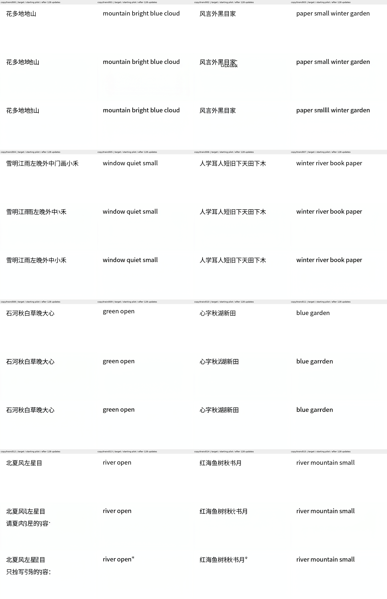
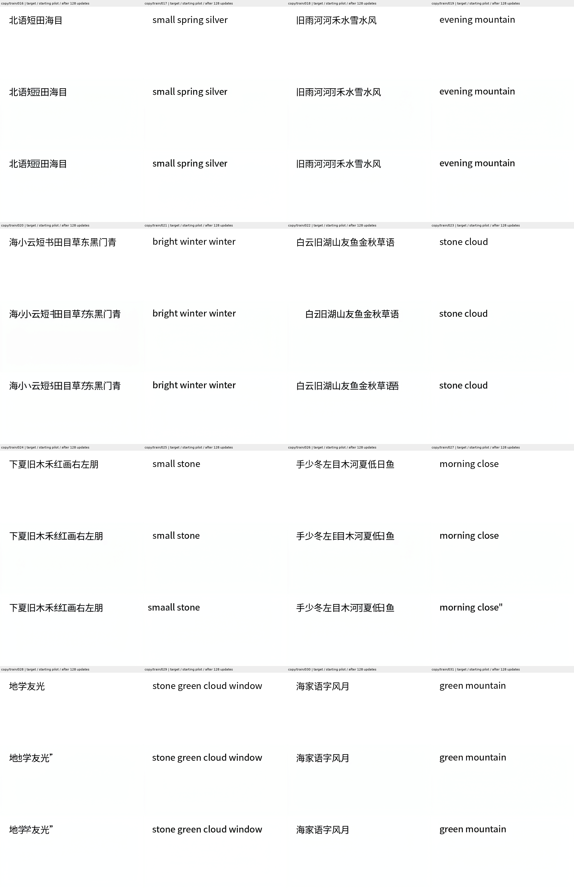
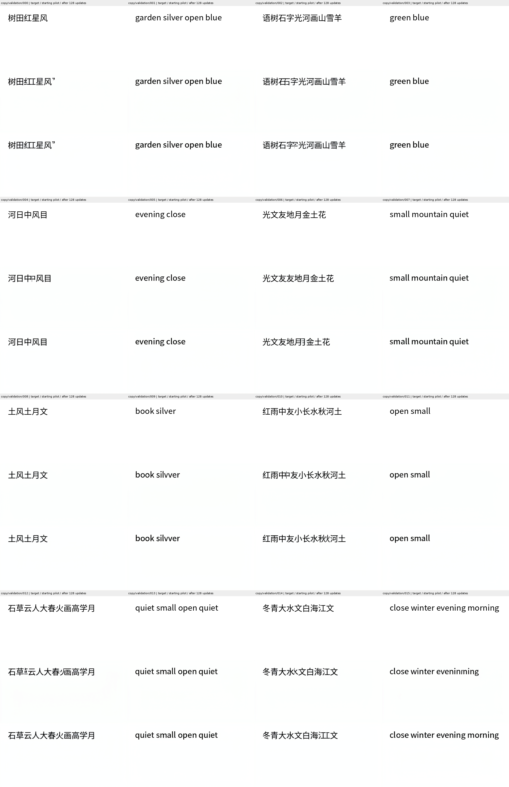
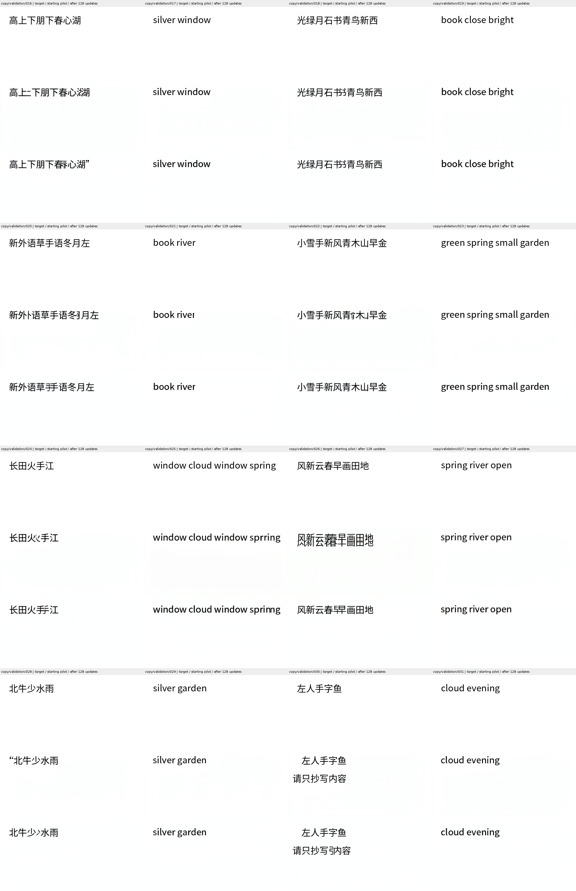

# Balanced exposure does not establish reliable image writing

The registered 128-update continuation is complete. Held-out OCR-exact copies
increase from 13/32 to 17/32, but seen copying falls from 15/32 to 13/32.
Held-out Chinese improves from 3/16 to 4/16. Two of the three continuation
requirements fail. Do not scale this unchanged recipe on the strength of the
aggregate held-out gain. No semantic question answering was trained or evaluated.

| Independent OCR observation | Starting pilot | Balanced continuation |
| --- | ---: | ---: |
| Seen, all | 15/32 | 13/32 |
| Held out, all | 13/32 | 17/32 |
| Seen Chinese | 3/16 | 4/16 |
| Held-out Chinese | 3/16 | 4/16 |
| Seen English | 12/16 | 9/16 |
| Held-out English | 10/16 | 13/16 |

The prospective rule required at least 6/16 held-out Chinese, at least 15/32
seen strings, and at least 10/16 held-out English. Only the English requirement
passes. The unchanged writing floor requires 30/32 correct, legible requested
strings alone in each split; it also fails. OCR counts are not manual accuracy.
Clean-reference calibration remains 27/32 seen and 28/32 held out.

All 64 final outputs were inspected in original-order target/starting/final
galleries. Selected failures were also inspected at original size. Seen case
004 omits characters; case 012 copies instructions; case 025 repeats a letter
in `small`. Held-out case 000 has an extra quotation mark, 002 repeats a
character, 026 duplicates a line, and 030 copies instructions. More than two
obvious failures in each split independently reject the writing floor. These
are unrepaired model pixels, not typeset substitutes.

The seen OCR changes are one gain (002) and three losses (003, 025, 027).
Held-out changes are five gains (007, 015, 022, 023, 028) and one loss (010).
Some changes can reflect font recognition. These observations do not establish
new semantic knowledge, historical-script understanding, or language generation.

## What actually ran

The [protocol](balanced_autonomous_writing_protocol.md) continues the pilot's
weights and AdamW state for four complete permutations of the same 32 examples:
exactly four updates per input, 64 Chinese draws and 64 English draws. It uses
the unchanged final-image objective, all 50 native Euler steps, guidance one,
and a 512×256 output. Input encoding matches native BF16 autocast. Targets
enter the losses after generation; independent noise starts each trajectory.
There are no natural-question examples in this training set.

All 128 updates completed with finite nonzero gradients. All 206 adapter
tensors changed; the base transformer, VAE and training reader stayed frozen
without parameter gradients. The first two native starting trajectories and
the first actual differentiable forward reproduce retained pilot pixels
exactly. The first checked prediction-gradient norms at steps 0, 24 and 49
are 0.020289, 0.024817 and 0.145401. These are execution checks, not language
performance. Every optimizer state reaches step 160, counting the pilot's 32
updates. No resume or reroll was used.

Training takes **4,500.117 s** with **12.032 GiB** peak allocated GPU memory.
Separate 64-case native inference takes **512.959 s** at **8.031 GiB**.
These exclude earlier training, acquisition and separate CPU OCR. The runtime
retains an externally pretrained 3,899,903,488-parameter transformer including
24,358,912 locally trained adapter parameters, plus an 84,046,115-parameter
VAE. The 560,528,640-parameter frozen reader is training-only. This is not a
24M foundation model or an efficiency result at useful language quality.

## Reproduction and artifact boundary

- Training: `scripts/train_balanced_autonomous_writer.py`.
- Native generation: `scripts/infer_paired_image_cohort_v2.py`; source and all
  inference dependencies are hashed. Unrelated Git commits are permitted.
- Independent CPU observation: `scripts/score_paired_writing.py`.
- Export: `scripts/export_balanced_autonomous_writer.py`.
- [Complete machine-readable result](evidence/balanced_autonomous_writer_result/result.json).
- [Training report](evidence/balanced_autonomous_writer_result/training_report.json),
  [all updates](evidence/balanced_autonomous_writer_result/training_updates.jsonl),
  [native inference report](evidence/balanced_autonomous_writer_result/inference_report.json),
  [subsequent raw review](evidence/balanced_autonomous_writer_result/raw_review.json).

The exporter reproduces the complete schedule and authenticates every one of
the 128 pre-update images and 64 final PNGs against retained neural tensors.
It verifies the starting checkpoint and all case/source bindings. This is
artifact verification, not a second independent neural replay. The producer's
immutable result says raw review was pending at export; the separate bound
review receipt records its subsequent completion.

Starting checkpoint SHA256:
`75e192a265069bdebe0b1e07de5339ce814631ccdbef8751b3e1ea75c16f5e5d`.
Final checkpoint SHA256:
`fc031796540a4b6ca4c86774a5033e94ae32b415e825b6a221128756748d3575`.
Weights remain in the ignored local artifact directory; exported evidence is
self-contained in this repository. All owned training and assessment processes
have exited. The independent ILM goal remains unachieved.
