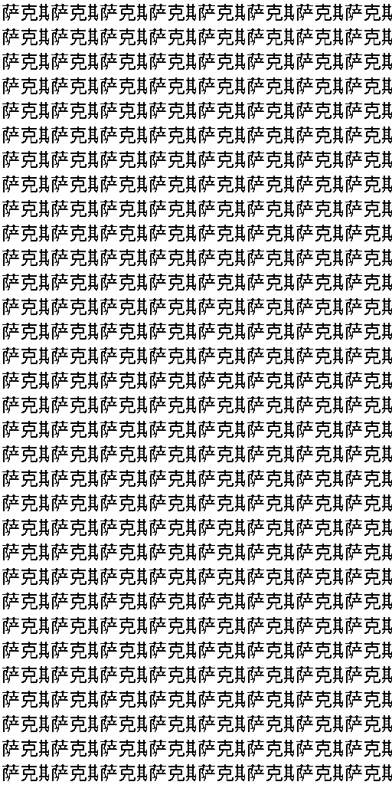

# Clean-code generation passes the fixed-image control

The clean-code predictor reproduces the selected original Chinese writing
block exactly on all 256 fresh Gaussian-noise draws. Mean and worst-sample
foreground F1 are both 100%. Independent CPU scoring and fixed-decoder replay
confirm every retained binary image.

Every cell is the same learned 32-by-64 source block. This is generation of
one known image, not prompt reading, language generalization, unseen-character
generation or a usable ILM. No conditional language result is claimed.

The control trains a 36,403,200-parameter flow head for 4,000 updates, batch
64, using the registered clean-code objective, FP32 final projection and
32 analytic endpoint updates. The control phase takes 33.502 seconds after
setup and reaches 1.361 GiB peak allocated memory. It loads the frozen writing
codec but no inherited reader or teacher. Earlier codec learning and external
foundation pretraining are excluded from these costs.

The complete 64,520,193-parameter causal writer is implemented separately in
the same module; its prompt-conditioned language behavior has not yet been
trained or qualified by this control.

| Control | Exact renders | Worst foreground F1 | Outcome |
| --- | ---: | ---: | --- |
| Narrow velocity, original 64 draws | 0/64 | 0% | Fail |
| Full-dimensional velocity, original 64 draws | 63/64 | 97.053% | Fail |
| Selected 64-step velocity, 128 fresh draws | 116/128 | 87.607% | Fail |
| Clean endpoint, 256 fresh draws | 256/256 | 100% | Pass |

The rows are separately registered experiments with different sample counts
and numerical choices. They are not a single-component causal comparison.
All failed velocity outcomes remain retained. The
[protocol](clean_endpoint_v74_protocol.md) specifies the exact objective,
seeds, image requirements and limits of the result. Clean-data prediction is
attributed to its prior literature there.

The inference sampler receives noise, time and a zero conditioning vector.
The image code is a supervised training label, not a sampler input, a stored
glyph lookup or a repair applied to output pixels.

Raw data and weights are under artifacts/clean_endpoint_v74_20261106/.
The [compact evidence receipt](evidence/clean_endpoint_v74_result.json)
binds source, checkpoint, raw predictions and independent verification.
This passes a generation prerequisite. The next test must train the complete
writer on distinct image prompts and generate full unassisted answers before
any general language claim.
