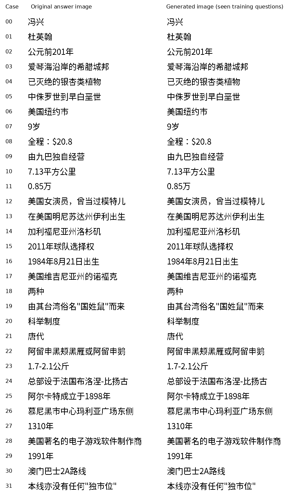

# The clean writer learns a fixed set of image questions

The complete clean-code writer generates 29 of 32 original Chinese answer
images exactly on seen training questions. Against the frozen codec's
supplied-code reference images it generates 31 of 32 exactly, with both
answers exact in 15 of 16 shared-passage pairs. Original-image foreground
F1 is 99.9967%, with worst-case F1 99.9518%. All 32 answers stop through the
learned decision. The registered learning-capacity requirements pass.

This is a training-set capacity control, not a demonstration of unseen
reading comprehension or a usable language model. The same 32 questions
receive 2,000 full training passes. The result shows that the complete image
path can learn different full answers and write them cleanly; it does not
establish general language understanding, novel historical forms or parity
with an existing LLM. The earlier 0/128 development result remains rejected.

Each of the 16 pairs shares the exact visible passage but has different
questions and different answers. Selection uses a fixed digest order of
eligible CMRC training records. At inference the actor receives only actual
prompt pixels, with the same sampling seed within a pair, no supplied answer
length and no gold code. Its sampler re-encodes emitted pixels as history.
The mean owning-target F1 exceeds scoring against the other question's
target by 77.6155 points. Cross scoring is an offline comparison, not a
second independent model generation. All 32 actual reader memories match
the training cache exactly.

The 64,520,193-parameter writer starts afresh, receives 4,000 updates and
64,000 draws, and takes 174.653 active seconds at 1.163 GiB peak allocated
memory without the reader. Actual-image generation and evidence capture
take 108.558 seconds, including 65.923 seconds setup, at 17.742 GiB including
the externally pretrained reader. These costs exclude earlier codec
learning and foundation pretraining; this is not an entirely small model
trained from scratch on one GPU.

Independent CPU verification authenticates all inputs and retained outputs,
reconstructs source prompt placement, re-renders the frozen reference codec
and independently scores the images. It does not replay the entire neural
generation or every feedback encoding. A separate execution preflight checks
future-target exclusion, exact optimizer/RNG restoration and actual-pixel
feedback; the model is reset after that preflight.

The [fixed protocol](clean_learning_v74_protocol.md) specifies selection,
optimization, seeds and requirements. The [evidence receipt](evidence/clean_learning_v74_result.json)
binds source, checkpoint, all cases and independent verification. The raw
run, full checkpoint and answer images are in
artifacts/clean_learning_v74_20261106/. Use
scripts/infer_clean_ilm_v74.py with training/checkpoint_latest.pt from that
run for standalone PNG input and PNG output. It remains experimental.

The next substantive test is full-corpus training followed by the original
unseen full-answer audit. The general ILM objective remains unachieved.
