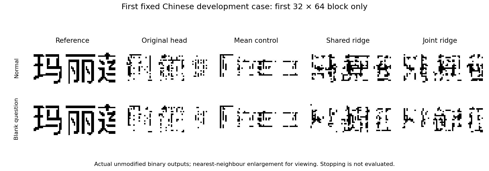

# Conditional readouts improve overlap without accurate first-block writing

The completed frozen-actor diagnostic fits two linear writing heads on 512
training examples and tests the 192 existing development questions. Both heads
retain zero exact first blocks on all 128 Chinese and 64 English cases. The
shared ridge head improves Chinese foreground F1 from 38.012% to 44.726%; the
joint head reaches 45.228%. This is a first-block diagnostic with stopping
ignored, not complete-answer generation or a language qualification.

## Fixed experiment

The unchanged V68 final actor supplies two 4096-dimensional contextual query
states from each prompt image. Target blocks are never part of that forward
call. Detached writing codes are encoded afterward. A source-bound capture
completes all 896 normal/control prompt forwards and exactly reproduces the
original first-stop decision and first output block on all 192 development
cases. No contextual or visual parameter is updated.

Training samples contain 256 Chinese and 256 English records, selected before
capture. Within each source, 192 records fit candidate heads and 64 calibrate
regularization. Both heads select lambda=1 from the fixed five-value grid by
calibration code MSE, then refit on all 512 training records. The shared head
has 3,150,593 stored FP32 values, including centering statistics; the joint head
has 12,592,641. Neither requires training examples at head inference.

Both use the same training records and fixed continuous targets. The original
V68 head has a different, full-corpus end-to-end training history and objective;
its comparison does not isolate head capacity alone. Development data are
reused and the sealed split remains unopened.

## First-block development scores

| Readout | Chinese F1, normal / blank | Chinese exact | English F1, normal / blank | English exact |
| --- | ---: | ---: | ---: | ---: |
| Original head | 38.012 / 26.581% | 0/128 | 34.977 / 21.549% | 0/64 |
| Training mean code | 19.449 / 19.449% | 0/128 | 30.062 / 30.062% | 0/64 |
| Shared ridge | 44.726 / 33.710% | 0/128 | 37.442 / 28.310% | 0/64 |
| Joint ridge | 45.228 / 33.648% | 0/128 | 37.643 / 25.356% | 0/64 |

Chinese normal-minus-blank F1 effects, with 95% source-article bootstrap
intervals, are 11.431 points [9.220, 14.148] for the original head,
11.016 [8.831, 13.406] for shared ridge and 11.580 [9.372, 14.115] for joint
ridge. All 64 pairs have zero both-first-block-correct outcomes in every route.
The fixed analysis uses 2,000 draws and seed 20266903. Question sensitivity
therefore persists without exact writing.

After refitting, shared/joint training F1 is 72.798/78.591% on Chinese and
47.139/50.233% on English. Neither selected regularized head has an exact
training block. These calibration-selected fits are not an interpolation
capacity bound and do not prove that every linear map would fail. Nonlinear
readouts and further feature learning are untested here.



The figure uses the first originally fixed Chinese case, without selecting
by quality. Every displayed image is the complete 32-by-64 first block; the
third visible character can straddle its physical edge. Enlargement uses
nearest-neighbour display only. The outputs remain inaccurate.

## Supplied-code control and numerical verification

A separate, explicitly post-hoc CPU control supplies true writing codes on
these same 704 reference blocks. It reaches 99.986% F1 and 114/128 exact Chinese
development blocks, and 100% with 64/64 exact English blocks. Training controls
reach 99.983% and 237/256 Chinese exact blocks, and 256/256 English exact blocks.
Thus the fixed renderer can reproduce most of these images when their codes
are supplied. This control is not a generated answer and does not affect head
selection or the primary scores. Its [source-bound report](evidence/conditional_readout_v69_supplied_control.json)
retains all 704 physical scores.

The independent CPU verifier reloads all 704 source cases, re-encodes targets,
repeats calibration with a NumPy eigensolve, checks the final ridge normal
equations and materialized weights, and replays all 3,584 continuous decoder
outputs exactly. It independently recomputes physical scores and clustered
intervals. Target-encoder replay differs by at most 6.080e-6 and independent
NumPy head predictions by 4.044e-6; decoder replay has zero difference.
It does not independently replay the full inherited actor.

The first verifier stops on its FP32 NumPy accumulation of the training-mean
reference. The [documented correction](conditional_readout_v69_verification.md)
uses FP64 independent accumulation, retaining the original tolerance and all
producer data, predictions, scores and calibration choices. The corrected
verification passes; the original verifier remains unchanged for provenance.

Capture takes 322.351 seconds including 72.195 seconds setup, with 15.750 GiB
peak allocated memory on physical GPU 0. CPU fitting takes 18.093 seconds and
corrected verification 46.521 seconds, on four threads with CUDA hidden.
These are diagnostic costs, excluding V68 training, codec learning and
external foundation pretraining. The model process exits and GPU 0 is released.

## Interpretation and reproduction

The tested readouts recover additional overlap from the frozen states, but
they do not recover precise written answers. The results do not identify a
unique repair or an information-theoretic limit. A larger linear readout is
insufficient in this particular calibrated comparison. Conditional features,
nonlinear output geometry, the objective and further learning remain open.
Before another long adaptation, check whether the authenticated source model
can answer the same visual prompts through its native interface; the earlier
eight-case source check covers text only. Offline semantic supervision may
then be tested without introducing a teacher into actor inference.

The fixed [protocol](conditional_readout_v69_protocol.md),
[measurement receipt](evidence/conditional_readout_v69_measurements.json) and
[exact verification receipt](evidence/conditional_readout_v69_result.json)
record the evidence. Local raw data are under
`artifacts/conditional_readout_v69_20261105/attempt01/`. The capture report SHA-256
is `605ffe0677816eacb9300560ca2dd46667b72e02fa570278b5ccdd109da0f9f7`,
fit report is `6ea7a8700acc5c8a0280e6c3e908ad8354dfe326f7b7cdc2b56a4fee2d02a5b1`,
and corrected verification is
`30bf620248f57b04aa08a5189adb17f1c3a50d031e695e46a74b14176f08c52d`.

Use the compatible Python environment and a fresh output directory. Prepare
and fit on CPU with CUDA hidden; capture on physical GPU 0 with
`CUDA_DEVICE_ORDER=PCI_BUS_ID`, `CUDA_VISIBLE_DEVICES=0` and
`CUBLAS_WORKSPACE_CONFIG=:4096:8`:

```bash
PYTHONPATH=. artifacts/external/mixar_env_py312/bin/python \
  scripts/probe_conditional_readout_v69.py --out NEW_RUN --stage prepare
# Switch to the specified GPU environment for capture, then hide CUDA again.
PYTHONPATH=. artifacts/external/mixar_env_py312/bin/python \
  scripts/probe_conditional_readout_v69.py --out NEW_RUN --stage capture
PYTHONPATH=. artifacts/external/mixar_env_py312/bin/python \
  scripts/probe_conditional_readout_v69.py --out NEW_RUN --stage fit
PYTHONPATH=. artifacts/external/mixar_env_py312/bin/python \
  scripts/verify_conditional_readout_v69_r2.py --out NEW_RUN
```

Use `scripts/check_readout_codec_control_v69.py` with a fresh `--out` directory
for the post-hoc supplied-code control, and
`scripts/plot_conditional_readout_v69.py` for the source-bound figure.
The original V68 language rejection is unchanged; a useful general ILM
remains unachieved.
