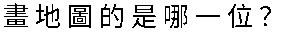
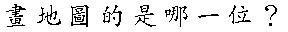
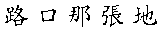
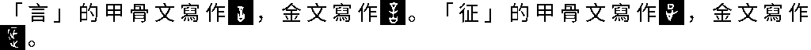
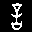

# A pretrained reader answers directly from glyph images

A pictured passage says that Qin Che got lost and Zhuo Lin drew a map. Asked who drew it and who needed directions, the responder returns 卓霖 and 秦澈 as two different images. The same deployed system can choose to compose a sentence in a new order and carry an actual bronze name into that sentence. [Original answer images and task controls](evidence/font_invariant_reader_20261119/responder.json) · [Figure 88](../publication/ilm-nature/figures/Figure_88_font_invariant_reader.png)

| On 64 matched questions | Correct individual answers | Situations correct with both name orders and both questions, out of 16 |
|---|---:|---:|
| Earlier compact writer, regular print | 13 | 0 |
| CKIP with its original text tokenizer | 49 | 6 |
| Raw visual regression, regular print | 48 | 6 |
| Raw visual regression, unseen bold | 1 | 0 |
| Combined responder, regular print | 46 | 6 |
| Combined responder, unseen bold | 41 | 3 |
| Combined responder, unseen Kai family | 1 | 0 |
| Local Qwen3-8B, text | 55 | 10 |

The reading branch takes streams of 32 × 32 images. A convolutional metric learned from seven typefaces feeds a dense regression into a pretrained Chinese contextual reader. At deployment this reader has no lexical embedding table, text tokenizer or glyph prototypes. Its answer is a complete interval of original source pixels. A separate learned image writer can reorder glyphs or emit images from writing memory. The action gate chooses using only the prompt and passage. The contextual encoder and QA head carry knowledge from CKIP BERT. Training this interface on one RTX 4090 D does not establish training a comparable language model from images alone. [CKIP model card](https://huggingface.co/ckiplab/bert-base-chinese-qa) · [Visual regression results](evidence/continuous_page_reader_20261119/result.json) · [Font comparison](evidence/font_invariant_reader_20261119/result.json)

The joined model recovered 263/387 natural person answers and 69/131 paired answers, compared with 148 and 19 previously. Complete DRCD passage answers rose from 1,344 to 2,698 of 3,505. Prior benchmark exposure of the CKIP checkpoint was not audited. The separate Chinese XWinograd completion test with no supplied options yielded 79/504 in regular print, 81/504 in bold and 3/504 in Kai for the visual reader. The native CKIP text reference gave 73. The visual system continued to compose 344/404 familiar reordered statements and 30/32 descriptions with bronze names. On unfamiliar phrasing it composed 8/404 exact statements. Open DuReader responses remained at zero exact references in 571. The original eight-scene target and the prespecified cross-font repair criterion both failed. [Matched Qwen comparison](evidence/font_invariant_reader_20261119/qwen.json) · [Font repair protocol](font_invariant_reader_protocol.md)

The raw map fit 15,743 distinct images by ridge regression in 1.55 seconds of GPU computation, excluding preparation. The second interface fit a 498,912-parameter visual metric for 2,000 updates and learned 9,437,184 regression coefficients. Its 54,956 training images represent 7,918 teacher input identities. The original fit completed its 900-second and 15-GiB checks. Serialization failed after saving the full visual metric, so the final analytic solve was repeated from those saved weights, with zero further metric updates. The original peak and duration were not retained. Numeric weights and writing memory for the deployed combined system total 395,149,396 bytes. [Fit and recovery](evidence/font_invariant_reader_20261119/fit.json) · [Recovery binding](evidence/font_invariant_reader_20261119/recovery_binding.json) · [Run the combined model](../docs/visual-page-responder.md)

## Where the answer breaks down

The figure below shows the first map question in two typefaces. The passage, question and correct answer are identical in wording. In regular print the model returns the mapmaker, 卓霖. In Kai it switches to composition and writes 路口那張地, a fragment of the passage ending halfway through 地圖 (“map”). All the strokes in that answer can be read. It fails because the question asks for a person. Across the same 64 questions this typeface change reduces correct answers from 46 to one. [Action and original image checks](evidence/font_invariant_reader_20261119/portable.json)

| Typeface | Pictured question | Actual returned image |
|---|---|---|
| Regular |  |  |
| Kai |  |  |

The first freely worded English request asks for the earliest meaning of 明. Its source explicitly gives “bright”. The writer instead assembles the pronunciation *míng*, the words 是金文作 and a bronze glyph. The glyph shapes survive while the answer mixes three fields. Across the English set the writer produced one exact complete response in 96. Exact reference agreement alone cannot distinguish a valid paraphrase from a wrong answer. This particular answer visibly omits the requested meaning. [Original passage](evidence/page_responder_errors_20261119/english_free_0_passage.png) · [Question](evidence/page_responder_errors_20261119/english_free_0_question.png) · [Returned image](evidence/page_responder_errors_20261119/english_free_0_answer.png)

## Reading the historical forms of 言

We supplied a pictured plate assembled from two Hanziyuan entries. The two attested forms of 言 are J04919 (oracle) and B02976 (bronze). In the order 言 then 征 the model returned each original glyph exactly when asked for it individually. With 征 first it still returned the oracle form of 言 correctly and missed its bronze form. Asked to write the two forms together in chronological order, it returned one cell in both orders. Across both characters and both plate orders the responder solved five of eight individual-form questions and zero of four two-form requests. The source family was present in earlier training. This example measures reading visible source forms, not generating an etymology from memory. [All twelve original decisions and Hanziyuan source labels](evidence/font_invariant_reader_20261119/etymology.json)

| Supplied plate | Returned oracle form of 言 | Returned bronze form of 言 | Returned image when asked for both | Expected sequence |
|---|---|---|---|---|
|  |  |  |  |  |
