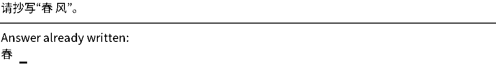
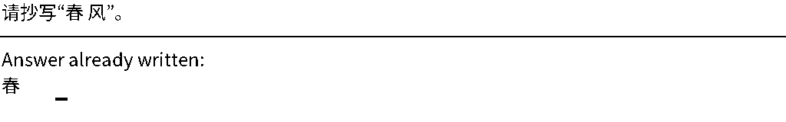

# A white emission needs a visible writing position

8 November 2026. The actual renderer produces identical padded pixels for
`春` and `春 `, including after the native observer resize. While copying
`春 风`, those two histories require different next character images: a
space and `风`. A writer that receives only those identical observations
cannot always distinguish the next action. This is a defect in the proposed
prefix-ink reconstruction interface, not a demonstrated cause of the earlier
failed models, which retain sequence positions.

The [protocol](cursor_history_protocol.md) and
[complete receipt](evidence/cursor_history_result/result.json) retain the
actual renderer counterexample and the bounded cursor checks. `␠` below
denotes a space for explanation; it is not a runtime glyph or lookup entry.

| Logical history | Old observed prefix | Required next tile |
|---|---|---|
| `春` | Identical to the row below | White space |
| `春␠` | Identical to the row above | `风` |

For two equally likely histories with the same observation X and distinct
next images A and B, any conditional distribution q satisfies

```text
(q(A | X) + q(B | X)) / 2 <= 1/2.
```

This is an elementary observation-aliasing bound, not a new learning theorem
or a limitation on all image-based language models. It identifies missing
state information that additional training alone cannot recover.

The new [WritingCanvas implementation](../ilm/visual_lm/cursor_canvas.py)
stores actual ordered 32-by-32 grayscale tiles and marks the next writable
cell in a separate four-pixel gutter. A white output advances that cursor.
The cursor records the emitted position, not a reference length, character
identity or expected answer. No output pixel is overwritten. Construction,
append and inverse recovery require no font, Unicode table, OCR or glyph bank.
The complete history page can be supplied directly to a visual encoder.

These are **input-state demonstrations**, not generated ILM answers. The first
image follows `春`; the second follows `春␠`. The cursor advances while the
written ink stays the same:




Each physical row contains 32 writing pixels and four gutter pixels. Bottom
padding aligns the complete page to 32-pixel observer dimensions. Because
padding is at most 31 pixels and row pitch is 36, the number of physical rows
is recovered as `floor(page_height/36)`. Validate the canonical height and
white padding before locating the unique cursor. The gutter adds 12.5% to
the writing-band height, plus the next-cursor row and bottom padding. This
layout cost is not a claim of lower neural training or inference cost.

The actual CPU audit verifies exact ordered payload recovery at lengths
0, 1, 31, 32, 33, 255, 256, 257, 512 and 4,096. Payloads contain arbitrary
gray-valued pixels and all-white tiles. Append preserves prior states;
invalid gutter marks and nonwhite future cells are rejected. For all-white
histories of every length 0..256, all **257 actual observer inputs remain
distinct after resizing**. The audit takes 4.281 seconds with four CPU
threads and performs no neural forward or optimizer update.

The inverse is lossless before observer resizing. The 257-state resize check
does not prove injectivity for all larger pages or recognition by a learned
encoder. No language, glyph-generation quality, stopping accuracy or LLM
efficiency result follows. The first larger-gutter audit remains local;
the published evidence uses the final four-pixel format.

Reproduce with the existing renderer environment and a fresh directory:

```bash
CUDA_VISIBLE_DEVICES='' OMP_NUM_THREADS=4 OPENBLAS_NUM_THREADS=2 MKL_NUM_THREADS=4 \
LD_PRELOAD='/usr/lib/x86_64-linux-gnu/libglib-2.0.so:/usr/lib/x86_64-linux-gnu/libgobject-2.0.so:/usr/lib/x86_64-linux-gnu/libgio-2.0.so' \
PYTHONPATH=. artifacts/external/mixar_env_py312/bin/python \
scripts/audit_cursor_history.py --output artifacts/cursor_history_reproduction
```
