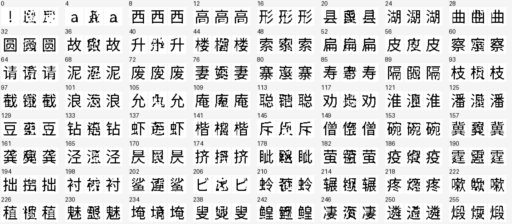

# Direct pixel loss qualifies genuine-input glyph writing

Broader genuine visual contexts strongly improve glyph copying, and a pixel-only
readout objective passes the fixed physical qualification. The architecture,
parameter count, image-feedback encoder and decoder are unchanged. Complete
autonomous language generation is being assessed separately; this result does
not establish a general language model.

| Readout | Training-copy mean F1 | Held-wording mean F1 | Held cases reaching F1 0.95 /256 | Original-history mean F1 | Gate |
| --- | ---: | ---: | ---: | ---: | --- |
| Preserved language baseline |0.591677|0.606911|6|0.999996|Fail|
| Genuine contexts, anchor MSE + cosine + pixel loss |0.998227|0.951778|194|0.999993|Fail|
| Same genuine contexts, pixel loss only |0.998447|0.972856|229|0.999997|Pass|

The held-wording requirement was fixed at mean F1 at least0.95 and at least80%
of cases reaching0.95. The anchor-loss candidate misses the latter requirement
(194/256,75.78%); it is not promoted to autonomous assessment. The pixel-only
candidate reaches229/256(89.45%). Both retain a first-state non-stop fraction
of1.0and original-history quality. The training-copy mean requirement is0.99;
the permitted original-history loss is0.01relative to the same baseline. No
threshold was changed after the result.

| Readout | Exact training-copy images /8172 | Exact held-wording images /256 | Exact original-history images /3855 |
| --- | ---: | ---: | ---: |
| Preserved baseline |0|0|3851|
| Genuine contexts, anchor losses |6683|6|3849|
| Genuine contexts, pixel only |7652|42|3852|

All three fixed64-triplet boards for each fitted candidate were actually
inspected. The held sample still contains wrong punctuation and altered or
incomplete strokes. Pixel-only qualification is not perfect copying, unseen
glyph identity, a human grade of every form, or language accuracy. Every one
of the24,566baseline/candidate glyph images per comparison is retained in
lossless packed PNGs, with every packed pixel checked against its saved tensor:
[anchor-loss archive](evidence/genuine_glyph_readout_v1/archive.json) and
[pixel-only archive](evidence/direct_pixel_readout_g_only_v1/archive.json).
Each archive also retains all per-state metrics and the actually viewed boards.

The data are8,172training images covering4,086visible canonical forms under two
copy instructions, plus256fixed held-wording cases. The empty form is excluded.
Each target is pasted as its exact32x32bitmap into the512x256input; no target
ID is supplied to the reader. All held identities are seen in training, and
the3,855original nonterminal histories were already seen by the original fit:
these routes test wording transfer and retention, respectively.

The frozen externally pretrained reader cached all8,428inputs in9,651.28seconds,
including70.07seconds of memory-pressure waiting, with peak allocation17.723GiB.
The measured first-batch/single-image state difference is0.00032425, below the
declared0.002limit. No temporary vocabulary head or teacher service produces
these new states. The [cache summary](evidence/genuine_glyph_readout_v1/cache_summary.json)
records geometry and resources. This cache cost and inherited pretraining must
not be omitted from an efficiency account.

Both fits start from the preserved language checkpoint and use18,000batch128
AdamW updates with the prescribed seed, learning rate, schedule and equal
copy/history sampling. Only G's16,791,552parameters train. Removing source-anchor
MSE and cosine losses leaves the existing balanced pixel BCE through frozen D.
The motor vector is no longer required to equal a source input embedding; the
actual emitted image still determines the next body embedding through frozen E.
The pixel-only fit takes90.54seconds with0.695GiBpeak GPU allocation, compared
with101.77seconds and0.759GiBfor the anchor-loss fit. These are small-readout
costs, not foundation-model training or a matched-quality text-LLM speed result.
Parent random-index traces were not retained; the prescribed sampler and seed,
not verified bitwise sample equality, are matched.

The [CPU reader-state audit](evidence/genuine_copy_state_audit_v1/report.json)
recovers252/256held identities by each of two fixed cosine rules against the
training views. It finds8,428distinct recorded state byte strings and no
conflicting exact-state group. This is evaluator-only geometry: no gallery
selects or repairs runtime output, and absence of collisions does not prove
semantics or learnability. Its complete measurements are retained, including
the less accurate cross-training-wording comparison. It makes no neural call.

The second declared arm, which would additionally train D's input block,
fails its shared-memory-pressure admission before training. Its failed-stage
record is preserved; it is not an unsuccessful trained algorithm and is not
needed to establish the loss-only physical result. The simpler passing arm
enters the original forty-stream autonomous assessment only after actual image
review. The C3 cohort remains excluded from fitting and model selection.

The runtime still inherits a7.5Bvisual/contextual body and uses a47.128Mbridge.
No new small foundation, historical-form understanding, general English,
Unicode-independent unseen-form accuracy, priority claim or LLM-efficiency
advantage follows from this controlled copying result. The
[genuine-context protocol](genuine_glyph_readout_protocol.md) and
[direct-pixel protocol](direct_pixel_readout_protocol.md) preserve the recipes.
