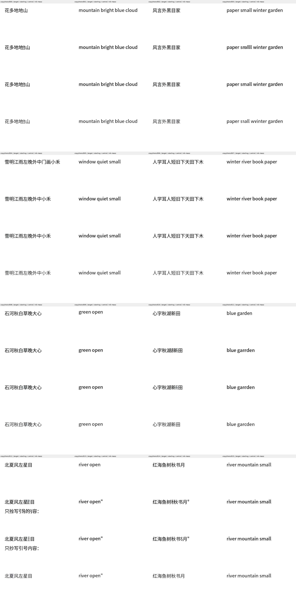
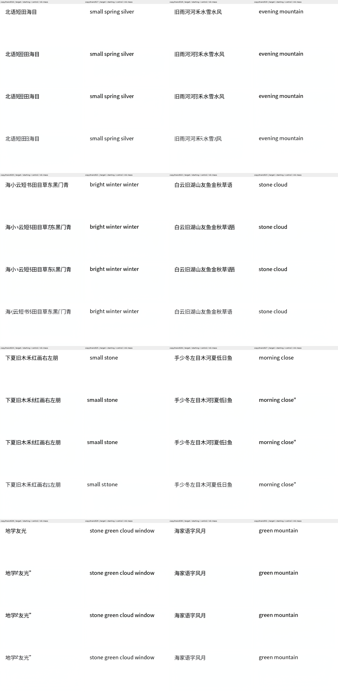
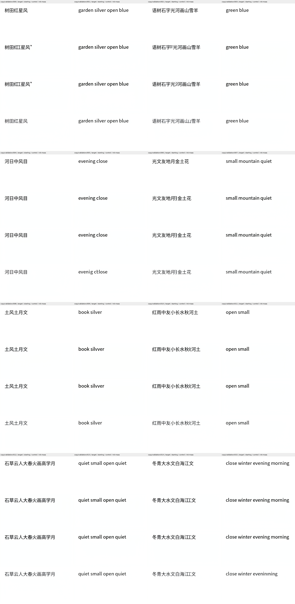
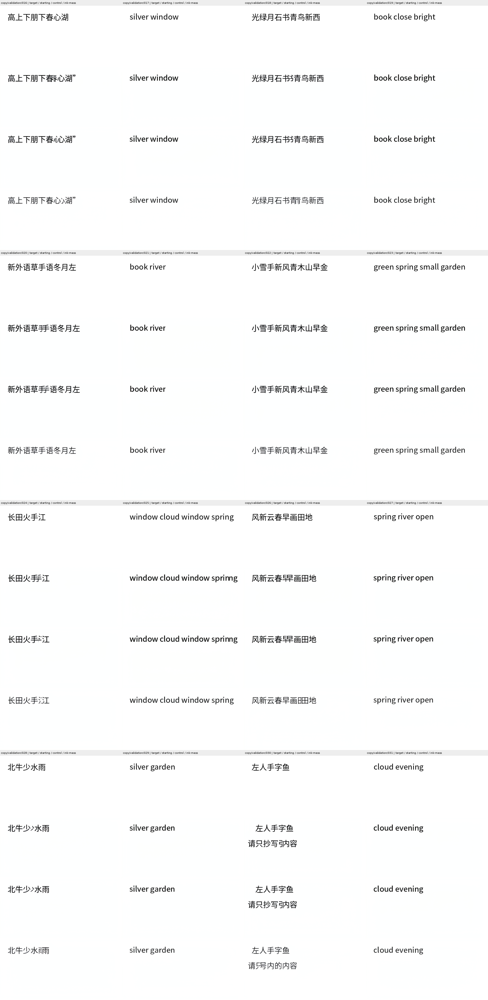

# Dense ink supervision improves some copies under a matched comparison

The complete registered comparison gives **18/32 seen and 19/32 held-out
OCR-exact copies** with the ink-mass objective, versus **16/32 and 16/32**
with the unchanged loss. Held-out Chinese rises from **4/16 to 6/16**.
All three exploratory requirements pass. Reliable writing still fails, and
neither arm trains or evaluates semantic question answering.

| Independent OCR observation | Unchanged physical loss | Ink-mass replacement |
| --- | ---: | ---: |
| Seen, all | 16/32 | 18/32 |
| Held out, all | 16/32 | 19/32 |
| Seen Chinese | 5/16 | 8/16 |
| Held-out Chinese | 4/16 | 6/16 |
| Seen English | 11/16 | 10/16 |
| Held-out English | 12/16 | 13/16 |

This is a single deterministic two-arm experiment on reused development
inputs. The seen English count decreases by one, despite the aggregate gain.
OCR is not manual reading accuracy; unchanged clean-reference scores are
27/32 seen and 28/32 held out. A numerical or aggregate gain does not admit
book-scale training or establish language understanding.

## Exact intervention

Both arms start from checkpoint
`fc031796540a4b6ca4c86774a5033e94ae32b415e825b6a221128756748d3575`,
including the same step-160 AdamW states. Each executes one identical
permutation of 32 training inputs: sixteen Chinese and sixteen English.
Noise seeds, rank-16 adapters, learning rate 1e-5, decay .01, clipping one,
native input precision, all 50 differentiable steps, guidance one, 512×256
output and fixed generic condition are held common. Every optimizer state
ends at step 192. Base, VAE and reader weights remain frozen without gradients.

Control retains reader CE plus ten times balanced ink/background L1.
Treatment replaces only that physical term with the fixed-target-mass
Bernoulli KL derived in the [CPU audit](writing_physical_loss_audit.md).
Its temperature is .05 and coefficient is **0.4035679875746343**, fixed from
the training references' deletion-cost ratio before optimization. Neither
coefficient nor budget is selected using the final outputs.

The first Chinese/English retained starting outputs replay exactly in both
arms. Their first actual pre-update page is also bit-identical at the same
scheduled input/seed, with identical recognition loss 0.07570605. Its
pre-clipping gradient norm changes from 8.79523 to 15.20039. Finite nonzero
gradients traverse steps 0, 24 and 49, and all 206 adapter tensors change.
This verifies a real training intervention; it is not a semantic result.

The [registered rule](ink_mass_writing_protocol.md) requires treatment Chinese
held-out exact match at least 6/16 and at least two above control; seen exact
match at least 13/32 and no worse than control; held-out English at least
13/16 and no worse than control. All pass. This permits further bounded
investigation, while the unchanged writing floor still requires 30/32
correct, legible requested strings alone in each split.

## Complete raw assessment

All 64 original-order target/starting/control/treatment panels were inspected.
Individual source PNGs were also opened for selected improvements and errors.
Treatment removes the control's copied instruction line in seen case 012 and
the extra quotation mark in held-out case 000. Failures remain: seen case
004 omits characters; 013 and 027 retain quotation marks. Held-out case 002
repeats a character, 005 corrupts English letters, 015 omits `morning` and
corrupts `evening`, 016 retains a quotation mark, 026 adds a character, and
030 still copies an instruction. More than two obvious failures per split
independently reject the writing floor.

Seen OCR changes relative to control are four treatment-only exact strings
(012, 014, 017, 026) and two control-only strings (003, 007). Held-out changes
are six treatment-only strings (000, 009, 012, 020, 023, 025) and three
control-only strings (005, 015, 028). Some differences can reflect font
recognition. Selected visible improvements do not establish a complete error
category annotation, independent-seed replication or a general effect size.

Training invocations take **1,146.423 s** at **12.032 GiB** for control and
**1,145.598 s** at **12.033 GiB** for treatment. These include native initial
replays and exclude earlier learning, acquisition and independent CPU OCR.
Separate complete inference takes 513.746 s and 514.150 s, respectively,
at 8.031 GiB in both arms. The
runtime still contains the externally pretrained 3,899,903,488-parameter
transformer, including 24,358,912 locally trained adapter parameters, and
84,046,115-parameter VAE. The 560,528,640-parameter reader is training-only.
There is no lightweight foundation or matched-language-quality efficiency claim.

## Reproduction and verification

- `scripts/train_ink_mass_writer.py` and `ilm/image_edit/ink_mass.py` implement
  the real two-arm optimizer experiment.
- `scripts/run_ink_mass_comparison.py` executes both arms and their complete
  native inference and unchanged CPU observations sequentially on GPU0.
- `scripts/export_ink_mass_comparison.py` reproduces the schedules, verifies
  every optimizer state and authenticates all 64 training PNGs and all 128
  final PNGs against retained neural tensors. This is artifact verification,
  not an independent second neural replay.
- [Complete result](evidence/ink_mass_comparison_result/result.json) and
  [subsequent raw review](evidence/ink_mass_comparison_result/raw_review.json).

Final checkpoint SHA256s are
`c6bd11e1dc220d631e604b0c99336bf4a4688ac66af40ffbbf657a05a41405f2`
(control) and
`166409db4f87af87393576195251527f1fcf54d5fe12812d75f6d1491674717d`
(treatment). Neither checkpoint is chosen from intermediate-quality evaluations.
All comparison-owned processes have exited. Subsequent full-page probes use
the separately fixed earlier checkpoint and do not alter these results.
The independent ILM goal remains active and unachieved.
