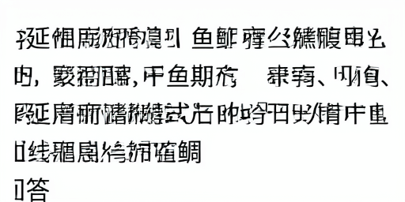

# Full-page execution fits; the fixed writer does not answer the questions

The registered native preflight completes all four 1024-square codec checks,
two real optimizer updates and eight independent input-only image generations
on GPU0. The fixed baseline answers **0/4 normal questions** correctly. All
four erased-question/passage controls also fail. Raw outputs copy and corrupt
parts of the supplied text instead of writing the requested answers.
This is execution evidence and a failed small baseline, not language learning.

The first future-training pair asks two questions about a manga passage;
the expected answers are `第四部` and `唐太宗李世民如何成为天子`. The first
held-out pair asks for a fish's distribution and type locality; expected
answers are `印度西太平洋区` and `印度Pondicherry`. Complete original pages,
canonical answers, reconstructions and every generated page are retained.
The four normal outputs visibly fail beyond the independent OCR limitation.

| Actual stage | Cases / updates | Elapsed seconds | Peak allocated GiB |
| --- | ---: | ---: | ---: |
| Complete source-page codec | 4 pages | 5.401 | 3.574 |
| Real gradient preflight | 2 discarded updates | 228.879 | 12.203 |
| Normal native inference | 4 pages | 94.888 | 9.536 |
| Question-erased inference | 2 pages | 48.952 | 9.536 |
| Passage-erased inference | 2 pages | 48.753 | 9.536 |

These are separate invocation costs. Acquisition, earlier training and CPU
OCR are excluded. No two project model jobs overlap, and GPU1 is preserved.
All preflight-owned processes have exited; GPU0 is released.

## Full pages and actual gradients

The frozen native encoder produces `[1,128,64,64]` features from every
1024×1024 input. Native reconstructions have thresholded foreground F1 of
**97.834–98.180%** and mean RGB absolute error **1.039–1.071%**. All four
complete reconstructed pages were inspected and remain readable. This checks
these pages' physical representation, not perfect preservation of every
character, successful reading by the generator or general script invariance.

The gradient probe uses only the first training question pair. It performs
two real AdamW updates under the unchanged final-image objective, traversing
all 50 native sampling steps. The first actual differentiable forward is
pixel-exact with native inference before its target is loaded. Its prediction
gradient norms at steps 0, 24 and 49 are 0.78508, 1.44972 and 0.12166.
Pre-clipping adapter norms are 2,026.184 and 123.281. Both are finite; global
clipping one is applied. All 206 adapter tensors change and all optimizer
states reach step two. Frozen parameters have no gradients. The weights are
explicitly discarded and are not used for the inference observations.

## Inference remains independent of the discarded updates

Each inference process reloads the prospectively fixed checkpoint
`fc031796540a4b6ca4c86774a5033e94ae32b415e825b6a221128756748d3575`.
It has no natural-QA optimizer exposure. Thus the labels “train” and
“validation” in these small observations identify the prepared future data
partitions, not prior QA training exposure of the assessed checkpoint.

Inference receives only pixels, the same generic condition and independent
noise: 50 native steps, guidance one, 512×256 output. It loads no training
manifest, target image, per-question transcript, varying text condition or
recognition reader. The two question-erased inputs and seeds are identical;
their actual generated tensors and PNGs are bit-exact, as required. This
validates a deterministic control, not semantic performance.

The independent OCR engine recognizes 23/32 future-training and 26/32 held-out
clean canonical answer pages in the broader reference calibration. All
preflight outputs and uncertain typography therefore require raw review.
The preflight's normal cohort has only four questions and controls four;
these are not complete language benchmark scores or a before/after learning
comparison. Substantial QA optimization and complete held-out paired-question
assessment remain required, along with reliable writing and broader ILM scope.

## Reproduction and retained evidence

The [protocol](paired_language_native_preflight_protocol.md) fixes cases,
checkpoint, geometry, seeds and interpretation before model execution.
`scripts/probe_native_paired_language.py` implements the real codec and
gradient probes. `scripts/finish_ink_mass_and_probe_language.py` waits for
the exact comparison owner to exit, authenticates that complete result and
runs the preflight stages sequentially. It never chooses weights from QA
outputs or automatically retries a failed stage.

The [complete result](evidence/native_paired_language_preflight_result/result.json)
binds all four reconstructed pages and eight native outputs to their actual
retained neural tensors. Its raw-review record follows the producer's
immutable assessment, which records review as pending at export time. This
is artifact authentication, not a second independent neural replay. The
runtime retains the externally pretrained 3.900B transformer plus 84.046M
VAE; the frozen training reader is 560.529M. No small foundation, historical
writing competence or efficiency at matched language quality is established.

Example raw held-out normal output (not a repaired transcription):

The independent ILM goal remains unachieved.
