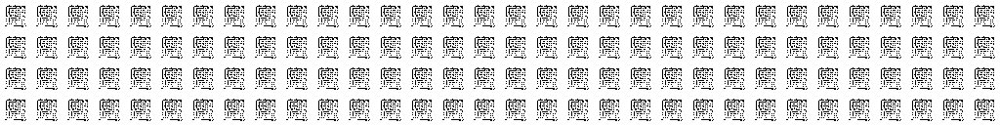
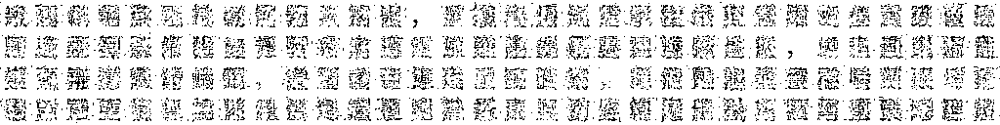

# The native model's answer to a question about 言

**Prompt**　請說明「言」字的演變。  
*Explain how the character 言 evolved.*

**Greedy answer**

**Sampled answer**

The final 23.55-million-parameter checkpoint produced no readable etymology in either rendering. Greedy decoding uses the most probable mixture component and its mean. Its 128 positions contain eight distinct bitmaps, and two account for 105 positions. Neighbouring glyphs change by an average of 0.29 of 1,024 pixels. Sampling the component and its residual with the fixed seed produces 128 distinct nonempty bitmaps, with an average of 199.76 changed pixels between neighbours. Punctuation-like forms and varied strokes are visible. A single model reader with the question visible could not read a complete explanation from either output. Both decoders reached the 128-cell cap.

The typed and pictured prompts ran in separate deterministic CPU processes. Both produced identical prompt hashes, complete greedy answer PNGs, arrays and termination decisions. The traced executions took 34.06 and 33.64 seconds including process startup and tracing. Neither opened another model or file in the project corpus or attempted an IPv4/IPv6 connection. Equivalent input routes establish independent execution on this case. The sampled comparison shows that increasing image diversity alone does not recover the requested meaning. This example sits outside the blind autonomous cohort and contributes no credit to it. [Cold-run measurements](evidence/native_yan_cold_20261118/result.json) · [Sampling measurements](evidence/native_yan_cold_20261118/sampled_result.json)
