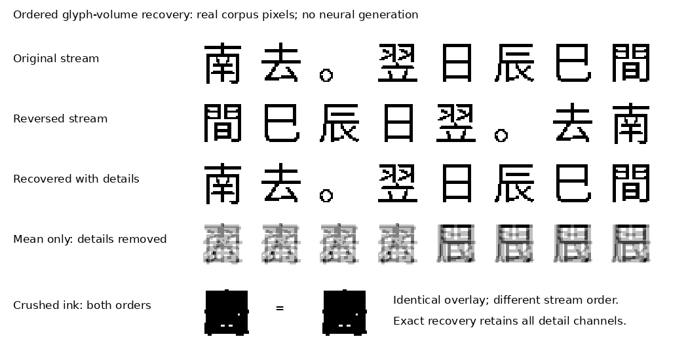

# Ordered glyph volumes: recovery, compression and language learning

Date: 2026-11-12. Status: mathematical analysis and completed CPU representation
experiment; no new neural fit and no new language score.

## The unresolved problem

A useful ILM has not been demonstrated. The compact comparisons produced zero
complete exact QA answers. A larger balanced writer produced 6/32 proportional
exact answers, zero both-correct passage pairs and zero qualified complete book
continuations. Its selected training glyphs were pixel-exact. These findings
separate successful rendering from successful conditional language generation;
they do not identify a unique cause. See the
[compact diagnosis](compact_visual_span_diagnosis_result.md),
[balanced comparison](balanced_writer_matched_result.md) and
[correct-image-history result](reference_image_history_result.md).

The complete-sequence continuation trial remains in progress with its original
model, data and evaluation. Its outcome is unmeasured. The analysis below does
not replace that comparison or change its acceptance rules.

## A corpus as a stream of glyph images

Let `G` have shape `[T,C,H,W]`: each time slice is a visible glyph, letter or
other written mark. This is a temporal stack of two-dimensional images; it does
not require three-dimensional surface geometry. Order, shape and sequence length
must survive any transformation used to read or reconstruct the writing.

For literal ink accumulation,

\[
Y_{h,w}=\sum_{t=1}^{T}G_{t,h,w},
\]

every permutation of the time axis has the same result. Maximum/union overlays
have the same problem and also lose multiplicity. An order-specific answer cannot
be recovered uniquely from such a measurement without additional information or
a prior that guesses an order. Giving that decoder the original order as a side
channel would invalidate a claimed reconstruction from the crushed image alone.

Order-sensitive weights help only when their precision and conditioning are
counted. Encoding binary frames using powers of two in one real-valued plane
can be injective in exact arithmetic, but needs precision growing with `T` and
is sensitive to quantization. It does not provide unlimited finite-rate storage.
For arbitrary binary volumes, a shorter volume of `K` planes with `b` bits per
pixel needs `K b >= T` for universally exact recovery at the same spatial size,
before counting metadata. Continuous linear projection from `T` to `K<T`
planes has a nullspace. Real writing occupies a structured subset of image
space, so statistical compression remains possible; its achievable rate and
distortion have to be measured on that distribution.

## An implemented, invertible reference

The new [volume operator](../ilm/visual_lm/glyph_volume.py) groups four consecutive
glyphs. For each adjacent pair, it retains both

\[
u_j=(g_{2j}+g_{2j+1})/2,\qquad
v_j=(g_{2j}-g_{2j+1})/2,
\]

with inverse `g[2j] = u[j] + v[j]`, `g[2j+1] = u[j] - v[j]`. Repeating this Haar
decomposition within each four-glyph group gives one coarse plane and three
temporal detail planes. They are stored as channels of a shorter volume:

\[
[T,C,H,W]\longleftrightarrow
[\lceil T/4\rceil,4C,H,W].
\]

Zero-ink padding and the original length are explicit. Binary input has exact
dyadic coefficients in float32. General float32 input is recovered to numerical
precision. The transform uses no character IDs, Unicode mapping, OCR, font
lookup or neural checkpoint. Its inverse does not infer an unknown end point.

This construction reorganizes information. It retains the scalar count, adds
padding and uses more bits when stored as floats. A learned projection to fewer
channels would introduce a real bottleneck. That projection needs separate
recovery and language tests.

### Full eligible-corpus result

[The analysis program](../scripts/analyze_glyph_volume.py) authenticated the
registered manifest and corpus report, verified each of the 108 used pixel
shards, and read every complete eligible training target. It never loaded
teacher-unit files. Results are in the
[report](evidence/ordered_glyph_volume_20261112/report.json).

| Measurement | Observed result |
|---|---:|
| Complete records | 13,766: 4,762 book and 9,004 QA |
| Glyphs recovered | 2,036,247 |
| Exact ordered recoveries | 13,766 / 13,766 |
| Maximum absolute pixel error | 0 |
| Non-palindromic records | 13,758 |
| Sum-overlay collisions with the reversed stream | 13,758 / 13,758 |
| Union-overlay collisions with the reversed stream | 13,758 / 13,758 |
| Ordered volumes distinguishing those reversals | 13,758 / 13,758 |
| Mean-only pixel MSE after removing detail planes | 0.0839179 |
| Temporal positions before / after | 2,036,247 / 514,234 |
| Coefficient count / original pixel count | 1.01016, including padding |
| Original bit-packed pixels | 260,639,616 bytes |
| Float32 volume coefficients, if materialized | 8,425,209,856 bytes |
| CPU analysis wall time | 33.414 seconds |

Eight tests cover exact binary recovery, odd lengths, order aliases, numerical
precision, invalid data and completed-block causality. The report's speed is
for this analytic transform and analysis; it is not a trained-model benchmark.
The coefficients were streamed rather than saved as an 8.4-GB artifact.
Dropping details changes every target in this test, including effects at padded
ends. Its MSE is not an OCR, readability or semantic score.



The displayed recovery is an exact inverse transform of supplied pixels. It is
not a generated answer. The eight-symbol illustration is drawn from the first
eligible book target; the quantitative result covers all targets above.

Reproduce with CPU-only execution:

```bash
CUDA_VISIBLE_DEVICES= OMP_NUM_THREADS=1 OPENBLAS_NUM_THREADS=1 \
  PYTHONPATH=. python scripts/analyze_glyph_volume.py \
  --limit 0 --max-seconds 120 --out artifacts/glyph_volume_recovery_new
python -m pytest -q tests/test_glyph_volume.py
```

## What the literature supports

- [PIXEL](https://arxiv.org/abs/2207.06991) learns representations by reconstructing
  masked rendered text. It supports visual language representation learning;
  masked reconstruction alone does not establish autonomous answer generation.
- [PIXAR](https://arxiv.org/html/2401.03321v2) investigates autoregressive writing
  in pixel space. Its factorized pixel likelihood can produce noisy writing;
  additional adversarial training improves its evaluated generation. The paper
  still reports long-sentence readability limits. This motivates testing output
  distributions, not assuming another reconstruction fit will solve the ILM.
- [DC-AE](https://arxiv.org/html/2410.10733v8) uses space-to-channel shortcuts and
  residual autoencoding for deep spatial compression. It provides an engineering
  precedent for preserving an explicit information path while learning residuals;
  its image-generation results do not establish glyph-language performance.
- [DC-AE 1.5](https://arxiv.org/html/2508.00413v1) finds that extra latent channels
  can improve reconstruction while worsening downstream generation convergence.
  Latent predictability matters alongside decoder fidelity.
- [Perceiver IO](https://arxiv.org/abs/2107.14795) uses latent processing and
  position-specific output queries. This offers a way to read a long stream
  into fewer learned states while retaining an explicit ordering interface.
- [CogVideoX](https://arxiv.org/abs/2408.06072) provides a temporal/spatial video
  VAE precedent. Adjacent glyphs change abruptly, so video-frame redundancy and
  video compression ratios cannot be assumed for a writing stream.
- [DeepSeek-OCR](https://arxiv.org/html/2510.18234v1) compresses document images
  into visual states and decodes text with a language model. Its report explicitly
  distinguishes OCR from establishing general context compression. It is useful
  preparation research, not evidence for independent glyph-image output.

These mechanisms have precedents. No first-ever or large-model-parity claim
follows from this note.

## A concrete learning hypothesis

Use a compact, ordered visual memory and learn a distribution over the next
complete visual block. Let `Q` be the visible question and `X` the visible context:

\[
Z^- = C_\phi(Q,X_{\leq t}),\qquad
Z^+\sim p_\theta(\cdot\mid Z^-),\qquad
\widehat G_{t+1:t+B}\sim p_\psi(\cdot\mid Z^+,Z^-).
\]

The exact temporal transform supplies an ordering-preserving reference and a
residual path. A learned compressor must reduce finite-rate storage while
retaining distinctions needed by the task. The generator must produce coherent
glyph configurations from predicted states, including states outside the clean
encoder distribution. A block decoder can use an autoregressive, flow or
denoising distribution; diffusion is not a requirement.

A useful objective combines future-block likelihood, a measured reconstruction
constraint and a rate estimate. Reconstruction gives the model visual access;
prediction supplies the learning pressure to use grammar, lexical context and
question/passage information. Neither objective alone proves semantic capability.
For an unconstrained factorized Bernoulli output with unweighted pixel BCE,
the optimum is the conditional pixel marginal. Foreground balancing changes
the weighting; it does not itself represent dependencies between pixels. Where
several continuations remain plausible, marginal thresholding can mix incompatible
glyph configurations. Whether this explains a specific failed output must be
tested; the prior results also leave reader access and feedback drift unresolved.

For a group of four, global processing can use roughly one quarter as many
positions. At unchanged hidden width, the dense attention matrix has roughly
one sixteenth as many entries. Encoding, channel projection, local decoding,
padding and any sampling iterations still cost computation. An exact reshape
alone does not establish an end-to-end speedup or smaller whole model.

Only completed earlier blocks may condition future-block prediction. A packed
block containing the target glyph leaks future pixels if reused as that glyph's
prefix. A partially observed block therefore needs an explicit visibility mask
or a local causal path. Question and passage images must remain separate
observable inputs, with erasure controls preserved. Actual emitted pixels must
be reread during autonomous generation, and stopping remains a learned decision.

## Decision before the next neural experiment

Finish the registered continuation comparison first. Use its complete outputs to
locate the failure before selecting one bounded intervention and an unchanged
control. No extra GPU fit is launched by this analysis.

- If glyphs remain damaged under correct image history, test a coherent block
  decoder against the current writer on identical conditional states.
- If writing is readable but ignores the question or passage, test predictive
  conditioning with the visual interface held fixed. More codec reconstruction
  does not address the measured question-dependence failure by itself.
- If correct-history writing works but emitted-history writing fails, test
  robustness to actual pixel histories with the rendering interface fixed.
- If the language pilot passes and untouched source groups confirm it, test
  learned volume compression as an efficiency ablation at matched language quality.

For the volume hypothesis, shuffled-order controls, held-out works, glyph
fidelity, complete answers, paired questions, erasures, coherent book continuation
and natural stopping must all be evaluated. Decoder recovery and finite-rate
storage are supporting measurements. Whole deployed parameters, preparation
cost, peak VRAM, training time and inference latency remain part of the goal.
The current 7.578B deployed actor is not a qualified lightweight foundation model.
