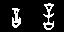
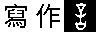
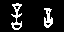

# Writing the two historical forms of 言 in either order

Given a plate containing 言 and 征, the ordered writer returns the authentic oracle and bronze forms of 言. Exchanging the two stage names in the question exchanges the two output cells. All 16 requests across both headwords, entry orders and stage orders received exact stopped answers. The plate comes from the earlier training-family partition. On genuinely held-out historical families the result depends on how the question is phrased. [Runnable weights and commands](../models/ordered_page_writer/README.md)

| Requested forms of 言 | Previous response | New response | Source reference |
|---|---|---|---|
| Oracle, then bronze |  |  |  |
| Bronze, then oracle |  |  |  |

## What the model learned

The reader takes pictures of the passage and question. The decoder selects a source span, writes a stored glyph or ends the answer. After copying, it receives the visual context from the start and end of the selected span. It can then select another location. The source pixels go directly into the answer. Previous work used related pointer and span-copying operations in text generation and editing. This experiment measures their behavior on actual glyph images using a frozen pretrained visual interface to a Chinese contextual reader. [Pointer-generator networks](https://aclanthology.org/P17-1099/) · [Editing sequences by copying spans](https://arxiv.org/abs/2006.04771) · [Inherited visual reader](continuous_interface_result.md)

On the first fit, changing question wording caused the decoder to stop after one glyph on 178 of 192 requests for two. Further training varied the way singular and compound requests were expressed while keeping the passages, architecture and number of updates matched to a replay control. Each historical comparison below requires both orders to be correct on the identical plate. The two unfamiliar conditions each fell short of the 48/96 criterion. [Initial experiment](ordered_page_writer_protocol.md) · [Matched variation](ordered_request_variation_protocol.md)

| Complete reversals out of 96 | Original requests | Rephrased | Further wording and cards |
|---|---:|---:|---:|
| First ordered writer | 94 | 0 | 0 |
| Additional replay | 94 | 0 | 1 |
| Varied training requests | 94 | 36 | 16 |

## Ordinary language

On a human-written question pair about a fish, the requested facts were its distribution and type locality. The varied writer returned 印度太平洋区；安汶岛 (“Indo-Pacific region; Ambon Island”), exactly the two reference answers, including their separator. Across the full paired set it returned 17/256 exact images and both orders of 4/128 pairs. The first ordered decoder reached 22/256 and seven pairs. The previous deployed responder returned zero complete pairs. [All scores and output hashes](evidence/ordered_page_writer_20261119/result.json) · [Equal-update comparison](evidence/ordered_page_writer_20261119/variation.json)

For a question asking who drew a map, the previous reader returned the exact name 卓霖. The varied writer returned 路口那張地圖是卓霖替他畫的。 (“Zhuo Lin drew the map at the junction for him.”). This answers the question in a sentence and receives zero under the name-only image criterion. On 64 role questions the varied writer produced zero exact name images. It included the requested name alone among the two candidates in 13 answers and both names in 30. It copied the entire passage 23 times and gave the same image to both questions about 13 of 32 passages. Its outputs also include wrong names and two sequences that reached the 200-decision limit. [All 64 returned readings](evidence/ordered_page_writer_20261119/role_readings.json)

All 37 exact DuReader responses from the varied writer occurred among 177 single-span source references. The scores were zero of 94 for references requiring dispersed source ink and zero of 300 for references requiring absent content ink. For 235 of those 300, the source and trained memory contained every required cell. The writer used some required source-absent ink in 88 cases and retained the full sequence of required source-absent cells in none. This localizes a remaining failure in selecting and ordering glyphs for open responses even when their images are available. A valid paraphrase can differ from the stored reference. [Writing-memory and emission audit](evidence/ordered_page_writer_20261119/ink_coverage.json)

## Training and reproduction

The initial 12-pass fit covered 11,781 records and 141,372 presentations. Training on one RTX 4090 D took 59.4 seconds for the new decoder. Preparing frozen features for both splits took 32.3 seconds. The costs exclude pretraining the inherited reader. The matched treatments added 1,512 updates each. Their output memory contains 1,331 bitmaps. Results establish image-based ordered copying on the measured cases. General writing, learning language from glyphs alone, and matched-quality compute savings remain open. [Fit receipt](evidence/ordered_page_writer_20261119/fit.json) · [Source coverage by cohort](evidence/ordered_page_writer_20261119/variation_audit.json)

From the repository root, the original ordered fit used `scripts/cache_ordered_page_features.py`, `scripts/train_ordered_page_writer.py` and `scripts/evaluate_ordered_page_writer.py`, in that order. The matched treatment used `scripts/compare_ordered_requests.py`. Set `PYTHONPATH=.` and `CUDA_VISIBLE_DEVICES=0` for those controlled training runs. For inference use the released checkpoint and command above.
