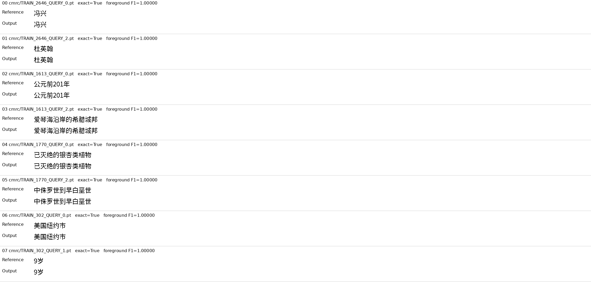
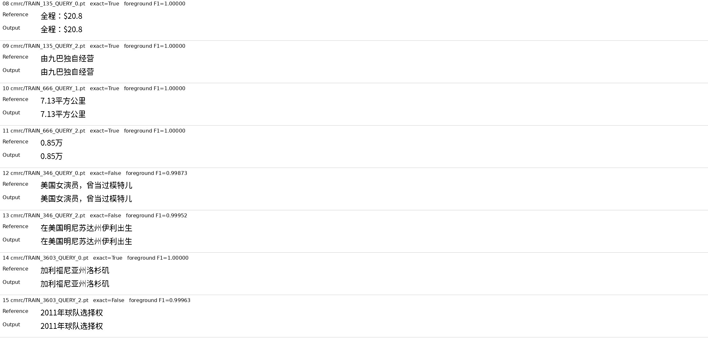
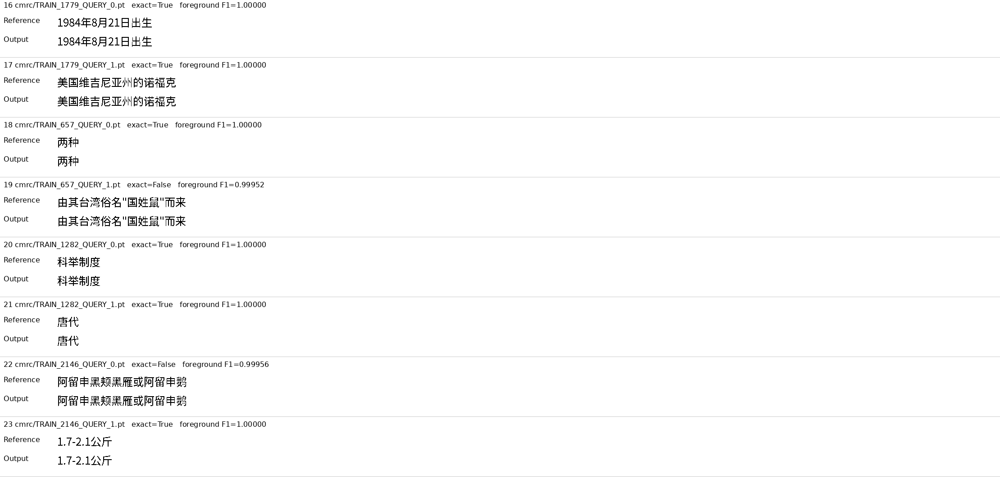
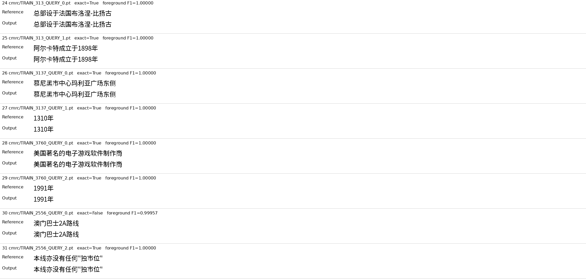

# Whole-canvas writing fits seen answers but does not generalize

8 November 2026. The new decoder writes the 32 previously failed training
answers clearly from prompt-only visual memory, reaching **26/32 exact
canvases** and **99.9892% foreground F1**. A fresh pixel-input process reproduces
all 32 training canvases and twelve new-copy canvases exactly. The model still
gives **0/12 exact new copies and 0/128 exact unseen Chinese answers**. This is
progress in training fit, not a useful independent language model.

The [prospective protocol](parallel_canvas_writer_protocol.md),
[complete receipt](evidence/parallel_canvas_result/result.json) and
[all-output gallery](evidence/parallel_canvas_result/README.md) retain both
successes and failures. The [implementation and commands](../docs/parallel-canvas.md)
are executable against the existing authenticated local installations.

| Cohort | Exact images | Foreground F1 |
|---|---:|---:|
| Training, initialization | 0/32 | 0.0000% |
| Training, final decoder | 26/32 | 99.9892% |
| New Chinese/English copies | 0/12 | 27.4902% |
| Unseen Chinese questions | 0/128 | 32.7784% |
| Same questions, question ink erased | 0/128 | 26.4347% |

Only **11/16 training paragraph pairs** have both images exact, below the
prospective 12/16 floor. The exact-image and foreground-F1 fit floors pass;
the complete fit rule fails. All three reader-screen requirements fail,
including zero both-correct development pairs and a 6.3437-percentage-point
question-erasure F1 gain. These rules are decision floors, not significance
tests. Pixel F1 is not semantic accuracy. Development has been repeatedly
reused and is not sealed.

## What changed

The earlier writer repeatedly inserted learned image embeddings into a frozen
language body's continuation history. This decoder instead reads the same
52-state prompt-only visual memory and predicts the whole image jointly.
Six 384-wide transformer decoder layers attend to memory from 64 continuous
position queries. A projection predicts 768 coordinates per image tile;
the fixed codec emits the actual pixels. The deployed path has no language
output head, OCR, source-answer crop, teacher service or glyph inventory.

No answer coordinates, reference length or preceding answer enters generation.
Training receives complete target coordinates through an explicit offline
loss. Unused canvas positions learn the white-image coordinate. The output
is a fixed 32-by-2048 canvas with no learned stream-termination event.
Scoring pads exterior white to a common width at the same left origin;
no foreground is removed. This differs from the earlier learned-stop exact
metric. It is a composite architecture/initialization/training replacement,
not an isolated intervention proving that history alignment caused failure.

A [common-metric rescore](evidence/parallel_canvas_prior_pixels.json) preserves
all original PNGs and confirms identical reference pixels for the 32 cases.
Under this same exterior-white rule, the preceding control and metric writers
both score 0/32 exact, at 85.9835% and 70.0094% foreground F1, respectively.
The canvas improvement is therefore not solely a change in the exact-image
scoring rule. Different architectures, initialization and training histories
prevent a causal or matched-efficiency interpretation.

The model makes a deterministic conditional estimate. Ambiguous prompts can
still produce averaged visual alternatives. The new-copy and unseen-question
failures show that fitting clean training writing does not establish lexical,
grammatical or semantic generalization. No historical-script, handwriting,
etymology, arbitrary-length or general English-answer capability is shown.
Visual inspection of all twelve new-copy outputs and the first eight normal
development outputs shows recurring malformed, overlapping glyph-like marks
in place of the requested writing. These examples remain in the complete
gallery. Their failure is substantial, not merely the strict pixel metric
rejecting otherwise correct answers.

## Pixel error and supplied-code control

The six inexact training canvases contain **13 wrong pixels in total** across
all 32 complete canvases. They remain visible in the unmodified outputs.
A separately labelled post-result reconstruction using supplied image codes
gives 28/32 exact canvases, 99.9953% foreground F1 and five wrong pixels.
All five of those errors also occur in the predicted canvases; prediction adds
eight further wrong pixels. This explains the small physical gap on these
seen examples without changing the failed 11/16 pair result. Supplied-code
decoding is answer-assisted and is not autonomous output or an upper bound
on the codec's full representational capacity.

All training examples, in fixed original order:

## Training, inference and verification

The decoder has **16,102,016 optimized parameters**. It receives exactly 2,000
AdamW updates, 8,000 draws and 250 exposures per training question. There are
no replayed production optimizer updates. A five-invocation gradient/resume
preflight covers four distinct update positions and is reset before training.
The final optimizer moments are finite and all steps equal 2,000.

The complete image-input runtime has **7,552,424,178 parameters** and retains
external Qwen3-VL pretraining. The small trained decoder is not the full model.
No tokenizer, categorical language output projection or model service is used
in inference. Numeric source-body weights and the fixed codec remain required.

Head training takes **72.025 seconds**, including checkpoint I/O, at **0.411
GiB** peak allocated memory on one RTX 4090 D. It reuses 44 previously prepared
prompt memories and excludes their earlier preparation and all pretraining.
The main actual-image assessment takes **395.244 seconds**, including 92.050
seconds setup, for 256 development calls and four replay calls; peak allocated
memory is **17.793 GiB**. The separate 44-input process takes **126.210 seconds**,
including 73.855 seconds setup, at **18.029 GiB** allocated. Those costs do not
establish an efficiency advantage at matched language quality.

Independent CPU verification reconstructs every one of 332 retained main
canvases from its predicted coordinates, checks all original pixel scores,
draw counts, optimizer completion and checkpoint/bundle equality. The exporter
authenticates and preserves all those PNG bytes and all 44 fresh-process PNGs.
All 44 fresh reader-memory hashes also agree. The Python file-open audit blocks
original data/training/cache paths; it is not a complete OS sandbox. No model
or GUI process remains live after evidence capture.

The unchanged inference bundle, current/previous optimizer checkpoints,
coordinate tensors and logs remain under `artifacts/parallel_canvas_v1`.
The clean native-image audit is under `artifacts/parallel_canvas_native_v1`.
Weights are not committed. The producer is `3954ce8`; the original mathematical
and experimental specification was committed before any new model execution.

The fit failure does not admit scaling the unchanged recipe under this
protocol. A successor must address the new-question failure and preserve the
clean writing rather than spend another run only improving seen-pixel scores.
The full ILM goal remains active and unachieved.

CMRC2018: Cui et al. (2019), [source dataset](https://github.com/ymcui/cmrc2018),
[CC BY-SA 4.0](https://creativecommons.org/licenses/by-sa/4.0/).
Qwen3-VL: Alibaba, Apache-2.0. Copy prompts are prepared examples. Related
[PixelGPT](https://aclanthology.org/2024.emnlp-main.182/) studies autoregressive
visual/text pretraining; this small fit experiment does not reproduce its
pretraining or establish a new learning theorem.
