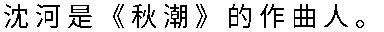

# Which part of the question identifies the composer?

Given a pictured song credit and the question “《秋潮》的作曲人是谁？”, the original reader selected the correct person but described him as the producer. The updated model writes **沈河是《秋潮》的作曲人。** It also writes the subject-first sentence when requested. The song exposed the error and motivated this study. A separate song with exchanged names tests whether the change transfers. [Inputs and generated answers](evidence/pictured_relation_20261123/songs.json)



| Questions | Inputs | Previous sentence pattern | Updated sentence pattern | Permuted-label update | Previous writer, both orders | Updated writer, both orders |
|---|---:|---:|---:|---:|---:|---:|
| Human-written, CMRC and DRCD | 48 | 33 | **36** | 31 | 31 | **34** |
| Independently written programme notes | 32 | 16 | **17** | 16 | 16 | **18** |
| DuIE passages with generated questions | 1,200 | 841 | **930** | 841 | 810 | **892** |

A complete answer with the learned sentence pattern must match the reference strip pixel for pixel. The last two columns require the autoregressive model to stop and match two reference strips for the same facts in different word orders. Their counts can exceed the sentence-pattern count because the two writers realize the selected fields differently. The updated model stopped on every human and programme reply and on 2,394 of 2,400 DuIE replies. Under the sentence-pattern score it repaired 3 human, 1 programme and 89 DuIE answers while losing zero previously correct answers. Only 2/8 programmes passed both questions on both assignments. The 48 original Chinese questions had been used in earlier failure analysis. The DuIE sources and normalized subjects were held out from fitting, and the questions were generated with held-out wording. The older broader direct-answer result remains 147/256 compared with 187/256 for the general reader. [Paired reader counts](evidence/pictured_relation_20261123/result.json) · [End-to-end writer counts](evidence/pictured_relation_20261123/writing.json) · [Previous reader, writer and transfer tests](role_binding_result.md)

## How the question changes the answer

The source reader predicts a subject span, a relation and an object span. A small additional classifier reads the pictured question after masking the predicted subject. It uses the presence of sequences of one to three exact glyph shapes in 32,768 hash buckets. Training uses the 26,890 original records plus 2,400 explicit-role questions using training subjects, equally divided among the twelve roles. At an estimated probability of 0.8 or higher, its prediction supplies the relation to the writer. Below that threshold the writer uses the contextual reader's prediction. Span selection and the generative model retain their original weights. At least one regularized logistic regression reached the fixed 160-iteration limit. The reported counts use the fitted coefficients. Training in a known printed face leaves transfer to other writing styles unresolved. [Experiment specification](pictured_relation_probe_protocol.md) · [Classifier](../ilm/visual_lm/pictured_relation.py)

The underlying visual reader and writer transfer prior Chinese text-model training. Five Lean results establish conditions under which a glyph pattern learned for one relation generalizes across new names and bound complete errors in terms of component errors. The empirical exchange tests check an assumption of that result. On a separate song, both generated orders agreed with the references on three of four questions. After exchanging the names, the page credits 苏恬 with composition and 周至 with lyrics. Asked for the composer, the model still writes **周至是《松窗》的作曲人。** The relation is now correct and the person is wrong. This failure isolates a remaining problem in linking a person to the right phrase on the page. [Lean proof](../formal/role_binding/RoleBinding.lean) · [Exchanged passage](evidence/pictured_relation_20261123/song_3_passage.png) · [Actual answer](evidence/pictured_relation_20261123/song_3_updated_object.png)

## Run or reproduce the experiment

The small update installs beside the existing local fact model. The inference command takes passage and question PNGs and writes a PNG. The local release check compares three isolated CPU runs with the original output images, including the wrong exchanged answer. [Installation and example](../models/pictured_relation/README.md) · [Release hashes](evidence/pictured_relation_20261123/release.json)

After preparing the original reader, writer and splits, run these commands in the repository environment. The supplementary fit uses the CPU. The full two-order generation comparison used a single RTX 4090 D.

```sh
export PYTHONPATH=.
python scripts/fit_pictured_relation.py
CUDA_VISIBLE_DEVICES=0 python scripts/evaluate_pictured_relation_writer.py
CUDA_VISIBLE_DEVICES=0 python scripts/test_pictured_song_credits.py
python scripts/report_pictured_relation.py
```
