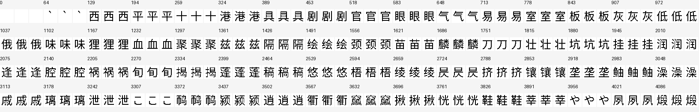

# A clear glyph interface, before language validation

The continuous semantic glyph interface learns clear forms for its prepared
training inventory. After 6,000 updates, direct decoding reproduces 4,048 of
4,087 images pixel-exactly, with mean foreground F1 0.999940. Encoding the
actual glyph image and decoding its continuous vector reproduces 3,697
images exactly, with F1 0.999634. This passes the declared rendering gate for
the [language-continuation experiment](semantic_glyph_language_protocol.md).

| Route | Images | Pixel-exact | Mean foreground F1 | Minimum F1 |
| --- | ---: | ---: | ---: | ---: |
| Training semantic vector → image | 4,087 | 4,048 | 0.999940 | 0.974359 |
| Actual image → continuous vector → image | 4,087 | 3,697 | 0.999634 | 0.956835 |

Each triplet shows the original glyph, direct neural decoding and the
actual-image roundtrip. The 64 indices are evenly spaced across the entire
inventory rather than selected by appearance. These sampled images were
visually inspected. Numerical assessment covers all 4,087 images; it does
not constitute manual inspection of every form. No strokes are repaired.

Preparation selects 4,096 characters from ASCII and training-text frequency,
merging nine visually identical aliases into shared image targets. Source
embedding anchors and the font are used offline. The runtime checkpoint
contains 47.128M neural parameters and two global 4,096-dimensional affine
buffers; it contains no character-indexed table, font, tokenizer or stored
glyph image. Only the image encoder and decoder are trained in this stage.
The language readout and stop predictor remain untrained and the primitive
checkpoint is explicitly refused by the language-generation interface.

Training took 80.22 seconds including 20.02 seconds waiting for memory pressure
to recover, with peak GPU allocation 0.728 GiB. These are measurements for
the small glyph primitive only, not for training a language model or its
externally pretrained body. The
[execution report and complete per-image metrics](evidence/semantic_glyph_bridge/)
retain checkpoint and preparation hashes. Mixed-precision training and the
one-font, seen-identity protocol are specified in the
[frozen primitive protocol](semantic_glyph_loop_protocol.md).

Pixel reconstruction is stronger than semantic alignment: mean cosine to
the training semantic anchor is only 0.77735 on the first 128 prepared glyphs.
The contextual body may be sensitive to that difference. The language stage
therefore constructs training histories with the same learned image encoder
used at deployment. It must still test autonomous generated-image histories;
good teacher-forced reconstruction cannot rule out feedback drift.

No unseen-answer, unknown-character, historical-script or independent
language capability is established by this result. Clear glyph generation
removes one practical obstacle. Correct image-language continuation remains
the required next test.
