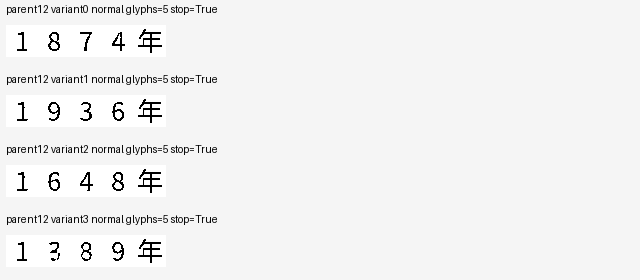
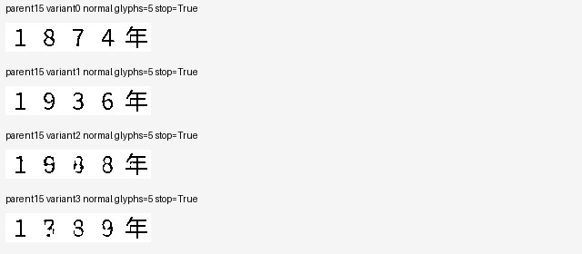
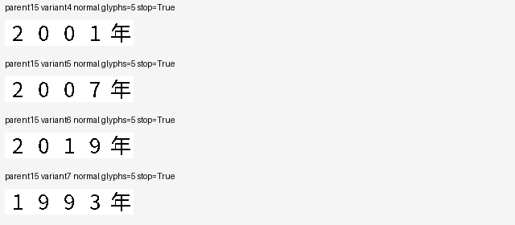

# Changed passage dates produce changed answer images

The frozen glyph-language model tracks most date changes on two selected
Chinese question templates. Of fourteen new normal interventions, eleven
outputs are clearly transcribed as the requested year during output-first
inspection. Two images are pixel-exact canonical references. All fourteen
stop naturally after five glyphs, without receiving a target length. Three
streams contain damaged or wrong digits and are not repaired toward gold.
None of the fourteen question-erased interventions produces a correct date.

| Condition | Cases | Exact canonical images | Output-first transcription matches | Stops | Caps |
| --- | ---: | ---: | ---: | ---: | ---: |
| Original normal baselines | 2 | 1 | 2 | 2 | 0 |
| New normal dates | 14 | 2 | 11 | 14 | 0 |
| Original erased baselines | 2 | 0 | 0 | 0 | 2 |
| New erased dates | 14 | 0 | 0 | 1 | 13 |

The numerical and manual measurements have different meanings. The new-date
normal foreground F1 is 0.970408, versus 0.048683 for erased controls.
Manual transcriptions are one-agent, non-independent observations, not a
formal general semantic-accuracy estimate. In both `1789` variants the second
form is damaged and is recorded as `1?89年`. The coast-template `1648` variant
appears as `19?8年`. These three are not counted as correct. All normal
streams, including failures, are shown below in their fixed preparation order.

The two parents were selected from previously observed successful date
responses. This is an exploratory, restricted test. The eight year values
and all sixteen normal plus sixteen erased images were fixed before this
inference, under the [prospective protocol](semantic_glyph_counterfactual_protocol.md).
Every occurrence of the answer year changes in the passage; the question
stays unchanged. The altered passages are counterfactual reading conditions,
not historical claims. Both original PNGs reproduce exactly through the host
renderer, and every variant preserves strip width, wrapping and question ink.

The model receives only the image. Its learned continuous readout and
convolutional glyph decoder emit pixels, which its image encoder rereads for
continuation. Source text, requested year, target length, font rendering,
glyph lookup, OCR and external teacher are absent from inference. It performs
zero updates during this test. The fixed 64-glyph safety cap remains unchanged.
The sixteen normal images contain fourteen different-input date interventions,
including cases that reuse a year from the other parent. Repeating the two
original inputs in this separate cold process gives bit-exact complete pixels,
stop probabilities and feedback hashes.

Nine changed-date conditions request complete year strings absent from the
508 supported training answers. Six of those produce clear matching images;
the other three are the uncertain/wrong outputs retained above. This supports
bounded input-dependent composition beyond replay of a complete fitted date
string. It does not rule out all shortcuts or demonstrate broad generalization.
The remaining five clear changed-date outputs use familiar full year strings.

The complete stage takes 229.23 seconds at 17.605 GiB peak GPU allocation,
excluding inherited pretraining and subsequent audits. All
[32 input images](evidence/semantic_glyph_counterfactual/inputs/),
[32 raw outputs](evidence/semantic_glyph_counterfactual/raw_outputs/),
[output-first notes](evidence/semantic_glyph_counterfactual/review_manual_review.json)
and [scores](evidence/semantic_glyph_counterfactual/review_scores.json) remain
available, including the erased failures. Fifteen of sixteen erased streams
cap; one stops after an entity-name-like response rather than the requested
date.

An [independent cold feedback audit](evidence/semantic_glyph_feedback_audit/report.json)
re-encodes all 2,781 actually emitted glyphs from these 32 streams and the
earlier forty-stream assessment. Every regenerated GPU embedding hash is
bit-exact. Maximum CPU/GPU embedding difference is 1.79e-7, below 1e-4.
This small audit loads no native contextual body or teacher. Its separate
48 GiB host-entry/32 GiB runtime reserve and 5 GiB allocation cap reflect the
measured small bridge, rather than relaxing a completed training or reader
protocol. Actual peak allocation is 0.351 GiB and runtime 30.80 seconds.
Recording and feedback consistency remain distinct from semantic correctness.

This is a functional numerical reading-and-writing subset, with two selected
templates, one canonical script style and substantial inherited language
pretraining. The [broader assessment](semantic_glyph_language_result.md)
still has eleven capped failures out of sixteen normal Chinese questions.
General image-language answering, English, historical forms, small-foundation
training and efficiency at matched LLM quality remain unresolved.
