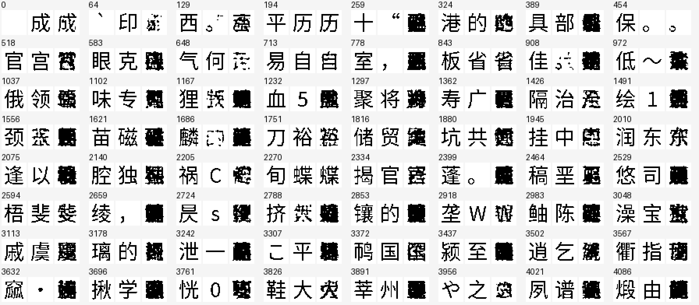

# Readout function transfer fails its prospective glyph gate

The offline readout-distillation candidate is rejected. On 4,087 held-out
counterfactual calibration states, mean foreground F1 rises from **0.333969
to 0.522572**, but only **1/4,087** reaches F1 >=0.95 and none is pixel-exact.
On 774 supported genuine held-out states, F1 falls from **0.896007 to
0.829770**, and pixel-exact glyphs fall from **638 to 180**. Neither route
meets the required mean F1 >=0.95 and 80% reaching F1 >=0.95. No new language
inference is run and the verified language/date checkpoint is unchanged.

The genuine histories are held out only from the additional compiler fitting.
The initial language checkpoint previously trained on all 508 questions,
including these histories. This route measures retention of teacher-associated
glyph rendering, not independently held-out language generalization.

All 20,435 requested synthetic states pass the full temporary teacher's
argmax check: four fitting and one held-out base for each of 4,087 forms.
Median standardized RMS displacement is 0.151012 (maximum 0.323332).
These constructed hidden vectors broaden teacher-function coverage, not
language knowledge or natural-context coverage. Genuine source states give
3,642 supported first-form labels, 531 terminal events and 190 exclusions.
The 6,000-update G-only fit preserves all other model weights exactly.

Calibration takes **102.41 s**, including **40.04 s** of host-pressure waiting,
and peaks at **2.775 GiB**. The readout fit takes **33.38 s**, peaking at
**0.869 GiB**. The temporary source matrix is reused from the shared GGUF
and never saved in a new model. No contextual body or teacher service is
loaded in this fit. These costs exclude the inherited model's pretraining.

An independent cold readout replay reproduces **all 9,722 pixel measurements
bit-exactly**. Every held-out output is retained as unmodified packed binary
pixels; the two fixed 64-triplet overview sheets were actually inspected.
The synthetic outputs mostly become dense malformed composites; genuine
outputs also lose strokes or become composites in many displayed cases.
Every individual glyph has not received a human grade. Pixel F1 against
teacher-associated forms is not semantic language accuracy.

The result rejects this readout/loss/calibration recipe. It does not show
that all teacher transfer is impossible, nor that sparse coverage is the
only cause of the language failure. MSE to semantic anchors can encourage
intermediate vectors, and the frozen decoder is qualified near individual
anchors rather than arbitrary interpolations. That is a hypothesis for the
composite shapes, not an isolated causal finding. A subsequent loss-only
intervention can test discrimination among competing anchors while retaining
the same architecture, data, initialization and iteration count.

[Protocol](semantic_readout_distillation_protocol.md) ·
[Measurements and all raw glyph pixels](evidence/semantic_readout_distillation_v1/)

