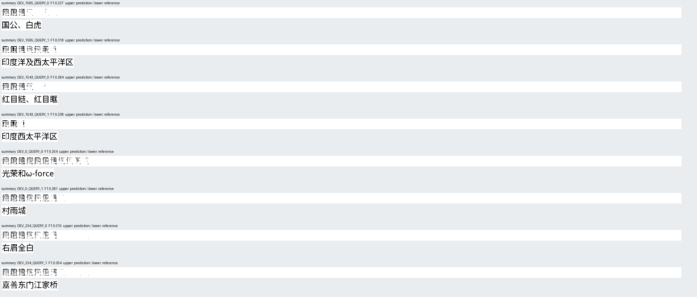
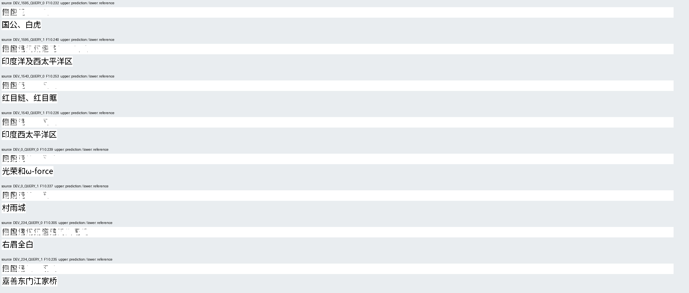
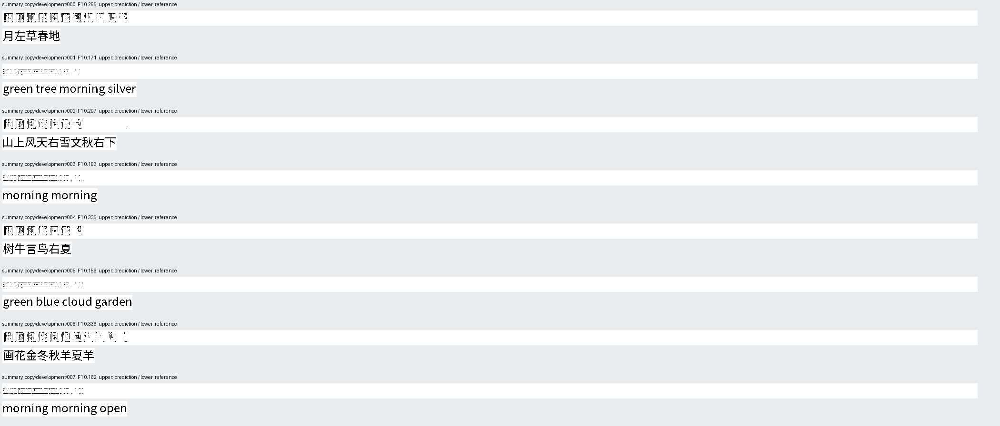
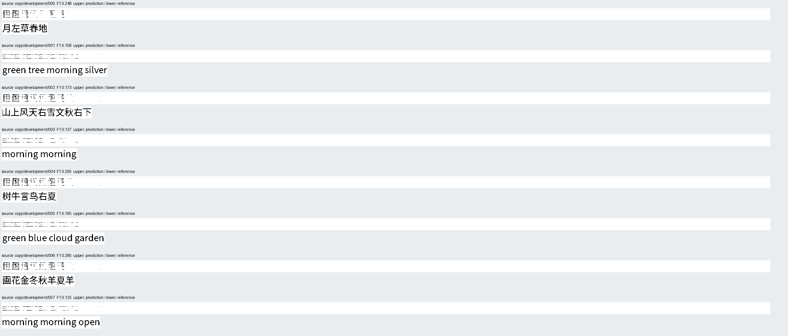

# Source descriptors do not repair unseen image-language writing

8 November 2026. The matched comparison fails: both writers produce **0/64
exact unseen Chinese answers and 0/32 exact unseen copies**. Adding pooled
source descriptors reduces foreground F1 in both tasks. The inspected outputs
contain repeated malformed marks, not readable answers that merely miss a
strict pixel threshold. No usable ILM or efficiency advantage is established.

The [prospective protocol](source_canvas_protocol.md),
[verified receipt](evidence/source_canvas_result/result.json),
[complete 512-output gallery](evidence/source_canvas_result/README.md) and
[reproduction commands](../docs/source-canvas.md) retain the negative result.

| Cohort | Summary-only exact | Summary F1 | Source-feature exact | Source F1 |
|---|---:|---:|---:|---:|
| First 32 training questions | 0/32 | 35.4434% | 0/32 | 31.1007% |
| Unseen normal Chinese QA | 0/64 | 30.2699% | 0/64 | 25.4899% |
| Same questions, question erased | 0/64 | 24.3425% | 0/64 | 19.8113% |
| Same questions, passage erased | 0/64 | 28.2816% | 0/64 | 23.3390% |
| Unseen Chinese/English copying | 0/32 | 24.5036% | 0/32 | 20.4251% |

Both arms have **0/32 both-correct question pairs**. Question-erasure F1 gains
are 5.9275 and 5.6786 percentage points; passage-erasure gains are 1.9884 and
2.1509 points. All six prospective continuation requirements fail. The source
treatment loses 4.7800 F1 points on normal QA and 4.0785 points on copying.
These are descriptive differences on reused public development, not sealed
generalization estimates or statistical significance claims.

## Computation and data

Both arms use identical initial weights, the same six-layer 384-wide decoder,
64 continuous output positions, fixed white-image initialization and the same
qualified image codec. They output a complete 32-by-2048 image. The summary
arm receives 52 frozen prompt states. The treatment adds the previously cached
per-ink-unit visual descriptors and four geometric coordinates. Each descriptor
averages nine samples from the final visual field: it is not the full visual
grid, native continuation history, source pixels or an image-code inventory.
The source route is the changed input; no source crop constructs an answer.

Training uses every admitted pair: 3,193 Chinese short extractive answers and
64 Chinese/English copy requests. Each arm receives exactly 3,257 AdamW updates,
13,028 draws and four exposures to every example. No example is selected from
its result. Earlier eighteen admission exclusions retain their original
reasons. Training/development complete input-image hashes do not overlap.
The development cohort has 64 questions with two matched erasure controls and
32 copying requests. It differs from the earlier 128-question canvas audit.

The [earlier small fit](parallel_canvas_result.md) gets 26/32 seen images exact
after 250 exposures per question, with no exact new-copy or development answer.
Its result must not be attributed to the present four-pass corpus run. The
current first-32 training check also fails; neither convergence nor sufficient
data coverage is established. This experiment rejects this particular
pooled-feature replacement at its declared budget. It cannot establish that
source information is intrinsically useless or that every visual LM must fail.

Supplied reference-image codes reconstruct **2,946/3,257 complete canvases
exactly**, with **99.9913% mean foreground F1**. This answer-assisted control
separates high-fidelity image decoding from the failed autonomous prediction.
It is not a bound on the codec's full capacity. Small codec pixel errors remain
relevant to exact scoring, but cannot explain the visibly malformed predictions.

## What the failure establishes

The working codec is insufficient: the learned map from a new visual prompt
to an appropriate sequence of image coordinates still fails. Clean small-set
fit is consistent with memorization and does not show language transfer.
Adding these pooled descriptors did not solve the missing transfer.

One risk of the objective can be stated exactly. Ordinary squared-error
regression has conditional-mean optimum `f(H) = E[Z | H]`. The actual
active/padding-weighted loss has a correspondingly weighted conditional mean
before the output constraint. A mean of distinct writing coordinates need not
encode a valid glyph. Layer normalization and a fixed decoder do not impose
spelling or grammatical correctness. This mathematical observation is a
possible failure mechanism, not an identified cause of every observed output.
Reader fidelity, feature pooling, data coverage, optimization and the
conditional objective remain distinct unresolved questions.

The next method needs evidence of unseen writing transfer and prompt-sensitive
answer correctness. Extending this unchanged pooled-feature/MSE recipe merely
because its training loss declines is not admitted by the failed screen.
No Qwen-8B parity, new learning theorem, arbitrary-script capability or reduction
in the compute needed for useful language quality follows from these runs.

## Verification and resource boundary

Each head has **16,104,704 optimizer parameters**; the summary-only geometry
parameters are unused, as specified prospectively. The inherited frozen reader
remains a separately pretrained billions-of-parameters model. Cached head
training is not the cost of training a complete lightweight ILM from scratch.

Summary training takes **152.002 seconds**, with **0.340 GiB** peak allocated
GPU memory; source training takes **155.789 seconds**, with **0.530 GiB**.
These times include checkpoint I/O but exclude feature loading, CPU preparation,
preflight, the earlier 11 GiB feature preparation and all external pretraining.
Cached assessment takes 4.636 and 5.479 seconds after model/codec setup. It is
not raw-image end-to-end latency. Poor language quality prevents an efficiency
claim, regardless of the small head's resource use.

Both arms pass finite-gradient and exact optimizer/sampler/model resume checks.
Ten discarded preflight optimizer invocations cover four distinct update
positions per arm; two additional largest-batch backwards have no optimizer
step. CPU verification checks all 6,514 production update IDs, all 26,056 draws,
finite completed optimizer moments, all 512 coordinate-to-PNG reconstructions
and an independent NumPy/PIL pixel scorer. All 512 raw PNGs are exported without
byte changes. Current and previous resumable snapshots remain local; weights
are not published. No native-image inference bundle is qualified for this
failed cached-feature diagnostic.

Two CPU preparations initially stopped at reference indexing, before GPU
training or optimization. The original audit was miscounted as 96 questions
with one erasure control. The corrected 64-question, two-control inventory and
its complete reference aliases were committed before either arm trained. The
failed preparations and logs remain private; no result was used to revise
the protocol denominators. The project GPU and controller have been released.

Fixed first eight normal QA and copying cases from each arm, with the full
generated width above the accepted reference:

CMRC2018: Cui et al. (2019), [source](https://github.com/ymcui/cmrc2018),
[CC BY-SA 4.0](https://creativecommons.org/licenses/by-sa/4.0/).
Qwen3-VL: Alibaba, Apache-2.0. Copy requests are prepared examples.
